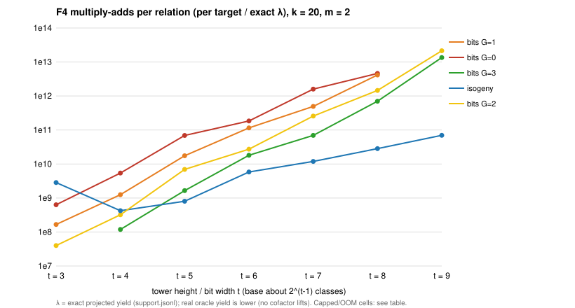

# Curve25519-family algebraic track beyond t = 2: results (2026-11-02)

Protocol: [PROTOCOL.md](PROTOCOL.md) (frozen; Amendment 1 adds hybrid guessing, Amendment 2 replaces the
end-to-end ladder by a stage measurement plus end-to-end checks, both written before their data).
PDF: [REPORT.pdf](REPORT.pdf). Code: `pkm-semaev` membership forms isogeny / bits (#3284), `guess=G` (#3287),
harness `curve25519_family f4cost` and `support` (#3288, #3290).

**Class:** stage measurement of the algebraic track plus two end-to-end checks. It is the algebraic track's
distance to the generic baseline. No improvement claim. Every number below is for **k = 20, m = 2**, one
miniature curve.

## Q-A: support of membership models (exact counts)

`analysis/support.jsonl`, `analysis/support-edwards.jsonl`. At width 2^10:

| membership model | signed classes | λ = M/ℓ |
|:--|--:|--:|
| Weierstrass x in [0, 2^t) | 458 | 0.959 |
| Montgomery x in [0, 2^t) | 533 | 0.987 |
| Edwards y in [0, 2^t) | 499 | 0.979 |
| T₀-invariant w = x + 1/x in [0, 2^t) | 268 | 0.669 |
| T₀-invariant Edwards y² in [0, 2^t) | 245 | 0.604 |
| PKM isogeny tower, height t | 498 | 0.978 |
| PKM Kummer tower | exists only for t ≤ 2 (p ≡ 5 mod 8) | |

The table is limited to these intervals. It measures one window, [0, 2^t), per coordinate, on one curve,
and only its support. It does **not** show that Edwards or invariant coordinates bring no advantage to
relation solving. Other subsets in those coordinates (offsets, other windows, sets structured in y) and the
algebraic cost of S_{m+1} in them are untested. Lead 5 is testing the latter. The statement in commit
`d3adb94a39` that the Edwards interval "carries the same support" means only this measured interval.

## Q-D: F4 cost per target and per relation

`analysis/f4cost.jsonl` (200 random targets per cell, or fewer where the 600 s cap stopped it, marked
"cap"). Per relation = F4 multiply-adds per target ÷ λ (the exact projected yield). This is a lower bound
on the oracle's real cost per relation: the oracle finds only exact decompositions of R, not of R + K for
K ∈ E[8] (lead 2). "per hit" uses the hits actually observed (1–7 per cell; large uncertainty).

| form | t | G | columns | targets | F4 mul-adds / target | solving degree | hits | per hit | λ | per λ-relation |
|:--|--:|--:|--:|--:|--:|--:|--:|--:|--:|--:|
| bits | 3 | 0 | 3 | 200 | 8.70e+04 | 5 | 0 | — | 0.0001 | 6.34e+08 |
| bits | 3 | 1 | 3 | 200 | 2.29e+04 | 5 | 0 | — | 0.0001 | 1.67e+08 |
| bits | 3 | 2 | 3 | 200 | 5.46e+03 | 4 | 0 | — | 0.0001 | 3.98e+07 |
| isogeny | 3 | 0 | 1 | 200 | 4.34e+04 | 5 | 0 | — | 0.0000 | 2.85e+09 |
| bits | 4 | 0 | 7 | 200 | 4.05e+06 | 6 | 0 | — | 0.0007 | 5.42e+09 |
| bits | 4 | 1 | 7 | 200 | 9.36e+05 | 5 | 0 | — | 0.0007 | 1.25e+09 |
| bits | 4 | 2 | 7 | 200 | 2.40e+05 | 5 | 0 | — | 0.0007 | 3.21e+08 |
| bits | 4 | 3 | 7 | 200 | 8.88e+04 | 4 | 0 | — | 0.0007 | 1.19e+08 |
| isogeny | 4 | 0 | 9 | 200 | 5.23e+05 | 5 | 0 | — | 0.0012 | 4.23e+08 |
| bits | 5 | 0 | 11 | 200 | 1.27e+08 | 6 | 0 | — | 0.0018 | 6.90e+10 |
| bits | 5 | 1 | 11 | 200 | 3.23e+07 | 6 | 0 | — | 0.0018 | 1.75e+10 |
| bits | 5 | 2 | 11 | 200 | 1.28e+07 | 5 | 0 | — | 0.0018 | 6.93e+09 |
| bits | 5 | 3 | 11 | 200 | 3.04e+06 | 5 | 0 | — | 0.0018 | 1.65e+09 |
| isogeny | 5 | 0 | 18 | 200 | 3.96e+06 | 5 | 0 | — | 0.0049 | 8.01e+08 |
| bits | 6 | 0 | 25 | 200 | 1.76e+09 | 7 | 1 | 3.51e+11 | 0.0095 | 1.84e+11 |
| bits | 6 | 1 | 25 | 200 | 1.10e+09 | 6 | 1 | 2.20e+11 | 0.0095 | 1.15e+11 |
| bits | 6 | 2 | 25 | 200 | 2.61e+08 | 6 | 1 | 5.21e+10 | 0.0095 | 2.74e+10 |
| bits | 6 | 3 | 25 | 200 | 1.72e+08 | 6 | 1 | 3.44e+10 | 0.0095 | 1.81e+10 |
| isogeny | 6 | 0 | 25 | 200 | 5.55e+07 | 5 | 1 | 1.11e+10 | 0.0095 | 5.83e+09 |
| bits | 7 | 0 | 58 | 63 (cap) | 7.94e+10 | 7 | 0 | — | 0.0499 | 1.59e+12 |
| bits | 7 | 1 | 58 | 164 (cap) | 2.47e+10 | 7 | 1 | 4.04e+12 | 0.0499 | 4.94e+11 |
| bits | 7 | 2 | 58 | 200 | 1.28e+10 | 7 | 2 | 1.28e+12 | 0.0499 | 2.57e+11 |
| bits | 7 | 3 | 58 | 200 | 3.47e+09 | 6 | 2 | 3.47e+11 | 0.0499 | 6.95e+10 |
| isogeny | 7 | 0 | 65 | 200 | 7.46e+08 | 5 | 4 | 3.73e+10 | 0.0627 | 1.19e+10 |
| bits | 8 | 0 | 114 | 6 (cap) | 8.29e+11 | 8 | 0 | — | 0.1795 | 4.62e+12 |
| bits | 8 | 1 | 114 | 6 (cap) | 7.47e+11 | 8 | 0 | — | 0.1795 | 4.16e+12 |
| bits | 8 | 2 | 114 | 12 (cap) | 2.61e+11 | 7 | 0 | — | 0.1795 | 1.45e+12 |
| bits | 8 | 3 | 114 | 24 (cap) | 1.26e+11 | 7 | 0 | — | 0.1795 | 7.02e+11 |
| isogeny | 8 | 0 | 136 | 200 | 6.98e+09 | 5 | 7 | 1.99e+11 | 0.2461 | 2.83e+10 |
| bits | 9 | 2 | 233 | 1 (cap) | 1.21e+13 | 8 | 0 | — | 0.5622 | 2.15e+13 |
| bits | 9 | 3 | 233 | 1 (cap) | 7.62e+12 | 8 | 0 | — | 0.5622 | 1.35e+13 |
| isogeny | 9 | 0 | 256 | 77 (cap) | 4.39e+10 | 5 | 5 | 6.76e+11 | 0.6277 | 7.00e+10 |
| bits | 9 | 0 | 233 | OOM | killed at ~4.5 GB RSS (shared memory cgroup) | | | | | |
| bits | 9 | 1 | 233 | OOM | killed at ~4.5 GB RSS | | | | | |

Reading, at this scope:
- **Hybrid guessing works on the bits form.** Per-target F4 work falls 10–46× from G = 0 to G = 3 at
  t = 4–7 (t = 4: 46×, 5: 42×, 6: 10×, 7: 23×), and is still falling at G = 3. Prediction C1 (optimum at G = 1–3) is not confirmed: the
  optimum lies at G ≥ 3. Lead 4 extends this.
- **The isogeny tower scales best with t.** Its per-λ-relation cost grows 2–7× per step in t (t = 4–9),
  against 4–19× for bits at G = 3. Its solving degree stays 5 for t = 3–9, while bits reaches 8.
- **The cheapest cells per λ-relation are the smallest bases:** bits t = 3, G = 2 (4.0·10⁷), then bits
  t = 4, G = 3 (1.2·10⁸). The isogeny t = 3 value rests on a one-class tower.
- Predictions B1 (both new forms run beyond t = 2) **held**. B3 (bits within 4× of isogeny at equal t)
  **failed** from t ≥ 5: unguessed bits costs 32× (t = 5, 6) to 106–119× (t = 7, 8) the isogeny form per target.

## End-to-end checks (ecbench, verified, replay-audited)

`sessions/e2e-iso-t6-k20`, `sessions/e2e-bits-t3-g2-k20` (2 public targets, 1 round each, frozen
binary, L0/L1 counts only; the generic arm is the current k = 20 baseline from #3290).

| arm | S, w = 0 | S, w = 0.1 | S, w = 1 |
|:--|--:|--:|--:|
| `rho.negation` | 1.71 | 1.84 | 2.99 |
| generic baseline `ksum:m=3`, N = 11 | 7.92 | 8.43 | 13.0 |
| algebraic, isogeny t = 6 | 42.4 | 1.9·10⁸ | 1.9·10⁹ |
| algebraic, bits t = 3, G = 2 | 795 | 2.5·10⁶ | 2.5·10⁷ |

The stage ranking carries over where F4 is priced. The protocol's cheapest cell, bits t = 3, G = 2, is about
80× cheaper than isogeny t = 6 at w ≥ 0.1, and about 19× worse at w = 0, because a 3-column base needs many
more walk steps. The best measured algebraic configuration is about **3·10⁵×** the generic baseline at
w = 0.1 on this curve. That is the algebraic track's distance, on 2 targets, at k = 20 only.

## Problem record

`problems/curve25519-family-algebraic-ic-tower.md`: its "missing capability" (an isogeny-tower Semaev
oracle) is now provided by #3284. The obstruction for useful bases is now cost, not existence.

## Next

Leads 2–5 are being completed one at a time (exclusive build slot): cofactor lifts (2), m = 3 chained S₃ (3),
deeper guessing incl. isogeny guessing (4), Edwards-coordinate S₃ (5).
