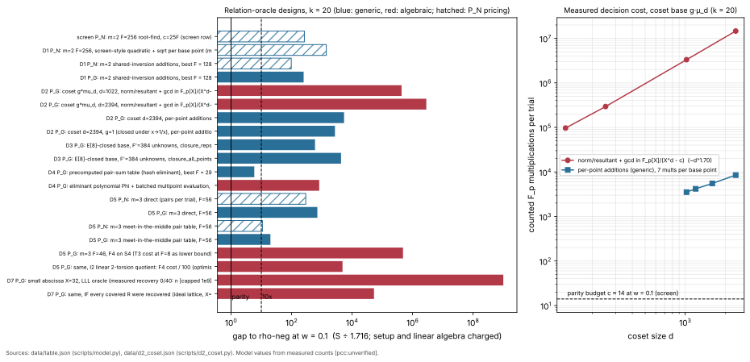

# Algebraic relation oracles for the Curve25519 family: a search with counted costs (k = 20, 2026-11-07)

**Class.** Counted measurements of decision procedures in exact Python on the k = 20 miniature,
combined with the parity model of `curve25519_rho_parity_bound_20261104/scripts/screen.py`. No
ecbench run, no leaderboard or `benchmarks/` row. Every number is labelled measured (with its file)
or derived. Every result here is an unverified assertion; no pcc claim was filed. Protocol, frozen
before data: [PROTOCOL.md](PROTOCOL.md) (amendments at the end).

**Question.** ALGEBRAIC_SCREEN.md left a 265x gap to rho-neg at w = 0.1 for its best row, an m = 2
full-coverage base with one root-find per base point. Parity there needs about 14 native ops per
trial at w = 0.1 and about 3 at w = 1. Is there a relation oracle, meaning a way to find
index-calculus relations without collisions, that closes this gap?

**Answer.** No design found here closes it. The best non-generic oracle is 821x behind rho-neg at
w = 0.1, and every non-generic gap grows with r [pcc:unverified]. The screen's 265x row turned out
to be generic. Its per-base-point root-find is exactly a group addition: the two roots in x2 of
S3(x1, x2, xR) are x(R + P1) and x(R − P1), and this held on 2,000 of 2,000 instances
(`data/d1_m2.json`) [pcc:unverified]. So that row is baby-step giant-step with an unknown base.
Charged as group operations, it is 251x behind at w = 0.1 [pcc:unverified]. The only designs
within 10x at any weight are generic (BSGS-shaped). The collision floor bounds them, and the
existing wwalk incumbent (about 1.8x) beats them [pcc:unverified]. Under the frozen rule, no
ecbench test design is triggered.

## Method

- Curve: y² = x³ + 926x² + x over F_p, p = 1,048,573, #E = 8r with r = 131,203. `fp.self_check`
  verifies #E·P = O, rP = O on E[r], and a point of order 8 (cyclic 2-part).
- Counted unit: one F_p multiplication or squaring = 1 native op (`scripts/fp.py`). Inversion is
  counted through its Fermat chain (37 ops). Additions are not counted.
- Model: S(w) = [G_setup + w·N_setup + T·(1 + g + w·c) + w·N_LA] / √r, with T = (F + 1)·r/C. The rho
  reference is rho-neg S = 1.600 / 1.716 / 2.764 at w = 0 / 0.1 / 1, as in the screen. Gap =
  S ÷ S(rho-neg).
- Charges the screen leaves out are included here: base decoding (25 native and 3 group ops per base
  point, derived) and linear algebra ((m + 1)·F² native, derived). The table also gives the
  setup-free gap.
- Two pricings for an oracle that computes group elements:
  - **P_G (primary):** each element is a group operation (1 GAE), the same charge as a rho step.
  - **P_N (the screen's convention):** its field multiplications are native, priced at w. At w = 0
    this makes a BSGS table free, so it is not a fair comparison.
- Coverage C: exhaustive enumeration of ±P1 ± P2 (or ±P1 ± P2 ± P3) over the base. Torsion
  compatibility is enforced for bases outside E[r]. Hit rates on random R ∈ E[r] agree with C/r
  within sampling error in every measured row (`data/d1_m2.json`, `d2`, `d3`, `d5`).

## Design table (gaps to rho-neg; k = 20)

C/r = measured coverage; g = group ops per trial beyond the trial point; c = native ops per trial;
exp = growth exponent of S in r (rho = 0). Source files are under `data/`. Rows come from
`data/table.json` (`scripts/model.py`).

| id | design | class | pricing | F | C/r | trials | g | c | gap w=0 | gap w=0.1 | gap w=1 | setup-free w=0.1 | exp |
|:--|:--|:--|:--|--:|--:|--:|--:|--:|--:|--:|--:|--:|--:|
| screen | m=2, F=256, root-find, c = 25F (derived, screen) | generic | P_N | 256 | 1.0 | 257 | 0 | 6,400 | 0.44 | 265 | 1.6·10³ | 265 | 0.5 |
| D1 | m=2, F=256, quadratic + sqrt per base point (measured 82 / base point) | generic | P_N | 256 | 0.632 | 406 | 0 | 2.1·10⁴ | 2.0 | 1.4·10³ | 8.7·10³ | 1.4·10³ | 0.5 |
| D1 | m=2, shared-inversion x(R ± P1) (measured 7.1–7.3 / base point), F=128 | generic | P_N | 128 | 0.221 | 584 | 0 | 930 | 1.7 | 97 | 596 | 88 | 0.5 |
| D1 | same | generic | P_G | 128 | 0.221 | 584 | 256 | 0 | 260 | 251 | 203 | 242 | 0.5 |
| D2 | coset g·μ_d, d=1022, norm/resultant + gcd in F_p[X]/(X^d − c) | algebraic | P_G | 495 | 0.611 | 812 | 0 | 3.3·10⁶ | 1.4 | 4.3·10⁵ | 2.7·10⁶ | 4.3·10⁵ | 1.35 |
| D2 | same, d=2394 | algebraic | P_G | 1208 | 0.996 | 1,212 | 0 | 1.46·10⁷ | 2.1 | 2.9·10⁶ | 1.8·10⁷ | 2.9·10⁶ | 1.35 |
| D2 | coset d=2394, per-point additions | generic | P_G | 1208 | 0.996 | 1,212 | 2,418 | 0 | 5.1·10³ | 5.4·10³ | 7.3·10³ | 4.7·10³ | 0.5 |
| D3 | E[8]-closed base, 384 unknowns, one representative per orbit | generic | P_G | 384 | 0.913 | 422 | 768 | 0 | 561 | 596 | 776 | 522 | 0.5 |
| D3 | same, every orbit point tested | generic | P_G | 384 | 0.897 | 429 | 6,144 | 0 | 4.6·10³ | 4.3·10³ | 3.1·10³ | 4.2·10³ | 0.5 |
| D4 | pair-sum table, hash lookup (best F=29) | generic, BSGS-shaped | P_G | 29 | 0.0127 | 2,362 | 0 | 0 | 5.7 | **5.9** | 6.6 | 3.8 | 0.16 |
| D4 | eliminant Φ of the pair-sum set, batched multipoint evaluation (best F=16) | algebraic decision, generic setup | P_G | 16 | 0.0039 | 4,364 | 0 | 1,150 | 9.0 | **821** | 5.1·10³ | 816 | 0.5 |
| D5 | m=3, direct pair loop, F=56 | generic | P_G | 56 | 0.84 | 68 | 6,496 | 0 | 761 | 712 | 454 | 709 | 0.5 |
| D5 | m=3, meet in the middle (pair table), F=56 | generic, BSGS-shaped | P_N | 56 | 0.84 | 68 | 0 | 426 | 0.41 | 10.9 | 65 | 4.8 | 0.17 |
| D5 | same | generic, BSGS-shaped | P_G | 56 | 0.84 | 68 | 112 | 0 | 19 | 20 | 25 | 12 | 0.17 |
| D5 | m=3, F=46, F4 on S4 (T3 measured cost at F=8, a lower bound) | algebraic | P_G | 46 | 0.633 | 74 | 0 | 4.0·10⁷ | 0.13 | 4.8·10⁵ | 3.0·10⁶ | 4.8·10⁵ | 0.53 |
| D5 | same, I2 linear 2-torsion quotient, F4 cost ÷ 100 (derived, optimistic) | algebraic | P_G | 46 | 0.633 | 74 | 0 | 4.0·10⁵ | 0.13 | 4.8·10³ | 3.0·10⁴ | 4.8·10³ | 0.53 |
| D7 | small abscissa x ≤ 32, LLL oracle (measured: 0 of 40 planted relations recovered) | algebraic | P_G | 15 | 0 found | ∞ | 0 | 1.5·10⁴ | ∞ | ∞ | ∞ | ∞ | — |
| D7 | same, if every covered R were recovered (ideal lattice) | algebraic | P_G | 15 | 7.5·10⁻⁴ | 2.1·10⁴ | 0 | 1.5·10⁴ | 37 | 5.3·10⁴ | 3.3·10⁵ | 5.3·10⁴ | 0.4 |

All table values are model outputs from measured counts (D1–D3, D5 direct and MITM, D7) or from
derived counts, labelled in the row [pcc:unverified].

## Findings per candidate

**(D1) The screen's best row is generic.** The roots in x2 of S3(x1, x2, xR) are x(R ± P1) on
2,000 of 2,000 instances, so a "root-find per base point" is a group addition (`data/d1_m2.json`)
[pcc:unverified]. The screen-style solve (quadratic, Atkin square root, inversion) costs a measured
82 multiplications per base point, not 25 [pcc:unverified]. Sharing the denominator xR − x1 between
both signs and using batch inversion brings this to 7.1–7.3 multiplications per base point
[pcc:unverified]. Coverage at F = 256 is 0.632·r, not r, because pair sums collide; the measured C
follows r·(1 − e^(−2F²/r)) within 1 % [pcc:unverified]. Under P_G the best measured F (128, the
smallest in the sweep) is 251x behind at w = 0.1 [pcc:unverified]. Under P_N it is 97x at w = 0.1
and 596x at w = 1 [pcc:unverified].

**(a / D2) A coset base g·μ_d gives no sublinear decision.** The norm-resultant decision
N(X) = Res_Y(S3(X, Y, xR), Y^d − c) uses only O(log d) ring operations. Each operation is a
degree-d polynomial product, and the closing gcd is quadratic. The counted cost is 9.7·10⁴, 2.9·10⁵,
3.3·10⁶ and 1.46·10⁷ multiplications at d = 126, 252, 1022 and 2394, which scales as d^1.70
(`data/d2_coset.json`) [pcc:unverified]. At d = 2394 that is 1,717x the per-point decision (8,497)
[pcc:unverified]. Its yes/no answer agreed with the per-point oracle on 60 of 60 checks, 30 of them
planted relations [pcc:unverified]. Coverage is real: d = 2394 with g = 5 covers 0.996·r with 1,208
unknowns [pcc:unverified]. The structure does not cut the cost. Any polynomial approach handles
elements of size d, so it is Ω(d) per trial, and here it is about d^1.7 [pcc:unverified].
- The g = 1 coset is closed under x → 1/x, which is translation by the 2-torsion point.
  Testing both points of each orbit doubles the per-unknown cost to 14.1 [pcc:unverified].

**(b / D3) Linear 2-torsion (Edwards) does not cut the decision.** At equal unknowns (128, 256,
384), the E[8]-closed base with one representative per orbit has the same counted cost as the
E[r]-only base (930, 1,826 and 2,722) [pcc:unverified]. Its hit rate is the same within 4.5 %
(`data/d3_torsion.json`) [pcc:unverified]. Testing every orbit point costs 7.9x more for the same
coverage [pcc:unverified]. The quotient merges base points that share one unknown. It removes no
work per unknown. Its only lever is the F4 degree (record I2), and even an optimistic 100x F4 saving
leaves 4.8·10³x [pcc:unverified].

**(c / D4) The precomputed eliminant is either a hash table or worse.** At full coverage the
covered set is all of x(E[r]). Φ is then the r-division polynomial, which a ladder decides in
O(log r), but it never names the pair, so the search cost is unchanged (derived).
- At partial coverage, a hash table of the pair-sum set is BSGS-shaped: 5.9x at w = 0.1 at F = 29,
  growth exponent 0.16 (`data/table.json`) [pcc:unverified].
- Swapping the hash for a polynomial Φ with batched multipoint evaluation costs 821x at w = 0.1. It
  is dominated by the hash table it replaces [pcc:unverified].
- Its Karatsuba count model matches the counted implementation exactly at n = 30, 100 and 257
  (`scripts/model.py`) [pcc:unverified].

**(d / D5) m = 3 at full coverage.** Coverage at F = 46 is 0.633·r, not ≥ r as the screen assumed.
F = 56 reaches 0.84·r (`data/d5_m3.json`) [pcc:unverified].
- The direct pair loop costs 2.7·10⁴ native ops per trial [pcc:unverified].
- A meet-in-the-middle pair table cuts this to 426 per trial: 2F additions per trial against a
  setup of F(F + 1) [pcc:unverified]. That design is generic and is 20x behind under P_G
  [pcc:unverified]. Under P_N it is 10.9x at w = 0.1 and 65x at w = 1 [pcc:unverified].
- Over the F sweep, the best P_N value is 7.1x at F = 32, w = 0.1, and the P_G values stay at 14.7x
  or more (`data/d6_tradeoff.json`) [pcc:unverified].
- Algebraic m = 3 (F4 on S4) costs at least 4.0·10⁷ per trial (T3), which is 4.8·10⁵x behind
  [pcc:unverified].

**(e / D6) Coverage against decision cost.** For per-point oracles, total native work is about
trials × c ≈ (r/2F)·7F, roughly 3.5·r, whatever F is (derived; `data/d6_tradeoff.json`). So P_N
gaps fall slowly as F shrinks, and P_G gaps stay at 250x or more [pcc:unverified]. Trading coverage
for decision cost moves work between the two factors and leaves the product near r.

**(own / D7) Small-abscissa base with a lattice oracle.** S3 is linear in the six monomials
(1, s, t, s², st, t²) of s = x1 + x2 and t = x1·x2. A 6-dimensional LLL per trial costs O(1)
independent of F: 1.5–2.1·10⁴ arithmetic ops, multi-precision, so this undercounts
[pcc:unverified].
- Positive control: planted vectors with entries in [−3, 3] were recovered 20 of 20 times
  [pcc:unverified].
- Real instances: 0 of 40 recovered at every X from 3 to 32 (`data/d7_lattice.json`)
  [pcc:unverified]. The Gaussian heuristic gives X_max ≈ 1.8 (derived), below the smallest base
  abscissa on the curve (x = 3).
- Even an ideal lattice at X = 32 is 37x behind at w = 0 [pcc:unverified]. Coverage scales as
  X² ≈ p^(1/5) at the heuristic bound (derived).

## Frozen predictions: outcomes

| id | outcome |
|:--|:--|
| P1 | held: 0 / 2,000 failures (after fixing a script bug in `S3`; amendment 1) [pcc:unverified] |
| P2 | held: c = 1,826 at F = 256 [pcc:unverified] |
| P3 | held: 1,717x at d = 2394, cost ∝ d^1.70 [pcc:unverified] |
| P4 | held for one representative per orbit (cost equal, hit rate within 4.5 %); testing all orbit points is 7.9x worse [pcc:unverified] |
| P5 | held: polynomial Φ 821x; hash version generic [pcc:unverified] |
| P6 | held: MITM P_G 20x at F = 56; the collision floor for F = 56 is 8.5x of model rho [pcc:unverified] |
| P7 | held: best non-generic optimum 821x at w = 0.1 [pcc:unverified] |
| P8 | **failed** in its first half: LLL recovered nothing for any X (predicted success at X ≤ 4); the second half (≥ 30x at w = 0) held [pcc:unverified] |
| P9 | held for every non-generic design with a defined exponent (0.4 to 1.35) [pcc:unverified] |

## Conclusion and test design

- No non-generic oracle comes within 10x of rho-neg at w = 0.1, so no single-target ecbench test
  design is written [pcc:unverified].
- Two generic designs come within 10x at some weight under some pricing: the pair-sum hash table
  (D4, 5.9x) and the m = 3 MITM under P_N (D5, 7.1–10.9x) [pcc:unverified].
  - Under the frozen classification they are BSGS relabelled with an unknown base.
  - For F = 29 the collision floor is 6.15x of model rho, and the D4 model sits at 10.3x of model
    rho (derived).
  - The lab's generic incumbent, wwalk (F = 2), already measures about 1.8x, so an ecbench test of
    either would be uninformative.
- What would be needed is unchanged: a relation-finding procedure whose per-trial work is below
  about 14 native ops at w = 0.1 while it never forms R ± P_i.
  - Every explicit-base route measured here either computes those group elements (generic) or
    handles a degree-d object (Ω(d)).
  - The lattice route, the only O(1)-per-trial route, has no usable coverage [pcc:unverified].

## Limits

- Python counts, not ecbench counters. Additions in F_p are free. LLL ops are multi-precision.
- Linear algebra is charged as (m + 1)F² (derived). For m = 2 a spanning-tree solve costs O(F),
  which changes no conclusion.
- Using cycles in the m = 2 relation graph needs fewer rows, but cycles are collisions, which the
  generic floor covers.
- The D1 optimum is at the edge of the sweep (F = 128). Smaller F tends to about 74x under P_N at
  w = 0.1 (derived from the 3.5·r work law).

## Files

`PROTOCOL.md`. Scripts: `scripts/fp.py` (counted arithmetic, curve), `d1_m2_rootfind.py`,
`d2_coset.py`, `d3_torsion_closed.py`, `d5_m3.py`, `d7_lattice.py`, `tradeoff.py`, `model.py`,
`make_figure.py`. Data: `data/d1_m2.json`, `d2_coset.json`, `d3_torsion.json`, `d5_m3.json`,
`d6_tradeoff.json`, `d7_lattice.json`, `table.json`. Figure: `figures/oracle_search.{svg,png}`.
Reproduce: run each `scripts/d*.py`, then `tradeoff.py`, `model.py` and `make_figure.py`, from this
directory (about one minute in total).
