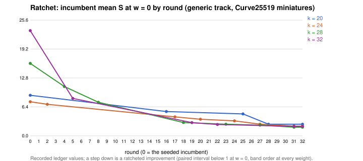

# Curve25519-family index calculus: the autolab improvement loop

> **Owner ruling, 2026-11-10: only algebraic index calculus counts**
> ([`research/ic_track_ruling_20261110/DECISIONS.md`](../ic_track_ruling_20261110/DECISIONS.md)).
> The `generic` track below is **retired**. Its rounds 1–37 and incumbents are
> history: they are generic decomposition and BSGS-boundary arms, references
> and not index calculus. `ic_autolab` now refuses the generic track and any
> non-algebraic arm, and defaults to `--track algebraic`. The algebraic track is
> seeded at k = 20 and k = 24. k = 28 and k = 32 wait on the blockers of the
> ruling's queue (Q2, Q3).

**Class:** an automated optimisation loop (the owner's success criterion made
mechanical), with its ledger of incumbents and its rounds. Not itself a result;
each round's `README.md` and `RESULT.json` carry that round's result, and the
ledger carries the ratchet. Development evidence only: no round is a leaderboard
or `benchmarks/README.md` row until it passes the validation gate.

The driver is native (`src/bin/ic_autolab.rs`; AGENTS.md "Implementation
language: no Python"). Every measurement is an ecbench session: each solve
checked against its target by ecbench, same-host replays, the §5a pricing
band, paired comparisons. Under AGENTS.md "Sabotage is assumed" these are the
producer's own checks; a round's result is cited by its pcc claim id with its
standing (see Rounds). The driver
writes specs, calls `ecbench`, reads its JSON back, classifies under the rule
frozen in each round's `PROTOCOL.md`, and keeps `ledger.json`. It computes no
ECDLP result itself.

## The loop

```
ledger.json ──► propose ──► freeze ──► run train ──► select ──► run holdout ──► assess ──► ratchet ──► report
(incumbents,    panel       PROTOCOL   sessions/     holdout    sessions/        RESULT     ledger      README.md
 trials,        .json       specs/     train-k*      specs      holdout-k*       .json      .json       round.svg
 exposures)                 MANIFEST   verify+band              verify+band                 ratchet.svg REPORT.pdf
```

| step | what it does | rule it enforces |
|:--|:--|:--|
| `propose` | candidate arms per size from the incumbent's base-size neighbourhood, refinement of alternatives within 1.5x of the incumbent, and exploration slots for families never tried at that size; never a configuration already in the trial history | autolab portfolio: total-cost leaders, Pareto alternatives, predeclared exploration (`AUTOLAB.md`, "Iterate without discarding useful alternatives") |
| `freeze` | `PROTOCOL.md`, train specs, `MANIFEST.json` (sha256 of everything), fresh target seeds disjoint from every exposure; `ecbench plan` validates each spec first; refuses an existing round | protocol before data; no reuse of exposed targets |
| `run` | `ecbench run` per size into a new session directory, `ecbench verify --replay`, `ecbench band --json --ranks`; a failure is recorded, never retried | verified solves, replay audit, every arm retained |
| `card` | the same stage as a frozen-command task card for the director/executor relay (`tools/task_card.py lint`) | AGENTS.md "Model tiers" |
| `select` | one challenger per size: lowest mean S at w = 0 among candidates whose every run verified, and only if below the incumbent in train; writes the holdout specs; appends the dated amendment | disclosed in-sample selection; fresh holdout |
| `assess` | `ecbench compare --a inc --b sel` at w = 0 (and 0.1, 1), the A/A `inc-aa`, the band order; classifies improvement / regression / null / inadmissible | AGENTS.md success criterion and §5a |
| `ratchet` | an improvement becomes the incumbent with its delta, session id, spec and receipt sha256; all arms join the trials; all seeds join the exposures | ratchet; cumulative, visible progress |
| `report` | the round's README, `round.svg`, the loop's `ratchet.svg`; `scripts/render_pdf.sh` makes `REPORT.pdf` | research-visuals |

`loop --rounds N` runs the whole sequence on the local route. Each round is
write-once: a second `freeze`, `select`, `assess` or `ratchet` of the same
round is refused, and session directories are never rerun.

## Tracks and families

`ledger.json` keeps one incumbent per **track** (AGENTS.md "Tracks of index
calculus": generic decomposition and algebraic) and **size** (k = 20, 24, 28,
32 bits of p; the miniatures of `research/curve25519_ic_baseline_20261102`,
built by Curve25519's own selection rule). A gain in one track never ratchets
the other. `families.json` lists the candidate families per track: each is an
existing ecbench `ic.pipeline` oracle on the track's factor-base template, and
the searched knob is the base size N (the tower height t on the algebraic
track). A family that needs new code is a source change: build it, add it to
`families.json`, and the next round's exploration slot picks it up.

The seeded incumbents (round 0) and their provenance are in
`ledger.seed.json`; `ic_autolab init --from ledger.seed.json` wrote
`ledger.json` from it. Status at any time: `ic_autolab status`.

## Running a round

```bash
cargo build --release --bin ecbench --bin ic_autolab
H=research/curve25519_autolab_20261104
# one round, generic track, k = 20 and 24, local route (an explicitly requested development screen)
./target/release/ic_autolab --home $H loop --rounds 1 --track generic --sizes 20,24 --cpus none --allow-busy
$H/scripts/render_pdf.sh $H/round-001
```

Step by step, or through the model-tier relay (the lab's default route):

```bash
./target/release/ic_autolab --home $H propose --round 2 --track generic --sizes 20,24 --out /tmp/panel.json
./target/release/ic_autolab --home $H freeze  --round 2 --panel /tmp/panel.json --route eks --ecbench target/release/ecbench
./target/release/ic_autolab --home $H card    --round 2 --stage train        # -> round-002/cards/CARD-...yaml
python3 tools/task_card.py lint $H/round-002/cards/CARD-*.yaml                # experiment-director lints, executor-mechanical runs
./target/release/ic_autolab --home $H select  --round 2 --ecbench target/release/ecbench
./target/release/ic_autolab --home $H card    --round 2 --stage holdout --n 2
./target/release/ic_autolab --home $H assess  --round 2 && ./target/release/ic_autolab --home $H ratchet --round 2 && ./target/release/ic_autolab --home $H report --round 2
```

Before any run: `scripts/checkpoint.sh init` and fill `.resume/RESUME.md`
(CLAUDE.md "Resume checkpoints"). The algebraic track's arms take minutes per
target: use `--train-targets 6 --holdout-targets 12 --timeout-seconds 7200`.

## Decision rule (every round, frozen in its PROTOCOL.md)

Per size, from the fresh holdout: **improvement** if the paired `sel / inc`
95% interval is below 1 at w = 0 and `ecbench band --ranks` orders
`sel < inc` (the order holds at w = 0, 0.1 and 1 alike), with the A/A interval
containing 1; **regression** if the interval is above 1 or the band orders
`inc < sel`; **null** otherwise. Relabelling (a headline count falls while
total cost rises) is caught by the band. Distance to rho,
`S(sel) / S(rho-neg)` at each weight, is reported as the distance remaining.
The class names are labels of this rule, not claims; a round's outcome is
cited by its claim record [pcc:unverified].

## Owner ruling on the baby-step giant-step boundary (2026-11-04)

The owner ruled on 2026-11-04 that the C = 2 seed arms (`wsum2*`, `wwalk*`) and the `wwalk` arms with known-log G jumps (`g=1,grow=2`) count as index-calculus results under the decision rule above. Rows marked "classification pending an owner ruling" in the table below are settled by this ruling and keep their claim records unchanged. The owner also set the next direction: a structure search for curve-specific levers (`ideas/STRUCTURE-R4.md`), because table-and-probe designs are bounded near the generic floor.

## Rounds

| round | track | sizes | outcome | report |
|--:|:--|:--|:--|:--|
| 1 | generic | 20, 24 | no challenger at either size: the `ksum3` incumbents (N = 11, 20) beat their N neighbourhood and the `mitm2` / `mitm3` exploration arms in train | [round-001](round-001/README.md), [PDF](round-001/REPORT.pdf) |
| 2 | generic | 20, 24 | k = 24: **improvement**, `ksum4-n12` (`ksum:m=4`, N = 12) replaces `ksum3-n20`: paired sel / inc 0.917 [0.879, 0.957] at w = 0 (0.911 at w = 0.1, 0.880 at w = 1), band `sel < inc`, A/A exactly 1, 480/480 holdout runs verified (session `ECBS1h32d89e6cb3e5`); distance to rho 6.5x -> 6.0x. k = 20: no challenger (`ksum4-n5` 3.9x worse, `ksum5-n4` exhausted on 16/16 runs, `mitm2` refinements worse) | [round-002](round-002/README.md), [PDF](round-002/REPORT.pdf) |
| 3 | generic | 20, 24 | no challenger at either size. k = 20: the cross-size transfer of `ksum:m=4` came closest (`ksum4-n10` 10.29 vs inc 8.70 at w = 0, but 13.37 vs 15.56 at w = 1; band unresolved), `ksum4-n7` 10.95, `rootfind-mitm:m=2` 11.25. k = 24: `ksum4-n12` is a sharp optimum (N = 8 at 2.3x, N = 17 at 2.6x, N = 6 and 24 far worse); `rootfind-mitm:m=2` 12.17; `rootfind-pairs:m=3` costs 70x (k = 20) and 320x (k = 24) the incumbent | [round-003](round-003/README.md), [PDF](round-003/REPORT.pdf) |
| 4 | generic | 28, 32 | k = 28: `ksum4-n21` (`ksum:m=4`, N = 21) replaces `mitm2-n203` under the frozen rule: holdout `ECBS1h4fa56ebd629d`, paired sel / inc 0.654 [0.636, 0.672] at w = 0, band `sel < inc`; S 16.74 to 10.94, distance to rho 16.5x to 10.8x. k = 32: no challenger; `ksum4` at the transferred N = 53, 76, 106 costs 4.4x to 72x the incumbent, so the m = 4 optimum N grows more slowly than N_a (12 at k = 24, 21 at k = 28) [pcc:unverified] | [round-004](round-004/README.md), [PDF](round-004/REPORT.pdf) |
| 5 | generic | 32 | `ksum4-n26` (`ksum:m=4`, N = 26) replaces `mitm2-n512` under the frozen rule: holdout `ECBS1hbc72fda3e97f`, paired sel / inc 0.352 [0.340, 0.363] at w = 0 (0.291 at w = 1), band `sel < inc`; S 23.60 to 8.30, distance to rho 25.9x to 9.1x. The proposer's log-log fit put N at 37; the train optimum was 26 (N = 19 at 9.05, 37 at 25.2) [pcc:unverified] | [round-005](round-005/README.md), [PDF](round-005/REPORT.pdf) |
| 6 | generic | 28 | null: `ksum4-n15` costs 0.616 [0.593, 0.641] of the incumbent at w = 0 but 1.092 [1.039, 1.149] at w = 1 (holdout `ECBS1h584855d3a3bb`), so the band does not order it and `ksum4-n21` stays; `ksum3-n35` 8.91 vs 10.87 in train, also higher at w = 1 [pcc:unverified] | [round-006](round-006/README.md), [PDF](round-006/REPORT.pdf) |
| 7 | generic | 20 | regression: the train leader `ksum4-n8` (8.18 vs 9.31) costs 1.026 [0.966, 1.090] of `ksum3-n11` on the fresh holdout `ECBS1ha3ed7f4ce6e6`, band `inc < sel`; a winner's-curse selection on 16 targets, kept on record. `ksum4-n9` and `ksum5-n8` were lower only at w = 1 in train [pcc:unverified] | [round-007](round-007/README.md), [PDF](round-007/REPORT.pdf) |
| 8 | generic | 28 | `ksum4-n18` replaces `ksum4-n21` under the frozen rule (32 train targets; the finer N grid): holdout `ECBS1hc8e87821dc40`, paired sel / inc 0.678 [0.666, 0.691] at w = 0, 0.869 at w = 1, band `sel < inc`; S 10.98 to 7.44, distance to rho 11.5x to 7.8x [pcc:unverified] | [round-008](round-008/README.md), [PDF](round-008/REPORT.pdf) |
| 9 | generic | 32 | censored: stopped after 10 train records because the panel held `rootfind-pairs:m=3` at N = 179 (see round-009/STOPPED.md); four dominated families disabled | [round-009](round-009/STOPPED.md) |
| 10 | generic | 32 | null: `ksum4-n22` costs 0.889 [0.869, 0.910] of `ksum4-n26` at w = 0 but 1.202 at w = 1 (holdout `ECBS1h572a148f6fbf`), band unresolved; the same counted-work vs lookups trade as round 6 [pcc:unverified] | [round-010](round-010/README.md), [PDF](round-010/REPORT.pdf) |
| 11 | generic | 24 | no challenger on 32 train targets: `ksum4-n12` 6.61, `ksum4-n10` 6.96, `ksum3-n20` 7.82, `ksum4-n14` 9.00 [pcc:unverified] | [round-011](round-011/README.md), [PDF](round-011/REPORT.pdf) |
| 12 | generic | 24 | no challenger; tests proposal P1 (`targets=stride`): the incumbent configuration on the stride stream costs 7.41 vs 6.86 on the jump walk (1.08x), so P1's predicted 0.84 is falsified [pcc:unverified] | [round-012](round-012/README.md), [PDF](round-012/REPORT.pdf) |
| 13 | generic | 20 | null: the first free-rows arm `ksum4f-n8` (`ksum:m=4,free=1`) costs 0.971 [0.931, 1.012] of `ksum3-n11` on holdout `ECBS1ha91af1cc9a88`, band `sel < inc`, interval spans 1; in train free rows took ksum4 at N = 8 below the incumbent (8.28 vs 9.04) and ksum5 at N = 8 to the lowest w = 1 cost (13.40) [pcc:unverified] | [round-013](round-013/README.md), [PDF](round-013/REPORT.pdf) |
| 14 | generic | 28 | no challenger: `ksum4f-n18` has no 4-sum collisions on this base and equals the incumbent (7.33); `ksum5f-n16` gets 51 free rows per run but its table costs 15.92; `ksum3f-n30` 8.21 [pcc:unverified] | [round-014](round-014/README.md), [PDF](round-014/REPORT.pdf) |
| 15 | generic | 28 | null: `ksum4f-n15` 0.964 [0.927, 1.002] at w = 0, 1.340 at w = 1, band unresolved. `ksum4f-n22` emits 90 free rows per run (the collision count the model predicts) yet still needs about 4800-8500 trials and scores as the plain table (12.64), so those rows have low rank: colliding 4-sums share summands and repeat few relations [pcc:unverified] | [round-015](round-015/README.md), [PDF](round-015/REPORT.pdf) |
| 16 | generic | 20 | `wsum-b5-n3` (`wsum:coef=5,free=1`, a coefficient box over C = 3 seeds with abs(e) <= 5, proposal P3) replaces `ksum3-n11` under the frozen rule: holdout `ECBS1h458afdb84a20`, paired sel / inc 0.605 [0.575, 0.637] at w = 0, 0.478 at w = 1, band `sel < inc`; S 8.89 to 5.38, distance to rho 6.0x to 3.6x (3.0x at w = 1). B = 12 and 20 cost 29 and 191 (the box approaches r), B = 4 at C = 4 11.9 [pcc:unverified] | [round-016](round-016/README.md), [PDF](round-016/REPORT.pdf) |
| 17 | generic | 24 | `wsum-b4-n4` (C = 4 seeds, B = 4) replaces `ksum4-n12` under the frozen rule: holdout `ECBS1h509cf46feb02`, paired sel / inc 0.620 [0.591, 0.649] at w = 0, 0.559 at w = 1, band `sel < inc`; S 6.78 to 4.20, distance to rho 3.4x. B = 12 at C = 3 was 6.56 in train [pcc:unverified] | [round-017](round-017/README.md), [PDF](round-017/REPORT.pdf) |
| 18 | generic | 28 | `wsum-b12-n3` (C = 3 seeds, B = 12) replaces `ksum4-n18` under the frozen rule: holdout `ECBS1h22b557bd4431`, paired sel / inc 0.397 [0.372, 0.424] at w = 0, 0.471 at w = 1, band `sel < inc`; S 7.43 to 2.95, distance to rho 7.6x to 3.0x (3.0x at every weight). In train B = 5 at C = 4 was 3.25, B = 20 at C = 3 6.53 [pcc:unverified] | [round-018](round-018/README.md), [PDF](round-018/REPORT.pdf) |
| 19 | generic | 32 | `wsum-b20-n3` (C = 3 seeds, B = 20) replaces `ksum4-n26` under the frozen rule: holdout `ECBS1hf3547017358d`, paired sel / inc 0.350 [0.329, 0.373] at w = 0, 0.416 at w = 1, band `sel < inc`; S 8.38 to 2.94, distance to rho 3.1x. In train B = 16 3.08, B = 24 3.37, B = 30 5.37 at C = 3 [pcc:unverified] | [round-019](round-019/README.md), [PDF](round-019/REPORT.pdf) |
| 20 | generic | 24 | `wsum-b8-n3` (C = 3, B = 8) replaces `wsum-b4-n4`: holdout `ECBS1hbaf914946ee3`, paired sel / inc 0.882 [0.839, 0.928] at w = 0, band `sel < inc`; S 4.17 to 3.68, distance to rho 3.45x to 3.0x; B = 16, 24, 30 at C = 3 cost 13.3 to 149 in train [pcc:unverified] | [round-020](round-020/README.md), [PDF](round-020/REPORT.pdf) |
| 21 | generic | 20 | no challenger: `wsum-b5-n3` 5.49 is the box optimum; B = 8 at 9.47, B = 16 to 30 at 83 to 912, B = 5 on 4 seeds 22.8 [pcc:unverified] | [round-021](round-021/README.md), [PDF](round-021/REPORT.pdf) |
| 22 | generic (BSGS boundary) | 32 | `wsum2-b120-n2` (C = 2 seeds, B = 120; SYNTHESIS.md R2) replaces `wsum-b20-n3` under the frozen rule: holdout `ECBS1h66e91aeb7780`, paired sel / inc 0.838 [0.749, 0.937] at w = 0, 0.833 at w = 1, band `sel < inc`; S 3.01 to 2.52, distance to rho 2.7x. With C = 2 the method sits at the baby-step giant-step boundary; whether this ratchet counts as index calculus is pending an owner ruling [pcc:unverified] | [round-022](round-022/README.md), [PDF](round-022/REPORT.pdf) |
| 23 | generic (BSGS boundary) | 28 | `wsum2-b60-n2` (C = 2 seeds, B = 60; SYNTHESIS.md R2) replaces `wsum-b12-n3`: holdout `ECBS1hf1bfaa6be63c`, paired sel / inc 0.849 [0.782, 0.922] at w = 0, 0.800 at w = 1, band `sel < inc`; S 3.03 to 2.58, distance to rho 2.8x; classification pending an owner ruling [pcc:unverified] | [round-023](round-023/README.md), [PDF](round-023/REPORT.pdf) |
| 24 | generic (BSGS boundary) | 24 | `wsum2-b30-n2` (C = 2 seeds, B = 30) replaces `wsum-b8-n3`: holdout `ECBS1h4a5add065b8e`, paired sel / inc 0.900 [0.845, 0.959] at w = 0, 0.957 at w = 1, band `sel < inc`; S 3.69 to 3.32, distance to rho 2.7x; classification pending an owner ruling [pcc:unverified] | [round-024](round-024/README.md), [PDF](round-024/REPORT.pdf) |
| 25 | generic (BSGS boundary) | 20 | `wsum2-b15-n2` (C = 2 seeds, B = 15) replaces `wsum-b5-n3`: holdout `ECBS1hf759e8a6c6f9`, paired sel / inc 0.895 [0.862, 0.930] at w = 0, 0.920 at w = 1, band `sel < inc`; S 5.43 to 4.86, distance to rho 3.2x; classification pending an owner ruling [pcc:unverified] | [round-025](round-025/README.md), [PDF](round-025/REPORT.pdf) |
| 26 | generic (BSGS boundary) | 28, 32 | no ratchet: C = 2 box refined over B = 45..140; at k = 28 train-best `wsum2-b50-n2` regressed on holdout `ECBS1he23f5c757de8` (sel / inc 1.066 [0.990, 1.148]), at k = 32 no challenger; incumbents kept. Best B is about 0.47 r^(1/4) and S sits within about 3% of the 2 sqrt(3 r / 2) table-plus-probe model [pcc:unverified] | [round-026](round-026/README.md), [PDF](round-026/REPORT.pdf) |
| 27 | generic (BSGS boundary) | 24, 28 | stride-generator probes R = Q + [k]G on the C = 2 box (ideas/PROPOSALS-R3.md P1). k = 24: `wsum2g-b30-n2` replaces `wsum2-b30-n2`, holdout `ECBS1h30a8186f15ae`, sel / inc 0.829 [0.761, 0.903] at w = 0, 0.731 at w = 1, S 3.12 to 2.58, distance to rho 2.0x. k = 28: `wsum2g-b60-n2` replaces `wsum2-b60-n2`, holdout `ECBS1h77f9661c8891`, 0.946 [0.895, 0.999] at w = 0, 0.764 at w = 1, S 2.51 to 2.37, distance 2.4x; band `sel < inc` at both; classification pending an owner ruling [pcc:unverified] | [round-027](round-027/README.md), [PDF](round-027/REPORT.pdf) |
| 28 | generic (BSGS boundary) | 20, 32 | k = 20: `wsum2g-b15-n2` (stride-generator probes) replaces `wsum2-b15-n2`, holdout `ECBS1hedb8cab33622`, sel / inc 0.515 [0.474, 0.559] at w = 0, 0.499 at w = 1, band `sel < inc`; S 5.00 to 2.57, distance to rho 1.76x. k = 32: no challenger (best stride-generator train S 2.88 against the walk incumbent); classification pending an owner ruling [pcc:unverified] | [round-028](round-028/README.md), [PDF](round-028/REPORT.pdf) |
| 29 | generic (BSGS boundary) | 24, 28, 32 | no challenger: a fixed random stride (`targets=stride`, families `wsum2s`) is worse than the incumbents (best train S 3.65, 2.59, 2.77). Stride-generator and fixed-stride hits repeat along short seed relations w.S = [m]G (test `wsum_stride_dependence_tests`), which leave rank-2 rows [pcc:unverified] | [round-029](round-029/README.md), [PDF](round-029/REPORT.pdf) |
| 30 | generic (BSGS boundary) | 24, 28, 32 | no challenger: a stride renewed per relation (`targets=stride-renew`, families `wsum2r`) has no dependent rows but needs about 2.6 times the probes per independent hit at k = 32 (72,469 against 28,300), because progression hits cluster on short seed-relation lines; only the random-jump walk avoids the clustering [pcc:unverified] | [round-030](round-030/README.md), [PDF](round-030/REPORT.pdf) |
| 31 | generic (BSGS boundary) | 24, 28, 32 | P2 `wwalk` (walk-built C = 2 table with target-free collision rows, ideas/PROPOSALS-R3.md). k = 24: `wwalkg-x08-grow-n2` replaces `wsum2g-b30-n2`, holdout `ECBS1h74e92e8a400c`, 0.788 [0.702, 0.884], S 2.75 to 2.16, fixed-table distance 1.77x (not seed-averaged; R4-I1). k = 28: `wwalkg-x08-n2` replaces `wsum2g-b60-n2`, holdout `ECBS1h9970d0e17516`, 0.854 [0.758, 0.962], S 2.25 to 1.92, fixed-table distance 2.06x (the table draw is not seed-averaged; R4-I1). k = 32: `wwalk-x10-n2` replaces `wsum2-b120-n2`, holdout `ECBS1hedd879993025`, 0.807 [0.708, 0.921], S 2.61 to 2.11, fixed-table distance 2.42x (not seed-averaged; R4-I1). Band `sel < inc` at each; k = 20 null; classification pending an owner ruling [pcc:unverified] | [round-031](round-031/README.md), [PDF](round-031/REPORT.pdf) |
| 32 | generic (BSGS boundary) | 20..32 | no ratchet: wwalk refined over x = 0.5..0.9; k = 20 regression 1.092 [0.956, 1.248], k = 24 null 0.937 [0.819, 1.073], k = 28 null 0.972 [0.804, 1.174], k = 32 no challenger; train S flat over x = 0.7..1.0 [pcc:unverified] | [round-032](round-032/README.md), [PDF](round-032/REPORT.pdf) |
| 33 | generic (BSGS boundary) | 24, 28, 32 | wwalk with known-log G jumps grown to rank-2 seed rows (`g=1,grow=2`): one probe hit solves. k = 24: `wwalkGg-x09-n2`, holdout `ECBS1h05c72414c6d4`, 0.721 [0.610, 0.853], S 2.32 to 1.67, fixed-table distance 1.43x. k = 28: `wwalkGg-x09-n2`, holdout `ECBS1hba478ffc1d23`, 0.795 [0.673, 0.940], S 1.98 to 1.57, fixed-table distance 1.49x. k = 32: `wwalkG-x06-n2`, holdout `ECBS1h8b22612ef731`, 0.715 [0.648, 0.788], S 2.12 to 1.52, fixed-table distance 1.55x. The `sel/inc` ratios above are likewise the fixed-table comparison; the seed=run expected distances are 1.94x / 1.81x / 1.82x (re-baseline); round 35, the first both-arms seed=run test, finds nulls at k = 28 and 32. Band `sel < inc` at each; classification pending an owner ruling [pcc:unverified] | [round-033](round-033/README.md), [PDF](round-033/REPORT.pdf) |
| 34 | generic (BSGS boundary) | 20..32 | no ratchet: wwalk g=1 grow=2 with x = 0.3..0.5 or 8/32 jumps; k = 20 null 0.938 [0.864, 1.019], k = 24 no challenger, k = 28 null 0.981 [0.854, 1.126], k = 32 null 0.880 [0.741, 1.046]; measured against the fixed-table incumbent, not re-run under seed=run [pcc:unverified] | [round-034](round-034/README.md), [PDF](round-034/REPORT.pdf) |
| R4-I1 | correction | 28, 32 | the wwalk table is one fixed draw per configuration, so rounds 31 to 34 resampled only the probe phase. Averaged over 16 walk seeds, the round 33 incumbents cost S 1.78 [1.60, 1.96] at k = 32 and 1.97 [1.81, 2.13] at k = 28: 1.82x and 1.86x matched rho, against 1.55x and 1.49x for the incumbents' own table draw [pcc:unverified] | [r4-i1](r4-i1/README.md), [PDF](r4-i1/REPORT.pdf) |
| re-baseline | — | 24, 28, 32 | incumbents moved to `seed=run` (a fresh wwalk table per run): S 2.11 / 1.88 / 1.84 at k = 24 / 28 / 32, against 1.72 / 1.62 / 1.61 for the fixed table; distance to matched rho 1.94x / 1.81x / 1.82x [pcc:unverified] | [rebaseline-seedrun](rebaseline-seedrun/README.md), [PDF](rebaseline-seedrun/REPORT.pdf) |
| multi-curve | — | 20, 24, 28, 32 | incumbents and rho-neg on five family curves per size: mean S / rho 1.57 / 1.78 / 1.80 / 1.91 at k = 20 / 24 / 28 / 32, per-curve spread about 0.2; the 1.8x to 1.9x plateau holds across curves [pcc:unverified] | [multicurve](multicurve/README.md), [PDF](multicurve/REPORT.pdf) |
| C = 1 boundary | — | 20, 24, 28, 32 | one-seed `wwalk` screen (20 arms) plus pre-registered confirmation on fresh curves: mean S / rho 1.40 / 1.60 / 1.74 / 1.69, against 1.79 / 1.88 / 1.86 / 2.04 for the C = 2 baseline; 1.3x not met at k = 20 or 24; labelled boundary result outside the ratchet [pcc:unverified] | [c1](c1/README.md), [PDF](c1/REPORT.pdf) |
| BSGS-class boundary | — | 20, 24 | measured `bsgs.negation` / rho-neg: 0.61 / 0.63 / 0.70 at k = 20 (w = 0 / 0.1 / 1), 0.89 / 0.90 / 0.93 at k = 24; time-memory, outside the ratchet [pcc:unverified] | [bsgs](bsgs/README.md), [PDF](bsgs/REPORT.pdf) |
| SNC panel | — | 20, 24, 28, 32 | lazy certification (`lazy=1`) and the two-seed chained target walk (`tw=2,cj=1`) vs the C = 2 incumbent, frozen protocol, five fresh curves: combined 0.936 / 0.883 / 0.899 / 0.919 of the incumbent at w = 0 with the order holding across the band; ratio to rho-neg 1.61 / 1.63 / 1.74 / 1.78 (from 1.72 / 1.84 / 1.94 / 1.93); classification of `tw=2` is the owner's call [pcc:unverified] | [snc-panel](snc-panel/README.md), [PDF](snc-panel/REPORT.pdf) |
| 35 | generic (seed=run) | 24, 28, 32 | no ratchet: wwalk g=1 grow=2 seed=run over x = 0.5..1.5, both probe types; k = 24 no challenger, k = 28 null 0.986 [0.888, 1.094], k = 32 null 0.911 [0.790, 1.050]; with a fresh table per run S is flat in x; first both-arms seed=run test [pcc:unverified] | [round-035](round-035/README.md), [PDF](round-035/REPORT.pdf) |

Claim records (AGENTS.md "Sabotage is assumed: proof-carrying claims"): round 1
`PCC-20261104-6ca5d2`, round 2 `PCC-20261104-fa70c6`, round 3
`PCC-20261104-31cd98`, round 4 `PCC-20261104-6c0998`, round 5 `PCC-20261104-0213f5`, round 6 `PCC-20261104-249a57`, round 7 `PCC-20261104-15a1d6`, round 8 `PCC-20261104-ff48c0`, round 10 `PCC-20261104-87cbc0`, round 11 `PCC-20261104-f74cbc`, round 12 `PCC-20261104-4afdff`, round 13 `PCC-20261104-342ea5`, round 14 `PCC-20261104-f009c9`, round 15 `PCC-20261104-836de4`, round 16 `PCC-20261104-1c867a`, round 17 `PCC-20261104-2b80d2`, round 18 `PCC-20261104-13dcb4`, round 19 `PCC-20261104-997808`, round 20 `PCC-20261104-b49545`, round 21 `PCC-20261104-fe8236`, round 22 `PCC-20261104-09fa2c`, round 23 `PCC-20261104-cf671c`, round 24 `PCC-20261104-66c1d2`, round 25 `PCC-20261104-f461bc`, round 26 `PCC-20261104-f9ed8c`, round 27 `PCC-20261104-17a0be`, round 28 `PCC-20261104-d87806`, round 29 `PCC-20261104-795a16`, round 30 `PCC-20261104-2ed644`, round 31 `PCC-20261104-95313c`, round 32 `PCC-20261104-976b76`, round 33 `PCC-20261104-c28f16`, round 34 `PCC-20261104-2631da`, R4-I1 `PCC-20261104-c97d81`, re-baseline `PCC-20261104-d91a51`, multi-curve `PCC-20261105-37a78d`, round 35 `PCC-20261104-d8bbec`, all `statement` claims with standing `unverified` until a
second host signs a replay and a validator signs a recompute [pcc:unverified].

The ledger (`ledger.json`, `history`) carries every ratchet with its delta and
evidence; `trials` holds every arm ever measured and `exposures` every
target seed. The pre-correction fixed-table figures remain as their own
series; the `seed=run` rows are the expected cost.



## Deviations and limits (stated, not hidden)

- The local route is counted units at L0/L1 on a shared host: deterministic,
  replayed, no wall-time claim. The lab's default is Iso Lab on EKS through a
  task card (`card`); a second-host replay is required before any leaderboard
  row.
- Selection in train is in sample and disclosed; the holdout is fresh.
- The candidate space is configurations of existing methods. Source changes
  (a new oracle, a new table layout, linear-algebra or walk changes) are the
  next lever and need their own build and family entry.
- `ic sweep` (docs/ic/SWEEPER.md) is the TPE search over planted instances;
  this loop is the frozen-protocol confirmation on fresh public targets that
  a sweep's hypothesis has to pass. The two can be chained: sweep to propose,
  this loop to confirm and ratchet.
- The `wwalk` oracle draws a random table. Rounds 31–34 used one fixed draw
  per configuration, so their paired intervals cover target/probe noise but
  not table-draw noise. The R4-I1 sweep and the `seed=run` re-baseline measure
  that component at 15–22%; use their 1.9x matched-rho figure, not the
  fixed-draw 1.43x/1.49x/1.55x. Round 35 is the first both-arms `seed=run`
  test and finds nulls at k = 28 and 32.
- The A/A arm is an exact duplicate of the incumbent in counted units (same
  algorithm seed). Its interval [1, 1] is a determinism check; it is not a
  noise or position-bias check. That role belongs to wall time, which this
  loop does not claim.
- Round 34's nulls were measured against the favourable fixed-table
  incumbent and were not re-run after the `seed=run` fix. They are not
  evidence that the challengers would fail against the expected cost.
