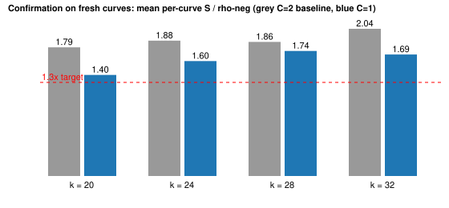

# C = 1 boundary study (one unknown seed)

Claim `PCC-20261107-301dd8`, standing `unverified`. Owner-approved on 2026-11-07 as a labelled boundary result outside the main ratchet (C >= 2 stays the main track). With one factor-base seed plus the target there are K = 2 unknown logarithms, so the collision floor is 1.329 (OBSTRUCTION.md). The oracle is `wwalk:...,g=1,grow=1,seed=run` on a size-1 base; the mode comes from another session's work-in-progress commit f51911e130.

## Design

- Screen: 20 arms (x in 0.5/0.7/1.0, jumps in 4/8/16, walk or stride probes) on the five multi-curve dev curves per size, 12 targets x 2 rounds. Audit 3600/3600 records, 8 replays reproduced, at every size.
- Pre-registration (`PREREGISTRATION.json`, frozen before any confirmation run): the arm with the lowest mean S at w = 0 per size.
- Confirmation: five fresh sibling curves per size (`confirm-curves.json`), arms rho-neg, `inc-c2` and the pre-registered arm. Audit 540/540, 8 replays reproduced, at every size.

## Result [pcc:unverified]

Mean per-curve S / rho-neg, w = 0, fresh curves:

| k | pre-registered arm | C = 1 S | C = 1 / rho (range) | C = 2 baseline / rho | screen ratio (selected) |
|--:|:--|--:|:--|--:|--:|
| 20 | `c1-x05-j4-g` | 2.227 | 1.40 (1.24 to 1.51) | 1.79 | 1.26 |
| 24 | `c1-x10-j16-g` | 1.814 | 1.60 (1.37 to 1.74) | 1.88 | 1.49 |
| 28 | `c1-x10-j8-g` | 1.711 | 1.74 (1.50 to 1.95) | 1.86 | 1.64 |
| 32 | `c1-x07-j16-g` | 1.545 | 1.69 (1.42 to 2.01) | 2.04 | 1.57 |

## Reading [pcc:unverified]

- The C = 1 arm is cheaper than the C = 2 baseline at every size (S ratio 0.78, 0.85, 0.93, 0.82), as the floor predicts.
- The 1.3x target is not met at k = 20 or k = 24. The screen's 1.26x at k = 20 is the best of 20 arms on the dev curves; on fresh curves the same arm is 1.40x. The gap between screen and confirmation is selection.
- No S falls below the C = 1 floor of 1.329, so the audit trigger in OBSTRUCTION.md does not fire. At k = 20 the arm sits 68 percent above the floor, at k = 32 16 percent above.
- Baseline `inc-c2` here is the box incumbent shape (`wsum`, C = 2), not the tuned `wwalk` C = 2 incumbent at k = 24 to 32; its ratios (1.79 to 2.04) match the multicurve baseline (1.57 to 1.91) within the curve spread.
- C = 1 is a boundary result: the seed logarithm is the only unknown, and the walk is close to a relabelling of rho with one extra relation. It does not count toward the main ratchet.
