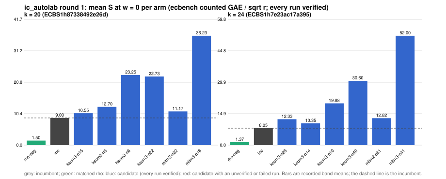

# ic_autolab round 1 (generic track): report

Protocol: [PROTOCOL.md](PROTOCOL.md), frozen 2026-11-04T01:43:53Z at git `5840364fa4f38a0c47dcdd7f167c580394813cb1`; route `local`. Counted GAE only (deterministic, host independent); no wall-time claim; development loop, no validation-gate row. Loop home: [`../`](../README.md); ledger: [`../ledger.json`](../ledger.json).

Claim record: `PCC-20261104-6ca5d2` (`python3 tools/pcc/pcc.py standing PCC-20261104-6ca5d2`). Until a signed replay and recompute exist, this round's outcome is an unverified assertion [pcc:unverified].

## Outcome

| k | class | sel | sel / inc at w = 0 [95%] | w = 0.1 | w = 1 | band | S sel (w = 0 / 0.1 / 1) | S inc | S rho-neg | distance sel / rho |
|--:|:--|:--|:--|:--|:--|:--|:--|:--|:--|:--|
| 20 | **no_challenger** | none (best candidate `ksum3-n15`, train S 10.552 / 10.993 / 14.965) | - | - | - | - | - | 8.998 / 9.734 / 16.356 | 1.501 / 1.607 / 2.560 | inc: 6.0x / 6.1x / 6.4x |
| 24 | **no_challenger** | none (best candidate `ksum3-n14`, train S 10.355 / 11.908 / 25.885) | - | - | - | - | - | 8.053 / 8.760 / 15.129 | 1.372 / 1.497 / 2.625 | inc: 5.9x / 5.9x / 5.8x |

Classes follow the protocol's decision rule. Distance to rho is the distance remaining, not a gate. The reasons per size:

- k = 20: no_challenger
- k = 24: no_challenger

## Train (development screen, in sample)

### k = 20: session `ECBS1h87338492e26d` (run exit 0, verify exit 0, receipt sha256 `5390d9bcbc9286a55d95b58c88c89813625f0a1b4699b1ac5ef90bd2509ac75b`)

| arm | family | N | factor base | oracle | runs | verified | S (w = 0 / 0.1 / 1) | reason proposed |
|:--|:--|--:|:--|:--|--:|--:|:--|:--|
| `rho-neg` | rho | - | `-` | `rho.negation` | 16 | 16 | 1.501 / 1.607 / 2.560 | matched reference |
| `inc` | ksum3 | 11 | `prime-projected-abscissa:size=11,scan_cap=176` | `ksum:m=3` | 16 | 16 | 8.998 / 9.734 / 16.356 | incumbent |
| `ksum3-n15` | ksum3 | 15 | `prime-projected-abscissa:size=15,scan_cap=240` | `ksum:m=3` | 16 | 16 | 10.552 / 10.993 / 14.965 | incumbent neighbourhood: N = 1.4 x 11 |
| `ksum3-n8` | ksum3 | 8 | `prime-projected-abscissa:size=8,scan_cap=128` | `ksum:m=3` | 16 | 16 | 12.697 / 14.226 / 27.988 | incumbent neighbourhood: N = 0.7 x 11 |
| `ksum3-n6` | ksum3 | 6 | `prime-projected-abscissa:size=6,scan_cap=96` | `ksum:m=3` | 16 | 16 | 23.251 / 26.894 / 59.674 | incumbent neighbourhood: N = 0.5 x 11 |
| `ksum3-n22` | ksum3 | 22 | `prime-projected-abscissa:size=22,scan_cap=352` | `ksum:m=3` | 16 | 16 | 22.729 / 23.087 / 26.301 | incumbent neighbourhood: N = 2 x 11 |
| `mitm2-n32` | mitm2 | 32 | `prime-projected-abscissa:size=32,scan_cap=512` | `mitm:negation_folded=1` | 16 | 16 | 11.170 / 11.972 / 19.189 | exploration: family mitm2 untried at k = 20, N = 1 x N_a |
| `mitm3-n16` | mitm3 | 16 | `prime-projected-abscissa:size=16,scan_cap=256` | `mitm:m=3,negation_folded=1` | 16 | 16 | 36.227 / 39.560 / 69.555 | exploration: family mitm3 untried at k = 20, N = 0.5 x N_a |

### k = 24: session `ECBS1h7e23ac17a395` (run exit 0, verify exit 0, receipt sha256 `95f7bc1fe91f99a3ebe501b10a3ccb06b3b074a96c3101d1d41c820e465a926f`)

| arm | family | N | factor base | oracle | runs | verified | S (w = 0 / 0.1 / 1) | reason proposed |
|:--|:--|--:|:--|:--|--:|--:|:--|:--|
| `rho-neg` | rho | - | `-` | `rho.negation` | 16 | 16 | 1.372 / 1.497 / 2.625 | matched reference |
| `inc` | ksum3 | 20 | `prime-projected-abscissa:size=20,scan_cap=320` | `ksum:m=3` | 16 | 16 | 8.053 / 8.760 / 15.129 | incumbent |
| `ksum3-n28` | ksum3 | 28 | `prime-projected-abscissa:size=28,scan_cap=448` | `ksum:m=3` | 16 | 16 | 12.330 / 12.699 / 16.021 | incumbent neighbourhood: N = 1.4 x 20 |
| `ksum3-n14` | ksum3 | 14 | `prime-projected-abscissa:size=14,scan_cap=224` | `ksum:m=3` | 16 | 16 | 10.355 / 11.908 / 25.885 | incumbent neighbourhood: N = 0.7 x 20 |
| `ksum3-n10` | ksum3 | 10 | `prime-projected-abscissa:size=10,scan_cap=160` | `ksum:m=3` | 16 | 16 | 19.881 / 23.476 / 55.830 | incumbent neighbourhood: N = 0.5 x 20 |
| `ksum3-n40` | ksum3 | 40 | `prime-projected-abscissa:size=40,scan_cap=640` | `ksum:m=3` | 16 | 16 | 30.597 / 30.879 / 33.419 | incumbent neighbourhood: N = 2 x 20 |
| `mitm2-n81` | mitm2 | 81 | `prime-projected-abscissa:size=81,scan_cap=1296` | `mitm:negation_folded=1` | 16 | 16 | 12.816 / 13.989 / 24.547 | exploration: family mitm2 untried at k = 24, N = 1 x N_a |
| `mitm3-n41` | mitm3 | 41 | `prime-projected-abscissa:size=41,scan_cap=656` | `mitm:m=3,negation_folded=1` | 16 | 16 | 51.995 / 57.066 / 102.697 | exploration: family mitm3 untried at k = 24, N = 0.5 x N_a |

## Selection

- k = 20: no_challenger  (Pareto alternative at w = 1: `ksum3-n15`)
- k = 24: no_challenger  (Pareto alternative at w = 1: `ksum3-n28`)

## Ledger after this round

| k | incumbent | since round | S (w = 0 / 0.1 / 1) | distance to rho |
|--:|:--|--:|:--|:--|
| 20 | `ksum3-n11` (`prime-projected-abscissa:size=11,scan_cap=176` + `ksum:m=3`) | 0 | 8.987 / 9.710 / 16.217 | 5.7x / 5.7x / 6.0x |
| 24 | `ksum4-n12` (`prime-projected-abscissa:size=12,scan_cap=192` + `ksum:m=4`) | 2 | 6.985 / 7.514 / 12.271 | 6.0x / 5.9x / 5.6x |
| 28 | `mitm2-n203` (`prime-projected-abscissa:size=203,scan_cap=3248` + `mitm:negation_folded=1`) | 0 | 16.057 / 17.564 / 31.130 | 16.6x / 16.6x / 16.7x |
| 32 | `mitm2-n512` (`prime-projected-abscissa:size=512,scan_cap=8192` + `mitm:negation_folded=1`) | 0 | 23.310 / 25.520 / 45.410 | 24.7x / 24.6x / 24.3x |

## Evidence and deviations

- ecbench binary sha256: `3fd22853485e388782ac0821295c56f81725fc832fd3610978be8088b5098bca`; `--cpus auto`, allow_busy = true; `verify --replay 8` per session; audit receipts in `analysis/`; sessions in `sessions/` (records in the artifact store when large).
- Route: the local route is an explicitly requested development screen, not the Iso Lab EKS default; counts are deterministic and replayed, wall time is not claimed. No row of this round enters the IC leaderboard or `benchmarks/README.md` (validation gate).
- Train selection is in sample (disclosed); the holdout is fresh (new `target_seed`, excluded exposures). Failed, timed-out and regressing arms are retained above.
