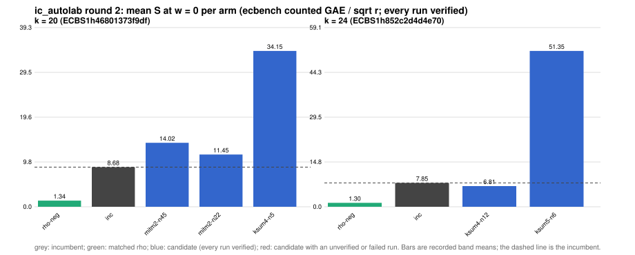

# ic_autolab round 2 (generic track): report

Protocol: [PROTOCOL.md](PROTOCOL.md), frozen 2026-11-04T02:11:15Z at git `5840364fa4f38a0c47dcdd7f167c580394813cb1`; route `local`. Counted GAE only (deterministic, host independent); no wall-time claim; development loop, no validation-gate row. Loop home: [`../`](../README.md); ledger: [`../ledger.json`](../ledger.json).

Claim record: `PCC-20261104-fa70c6` (`python3 tools/pcc/pcc.py standing PCC-20261104-fa70c6`). Until a signed replay and recompute exist, this round's outcome is an unverified assertion [pcc:unverified].

## Outcome

| k | class | sel | sel / inc at w = 0 [95%] | w = 0.1 | w = 1 | band | S sel (w = 0 / 0.1 / 1) | S inc | S rho-neg | distance sel / rho |
|--:|:--|:--|:--|:--|:--|:--|:--|:--|:--|:--|
| 20 | **no_challenger** | none (best candidate `mitm2-n22`, train S 11.449 / 12.552 / 22.481) | - | - | - | - | - | 8.679 / 9.366 / 15.550 | 1.340 / 1.430 / 2.245 | inc: 6.5x / 6.5x / 6.9x |
| 24 | **improvement** | ksum4-n12 | 0.917 [0.879, 0.957] | 0.911 [0.869, 0.955] | 0.880 [0.822, 0.942] | sel < inc | 6.985 / 7.514 / 12.271 | 7.613 / 8.246 / 13.944 | 1.160 / 1.264 / 2.201 | 6.0x / 5.9x / 5.6x |

Classes follow the protocol's decision rule. Distance to rho is the distance remaining, not a gate. The reasons per size:

- k = 20: no_challenger
- k = 24: compare ops.status = ok, admissible = true; sel / inc = 0.9175 [0.879, 0.957] at w = 0; band: sel < inc; A/A inc-aa / inc interval [1.000, 1.000] contains 1

## Train (development screen, in sample)

### k = 20: session `ECBS1h46801373f9df` (run exit 0, verify exit 0, receipt sha256 `ea315e4fa7d1217043c687740539f26e08f78fca204a19806bed3ed25e234039`)

| arm | family | N | factor base | oracle | runs | verified | S (w = 0 / 0.1 / 1) | reason proposed |
|:--|:--|--:|:--|:--|--:|--:|:--|:--|
| `rho-neg` | rho | - | `-` | `rho.negation` | 16 | 16 | 1.340 / 1.430 / 2.245 | matched reference |
| `inc` | ksum3 | 11 | `prime-projected-abscissa:size=11,scan_cap=176` | `ksum:m=3` | 16 | 16 | 8.679 / 9.366 / 15.550 | incumbent |
| `mitm2-n45` | mitm2 | 45 | `prime-projected-abscissa:size=45,scan_cap=720` | `mitm:negation_folded=1` | 16 | 16 | 14.020 / 14.738 / 21.204 | alternative mitm2 (best S(0) 11.170 at N = 32): N = 1.4 x 32 |
| `mitm2-n22` | mitm2 | 22 | `prime-projected-abscissa:size=22,scan_cap=352` | `mitm:negation_folded=1` | 16 | 16 | 11.449 / 12.552 / 22.481 | alternative mitm2 (best S(0) 11.170 at N = 32): N = 0.7 x 32 |
| `ksum4-n5` | ksum4 | 5 | `prime-projected-abscissa:size=5,scan_cap=80` | `ksum:m=4` | 16 | 16 | 34.150 / 39.915 / 91.799 | exploration: family ksum4 untried at k = 20, N = 0.15 x N_a |
| `ksum5-n4` | ksum5 | 4 | `prime-projected-abscissa:size=4,scan_cap=64` | `ksum:m=5` | 0 | 0 | no verified runs | exploration: family ksum5 untried at k = 20, N = 0.08 x N_a |

### k = 24: session `ECBS1h852c2d4d4e70` (run exit 0, verify exit 0, receipt sha256 `32def7afcbada285d3a8d608cbf69567402b52479b8fa9795645119d4b6d955e`)

| arm | family | N | factor base | oracle | runs | verified | S (w = 0 / 0.1 / 1) | reason proposed |
|:--|:--|--:|:--|:--|--:|--:|:--|:--|
| `rho-neg` | rho | - | `-` | `rho.negation` | 16 | 16 | 1.301 / 1.420 / 2.485 | matched reference |
| `inc` | ksum3 | 20 | `prime-projected-abscissa:size=20,scan_cap=320` | `ksum:m=3` | 16 | 16 | 7.848 / 8.521 / 14.572 | incumbent |
| `ksum4-n12` | ksum4 | 12 | `prime-projected-abscissa:size=12,scan_cap=192` | `ksum:m=4` | 16 | 16 | 6.814 / 7.309 / 11.769 | exploration: family ksum4 untried at k = 24, N = 0.15 x N_a |
| `ksum5-n6` | ksum5 | 6 | `prime-projected-abscissa:size=6,scan_cap=96` | `ksum:m=5` | 16 | 16 | 51.352 / 61.205 / 149.885 | exploration: family ksum5 untried at k = 24, N = 0.08 x N_a |

## Selection

- k = 20: no_challenger  (Pareto alternative at w = 1: `mitm2-n45`)
- k = 24: challenger `ksum4-n12` (Pareto alternative at w = 1: `ksum4-n12`)

## Holdout sessions

| k | session | run exit | verify exit | receipt sha256 | levels |
|--:|:--|--:|--:|:--|:--|
| 24 | `ECBS1h32d89e6cb3e5` | 0 | 0 | `fec1207de337ec6591e1a679a3c12414670f0ca2f5bea33641cc97a1fb699d92` | {"verified":480} |

## Ledger after this round

| k | incumbent | since round | S (w = 0 / 0.1 / 1) | distance to rho |
|--:|:--|--:|:--|:--|
| 20 | `ksum3-n11` (`prime-projected-abscissa:size=11,scan_cap=176` + `ksum:m=3`) | 0 | 8.987 / 9.710 / 16.217 | 5.7x / 5.7x / 6.0x |
| 24 | `ksum4-n12` (`prime-projected-abscissa:size=12,scan_cap=192` + `ksum:m=4`) | 2 | 6.985 / 7.514 / 12.271 | 6.0x / 5.9x / 5.6x |
| 28 | `mitm2-n203` (`prime-projected-abscissa:size=203,scan_cap=3248` + `mitm:negation_folded=1`) | 0 | 16.057 / 17.564 / 31.130 | 16.6x / 16.6x / 16.7x |
| 32 | `mitm2-n512` (`prime-projected-abscissa:size=512,scan_cap=8192` + `mitm:negation_folded=1`) | 0 | 23.310 / 25.520 / 45.410 | 24.7x / 24.6x / 24.3x |

## Evidence and deviations

- ecbench binary sha256: `3fd22853485e388782ac0821295c56f81725fc832fd3610978be8088b5098bca`; `--cpus auto`, allow_busy = true; `verify --replay 8` per session; audit receipts in `analysis/`; sessions in `sessions/` (records in the artifact store when large).
- Route: the local route is an explicitly requested development screen, not the Iso Lab EKS default; counts are deterministic and replayed, wall time is not claimed. No row of this round enters the IC leaderboard or `benchmarks/README.md` (validation gate).
- Train selection is in sample (disclosed); the holdout is fresh (new `target_seed`, excluded exposures). Failed, timed-out and regressing arms are retained above.
