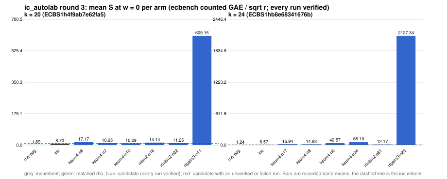

# ic_autolab round 3 (generic track): report

Protocol: [PROTOCOL.md](PROTOCOL.md), frozen 2026-11-04T02:44:38Z at git `9a3b129f9dde3557e84c784a5bed33c6fceb048c`; route `local`. Counted GAE only (deterministic, host independent); no wall-time claim; development loop, no validation-gate row. Loop home: [`../`](../README.md); ledger: [`../ledger.json`](../ledger.json).

## Outcome

| k | class | sel | sel / inc at w = 0 [95%] | w = 0.1 | w = 1 | band | S sel (w = 0 / 0.1 / 1) | S inc | S rho-neg | distance sel / rho |
|--:|:--|:--|:--|:--|:--|:--|:--|:--|:--|:--|
| 20 | **no_challenger** | none (best candidate `ksum4-n10`, train S 10.285 / 10.593 / 13.365) | - | - | - | - | - | 8.699 / 9.385 / 15.556 | 1.694 / 1.821 / 2.957 | inc: 5.1x / 5.2x / 5.3x |
| 24 | **no_challenger** | none (best candidate `rfmitm2-n81`, train S 12.170 / 13.209 / 22.560) | - | - | - | - | - | 6.575 / 7.022 / 11.048 | 1.242 / 1.354 / 2.366 | inc: 5.3x / 5.2x / 4.7x |

Classes follow the protocol's decision rule. Distance to rho is the distance remaining, not a gate. The reasons per size:

- k = 20: no_challenger
- k = 24: no_challenger

## Train (development screen, in sample)

### k = 20: session `ECBS1h4f9ab7e62fa5` (run exit 0, verify exit 0, receipt sha256 `ba8e6ce658ee3bc38902ede86463b3a78d0fdbf908d2faf9a1c6e265493404f7`)

| arm | family | N | factor base | oracle | runs | verified | S (w = 0 / 0.1 / 1) | reason proposed |
|:--|:--|--:|:--|:--|--:|--:|:--|:--|
| `rho-neg` | rho | - | `-` | `rho.negation` | 16 | 16 | 1.694 / 1.821 / 2.957 | matched reference |
| `inc` | ksum3 | 11 | `prime-projected-abscissa:size=11,scan_cap=176` | `ksum:m=3` | 16 | 16 | 8.699 / 9.385 / 15.556 | incumbent |
| `ksum4-n6` | ksum4 | 6 | `prime-projected-abscissa:size=6,scan_cap=96` | `ksum:m=4` | 16 | 16 | 17.166 / 19.585 / 41.363 | cross-size transfer: ksum4-n12 is the k = 24 incumbent at N / N_a = 0.148 |
| `ksum4-n7` | ksum4 | 7 | `prime-projected-abscissa:size=7,scan_cap=112` | `ksum:m=4` | 16 | 16 | 10.952 / 12.120 / 22.630 | cross-size transfer neighbourhood: N = 1.4 x 5 (ksum4 from k = 24) |
| `ksum4-n10` | ksum4 | 10 | `prime-projected-abscissa:size=10,scan_cap=160` | `ksum:m=4` | 16 | 16 | 10.285 / 10.593 / 13.365 | cross-size transfer neighbourhood: N = 2 x 5 (ksum4 from k = 24) |
| `mitm2-n16` | mitm2 | 16 | `prime-projected-abscissa:size=16,scan_cap=256` | `mitm:negation_folded=1` | 16 | 16 | 14.140 / 15.861 / 31.351 | cross-size transfer neighbourhood: N = 0.5 x 32 (mitm2 from k = 28) |
| `rfmitm2-n32` | rfmitm2 | 32 | `prime-projected-abscissa:size=32,scan_cap=512` | `rootfind-mitm:m=2` | 16 | 16 | 11.254 / 12.039 / 19.111 | exploration: family rfmitm2 untried at k = 20, N = 1 x N_a |
| `rfpairs3-n11` | rfpairs3 | 11 | `prime-projected-abscissa:size=11,scan_cap=176` | `rootfind-pairs:m=3` | 16 | 16 | 609.147 / 665.105 / 1168.730 | exploration: family rfpairs3 untried at k = 20, N = 0.35 x N_a |

### k = 24: session `ECBS1hb8e68341676b` (run exit 0, verify exit 0, receipt sha256 `45b8426ac95e1294bb5952c5bd79f6704ad713061624b332706c717a3fc4e272`)

| arm | family | N | factor base | oracle | runs | verified | S (w = 0 / 0.1 / 1) | reason proposed |
|:--|:--|--:|:--|:--|--:|--:|:--|:--|
| `rho-neg` | rho | - | `-` | `rho.negation` | 16 | 16 | 1.242 / 1.354 / 2.366 | matched reference |
| `inc` | ksum4 | 12 | `prime-projected-abscissa:size=12,scan_cap=192` | `ksum:m=4` | 16 | 16 | 6.575 / 7.022 / 11.048 | incumbent |
| `ksum4-n17` | ksum4 | 17 | `prime-projected-abscissa:size=17,scan_cap=272` | `ksum:m=4` | 16 | 16 | 16.936 / 17.122 / 18.796 | incumbent neighbourhood: N = 1.4 x 12 |
| `ksum4-n8` | ksum4 | 8 | `prime-projected-abscissa:size=8,scan_cap=128` | `ksum:m=4` | 16 | 16 | 14.828 / 17.388 / 40.424 | incumbent neighbourhood: N = 0.7 x 12 |
| `ksum4-n6` | ksum4 | 6 | `prime-projected-abscissa:size=6,scan_cap=96` | `ksum:m=4` | 16 | 16 | 42.568 / 50.707 / 123.958 | incumbent neighbourhood: N = 0.5 x 12 |
| `ksum4-n24` | ksum4 | 24 | `prime-projected-abscissa:size=24,scan_cap=384` | `ksum:m=4` | 16 | 16 | 66.098 / 66.257 / 67.688 | incumbent neighbourhood: N = 2 x 12 |
| `rfmitm2-n81` | rfmitm2 | 81 | `prime-projected-abscissa:size=81,scan_cap=1296` | `rootfind-mitm:m=2` | 16 | 16 | 12.170 / 13.209 / 22.560 | exploration: family rfmitm2 untried at k = 24, N = 1 x N_a |
| `rfpairs3-n28` | rfpairs3 | 28 | `prime-projected-abscissa:size=28,scan_cap=448` | `rootfind-pairs:m=3` | 16 | 16 | 2127.339 / 2332.827 / 4182.224 | exploration: family rfpairs3 untried at k = 24, N = 0.35 x N_a |

## Selection

- k = 20: no_challenger  (Pareto alternative at w = 1: `ksum4-n10`)
- k = 24: no_challenger  (Pareto alternative at w = 1: `ksum4-n17`)

## Ledger after this round

| k | incumbent | since round | S (w = 0 / 0.1 / 1) | distance to rho |
|--:|:--|--:|:--|:--|
| 20 | `ksum3-n11` (`prime-projected-abscissa:size=11,scan_cap=176` + `ksum:m=3`) | 0 | 8.987 / 9.710 / 16.217 | 5.7x / 5.7x / 6.0x |
| 24 | `ksum4-n12` (`prime-projected-abscissa:size=12,scan_cap=192` + `ksum:m=4`) | 2 | 6.985 / 7.514 / 12.271 | 6.0x / 5.9x / 5.6x |
| 28 | `mitm2-n203` (`prime-projected-abscissa:size=203,scan_cap=3248` + `mitm:negation_folded=1`) | 0 | 16.057 / 17.564 / 31.130 | 16.6x / 16.6x / 16.7x |
| 32 | `mitm2-n512` (`prime-projected-abscissa:size=512,scan_cap=8192` + `mitm:negation_folded=1`) | 0 | 23.310 / 25.520 / 45.410 | 24.7x / 24.6x / 24.3x |

## Evidence and deviations

- ecbench binary sha256: `3fd22853485e388782ac0821295c56f81725fc832fd3610978be8088b5098bca`; `--cpus auto`, allow_busy = true; `verify --replay 8` per session; audit receipts in `analysis/`; sessions in `sessions/` (records in the artifact store when large).
- Route: the local route is an explicitly requested development screen, not the Iso Lab EKS default; counts are deterministic and replayed, wall time is not claimed. No row of this round enters the IC leaderboard or `benchmarks/README.md` (validation gate).
- Train selection is in sample (disclosed); the holdout is fresh (new `target_seed`, excluded exposures). Failed, timed-out and regressing arms are retained above.
