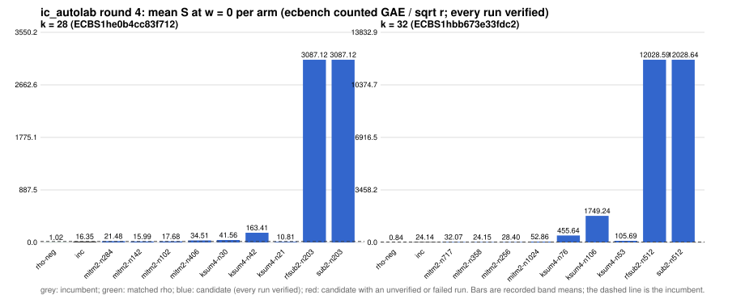

# ic_autolab round 4 (generic track): report

Protocol: [PROTOCOL.md](PROTOCOL.md), frozen 2026-11-04T03:30:01Z at git `bff904254912195ba9f42027279b0db7816c1b3c`; route `local`. Counted GAE only (deterministic, host independent); no wall-time claim; development loop, no validation-gate row. Loop home: [`../`](../README.md); ledger: [`../ledger.json`](../ledger.json).

Claim record: `PCC-20261104-6c0998` (`python3 tools/pcc/pcc.py standing PCC-20261104-6c0998`). Until a signed replay and recompute exist, this round's outcome is an unverified assertion [pcc:unverified].

## Outcome

| k | class | sel | sel / inc at w = 0 [95%] | w = 0.1 | w = 1 | band | S sel (w = 0 / 0.1 / 1) | S inc | S rho-neg | distance sel / rho |
|--:|:--|:--|:--|:--|:--|:--|:--|:--|:--|:--|
| 28 | **improvement** | ksum4-n21 | 0.654 [0.636, 0.672] | 0.611 [0.593, 0.630] | 0.416 [0.399, 0.435] | sel < inc | 10.939 / 11.226 / 13.809 | 16.737 / 18.380 / 33.168 | 1.015 / 1.110 / 1.966 | 10.8x / 10.1x / 7.0x |
| 32 | **no_challenger** | none (best candidate `mitm2-n358`, train S 24.150 / 27.736 / 60.009) | - | - | - | - | - | 24.138 / 26.515 / 47.907 | 0.844 / 0.927 / 1.672 | inc: 28.6x / 28.6x / 28.6x |

Classes follow the protocol's decision rule. Distance to rho is the distance remaining, not a gate. The reasons per size:

- k = 28: compare ops.status = ok, admissible = true; sel / inc = 0.6536 [0.636, 0.672] at w = 0; band: sel < inc; A/A inc-aa / inc interval [1.000, 1.000] contains 1
- k = 32: no_challenger

## Train (development screen, in sample)

### k = 28: session `ECBS1he0b4cc83f712` (run exit 0, verify exit 0, receipt sha256 `e864dd0a6062199aaee28da8dad2c980e9f829092a47be28e4d3f7d240e7b114`)

| arm | family | N | factor base | oracle | runs | verified | S (w = 0 / 0.1 / 1) | reason proposed |
|:--|:--|--:|:--|:--|--:|--:|:--|:--|
| `rho-neg` | rho | - | `-` | `rho.negation` | 16 | 16 | 1.016 / 1.112 / 1.968 | matched reference |
| `inc` | mitm2 | 203 | `prime-projected-abscissa:size=203,scan_cap=3248` | `mitm:negation_folded=1` | 16 | 16 | 16.350 / 17.914 / 31.997 | incumbent |
| `mitm2-n284` | mitm2 | 284 | `prime-projected-abscissa:size=284,scan_cap=4544` | `mitm:negation_folded=1` | 16 | 16 | 21.485 / 22.644 / 33.081 | incumbent neighbourhood: N = 1.4 x 203 |
| `mitm2-n142` | mitm2 | 142 | `prime-projected-abscissa:size=142,scan_cap=2272` | `mitm:negation_folded=1` | 16 | 16 | 15.987 / 18.266 / 38.780 | incumbent neighbourhood: N = 0.7 x 203 |
| `mitm2-n102` | mitm2 | 102 | `prime-projected-abscissa:size=102,scan_cap=1632` | `mitm:negation_folded=1` | 16 | 16 | 17.678 / 20.669 / 47.587 | incumbent neighbourhood: N = 0.5 x 203 |
| `mitm2-n406` | mitm2 | 406 | `prime-projected-abscissa:size=406,scan_cap=6496` | `mitm:negation_folded=1` | 16 | 16 | 34.505 / 35.252 / 41.971 | incumbent neighbourhood: N = 2 x 203 |
| `ksum4-n30` | ksum4 | 30 | `prime-projected-abscissa:size=30,scan_cap=480` | `ksum:m=4` | 16 | 16 | 41.559 / 41.670 / 42.668 | cross-size transfer: ksum4-n12 is the k = 24 incumbent at N / N_a = 0.148 |
| `ksum4-n42` | ksum4 | 42 | `prime-projected-abscissa:size=42,scan_cap=672` | `ksum:m=4` | 16 | 16 | 163.411 / 163.522 / 164.524 | cross-size transfer neighbourhood: N = 1.4 x 30 (ksum4 from k = 24) |
| `ksum4-n21` | ksum4 | 21 | `prime-projected-abscissa:size=21,scan_cap=336` | `ksum:m=4` | 16 | 16 | 10.814 / 11.076 / 13.431 | cross-size transfer neighbourhood: N = 0.7 x 30 (ksum4 from k = 24) |
| `rfsub2-n203` | rfsub2 | 203 | `prime-projected-abscissa:size=203,scan_cap=3248` | `rootfind-subtract:m=2` | 16 | 16 | 3087.121 / 3396.478 / 6180.688 | exploration: family rfsub2 untried at k = 28, N = 1 x N_a |
| `sub2-n203` | sub2 | 203 | `prime-projected-abscissa:size=203,scan_cap=3248` | `subtract` | 16 | 16 | 3087.119 / 3395.718 / 6173.109 | exploration: family sub2 untried at k = 28, N = 1 x N_a |

### k = 32: session `ECBS1hbb673e33fdc2` (run exit 0, verify exit 0, receipt sha256 `0792eae67547acfb35a46ae1b9a432c2bb3801530da545f67f441f9479a14996`)

| arm | family | N | factor base | oracle | runs | verified | S (w = 0 / 0.1 / 1) | reason proposed |
|:--|:--|--:|:--|:--|--:|--:|:--|:--|
| `rho-neg` | rho | - | `-` | `rho.negation` | 16 | 16 | 0.844 / 0.927 / 1.672 | matched reference |
| `inc` | mitm2 | 512 | `prime-projected-abscissa:size=512,scan_cap=8192` | `mitm:negation_folded=1` | 16 | 16 | 24.138 / 26.515 / 47.907 | incumbent |
| `mitm2-n717` | mitm2 | 717 | `prime-projected-abscissa:size=717,scan_cap=11472` | `mitm:negation_folded=1` | 16 | 16 | 32.069 / 33.793 / 49.315 | incumbent neighbourhood: N = 1.4 x 512 |
| `mitm2-n358` | mitm2 | 358 | `prime-projected-abscissa:size=358,scan_cap=5728` | `mitm:negation_folded=1` | 16 | 16 | 24.150 / 27.736 / 60.009 | incumbent neighbourhood: N = 0.7 x 512 |
| `mitm2-n256` | mitm2 | 256 | `prime-projected-abscissa:size=256,scan_cap=4096` | `mitm:negation_folded=1` | 16 | 16 | 28.404 / 33.414 / 78.499 | incumbent neighbourhood: N = 0.5 x 512 |
| `mitm2-n1024` | mitm2 | 1024 | `prime-projected-abscissa:size=1024,scan_cap=16384` | `mitm:negation_folded=1` | 16 | 16 | 52.863 / 54.035 / 64.586 | incumbent neighbourhood: N = 2 x 512 |
| `ksum4-n76` | ksum4 | 76 | `prime-projected-abscissa:size=76,scan_cap=1216` | `ksum:m=4` | 16 | 16 | 455.642 / 455.751 / 456.731 | cross-size transfer: ksum4-n12 is the k = 24 incumbent at N / N_a = 0.148 |
| `ksum4-n106` | ksum4 | 106 | `prime-projected-abscissa:size=106,scan_cap=1696` | `ksum:m=4` | 16 | 16 | 1749.242 / 1749.445 / 1751.274 | cross-size transfer neighbourhood: N = 1.4 x 76 (ksum4 from k = 24) |
| `ksum4-n53` | ksum4 | 53 | `prime-projected-abscissa:size=53,scan_cap=848` | `ksum:m=4` | 16 | 16 | 105.689 / 105.776 / 106.560 | cross-size transfer neighbourhood: N = 0.7 x 76 (ksum4 from k = 24) |
| `rfsub2-n512` | rfsub2 | 512 | `prime-projected-abscissa:size=512,scan_cap=8192` | `rootfind-subtract:m=2` | 16 | 16 | 12028.586 / 13232.542 / 24068.140 | exploration: family rfsub2 untried at k = 32, N = 1 x N_a |
| `sub2-n512` | sub2 | 512 | `prime-projected-abscissa:size=512,scan_cap=8192` | `subtract` | 16 | 16 | 12028.643 / 13231.431 / 24056.523 | exploration: family sub2 untried at k = 32, N = 1 x N_a |

## Selection

- k = 28: challenger `ksum4-n21` (Pareto alternative at w = 1: `ksum4-n21`)
- k = 32: no_challenger  (Pareto alternative at w = 1: `mitm2-n717`)

## Holdout sessions

| k | session | run exit | verify exit | receipt sha256 | levels |
|--:|:--|--:|--:|:--|:--|
| 28 | `ECBS1h4fa56ebd629d` | 0 | 0 | `6b1c0a3f7fc28a45c31c7bb9a197921ee1a4efff121e3eec87243d5396c945bd` | {"verified":480} |

## Ledger after this round

| k | incumbent | since round | S (w = 0 / 0.1 / 1) | distance to rho |
|--:|:--|--:|:--|:--|
| 20 | `ksum3-n11` (`prime-projected-abscissa:size=11,scan_cap=176` + `ksum:m=3`) | 0 | 8.987 / 9.710 / 16.217 | 5.7x / 5.7x / 6.0x |
| 24 | `ksum4-n12` (`prime-projected-abscissa:size=12,scan_cap=192` + `ksum:m=4`) | 2 | 6.985 / 7.514 / 12.271 | 6.0x / 5.9x / 5.6x |
| 28 | `ksum4-n21` (`prime-projected-abscissa:size=21,scan_cap=336` + `ksum:m=4`) | 4 | 10.939 / 11.226 / 13.809 | 10.8x / 10.1x / 7.0x |
| 32 | `mitm2-n512` (`prime-projected-abscissa:size=512,scan_cap=8192` + `mitm:negation_folded=1`) | 0 | 23.310 / 25.520 / 45.410 | 24.7x / 24.6x / 24.3x |

## Evidence and deviations

- ecbench binary sha256: `3fd22853485e388782ac0821295c56f81725fc832fd3610978be8088b5098bca`; `--cpus auto`, allow_busy = true; `verify --replay 8` per session; audit receipts in `analysis/`; sessions in `sessions/` (records in the artifact store when large).
- Route: the local route is an explicitly requested development screen, not the Iso Lab EKS default; counts are deterministic and replayed, wall time is not claimed. No row of this round enters the IC leaderboard or `benchmarks/README.md` (validation gate).
- Train selection is in sample (disclosed); the holdout is fresh (new `target_seed`, excluded exposures). Failed, timed-out and regressing arms are retained above.
