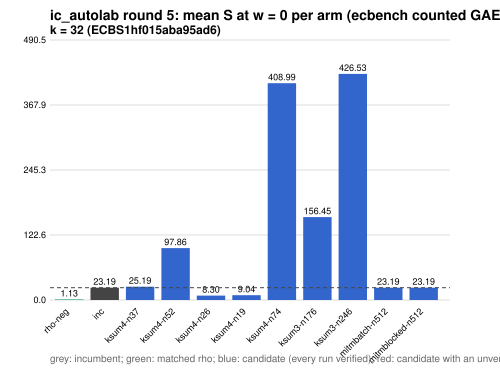

# ic_autolab round 5 (generic track): report

Protocol: [PROTOCOL.md](PROTOCOL.md), frozen 2026-11-04T04:14:21Z at git `fafd6d1ce992609429076251a3d2a97eb847b0bd`; route `local`. Counted GAE only (deterministic, host independent); no wall-time claim; development loop, no validation-gate row. Loop home: [`../`](../README.md); ledger: [`../ledger.json`](../ledger.json).

Claim record: `PCC-20261104-0213f5` (`python3 tools/pcc/pcc.py standing PCC-20261104-0213f5`). Until a signed replay and recompute exist, this round's outcome is an unverified assertion [pcc:unverified].

## Outcome

| k | class | sel | sel / inc at w = 0 [95%] | w = 0.1 | w = 1 | band | S sel (w = 0 / 0.1 / 1) | S inc | S rho-neg | distance sel / rho |
|--:|:--|:--|:--|:--|:--|:--|:--|:--|:--|:--|
| 32 | **improvement** | ksum4-n26 | 0.352 [0.340, 0.363] | 0.341 [0.329, 0.353] | 0.291 [0.276, 0.306] | sel < inc | 8.296 / 8.811 / 13.446 | 23.597 / 25.866 / 46.285 | 0.911 / 1.001 / 1.806 | 9.1x / 8.8x / 7.4x |

Classes follow the protocol's decision rule. Distance to rho is the distance remaining, not a gate. The reasons per size:

- k = 32: compare ops.status = ok, admissible = true; sel / inc = 0.3516 [0.340, 0.363] at w = 0; band: sel < inc; A/A inc-aa / inc interval [1.000, 1.000] contains 1

## Train (development screen, in sample)

### k = 32: session `ECBS1hf015aba95ad6` (run exit 0, verify exit 0, receipt sha256 `f5016f5397959d4d5aff48bc5a9398e850511d76219dd7a1000dc73475700790`)

| arm | family | N | factor base | oracle | runs | verified | S (w = 0 / 0.1 / 1) | reason proposed |
|:--|:--|--:|:--|:--|--:|--:|:--|:--|
| `rho-neg` | rho | - | `-` | `rho.negation` | 16 | 16 | 1.135 / 1.247 / 2.253 | matched reference |
| `inc` | mitm2 | 512 | `prime-projected-abscissa:size=512,scan_cap=8192` | `mitm:negation_folded=1` | 16 | 16 | 23.193 / 25.381 / 45.069 | incumbent |
| `ksum4-n37` | ksum4 | 37 | `prime-projected-abscissa:size=37,scan_cap=592` | `ksum:m=4` | 16 | 16 | 25.186 / 25.370 / 27.034 | cross-size transfer: ksum4 is incumbent at 2 sizes; ln N fitted on log2 r (slope 0.140) and extrapolated |
| `ksum4-n52` | ksum4 | 52 | `prime-projected-abscissa:size=52,scan_cap=832` | `ksum:m=4` | 16 | 16 | 97.863 / 97.959 / 98.821 | cross-size transfer neighbourhood: N = 1.4 x 37 (ksum4 from k = 28) |
| `ksum4-n26` | ksum4 | 26 | `prime-projected-abscissa:size=26,scan_cap=416` | `ksum:m=4` | 16 | 16 | 8.303 / 8.819 / 13.460 | cross-size transfer neighbourhood: N = 0.7 x 37 (ksum4 from k = 28) |
| `ksum4-n19` | ksum4 | 19 | `prime-projected-abscissa:size=19,scan_cap=304` | `ksum:m=4` | 16 | 16 | 9.045 / 10.523 / 23.829 | cross-size transfer neighbourhood: N = 0.5 x 37 (ksum4 from k = 28) |
| `ksum4-n74` | ksum4 | 74 | `prime-projected-abscissa:size=74,scan_cap=1184` | `ksum:m=4` | 16 | 16 | 408.992 / 409.092 / 409.996 | cross-size transfer neighbourhood: N = 2 x 37 (ksum4 from k = 28) |
| `ksum3-n176` | ksum3 | 176 | `prime-projected-abscissa:size=176,scan_cap=2816` | `ksum:m=3` | 16 | 16 | 156.453 / 156.760 / 159.522 | cross-size transfer: ksum3-n11 is the k = 20 incumbent at N / N_a = 0.344 |
| `ksum3-n246` | ksum3 | 246 | `prime-projected-abscissa:size=246,scan_cap=3936` | `ksum:m=3` | 16 | 16 | 426.529 / 427.077 / 432.011 | cross-size transfer neighbourhood: N = 1.4 x 176 (ksum3 from k = 20) |
| `mitmbatch-n512` | mitmbatch | 512 | `prime-projected-abscissa:size=512,scan_cap=8192` | `mitm-prime-batch:m=2` | 16 | 16 | 23.193 / 25.381 / 45.069 | exploration: family mitmbatch untried at k = 32, N = 1 x N_a |
| `mitmblocked-n512` | mitmblocked | 512 | `prime-projected-abscissa:size=512,scan_cap=8192` | `mitm-prime-blocked:m=2` | 16 | 16 | 23.193 / 25.381 / 45.069 | exploration: family mitmblocked untried at k = 32, N = 1 x N_a |

## Selection

- k = 32: challenger `ksum4-n26` (Pareto alternative at w = 1: `ksum4-n26`)

## Holdout sessions

| k | session | run exit | verify exit | receipt sha256 | levels |
|--:|:--|--:|--:|:--|:--|
| 32 | `ECBS1hbc72fda3e97f` | 0 | 0 | `66fa3e9a49eabcfa9b90bc60f28c909b548b10b516c674d8ca73594357a232b6` | {"verified":480} |

## Ledger after this round

| k | incumbent | since round | S (w = 0 / 0.1 / 1) | distance to rho |
|--:|:--|--:|:--|:--|
| 20 | `ksum3-n11` (`prime-projected-abscissa:size=11,scan_cap=176` + `ksum:m=3`) | 0 | 8.987 / 9.710 / 16.217 | 5.7x / 5.7x / 6.0x |
| 24 | `ksum4-n12` (`prime-projected-abscissa:size=12,scan_cap=192` + `ksum:m=4`) | 2 | 6.985 / 7.514 / 12.271 | 6.0x / 5.9x / 5.6x |
| 28 | `ksum4-n21` (`prime-projected-abscissa:size=21,scan_cap=336` + `ksum:m=4`) | 4 | 10.939 / 11.226 / 13.809 | 10.8x / 10.1x / 7.0x |
| 32 | `ksum4-n26` (`prime-projected-abscissa:size=26,scan_cap=416` + `ksum:m=4`) | 5 | 8.296 / 8.811 / 13.446 | 9.1x / 8.8x / 7.4x |

## Evidence and deviations

- ecbench binary sha256: `3fd22853485e388782ac0821295c56f81725fc832fd3610978be8088b5098bca`; `--cpus auto`, allow_busy = true; `verify --replay 8` per session; audit receipts in `analysis/`; sessions in `sessions/` (records in the artifact store when large).
- Route: the local route is an explicitly requested development screen, not the Iso Lab EKS default; counts are deterministic and replayed, wall time is not claimed. No row of this round enters the IC leaderboard or `benchmarks/README.md` (validation gate).
- Train selection is in sample (disclosed); the holdout is fresh (new `target_seed`, excluded exposures). Failed, timed-out and regressing arms are retained above.
