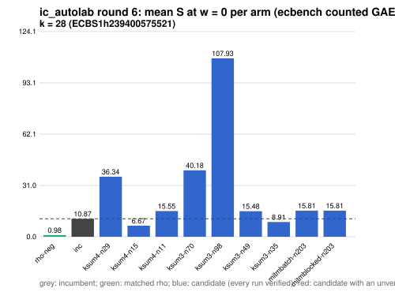

# ic_autolab round 6 (generic track): report

Protocol: [PROTOCOL.md](PROTOCOL.md), frozen 2026-11-04T04:21:45Z at git `3164ea861251556ac54c3f26da7defdd4a9d7db9`; route `local`. Counted GAE only (deterministic, host independent); no wall-time claim; development loop, no validation-gate row. Loop home: [`../`](../README.md); ledger: [`../ledger.json`](../ledger.json).

Claim record: `PCC-20261104-249a57` (`python3 tools/pcc/pcc.py standing PCC-20261104-249a57`). Until a signed replay and recompute exist, this round's outcome is an unverified assertion [pcc:unverified].

## Outcome

| k | class | sel | sel / inc at w = 0 [95%] | w = 0.1 | w = 1 | band | S sel (w = 0 / 0.1 / 1) | S inc | S rho-neg | distance sel / rho |
|--:|:--|:--|:--|:--|:--|:--|:--|:--|:--|:--|
| 28 | **null** | ksum4-n15 | 0.616 [0.593, 0.641] | 0.675 [0.648, 0.703] | 1.092 [1.039, 1.149] | unresolved inside the band | 6.731 / 7.559 / 15.017 | 10.919 / 11.202 / 13.746 | 1.042 / 1.139 / 2.019 | 6.5x / 6.6x / 7.4x |

Classes follow the protocol's decision rule. Distance to rho is the distance remaining, not a gate. The reasons per size:

- k = 28: compare ops.status = ok, admissible = true; sel / inc = 0.6164 [0.593, 0.641] at w = 0; band: unresolved inside the band; A/A inc-aa / inc interval [1.000, 1.000] contains 1

## Train (development screen, in sample)

### k = 28: session `ECBS1h239400575521` (run exit 0, verify exit 0, receipt sha256 `2cbf174ad639bad48305c339850443067356dc2e7c87e69284fa875340cf69cd`)

| arm | family | N | factor base | oracle | runs | verified | S (w = 0 / 0.1 / 1) | reason proposed |
|:--|:--|--:|:--|:--|--:|--:|:--|:--|
| `rho-neg` | rho | - | `-` | `rho.negation` | 16 | 16 | 0.983 / 1.075 / 1.901 | matched reference |
| `inc` | ksum4 | 21 | `prime-projected-abscissa:size=21,scan_cap=336` | `ksum:m=4` | 16 | 16 | 10.869 / 11.141 / 13.595 | incumbent |
| `ksum4-n29` | ksum4 | 29 | `prime-projected-abscissa:size=29,scan_cap=464` | `ksum:m=4` | 16 | 16 | 36.337 / 36.473 / 37.698 | incumbent neighbourhood: N = 1.4 x 21 |
| `ksum4-n15` | ksum4 | 15 | `prime-projected-abscissa:size=15,scan_cap=240` | `ksum:m=4` | 16 | 16 | 6.665 / 7.484 / 14.852 | incumbent neighbourhood: N = 0.7 x 21 |
| `ksum4-n11` | ksum4 | 11 | `prime-projected-abscissa:size=11,scan_cap=176` | `ksum:m=4` | 16 | 16 | 15.548 / 18.450 / 44.571 | incumbent neighbourhood: N = 0.5 x 21 |
| `ksum3-n70` | ksum3 | 70 | `prime-projected-abscissa:size=70,scan_cap=1120` | `ksum:m=3` | 16 | 16 | 40.181 / 40.460 / 42.964 | cross-size transfer: ksum3-n11 is the k = 20 incumbent at N / N_a = 0.344 |
| `ksum3-n98` | ksum3 | 98 | `prime-projected-abscissa:size=98,scan_cap=1568` | `ksum:m=3` | 16 | 16 | 107.932 / 108.211 / 110.729 | cross-size transfer neighbourhood: N = 1.4 x 70 (ksum3 from k = 20) |
| `ksum3-n49` | ksum3 | 49 | `prime-projected-abscissa:size=49,scan_cap=784` | `ksum:m=3` | 16 | 16 | 15.478 / 15.891 / 19.607 | cross-size transfer neighbourhood: N = 0.7 x 70 (ksum3 from k = 20) |
| `ksum3-n35` | ksum3 | 35 | `prime-projected-abscissa:size=35,scan_cap=560` | `ksum:m=3` | 16 | 16 | 8.906 / 9.670 / 16.553 | cross-size transfer neighbourhood: N = 0.5 x 70 (ksum3 from k = 20) |
| `mitmbatch-n203` | mitmbatch | 203 | `prime-projected-abscissa:size=203,scan_cap=3248` | `mitm-prime-batch:m=2` | 16 | 16 | 15.813 / 17.272 / 30.399 | exploration: family mitmbatch untried at k = 28, N = 1 x N_a |
| `mitmblocked-n203` | mitmblocked | 203 | `prime-projected-abscissa:size=203,scan_cap=3248` | `mitm-prime-blocked:m=2` | 16 | 16 | 15.813 / 17.272 / 30.399 | exploration: family mitmblocked untried at k = 28, N = 1 x N_a |

## Selection

- k = 28: challenger `ksum4-n15` (Pareto alternative at w = 1: `ksum4-n15`)

## Holdout sessions

| k | session | run exit | verify exit | receipt sha256 | levels |
|--:|:--|--:|--:|:--|:--|
| 28 | `ECBS1h584855d3a3bb` | 0 | 0 | `d191bbb32a352406c1328260b9c0e8d98f18af16814df170d3906db136aa22f9` | {"verified":480} |

## Ledger after this round

| k | incumbent | since round | S (w = 0 / 0.1 / 1) | distance to rho |
|--:|:--|--:|:--|:--|
| 20 | `ksum3-n11` (`prime-projected-abscissa:size=11,scan_cap=176` + `ksum:m=3`) | 0 | 8.987 / 9.710 / 16.217 | 5.7x / 5.7x / 6.0x |
| 24 | `ksum4-n12` (`prime-projected-abscissa:size=12,scan_cap=192` + `ksum:m=4`) | 2 | 6.985 / 7.514 / 12.271 | 6.0x / 5.9x / 5.6x |
| 28 | `ksum4-n21` (`prime-projected-abscissa:size=21,scan_cap=336` + `ksum:m=4`) | 4 | 10.939 / 11.226 / 13.809 | 10.8x / 10.1x / 7.0x |
| 32 | `ksum4-n26` (`prime-projected-abscissa:size=26,scan_cap=416` + `ksum:m=4`) | 5 | 8.296 / 8.811 / 13.446 | 9.1x / 8.8x / 7.4x |

## Evidence and deviations

- ecbench binary sha256: `3fd22853485e388782ac0821295c56f81725fc832fd3610978be8088b5098bca`; `--cpus auto`, allow_busy = true; `verify --replay 8` per session; audit receipts in `analysis/`; sessions in `sessions/` (records in the artifact store when large).
- Route: the local route is an explicitly requested development screen, not the Iso Lab EKS default; counts are deterministic and replayed, wall time is not claimed. No row of this round enters the IC leaderboard or `benchmarks/README.md` (validation gate).
- Train selection is in sample (disclosed); the holdout is fresh (new `target_seed`, excluded exposures). Failed, timed-out and regressing arms are retained above.
