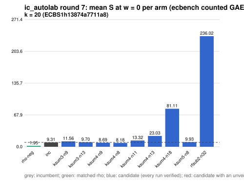

# ic_autolab round 7 (generic track): report

Protocol: [PROTOCOL.md](PROTOCOL.md), frozen 2026-11-04T04:23:34Z at git `62c2fb6bb27e715afe279b32539ea0a7494d193a`; route `local`. Counted GAE only (deterministic, host independent); no wall-time claim; development loop, no validation-gate row. Loop home: [`../`](../README.md); ledger: [`../ledger.json`](../ledger.json).

Claim record: `PCC-20261104-15a1d6` (`python3 tools/pcc/pcc.py standing PCC-20261104-15a1d6`). Until a signed replay and recompute exist, this round's outcome is an unverified assertion [pcc:unverified].

## Outcome

| k | class | sel | sel / inc at w = 0 [95%] | w = 0.1 | w = 1 | band | S sel (w = 0 / 0.1 / 1) | S inc | S rho-neg | distance sel / rho |
|--:|:--|:--|:--|:--|:--|:--|:--|:--|:--|:--|
| 20 | **regression** | ksum4-n8 | 1.026 [0.966, 1.090] | 1.026 [0.962, 1.094] | 1.025 [0.941, 1.115] | inc < sel | 8.563 / 9.212 / 15.053 | 8.348 / 8.982 / 14.691 | 1.796 / 1.932 / 3.156 | 4.8x / 4.8x / 4.8x |

Classes follow the protocol's decision rule. Distance to rho is the distance remaining, not a gate. The reasons per size:

- k = 20: compare ops.status = ok, admissible = true; sel / inc = 1.0258 [0.966, 1.090] at w = 0; band: inc < sel; A/A inc-aa / inc interval [1.000, 1.000] contains 1

## Train (development screen, in sample)

### k = 20: session `ECBS1h13874a7711a8` (run exit 0, verify exit 0, receipt sha256 `9fc538ecb45b3525b3525a1d7d625d3a07d1e953f0e2a515f573538f475d3f18`)

| arm | family | N | factor base | oracle | runs | verified | S (w = 0 / 0.1 / 1) | reason proposed |
|:--|:--|--:|:--|:--|--:|--:|:--|:--|
| `rho-neg` | rho | - | `-` | `rho.negation` | 16 | 16 | 1.947 / 2.098 / 3.454 | matched reference |
| `inc` | ksum3 | 11 | `prime-projected-abscissa:size=11,scan_cap=176` | `ksum:m=3` | 16 | 16 | 9.311 / 10.089 / 17.089 | incumbent |
| `ksum3-n9` | ksum3 | 9 | `prime-projected-abscissa:size=9,scan_cap=144` | `ksum:m=3` | 16 | 16 | 11.562 / 12.817 / 24.115 | incumbent neighbourhood: N = 0.85 x 11 |
| `ksum3-n13` | ksum3 | 13 | `prime-projected-abscissa:size=13,scan_cap=208` | `ksum:m=3` | 16 | 16 | 9.703 / 10.336 / 16.028 | incumbent neighbourhood: N = 1.2 x 11 |
| `ksum4-n9` | ksum4 | 9 | `prime-projected-abscissa:size=9,scan_cap=144` | `ksum:m=4` | 16 | 16 | 8.690 / 9.117 / 12.961 | cross-size transfer: ksum4 is incumbent at 3 sizes; ln N fitted on log2 r (slope 0.097) and extrapolated |
| `ksum4-n8` | ksum4 | 8 | `prime-projected-abscissa:size=8,scan_cap=128` | `ksum:m=4` | 16 | 16 | 8.184 / 8.774 / 14.079 | cross-size transfer neighbourhood: N = 0.85 x 9 (ksum4 from k = 24) |
| `ksum4-n11` | ksum4 | 11 | `prime-projected-abscissa:size=11,scan_cap=176` | `ksum:m=4` | 16 | 16 | 13.319 / 13.605 / 16.170 | cross-size transfer neighbourhood: N = 1.2 x 9 (ksum4 from k = 24) |
| `ksum4-n13` | ksum4 | 13 | `prime-projected-abscissa:size=13,scan_cap=208` | `ksum:m=4` | 16 | 16 | 23.028 / 23.275 / 25.491 | cross-size transfer neighbourhood: N = 1.4 x 9 (ksum4 from k = 24) |
| `ksum4-n18` | ksum4 | 18 | `prime-projected-abscissa:size=18,scan_cap=288` | `ksum:m=4` | 16 | 16 | 81.114 / 81.393 / 83.910 | cross-size transfer neighbourhood: N = 2 x 9 (ksum4 from k = 24) |
| `ksum5-n8` | ksum5 | 8 | `prime-projected-abscissa:size=8,scan_cap=128` | `ksum:m=5` | 16 | 16 | 9.930 / 10.408 / 14.713 | exploration: family ksum5 untried at k = 20, N = 0.08 x N_a |
| `rfsub2-n32` | rfsub2 | 32 | `prime-projected-abscissa:size=32,scan_cap=512` | `rootfind-subtract:m=2` | 16 | 16 | 236.022 / 259.586 / 471.660 | exploration: family rfsub2 untried at k = 20, N = 1 x N_a |

## Selection

- k = 20: challenger `ksum4-n8` (Pareto alternative at w = 1: `ksum4-n9`)

## Holdout sessions

| k | session | run exit | verify exit | receipt sha256 | levels |
|--:|:--|--:|--:|:--|:--|
| 20 | `ECBS1ha3ed7f4ce6e6` | 0 | 0 | `c5bc567be380c0c0e77d8e31f6b13c752dfeb0ec3d805ff6aca41959635cae1f` | {"verified":480} |

## Ledger after this round

| k | incumbent | since round | S (w = 0 / 0.1 / 1) | distance to rho |
|--:|:--|--:|:--|:--|
| 20 | `ksum3-n11` (`prime-projected-abscissa:size=11,scan_cap=176` + `ksum:m=3`) | 0 | 8.987 / 9.710 / 16.217 | 5.7x / 5.7x / 6.0x |
| 24 | `ksum4-n12` (`prime-projected-abscissa:size=12,scan_cap=192` + `ksum:m=4`) | 2 | 6.985 / 7.514 / 12.271 | 6.0x / 5.9x / 5.6x |
| 28 | `ksum4-n21` (`prime-projected-abscissa:size=21,scan_cap=336` + `ksum:m=4`) | 4 | 10.939 / 11.226 / 13.809 | 10.8x / 10.1x / 7.0x |
| 32 | `ksum4-n26` (`prime-projected-abscissa:size=26,scan_cap=416` + `ksum:m=4`) | 5 | 8.296 / 8.811 / 13.446 | 9.1x / 8.8x / 7.4x |

## Evidence and deviations

- ecbench binary sha256: `3fd22853485e388782ac0821295c56f81725fc832fd3610978be8088b5098bca`; `--cpus auto`, allow_busy = true; `verify --replay 8` per session; audit receipts in `analysis/`; sessions in `sessions/` (records in the artifact store when large).
- Route: the local route is an explicitly requested development screen, not the Iso Lab EKS default; counts are deterministic and replayed, wall time is not claimed. No row of this round enters the IC leaderboard or `benchmarks/README.md` (validation gate).
- Train selection is in sample (disclosed); the holdout is fresh (new `target_seed`, excluded exposures). Failed, timed-out and regressing arms are retained above.
