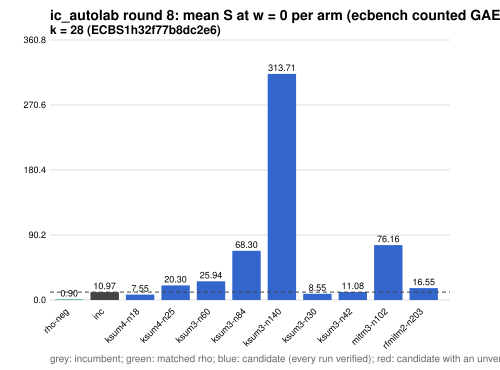

# ic_autolab round 8 (generic track): report

Protocol: [PROTOCOL.md](PROTOCOL.md), frozen 2026-11-04T04:25:45Z at git `ebe86a2d6dbe856a7e708256cd72450f2b0c5192`; route `local`. Counted GAE only (deterministic, host independent); no wall-time claim; development loop, no validation-gate row. Loop home: [`../`](../README.md); ledger: [`../ledger.json`](../ledger.json).

Claim record: `PCC-20261104-ff48c0` (`python3 tools/pcc/pcc.py standing PCC-20261104-ff48c0`). Until a signed replay and recompute exist, this round's outcome is an unverified assertion [pcc:unverified].

## Outcome

| k | class | sel | sel / inc at w = 0 [95%] | w = 0.1 | w = 1 | band | S sel (w = 0 / 0.1 / 1) | S inc | S rho-neg | distance sel / rho |
|--:|:--|:--|:--|:--|:--|:--|:--|:--|:--|:--|
| 28 | **improvement** | ksum4-n18 | 0.678 [0.666, 0.691] | 0.702 [0.687, 0.716] | 0.869 [0.841, 0.898] | sel < inc | 7.445 / 7.910 / 12.100 | 10.980 / 11.274 / 13.921 | 0.956 / 1.045 / 1.848 | 7.8x / 7.6x / 6.5x |

Classes follow the protocol's decision rule. Distance to rho is the distance remaining, not a gate. The reasons per size:

- k = 28: compare ops.status = ok, admissible = true; sel / inc = 0.6781 [0.666, 0.691] at w = 0; band: sel < inc; A/A inc-aa / inc interval [1.000, 1.000] contains 1

## Train (development screen, in sample)

### k = 28: session `ECBS1h32f77b8dc2e6` (run exit 0, verify exit 0, receipt sha256 `5ea2cf014199d5fda35a3c86bc48f4bd83e1025d43c912b973fe021b5bcaa4b2`)

| arm | family | N | factor base | oracle | runs | verified | S (w = 0 / 0.1 / 1) | reason proposed |
|:--|:--|--:|:--|:--|--:|--:|:--|:--|
| `rho-neg` | rho | - | `-` | `rho.negation` | 32 | 32 | 0.897 / 0.981 / 1.730 | matched reference |
| `inc` | ksum4 | 21 | `prime-projected-abscissa:size=21,scan_cap=336` | `ksum:m=4` | 32 | 32 | 10.972 / 11.266 / 13.912 | incumbent |
| `ksum4-n18` | ksum4 | 18 | `prime-projected-abscissa:size=18,scan_cap=288` | `ksum:m=4` | 32 | 32 | 7.548 / 8.035 / 12.417 | incumbent neighbourhood: N = 0.85 x 21 |
| `ksum4-n25` | ksum4 | 25 | `prime-projected-abscissa:size=25,scan_cap=400` | `ksum:m=4` | 32 | 32 | 20.301 / 20.483 / 22.122 | incumbent neighbourhood: N = 1.2 x 21 |
| `ksum3-n60` | ksum3 | 60 | `prime-projected-abscissa:size=60,scan_cap=960` | `ksum:m=3` | 32 | 32 | 25.936 / 26.226 / 28.837 | cross-size transfer neighbourhood: N = 0.85 x 70 (ksum3 from k = 20) |
| `ksum3-n84` | ksum3 | 84 | `prime-projected-abscissa:size=84,scan_cap=1344` | `ksum:m=3` | 32 | 32 | 68.298 / 68.549 / 70.802 | cross-size transfer neighbourhood: N = 1.2 x 70 (ksum3 from k = 20) |
| `ksum3-n140` | ksum3 | 140 | `prime-projected-abscissa:size=140,scan_cap=2240` | `ksum:m=3` | 32 | 32 | 313.708 / 314.199 / 318.622 | cross-size transfer neighbourhood: N = 2 x 70 (ksum3 from k = 20) |
| `ksum3-n30` | ksum3 | 30 | `prime-projected-abscissa:size=30,scan_cap=480` | `ksum:m=3` | 32 | 32 | 8.550 / 9.586 / 18.909 | alternative ksum3 (best S(0) 8.906 at N = 35): N = 0.85 x 35 |
| `ksum3-n42` | ksum3 | 42 | `prime-projected-abscissa:size=42,scan_cap=672` | `ksum:m=3` | 32 | 32 | 11.082 / 11.591 / 16.166 | alternative ksum3 (best S(0) 8.906 at N = 35): N = 1.2 x 35 |
| `mitm3-n102` | mitm3 | 102 | `prime-projected-abscissa:size=102,scan_cap=1632` | `mitm:m=3,negation_folded=1` | 32 | 32 | 76.155 / 83.702 / 151.618 | exploration: family mitm3 untried at k = 28, N = 0.5 x N_a |
| `rfmitm2-n203` | rfmitm2 | 203 | `prime-projected-abscissa:size=203,scan_cap=3248` | `rootfind-mitm:m=2` | 32 | 32 | 16.550 / 18.159 / 32.637 | exploration: family rfmitm2 untried at k = 28, N = 1 x N_a |

## Selection

- k = 28: challenger `ksum4-n18` (Pareto alternative at w = 1: `ksum4-n18`)

## Holdout sessions

| k | session | run exit | verify exit | receipt sha256 | levels |
|--:|:--|--:|--:|:--|:--|
| 28 | `ECBS1hc8e87821dc40` | 0 | 0 | `216709a0d05d32769a88a12df2873aee9ec4b2b94dce51e174bd721710ae2efc` | {"verified":480} |

## Ledger after this round

| k | incumbent | since round | S (w = 0 / 0.1 / 1) | distance to rho |
|--:|:--|--:|:--|:--|
| 20 | `ksum3-n11` (`prime-projected-abscissa:size=11,scan_cap=176` + `ksum:m=3`) | 0 | 8.987 / 9.710 / 16.217 | 5.7x / 5.7x / 6.0x |
| 24 | `ksum4-n12` (`prime-projected-abscissa:size=12,scan_cap=192` + `ksum:m=4`) | 2 | 6.985 / 7.514 / 12.271 | 6.0x / 5.9x / 5.6x |
| 28 | `ksum4-n18` (`prime-projected-abscissa:size=18,scan_cap=288` + `ksum:m=4`) | 8 | 7.445 / 7.910 / 12.100 | 7.8x / 7.6x / 6.5x |
| 32 | `ksum4-n26` (`prime-projected-abscissa:size=26,scan_cap=416` + `ksum:m=4`) | 5 | 8.296 / 8.811 / 13.446 | 9.1x / 8.8x / 7.4x |

## Evidence and deviations

- ecbench binary sha256: `3fd22853485e388782ac0821295c56f81725fc832fd3610978be8088b5098bca`; `--cpus auto`, allow_busy = true; `verify --replay 8` per session; audit receipts in `analysis/`; sessions in `sessions/` (records in the artifact store when large).
- Route: the local route is an explicitly requested development screen, not the Iso Lab EKS default; counts are deterministic and replayed, wall time is not claimed. No row of this round enters the IC leaderboard or `benchmarks/README.md` (validation gate).
- Train selection is in sample (disclosed); the holdout is fresh (new `target_seed`, excluded exposures). Failed, timed-out and regressing arms are retained above.
