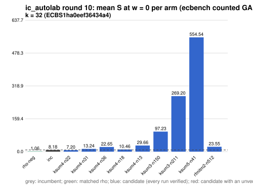

# ic_autolab round 10 (generic track): report

Protocol: [PROTOCOL.md](PROTOCOL.md), frozen 2026-11-04T04:28:44Z at git `bb4c6c0ef164288d4417e7e70011c727804483f0`; route `local`. Counted GAE only (deterministic, host independent); no wall-time claim; development loop, no validation-gate row. Loop home: [`../`](../README.md); ledger: [`../ledger.json`](../ledger.json).

Claim record: `PCC-20261104-87cbc0` (`python3 tools/pcc/pcc.py standing PCC-20261104-87cbc0`). Until a signed replay and recompute exist, this round's outcome is an unverified assertion [pcc:unverified].

## Outcome

| k | class | sel | sel / inc at w = 0 [95%] | w = 0.1 | w = 1 | band | S sel (w = 0 / 0.1 / 1) | S inc | S rho-neg | distance sel / rho |
|--:|:--|:--|:--|:--|:--|:--|:--|:--|:--|:--|
| 32 | **null** | ksum4-n22 | 0.889 [0.869, 0.910] | 0.937 [0.914, 0.961] | 1.202 [1.163, 1.242] | unresolved inside the band | 7.493 / 8.408 / 16.638 | 8.430 / 8.971 / 13.845 | 0.988 / 1.085 / 1.959 | 7.6x / 7.8x / 8.5x |

Classes follow the protocol's decision rule. Distance to rho is the distance remaining, not a gate. The reasons per size:

- k = 32: compare ops.status = ok, admissible = true; sel / inc = 0.8889 [0.869, 0.910] at w = 0; band: unresolved inside the band; A/A inc-aa / inc interval [1.000, 1.000] contains 1

## Train (development screen, in sample)

### k = 32: session `ECBS1ha0eef36434a4` (run exit 0, verify exit 0, receipt sha256 `d9d7b916157de7637f070e5a9fc2383d31ef111c5016a3b24ecfc27a3579e774`)

| arm | family | N | factor base | oracle | runs | verified | S (w = 0 / 0.1 / 1) | reason proposed |
|:--|:--|--:|:--|:--|--:|--:|:--|:--|
| `rho-neg` | rho | - | `-` | `rho.negation` | 32 | 32 | 1.065 / 1.170 / 2.113 | matched reference |
| `inc` | ksum4 | 26 | `prime-projected-abscissa:size=26,scan_cap=416` | `ksum:m=4` | 32 | 32 | 8.179 / 8.671 / 13.096 | incumbent |
| `ksum4-n22` | ksum4 | 22 | `prime-projected-abscissa:size=22,scan_cap=352` | `ksum:m=4` | 32 | 32 | 7.196 / 8.052 / 15.751 | incumbent neighbourhood: N = 0.85 x 26 |
| `ksum4-n31` | ksum4 | 31 | `prime-projected-abscissa:size=31,scan_cap=496` | `ksum:m=4` | 32 | 32 | 13.241 / 13.539 / 16.224 | incumbent neighbourhood: N = 1.2 x 26 |
| `ksum4-n36` | ksum4 | 36 | `prime-projected-abscissa:size=36,scan_cap=576` | `ksum:m=4` | 32 | 32 | 22.647 / 22.840 / 24.577 | incumbent neighbourhood: N = 1.4 x 26 |
| `ksum4-n18` | ksum4 | 18 | `prime-projected-abscissa:size=18,scan_cap=288` | `ksum:m=4` | 32 | 32 | 10.459 / 12.282 / 28.691 | incumbent neighbourhood: N = 0.7 x 26 |
| `ksum4-n13` | ksum4 | 13 | `prime-projected-abscissa:size=13,scan_cap=208` | `ksum:m=4` | 32 | 32 | 29.657 / 35.500 / 88.084 | incumbent neighbourhood: N = 0.5 x 26 |
| `ksum3-n150` | ksum3 | 150 | `prime-projected-abscissa:size=150,scan_cap=2400` | `ksum:m=3` | 32 | 32 | 97.229 / 97.511 / 100.050 | cross-size transfer neighbourhood: N = 0.85 x 176 (ksum3 from k = 20) |
| `ksum3-n211` | ksum3 | 211 | `prime-projected-abscissa:size=211,scan_cap=3376` | `ksum:m=3` | 32 | 32 | 269.196 / 269.574 / 272.973 | cross-size transfer neighbourhood: N = 1.2 x 176 (ksum3 from k = 20) |
| `ksum5-n41` | ksum5 | 41 | `prime-projected-abscissa:size=41,scan_cap=656` | `ksum:m=5` | 32 | 32 | 554.538 / 554.577 / 554.925 | exploration: family ksum5 untried at k = 32, N = 0.08 x N_a |
| `rfmitm2-n512` | rfmitm2 | 512 | `prime-projected-abscissa:size=512,scan_cap=8192` | `rootfind-mitm:m=2` | 32 | 32 | 23.548 / 25.807 / 46.136 | exploration: family rfmitm2 untried at k = 32, N = 1 x N_a |

## Selection

- k = 32: challenger `ksum4-n22` (Pareto alternative at w = 1: `ksum4-n22`)

## Holdout sessions

| k | session | run exit | verify exit | receipt sha256 | levels |
|--:|:--|--:|--:|:--|:--|
| 32 | `ECBS1h572a148f6fbf` | 0 | 0 | `a07ad64e6efb8d2f763433a834bbaf95ca7b24e46b006d70beca747c797f39d7` | {"verified":480} |

## Ledger after this round

| k | incumbent | since round | S (w = 0 / 0.1 / 1) | distance to rho |
|--:|:--|--:|:--|:--|
| 20 | `ksum3-n11` (`prime-projected-abscissa:size=11,scan_cap=176` + `ksum:m=3`) | 0 | 8.987 / 9.710 / 16.217 | 5.7x / 5.7x / 6.0x |
| 24 | `ksum4-n12` (`prime-projected-abscissa:size=12,scan_cap=192` + `ksum:m=4`) | 2 | 6.985 / 7.514 / 12.271 | 6.0x / 5.9x / 5.6x |
| 28 | `ksum4-n18` (`prime-projected-abscissa:size=18,scan_cap=288` + `ksum:m=4`) | 8 | 7.445 / 7.910 / 12.100 | 7.8x / 7.6x / 6.5x |
| 32 | `ksum4-n26` (`prime-projected-abscissa:size=26,scan_cap=416` + `ksum:m=4`) | 5 | 8.296 / 8.811 / 13.446 | 9.1x / 8.8x / 7.4x |

## Evidence and deviations

- ecbench binary sha256: `3fd22853485e388782ac0821295c56f81725fc832fd3610978be8088b5098bca`; `--cpus auto`, allow_busy = true; `verify --replay 8` per session; audit receipts in `analysis/`; sessions in `sessions/` (records in the artifact store when large).
- Route: the local route is an explicitly requested development screen, not the Iso Lab EKS default; counts are deterministic and replayed, wall time is not claimed. No row of this round enters the IC leaderboard or `benchmarks/README.md` (validation gate).
- Train selection is in sample (disclosed); the holdout is fresh (new `target_seed`, excluded exposures). Failed, timed-out and regressing arms are retained above.
