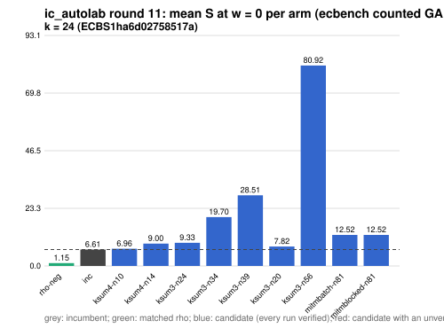

# ic_autolab round 11 (generic track): report

Protocol: [PROTOCOL.md](PROTOCOL.md), frozen 2026-11-04T04:37:51Z at git `2c0d54ecc8eac10981bfa1d15e8cf3245942354c`; route `local`. Counted GAE only (deterministic, host independent); no wall-time claim; development loop, no validation-gate row. Loop home: [`../`](../README.md); ledger: [`../ledger.json`](../ledger.json).

Claim record: `PCC-20261104-f74cbc` (`python3 tools/pcc/pcc.py standing PCC-20261104-f74cbc`). Until a signed replay and recompute exist, this round's outcome is an unverified assertion [pcc:unverified].

## Outcome

| k | class | sel | sel / inc at w = 0 [95%] | w = 0.1 | w = 1 | band | S sel (w = 0 / 0.1 / 1) | S inc | S rho-neg | distance sel / rho |
|--:|:--|:--|:--|:--|:--|:--|:--|:--|:--|:--|
| 24 | **no_challenger** | none (best candidate `ksum4-n10`, train S 6.959 / 7.815 / 15.519) | - | - | - | - | - | 6.607 / 7.064 / 11.171 | 1.147 / 1.250 / 2.177 | inc: 5.8x / 5.7x / 5.1x |

Classes follow the protocol's decision rule. Distance to rho is the distance remaining, not a gate. The reasons per size:

- k = 24: no_challenger

## Train (development screen, in sample)

### k = 24: session `ECBS1ha6d02758517a` (run exit 0, verify exit 0, receipt sha256 `30dc04a1043b1f275910beb71735126c68a8e4cfb6e01b79101c375b5b9af890`)

| arm | family | N | factor base | oracle | runs | verified | S (w = 0 / 0.1 / 1) | reason proposed |
|:--|:--|--:|:--|:--|--:|--:|:--|:--|
| `rho-neg` | rho | - | `-` | `rho.negation` | 32 | 32 | 1.147 / 1.250 / 2.177 | matched reference |
| `inc` | ksum4 | 12 | `prime-projected-abscissa:size=12,scan_cap=192` | `ksum:m=4` | 32 | 32 | 6.607 / 7.064 / 11.171 | incumbent |
| `ksum4-n10` | ksum4 | 10 | `prime-projected-abscissa:size=10,scan_cap=160` | `ksum:m=4` | 32 | 32 | 6.959 / 7.815 / 15.519 | incumbent neighbourhood: N = 0.85 x 12 |
| `ksum4-n14` | ksum4 | 14 | `prime-projected-abscissa:size=14,scan_cap=224` | `ksum:m=4` | 32 | 32 | 9.003 / 9.308 / 12.050 | incumbent neighbourhood: N = 1.2 x 12 |
| `ksum3-n24` | ksum3 | 24 | `prime-projected-abscissa:size=24,scan_cap=384` | `ksum:m=3` | 32 | 32 | 9.334 / 9.812 / 14.117 | cross-size transfer neighbourhood: N = 0.85 x 28 (ksum3 from k = 20) |
| `ksum3-n34` | ksum3 | 34 | `prime-projected-abscissa:size=34,scan_cap=544` | `ksum:m=3` | 32 | 32 | 19.705 / 20.012 / 22.772 | cross-size transfer neighbourhood: N = 1.2 x 28 (ksum3 from k = 20) |
| `ksum3-n39` | ksum3 | 39 | `prime-projected-abscissa:size=39,scan_cap=624` | `ksum:m=3` | 32 | 32 | 28.511 / 28.784 / 31.242 | cross-size transfer neighbourhood: N = 1.4 x 28 (ksum3 from k = 20) |
| `ksum3-n20` | ksum3 | 20 | `prime-projected-abscissa:size=20,scan_cap=320` | `ksum:m=3` | 32 | 32 | 7.824 / 8.494 / 14.517 | cross-size transfer neighbourhood: N = 0.7 x 28 (ksum3 from k = 20) |
| `ksum3-n56` | ksum3 | 56 | `prime-projected-abscissa:size=56,scan_cap=896` | `ksum:m=3` | 32 | 32 | 80.916 / 81.255 / 84.302 | cross-size transfer neighbourhood: N = 2 x 28 (ksum3 from k = 20) |
| `mitmbatch-n81` | mitmbatch | 81 | `prime-projected-abscissa:size=81,scan_cap=1296` | `mitm-prime-batch:m=2` | 32 | 32 | 12.517 / 13.628 / 23.626 | exploration: family mitmbatch untried at k = 24, N = 1 x N_a |
| `mitmblocked-n81` | mitmblocked | 81 | `prime-projected-abscissa:size=81,scan_cap=1296` | `mitm-prime-blocked:m=2` | 32 | 32 | 12.517 / 13.628 / 23.626 | exploration: family mitmblocked untried at k = 24, N = 1 x N_a |

## Selection

- k = 24: no_challenger  (Pareto alternative at w = 1: `ksum4-n14`)

## Ledger after this round

| k | incumbent | since round | S (w = 0 / 0.1 / 1) | distance to rho |
|--:|:--|--:|:--|:--|
| 20 | `ksum3-n11` (`prime-projected-abscissa:size=11,scan_cap=176` + `ksum:m=3`) | 0 | 8.987 / 9.710 / 16.217 | 5.7x / 5.7x / 6.0x |
| 24 | `ksum4-n12` (`prime-projected-abscissa:size=12,scan_cap=192` + `ksum:m=4`) | 2 | 6.985 / 7.514 / 12.271 | 6.0x / 5.9x / 5.6x |
| 28 | `ksum4-n18` (`prime-projected-abscissa:size=18,scan_cap=288` + `ksum:m=4`) | 8 | 7.445 / 7.910 / 12.100 | 7.8x / 7.6x / 6.5x |
| 32 | `ksum4-n26` (`prime-projected-abscissa:size=26,scan_cap=416` + `ksum:m=4`) | 5 | 8.296 / 8.811 / 13.446 | 9.1x / 8.8x / 7.4x |

## Evidence and deviations

- ecbench binary sha256: `3fd22853485e388782ac0821295c56f81725fc832fd3610978be8088b5098bca`; `--cpus auto`, allow_busy = true; `verify --replay 8` per session; audit receipts in `analysis/`; sessions in `sessions/` (records in the artifact store when large).
- Route: the local route is an explicitly requested development screen, not the Iso Lab EKS default; counts are deterministic and replayed, wall time is not claimed. No row of this round enters the IC leaderboard or `benchmarks/README.md` (validation gate).
- Train selection is in sample (disclosed); the holdout is fresh (new `target_seed`, excluded exposures). Failed, timed-out and regressing arms are retained above.
