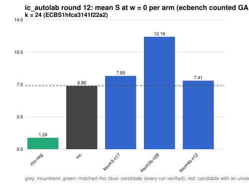

# ic_autolab round 12 (generic track): report

Protocol: [PROTOCOL.md](PROTOCOL.md), frozen 2026-11-04T04:45:38Z at git `fdeed51f64bdb7c43a639fdbef55d3ffeebbcdd6`; route `local`. Counted GAE only (deterministic, host independent); no wall-time claim; development loop, no validation-gate row. Loop home: [`../`](../README.md); ledger: [`../ledger.json`](../ledger.json).

Claim record: `PCC-20261104-4afdff` (`python3 tools/pcc/pcc.py standing PCC-20261104-4afdff`). Until a signed replay and recompute exist, this round's outcome is an unverified assertion [pcc:unverified].

## Outcome

| k | class | sel | sel / inc at w = 0 [95%] | w = 0.1 | w = 1 | band | S sel (w = 0 / 0.1 / 1) | S inc | S rho-neg | distance sel / rho |
|--:|:--|:--|:--|:--|:--|:--|:--|:--|:--|:--|
| 24 | **no_challenger** | none (best candidate `ksum4s-n12`, train S 7.413 / 8.176 / 15.041) | - | - | - | - | - | 6.857 / 7.359 / 11.877 | 1.238 / 1.350 / 2.358 | inc: 5.5x / 5.5x / 5.0x |

Classes follow the protocol's decision rule. Distance to rho is the distance remaining, not a gate. The reasons per size:

- k = 24: no_challenger

## Train (development screen, in sample)

### k = 24: session `ECBS1hfca3141f22a2` (run exit 0, verify exit 0, receipt sha256 `4c4b2bb576a6cccb0160ec4d99852cb81280d99ecd65c00169bf80786e8c6960`)

| arm | family | N | factor base | oracle | runs | verified | S (w = 0 / 0.1 / 1) | reason proposed |
|:--|:--|--:|:--|:--|--:|--:|:--|:--|
| `rho-neg` | rho | - | `-` | `rho.negation` | 32 | 32 | 1.238 / 1.350 / 2.358 | matched reference |
| `inc` | ksum4 | 12 | `prime-projected-abscissa:size=12,scan_cap=192` | `ksum:m=4` | 32 | 32 | 6.857 / 7.359 / 11.877 | incumbent |
| `ksum3-n17` | ksum3 | 17 | `prime-projected-abscissa:size=17,scan_cap=272` | `ksum:m=3` | 32 | 32 | 7.931 / 8.861 / 17.222 | alternative ksum3 (best S(0) 7.824 at N = 20): N = 0.85 x 20 |
| `ksum3s-n28` | ksum3s | 28 | `prime-projected-abscissa:size=28,scan_cap=448` | `ksum:m=3` | 32 | 32 | 12.164 / 12.642 / 16.940 | exploration: family ksum3s untried at k = 24, N = 0.344 x N_a |
| `ksum4s-n12` | ksum4s | 12 | `prime-projected-abscissa:size=12,scan_cap=192` | `ksum:m=4` | 32 | 32 | 7.413 / 8.176 / 15.041 | exploration: family ksum4s untried at k = 24, N = 0.148 x N_a |

## Selection

- k = 24: no_challenger  (Pareto alternative at w = 1: `ksum4s-n12`)

## Ledger after this round

| k | incumbent | since round | S (w = 0 / 0.1 / 1) | distance to rho |
|--:|:--|--:|:--|:--|
| 20 | `ksum3-n11` (`prime-projected-abscissa:size=11,scan_cap=176` + `ksum:m=3`) | 0 | 8.987 / 9.710 / 16.217 | 5.7x / 5.7x / 6.0x |
| 24 | `ksum4-n12` (`prime-projected-abscissa:size=12,scan_cap=192` + `ksum:m=4`) | 2 | 6.985 / 7.514 / 12.271 | 6.0x / 5.9x / 5.6x |
| 28 | `ksum4-n18` (`prime-projected-abscissa:size=18,scan_cap=288` + `ksum:m=4`) | 8 | 7.445 / 7.910 / 12.100 | 7.8x / 7.6x / 6.5x |
| 32 | `ksum4-n26` (`prime-projected-abscissa:size=26,scan_cap=416` + `ksum:m=4`) | 5 | 8.296 / 8.811 / 13.446 | 9.1x / 8.8x / 7.4x |

## Evidence and deviations

- ecbench binary sha256: `3fd22853485e388782ac0821295c56f81725fc832fd3610978be8088b5098bca`; `--cpus auto`, allow_busy = true; `verify --replay 8` per session; audit receipts in `analysis/`; sessions in `sessions/` (records in the artifact store when large).
- Route: the local route is an explicitly requested development screen, not the Iso Lab EKS default; counts are deterministic and replayed, wall time is not claimed. No row of this round enters the IC leaderboard or `benchmarks/README.md` (validation gate).
- Train selection is in sample (disclosed); the holdout is fresh (new `target_seed`, excluded exposures). Failed, timed-out and regressing arms are retained above.
