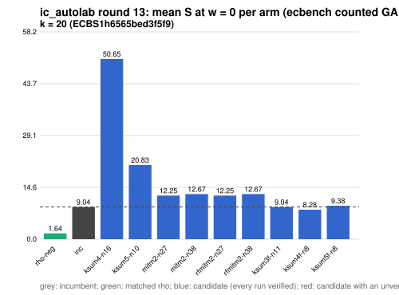

# ic_autolab round 13 (generic track): report

Protocol: [PROTOCOL.md](PROTOCOL.md), frozen 2026-11-04T05:09:59Z at git `cbbedb92c5f124af56dee74c137878aa74629c91`; route `local`. Counted GAE only (deterministic, host independent); no wall-time claim; development loop, no validation-gate row. Loop home: [`../`](../README.md); ledger: [`../ledger.json`](../ledger.json).

Claim record: `PCC-20261104-342ea5` (`python3 tools/pcc/pcc.py standing PCC-20261104-342ea5`). Until a signed replay and recompute exist, this round's outcome is an unverified assertion [pcc:unverified].

## Outcome

| k | class | sel | sel / inc at w = 0 [95%] | w = 0.1 | w = 1 | band | S sel (w = 0 / 0.1 / 1) | S inc | S rho-neg | distance sel / rho |
|--:|:--|:--|:--|:--|:--|:--|:--|:--|:--|:--|
| 20 | **null** | ksum4f-n8 | 0.971 [0.931, 1.012] | 0.967 [0.925, 1.012] | 0.951 [0.895, 1.011] | sel < inc | 8.540 / 9.192 / 15.058 | 8.798 / 9.501 / 15.831 | 1.583 / 1.698 / 2.733 | 5.4x / 5.4x / 5.5x |

Classes follow the protocol's decision rule. Distance to rho is the distance remaining, not a gate. The reasons per size:

- k = 20: compare ops.status = ok, admissible = true; sel / inc = 0.9708 [0.931, 1.012] at w = 0; band: sel < inc; A/A inc-aa / inc interval [1.000, 1.000] contains 1

## Train (development screen, in sample)

### k = 20: session `ECBS1h6565bed3f5f9` (run exit 0, verify exit 0, receipt sha256 `6a9fc25aadc2667ddf56f735adc76f6eb557b7cb5f0ef661b094c2a344dde5ea`)

| arm | family | N | factor base | oracle | runs | verified | S (w = 0 / 0.1 / 1) | reason proposed |
|:--|:--|--:|:--|:--|--:|--:|:--|:--|
| `rho-neg` | rho | - | `-` | `rho.negation` | 32 | 32 | 1.643 / 1.764 / 2.851 | matched reference |
| `inc` | ksum3 | 11 | `prime-projected-abscissa:size=11,scan_cap=176` | `ksum:m=3` | 32 | 32 | 9.043 / 9.781 / 16.417 | incumbent |
| `ksum4-n16` | ksum4 | 16 | `prime-projected-abscissa:size=16,scan_cap=256` | `ksum:m=4` | 32 | 32 | 50.645 / 50.903 / 53.219 | cross-size transfer neighbourhood: N = 2 x 8 (ksum4 from k = 24) |
| `ksum5-n10` | ksum5 | 10 | `prime-projected-abscissa:size=10,scan_cap=160` | `ksum:m=5` | 32 | 32 | 20.827 / 21.047 / 23.031 | alternative ksum5 (best S(0) 9.930 at N = 8): N = 1.2 x 8 |
| `mitm2-n27` | mitm2 | 27 | `prime-projected-abscissa:size=27,scan_cap=432` | `mitm:negation_folded=1` | 32 | 32 | 12.246 / 13.329 / 23.070 | alternative mitm2 (best S(0) 11.170 at N = 32): N = 0.85 x 32 |
| `mitm2-n38` | mitm2 | 38 | `prime-projected-abscissa:size=38,scan_cap=608` | `mitm:negation_folded=1` | 32 | 32 | 12.668 / 13.472 / 20.705 | alternative mitm2 (best S(0) 11.170 at N = 32): N = 1.2 x 32 |
| `rfmitm2-n27` | rfmitm2 | 27 | `prime-projected-abscissa:size=27,scan_cap=432` | `rootfind-mitm:m=2` | 32 | 32 | 12.246 / 13.329 / 23.070 | alternative rfmitm2 (best S(0) 11.254 at N = 32): N = 0.85 x 32 |
| `rfmitm2-n38` | rfmitm2 | 38 | `prime-projected-abscissa:size=38,scan_cap=608` | `rootfind-mitm:m=2` | 32 | 32 | 12.668 / 13.472 / 20.705 | alternative rfmitm2 (best S(0) 11.254 at N = 32): N = 1.2 x 32 |
| `ksum3f-n11` | ksum3f | 11 | `prime-projected-abscissa:size=11,scan_cap=176` | `ksum:m=3,free=1` | 32 | 32 | 9.043 / 9.781 / 16.417 | exploration: family ksum3f untried at k = 20, at its parent ksum3's best N = 11 |
| `ksum4f-n8` | ksum4f | 8 | `prime-projected-abscissa:size=8,scan_cap=128` | `ksum:m=4,free=1` | 32 | 32 | 8.282 / 8.898 / 14.438 | exploration: family ksum4f untried at k = 20, at its parent ksum4's best N = 8 |
| `ksum5f-n8` | ksum5f | 8 | `prime-projected-abscissa:size=8,scan_cap=128` | `ksum:m=5,free=1` | 32 | 32 | 9.379 / 9.781 / 13.400 | exploration: family ksum5f untried at k = 20, at its parent ksum5's best N = 8 |

## Selection

- k = 20: challenger `ksum4f-n8` (Pareto alternative at w = 1: `ksum5f-n8`)

## Holdout sessions

| k | session | run exit | verify exit | receipt sha256 | levels |
|--:|:--|--:|--:|:--|:--|
| 20 | `ECBS1ha91af1cc9a88` | 0 | 0 | `a9ef08af15aa14758a3b4ef8732dc03788ecc5efcb2798707bc1c2164ee72b17` | {"verified":480} |

## Ledger after this round

| k | incumbent | since round | S (w = 0 / 0.1 / 1) | distance to rho |
|--:|:--|--:|:--|:--|
| 20 | `ksum3-n11` (`prime-projected-abscissa:size=11,scan_cap=176` + `ksum:m=3`) | 0 | 8.987 / 9.710 / 16.217 | 5.7x / 5.7x / 6.0x |
| 24 | `ksum4-n12` (`prime-projected-abscissa:size=12,scan_cap=192` + `ksum:m=4`) | 2 | 6.985 / 7.514 / 12.271 | 6.0x / 5.9x / 5.6x |
| 28 | `ksum4-n18` (`prime-projected-abscissa:size=18,scan_cap=288` + `ksum:m=4`) | 8 | 7.445 / 7.910 / 12.100 | 7.8x / 7.6x / 6.5x |
| 32 | `ksum4-n26` (`prime-projected-abscissa:size=26,scan_cap=416` + `ksum:m=4`) | 5 | 8.296 / 8.811 / 13.446 | 9.1x / 8.8x / 7.4x |

## Evidence and deviations

- ecbench binary sha256: `2dedee1fa0e91ee8161c47f825ff60dfaa00e4923cd6b2bb87afdd21bf238b4e`; `--cpus auto`, allow_busy = true; `verify --replay 8` per session; audit receipts in `analysis/`; sessions in `sessions/` (records in the artifact store when large).
- Route: the local route is an explicitly requested development screen, not the Iso Lab EKS default; counts are deterministic and replayed, wall time is not claimed. No row of this round enters the IC leaderboard or `benchmarks/README.md` (validation gate).
- Train selection is in sample (disclosed); the holdout is fresh (new `target_seed`, excluded exposures). Failed, timed-out and regressing arms are retained above.
