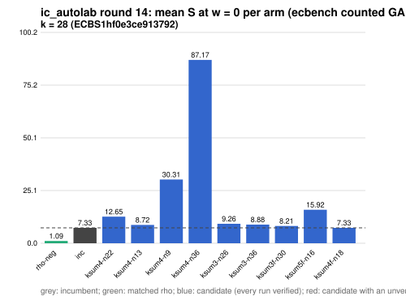

# ic_autolab round 14 (generic track): report

Protocol: [PROTOCOL.md](PROTOCOL.md), frozen 2026-11-04T05:11:37Z at git `f8459a0ea555960a94787ea80a32ce39a66a691c`; route `local`. Counted GAE only (deterministic, host independent); no wall-time claim; development loop, no validation-gate row. Loop home: [`../`](../README.md); ledger: [`../ledger.json`](../ledger.json).

Claim record: `PCC-20261104-f009c9` (`python3 tools/pcc/pcc.py standing PCC-20261104-f009c9`). Until a signed replay and recompute exist, this round's outcome is an unverified assertion [pcc:unverified].

## Outcome

| k | class | sel | sel / inc at w = 0 [95%] | w = 0.1 | w = 1 | band | S sel (w = 0 / 0.1 / 1) | S inc | S rho-neg | distance sel / rho |
|--:|:--|:--|:--|:--|:--|:--|:--|:--|:--|:--|
| 28 | **no_challenger** | none (best candidate `ksum4f-n18`, train S 7.330 / 7.772 / 11.753) | - | - | - | - | - | 7.330 / 7.772 / 11.753 | 1.088 / 1.191 / 2.112 | inc: 6.7x / 6.5x / 5.6x |

Classes follow the protocol's decision rule. Distance to rho is the distance remaining, not a gate. The reasons per size:

- k = 28: no_challenger

## Train (development screen, in sample)

### k = 28: session `ECBS1hf0e3ce913792` (run exit 0, verify exit 0, receipt sha256 `0e7b67daead1c5f7d835044a791545f4e932e99d0934eee4e091d90ffc6817b0`)

| arm | family | N | factor base | oracle | runs | verified | S (w = 0 / 0.1 / 1) | reason proposed |
|:--|:--|--:|:--|:--|--:|--:|:--|:--|
| `rho-neg` | rho | - | `-` | `rho.negation` | 32 | 32 | 1.088 / 1.191 / 2.112 | matched reference |
| `inc` | ksum4 | 18 | `prime-projected-abscissa:size=18,scan_cap=288` | `ksum:m=4` | 32 | 32 | 7.330 / 7.772 / 11.753 | incumbent |
| `ksum4-n22` | ksum4 | 22 | `prime-projected-abscissa:size=22,scan_cap=352` | `ksum:m=4` | 32 | 32 | 12.654 / 12.886 / 14.976 | incumbent neighbourhood: N = 1.2 x 18 |
| `ksum4-n13` | ksum4 | 13 | `prime-projected-abscissa:size=13,scan_cap=208` | `ksum:m=4` | 32 | 32 | 8.720 / 10.138 / 22.896 | incumbent neighbourhood: N = 0.7 x 18 |
| `ksum4-n9` | ksum4 | 9 | `prime-projected-abscissa:size=9,scan_cap=144` | `ksum:m=4` | 32 | 32 | 30.306 / 36.223 / 89.476 | incumbent neighbourhood: N = 0.5 x 18 |
| `ksum4-n36` | ksum4 | 36 | `prime-projected-abscissa:size=36,scan_cap=576` | `ksum:m=4` | 32 | 32 | 87.173 / 87.283 / 88.273 | incumbent neighbourhood: N = 2 x 18 |
| `ksum3-n26` | ksum3 | 26 | `prime-projected-abscissa:size=26,scan_cap=416` | `ksum:m=3` | 32 | 32 | 9.259 / 10.636 / 23.033 | alternative ksum3 (best S(0) 8.550 at N = 30): N = 0.85 x 30 |
| `ksum3-n36` | ksum3 | 36 | `prime-projected-abscissa:size=36,scan_cap=576` | `ksum:m=3` | 32 | 32 | 8.876 / 9.550 / 15.618 | alternative ksum3 (best S(0) 8.550 at N = 30): N = 1.2 x 30 |
| `ksum3f-n30` | ksum3f | 30 | `prime-projected-abscissa:size=30,scan_cap=480` | `ksum:m=3,free=1` | 32 | 32 | 8.208 / 9.174 / 17.876 | exploration: family ksum3f untried at k = 28, at its parent ksum3's best N = 30 |
| `ksum5f-n16` | ksum5f | 16 | `prime-projected-abscissa:size=16,scan_cap=256` | `ksum:m=5,free=1` | 32 | 32 | 15.922 / 16.068 / 17.382 | exploration: family ksum5f untried at k = 28, N = 0.08 x N_a |
| `ksum4f-n18` | ksum4f | 18 | `prime-projected-abscissa:size=18,scan_cap=288` | `ksum:m=4,free=1` | 32 | 32 | 7.330 / 7.772 / 11.753 | exploration: family ksum4f untried at k = 28, at its parent ksum4's best N = 18 |

## Selection

- k = 28: no_challenger  (Pareto alternative at w = 1: `ksum4f-n18`)

## Ledger after this round

| k | incumbent | since round | S (w = 0 / 0.1 / 1) | distance to rho |
|--:|:--|--:|:--|:--|
| 20 | `ksum3-n11` (`prime-projected-abscissa:size=11,scan_cap=176` + `ksum:m=3`) | 0 | 8.987 / 9.710 / 16.217 | 5.7x / 5.7x / 6.0x |
| 24 | `ksum4-n12` (`prime-projected-abscissa:size=12,scan_cap=192` + `ksum:m=4`) | 2 | 6.985 / 7.514 / 12.271 | 6.0x / 5.9x / 5.6x |
| 28 | `ksum4-n18` (`prime-projected-abscissa:size=18,scan_cap=288` + `ksum:m=4`) | 8 | 7.445 / 7.910 / 12.100 | 7.8x / 7.6x / 6.5x |
| 32 | `ksum4-n26` (`prime-projected-abscissa:size=26,scan_cap=416` + `ksum:m=4`) | 5 | 8.296 / 8.811 / 13.446 | 9.1x / 8.8x / 7.4x |

## Evidence and deviations

- ecbench binary sha256: `2dedee1fa0e91ee8161c47f825ff60dfaa00e4923cd6b2bb87afdd21bf238b4e`; `--cpus auto`, allow_busy = true; `verify --replay 8` per session; audit receipts in `analysis/`; sessions in `sessions/` (records in the artifact store when large).
- Route: the local route is an explicitly requested development screen, not the Iso Lab EKS default; counts are deterministic and replayed, wall time is not claimed. No row of this round enters the IC leaderboard or `benchmarks/README.md` (validation gate).
- Train selection is in sample (disclosed); the holdout is fresh (new `target_seed`, excluded exposures). Failed, timed-out and regressing arms are retained above.
