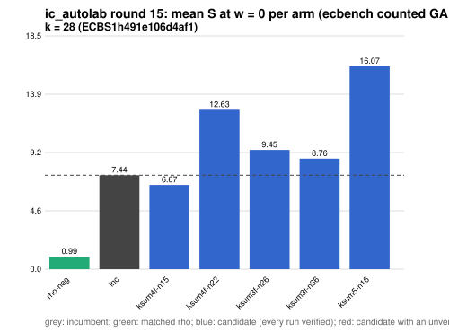

# ic_autolab round 15 (generic track): report

Protocol: [PROTOCOL.md](PROTOCOL.md), frozen 2026-11-04T05:13:12Z at git `7d336d597f38cd97fc0015a46a4bf3d66c66ccbe`; route `local`. Counted GAE only (deterministic, host independent); no wall-time claim; development loop, no validation-gate row. Loop home: [`../`](../README.md); ledger: [`../ledger.json`](../ledger.json).

Claim record: `PCC-20261104-836de4` (`python3 tools/pcc/pcc.py standing PCC-20261104-836de4`). Until a signed replay and recompute exist, this round's outcome is an unverified assertion [pcc:unverified].

## Outcome

| k | class | sel | sel / inc at w = 0 [95%] | w = 0.1 | w = 1 | band | S sel (w = 0 / 0.1 / 1) | S inc | S rho-neg | distance sel / rho |
|--:|:--|:--|:--|:--|:--|:--|:--|:--|:--|:--|
| 28 | **null** | ksum4f-n15 | 0.964 [0.927, 1.002] | 1.022 [0.981, 1.065] | 1.340 [1.274, 1.409] | unresolved inside the band | 7.294 / 8.232 / 16.670 | 7.564 / 8.052 / 12.445 | 1.117 / 1.222 / 2.170 | 6.5x / 6.7x / 7.7x |

Classes follow the protocol's decision rule. Distance to rho is the distance remaining, not a gate. The reasons per size:

- k = 28: compare ops.status = ok, admissible = true; sel / inc = 0.9642 [0.927, 1.002] at w = 0; band: unresolved inside the band; A/A inc-aa / inc interval [1.000, 1.000] contains 1

## Train (development screen, in sample)

### k = 28: session `ECBS1h491e106d4af1` (run exit 0, verify exit 0, receipt sha256 `e433b3fd2e73ef3fa781c3c6c0f465bf0d0b88e200fbb7bb2566ccf05bcb110f`)

| arm | family | N | factor base | oracle | runs | verified | S (w = 0 / 0.1 / 1) | reason proposed |
|:--|:--|--:|:--|:--|--:|--:|:--|:--|
| `rho-neg` | rho | - | `-` | `rho.negation` | 32 | 32 | 0.993 / 1.085 / 1.921 | matched reference |
| `inc` | ksum4 | 18 | `prime-projected-abscissa:size=18,scan_cap=288` | `ksum:m=4` | 32 | 32 | 7.440 / 7.906 / 12.101 | incumbent |
| `ksum4f-n15` | ksum4f | 15 | `prime-projected-abscissa:size=15,scan_cap=240` | `ksum:m=4,free=1` | 32 | 32 | 6.675 / 7.494 / 14.873 | alternative ksum4f (best S(0) 7.330 at N = 18): N = 0.85 x 18 |
| `ksum4f-n22` | ksum4f | 22 | `prime-projected-abscissa:size=22,scan_cap=352` | `ksum:m=4,free=1` | 32 | 32 | 12.635 / 12.873 / 15.016 | alternative ksum4f (best S(0) 7.330 at N = 18): N = 1.2 x 18 |
| `ksum3f-n26` | ksum3f | 26 | `prime-projected-abscissa:size=26,scan_cap=416` | `ksum:m=3,free=1` | 32 | 32 | 9.449 / 10.865 / 23.607 | alternative ksum3f (best S(0) 8.208 at N = 30): N = 0.85 x 30 |
| `ksum3f-n36` | ksum3f | 36 | `prime-projected-abscissa:size=36,scan_cap=576` | `ksum:m=3,free=1` | 32 | 32 | 8.756 / 9.416 / 15.359 | alternative ksum3f (best S(0) 8.208 at N = 30): N = 1.2 x 30 |
| `ksum5-n16` | ksum5 | 16 | `prime-projected-abscissa:size=16,scan_cap=256` | `ksum:m=5` | 32 | 32 | 16.072 / 16.239 / 17.738 | exploration: family ksum5 untried at k = 28, N = 0.08 x N_a |

## Selection

- k = 28: challenger `ksum4f-n15` (Pareto alternative at w = 1: `ksum4f-n15`)

## Holdout sessions

| k | session | run exit | verify exit | receipt sha256 | levels |
|--:|:--|--:|--:|:--|:--|
| 28 | `ECBS1hb67f2de61d76` | 0 | 0 | `39c97f11518bc6707cadd17aeb36f1a30677096f82a7ecf7f1c53b76cef5fe2c` | {"verified":480} |

## Ledger after this round

| k | incumbent | since round | S (w = 0 / 0.1 / 1) | distance to rho |
|--:|:--|--:|:--|:--|
| 20 | `ksum3-n11` (`prime-projected-abscissa:size=11,scan_cap=176` + `ksum:m=3`) | 0 | 8.987 / 9.710 / 16.217 | 5.7x / 5.7x / 6.0x |
| 24 | `ksum4-n12` (`prime-projected-abscissa:size=12,scan_cap=192` + `ksum:m=4`) | 2 | 6.985 / 7.514 / 12.271 | 6.0x / 5.9x / 5.6x |
| 28 | `ksum4-n18` (`prime-projected-abscissa:size=18,scan_cap=288` + `ksum:m=4`) | 8 | 7.445 / 7.910 / 12.100 | 7.8x / 7.6x / 6.5x |
| 32 | `ksum4-n26` (`prime-projected-abscissa:size=26,scan_cap=416` + `ksum:m=4`) | 5 | 8.296 / 8.811 / 13.446 | 9.1x / 8.8x / 7.4x |

## Evidence and deviations

- ecbench binary sha256: `2dedee1fa0e91ee8161c47f825ff60dfaa00e4923cd6b2bb87afdd21bf238b4e`; `--cpus auto`, allow_busy = true; `verify --replay 8` per session; audit receipts in `analysis/`; sessions in `sessions/` (records in the artifact store when large).
- Route: the local route is an explicitly requested development screen, not the Iso Lab EKS default; counts are deterministic and replayed, wall time is not claimed. No row of this round enters the IC leaderboard or `benchmarks/README.md` (validation gate).
- Train selection is in sample (disclosed); the holdout is fresh (new `target_seed`, excluded exposures). Failed, timed-out and regressing arms are retained above.
