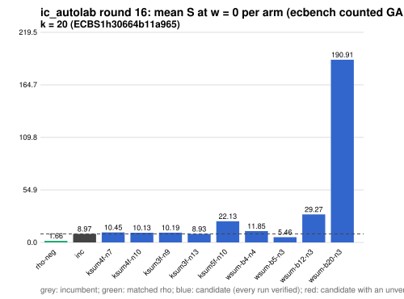

# ic_autolab round 16 (generic track): report

Protocol: [PROTOCOL.md](PROTOCOL.md), frozen 2026-11-04T06:42:40Z at git `1d09988e20cc91cf05990398bed753359216ff58`; route `local`. Counted GAE only (deterministic, host independent); no wall-time claim; development loop, no validation-gate row. Loop home: [`../`](../README.md); ledger: [`../ledger.json`](../ledger.json).

Claim record: `PCC-20261104-1c867a` (`python3 tools/pcc/pcc.py standing PCC-20261104-1c867a`). Until a signed replay and recompute exist, this round's outcome is an unverified assertion [pcc:unverified].

## Outcome

| k | class | sel | sel / inc at w = 0 [95%] | w = 0.1 | w = 1 | band | S sel (w = 0 / 0.1 / 1) | S inc | S rho-neg | distance sel / rho |
|--:|:--|:--|:--|:--|:--|:--|:--|:--|:--|:--|
| 20 | **improvement** | wsum-b5-n3 | 0.605 [0.575, 0.637] | 0.584 [0.553, 0.618] | 0.478 [0.441, 0.519] | sel < inc | 5.384 / 5.609 / 7.638 | 8.893 / 9.601 / 15.971 | 1.487 / 1.592 / 2.538 | 3.6x / 3.5x / 3.0x |

Classes follow the protocol's decision rule. Distance to rho is the distance remaining, not a gate. The reasons per size:

- k = 20: compare ops.status = ok, admissible = true; sel / inc = 0.6054 [0.575, 0.637] at w = 0; band: sel < inc; A/A inc-aa / inc interval [1.000, 1.000] contains 1

## Train (development screen, in sample)

### k = 20: session `ECBS1h30664b11a965` (run exit 0, verify exit 0, receipt sha256 `65e232a89888a4ba7f54d598b296572231c5df8e1a47de6b6a67f19e85b6a2b0`)

| arm | family | N | factor base | oracle | runs | verified | S (w = 0 / 0.1 / 1) | reason proposed |
|:--|:--|--:|:--|:--|--:|--:|:--|:--|
| `rho-neg` | rho | - | `-` | `rho.negation` | 32 | 32 | 1.660 / 1.783 / 2.886 | matched reference |
| `inc` | ksum3 | 11 | `prime-projected-abscissa:size=11,scan_cap=176` | `ksum:m=3` | 32 | 32 | 8.970 / 9.710 / 16.368 | incumbent |
| `ksum4f-n7` | ksum4f | 7 | `prime-projected-abscissa:size=7,scan_cap=112` | `ksum:m=4,free=1` | 32 | 32 | 10.452 / 11.535 / 21.288 | alternative ksum4f (best S(0) 8.282 at N = 8): N = 0.85 x 8 |
| `ksum4f-n10` | ksum4f | 10 | `prime-projected-abscissa:size=10,scan_cap=160` | `ksum:m=4,free=1` | 32 | 32 | 10.129 / 10.433 / 13.173 | alternative ksum4f (best S(0) 8.282 at N = 8): N = 1.2 x 8 |
| `ksum3f-n9` | ksum3f | 9 | `prime-projected-abscissa:size=9,scan_cap=144` | `ksum:m=3,free=1` | 32 | 32 | 10.193 / 11.240 / 20.671 | alternative ksum3f (best S(0) 9.043 at N = 11): N = 0.85 x 11 |
| `ksum3f-n13` | ksum3f | 13 | `prime-projected-abscissa:size=13,scan_cap=208` | `ksum:m=3,free=1` | 32 | 32 | 8.927 / 9.457 / 14.222 | alternative ksum3f (best S(0) 9.043 at N = 11): N = 1.2 x 11 |
| `ksum5f-n10` | ksum5f | 10 | `prime-projected-abscissa:size=10,scan_cap=160` | `ksum:m=5,free=1` | 32 | 32 | 22.132 / 22.738 / 28.198 | alternative ksum5f (best S(0) 9.379 at N = 8): N = 1.2 x 8 |
| `wsum-b4-n4` | wsum-b4 | 4 | `prime-projected-abscissa:size=4,scan_cap=64` | `wsum:coef=4,free=1` | 32 | 32 | 11.851 / 11.941 / 12.745 | exploration: family wsum-b4 untried at k = 20, N = 0.0001 x N_a |
| `wsum-b5-n3` | wsum-b5 | 3 | `prime-projected-abscissa:size=3,scan_cap=48` | `wsum:coef=5,free=1` | 32 | 32 | 5.459 / 5.706 / 7.925 | exploration: family wsum-b5 untried at k = 20, N = 0.0001 x N_a |
| `wsum-b12-n3` | wsum-b12 | 3 | `prime-projected-abscissa:size=3,scan_cap=48` | `wsum:coef=12,free=1` | 32 | 32 | 29.267 / 29.840 / 34.995 | exploration: family wsum-b12 untried at k = 20, N = 0.0001 x N_a |
| `wsum-b20-n3` | wsum-b20 | 3 | `prime-projected-abscissa:size=3,scan_cap=48` | `wsum:coef=20,free=1` | 32 | 32 | 190.912 / 200.838 / 290.173 | exploration: family wsum-b20 untried at k = 20, N = 0.0001 x N_a |

## Selection

- k = 20: challenger `wsum-b5-n3` (Pareto alternative at w = 1: `wsum-b5-n3`)

## Holdout sessions

| k | session | run exit | verify exit | receipt sha256 | levels |
|--:|:--|--:|--:|:--|:--|
| 20 | `ECBS1h458afdb84a20` | 0 | 0 | `3f6ccf922ffe57b4946303075ac33e0e144e60e1fa096858a243be80fadb648c` | {"verified":480} |

## Ledger after this round

| k | incumbent | since round | S (w = 0 / 0.1 / 1) | distance to rho |
|--:|:--|--:|:--|:--|
| 20 | `wsum-b5-n3` (`prime-projected-abscissa:size=3,scan_cap=48` + `wsum:coef=5,free=1`) | 16 | 5.384 / 5.609 / 7.638 | 3.6x / 3.5x / 3.0x |
| 24 | `ksum4-n12` (`prime-projected-abscissa:size=12,scan_cap=192` + `ksum:m=4`) | 2 | 6.985 / 7.514 / 12.271 | 6.0x / 5.9x / 5.6x |
| 28 | `ksum4-n18` (`prime-projected-abscissa:size=18,scan_cap=288` + `ksum:m=4`) | 8 | 7.445 / 7.910 / 12.100 | 7.8x / 7.6x / 6.5x |
| 32 | `ksum4-n26` (`prime-projected-abscissa:size=26,scan_cap=416` + `ksum:m=4`) | 5 | 8.296 / 8.811 / 13.446 | 9.1x / 8.8x / 7.4x |

## Evidence and deviations

- ecbench binary sha256: `e7242bc192bda8c8da9e64895afe943e8aa47cfa37bd490d656e2181758e9533`; `--cpus auto`, allow_busy = true; `verify --replay 8` per session; audit receipts in `analysis/`; sessions in `sessions/` (records in the artifact store when large).
- Route: the local route is an explicitly requested development screen, not the Iso Lab EKS default; counts are deterministic and replayed, wall time is not claimed. No row of this round enters the IC leaderboard or `benchmarks/README.md` (validation gate).
- Train selection is in sample (disclosed); the holdout is fresh (new `target_seed`, excluded exposures). Failed, timed-out and regressing arms are retained above.
