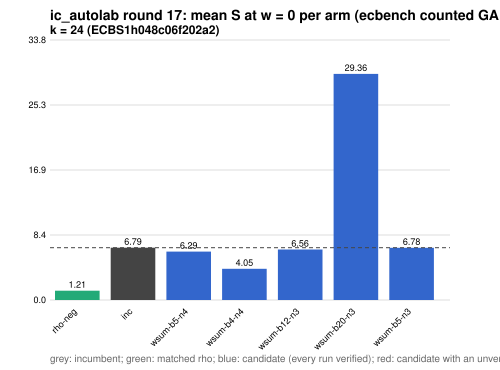

# ic_autolab round 17 (generic track): report

Protocol: [PROTOCOL.md](PROTOCOL.md), frozen 2026-11-04T06:45:30Z at git `fbc220886744f4ba731cf19a2efcdc14c735b367`; route `local`. Counted GAE only (deterministic, host independent); no wall-time claim; development loop, no validation-gate row. Loop home: [`../`](../README.md); ledger: [`../ledger.json`](../ledger.json).

Claim record: `PCC-20261104-2b80d2` (`python3 tools/pcc/pcc.py standing PCC-20261104-2b80d2`). Until a signed replay and recompute exist, this round's outcome is an unverified assertion [pcc:unverified].

## Outcome

| k | class | sel | sel / inc at w = 0 [95%] | w = 0.1 | w = 1 | band | S sel (w = 0 / 0.1 / 1) | S inc | S rho-neg | distance sel / rho |
|--:|:--|:--|:--|:--|:--|:--|:--|:--|:--|:--|
| 24 | **improvement** | wsum-b4-n4 | 0.620 [0.591, 0.649] | 0.610 [0.579, 0.643] | 0.559 [0.514, 0.608] | sel < inc | 4.201 / 4.433 / 6.528 | 6.780 / 7.269 / 11.669 | 1.235 / 1.346 / 2.352 | 3.4x / 3.3x / 2.8x |

Classes follow the protocol's decision rule. Distance to rho is the distance remaining, not a gate. The reasons per size:

- k = 24: compare ops.status = ok, admissible = true; sel / inc = 0.6196 [0.591, 0.649] at w = 0; band: sel < inc; A/A inc-aa / inc interval [1.000, 1.000] contains 1

## Train (development screen, in sample)

### k = 24: session `ECBS1h048c06f202a2` (run exit 0, verify exit 0, receipt sha256 `891c2f997afef3bad5677cdbc95ad0fc31c4f543f1af7d9b9ddac66f88541db1`)

| arm | family | N | factor base | oracle | runs | verified | S (w = 0 / 0.1 / 1) | reason proposed |
|:--|:--|--:|:--|:--|--:|--:|:--|:--|
| `rho-neg` | rho | - | `-` | `rho.negation` | 32 | 32 | 1.206 / 1.315 / 2.295 | matched reference |
| `inc` | ksum4 | 12 | `prime-projected-abscissa:size=12,scan_cap=192` | `ksum:m=4` | 32 | 32 | 6.789 / 7.281 / 11.714 | incumbent |
| `wsum-b5-n4` | wsum-b5 | 4 | `prime-projected-abscissa:size=4,scan_cap=64` | `wsum:coef=5,free=1` | 32 | 32 | 6.288 / 6.386 / 7.261 | cross-size transfer: wsum-b5-n3 is the k = 20 incumbent at N / N_a = 0.094 |
| `wsum-b4-n4` | wsum-b4 | 4 | `prime-projected-abscissa:size=4,scan_cap=64` | `wsum:coef=4,free=1` | 32 | 32 | 4.048 / 4.251 / 6.080 | exploration: family wsum-b4 untried at k = 24, N = 0.0001 x N_a |
| `wsum-b12-n3` | wsum-b12 | 3 | `prime-projected-abscissa:size=3,scan_cap=48` | `wsum:coef=12,free=1` | 32 | 32 | 6.557 / 6.641 / 7.400 | exploration: family wsum-b12 untried at k = 24, N = 0.0001 x N_a |
| `wsum-b20-n3` | wsum-b20 | 3 | `prime-projected-abscissa:size=3,scan_cap=48` | `wsum:coef=20,free=1` | 32 | 32 | 29.356 / 29.855 / 34.352 | exploration: family wsum-b20 untried at k = 24, N = 0.0001 x N_a |
| `wsum-b5-n3` | wsum-b5 | 3 | `prime-projected-abscissa:size=3,scan_cap=48` | `wsum:coef=5,free=1` | 32 | 32 | 6.777 / 7.809 / 17.096 | exploration: family wsum-b5 untried at k = 24, N = 0.0001 x N_a |

## Selection

- k = 24: challenger `wsum-b4-n4` (Pareto alternative at w = 1: `wsum-b4-n4`)

## Holdout sessions

| k | session | run exit | verify exit | receipt sha256 | levels |
|--:|:--|--:|--:|:--|:--|
| 24 | `ECBS1h509cf46feb02` | 0 | 0 | `6a286b7a31f12413ecae0caa8c0d407a89e4a0e2c93ef6330334c26a886e686c` | {"verified":480} |

## Ledger after this round

| k | incumbent | since round | S (w = 0 / 0.1 / 1) | distance to rho |
|--:|:--|--:|:--|:--|
| 20 | `wsum-b5-n3` (`prime-projected-abscissa:size=3,scan_cap=48` + `wsum:coef=5,free=1`) | 16 | 5.384 / 5.609 / 7.638 | 3.6x / 3.5x / 3.0x |
| 24 | `wsum-b4-n4` (`prime-projected-abscissa:size=4,scan_cap=64` + `wsum:coef=4,free=1`) | 17 | 4.201 / 4.433 / 6.528 | 3.4x / 3.3x / 2.8x |
| 28 | `ksum4-n18` (`prime-projected-abscissa:size=18,scan_cap=288` + `ksum:m=4`) | 8 | 7.445 / 7.910 / 12.100 | 7.8x / 7.6x / 6.5x |
| 32 | `ksum4-n26` (`prime-projected-abscissa:size=26,scan_cap=416` + `ksum:m=4`) | 5 | 8.296 / 8.811 / 13.446 | 9.1x / 8.8x / 7.4x |

## Evidence and deviations

- ecbench binary sha256: `e7242bc192bda8c8da9e64895afe943e8aa47cfa37bd490d656e2181758e9533`; `--cpus auto`, allow_busy = true; `verify --replay 8` per session; audit receipts in `analysis/`; sessions in `sessions/` (records in the artifact store when large).
- Route: the local route is an explicitly requested development screen, not the Iso Lab EKS default; counts are deterministic and replayed, wall time is not claimed. No row of this round enters the IC leaderboard or `benchmarks/README.md` (validation gate).
- Train selection is in sample (disclosed); the holdout is fresh (new `target_seed`, excluded exposures). Failed, timed-out and regressing arms are retained above.
