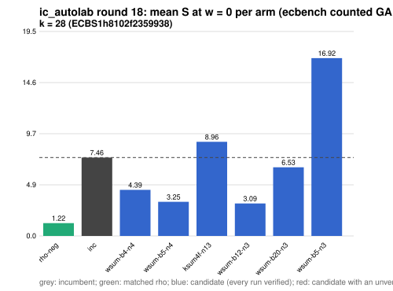

# ic_autolab round 18 (generic track): report

Protocol: [PROTOCOL.md](PROTOCOL.md), frozen 2026-11-04T06:46:59Z at git `ddb03aeb06027907fe7d3117a7f6a8503ab5511b`; route `local`. Counted GAE only (deterministic, host independent); no wall-time claim; development loop, no validation-gate row. Loop home: [`../`](../README.md); ledger: [`../ledger.json`](../ledger.json).

Claim record: `PCC-20261104-13dcb4` (`python3 tools/pcc/pcc.py standing PCC-20261104-13dcb4`). Until a signed replay and recompute exist, this round's outcome is an unverified assertion [pcc:unverified].

## Outcome

| k | class | sel | sel / inc at w = 0 [95%] | w = 0.1 | w = 1 | band | S sel (w = 0 / 0.1 / 1) | S inc | S rho-neg | distance sel / rho |
|--:|:--|:--|:--|:--|:--|:--|:--|:--|:--|:--|
| 28 | **improvement** | wsum-b12-n3 | 0.397 [0.372, 0.424] | 0.408 [0.380, 0.439] | 0.471 [0.426, 0.521] | sel < inc | 2.949 / 3.222 / 5.676 | 7.426 / 7.888 / 12.049 | 0.981 / 1.073 / 1.898 | 3.0x / 3.0x / 3.0x |

Classes follow the protocol's decision rule. Distance to rho is the distance remaining, not a gate. The reasons per size:

- k = 28: compare ops.status = ok, admissible = true; sel / inc = 0.3972 [0.372, 0.424] at w = 0; band: sel < inc; A/A inc-aa / inc interval [1.000, 1.000] contains 1

## Train (development screen, in sample)

### k = 28: session `ECBS1h8102f2359938` (run exit 0, verify exit 0, receipt sha256 `a2eab52e05dfa6c60d33b82f31f8695efba8d6bbd5ec4f8598d96894f605f136`)

| arm | family | N | factor base | oracle | runs | verified | S (w = 0 / 0.1 / 1) | reason proposed |
|:--|:--|--:|:--|:--|--:|--:|:--|:--|
| `rho-neg` | rho | - | `-` | `rho.negation` | 32 | 32 | 1.219 / 1.334 / 2.373 | matched reference |
| `inc` | ksum4 | 18 | `prime-projected-abscissa:size=18,scan_cap=288` | `ksum:m=4` | 32 | 32 | 7.463 / 7.932 / 12.153 | incumbent |
| `wsum-b4-n4` | wsum-b4 | 4 | `prime-projected-abscissa:size=4,scan_cap=64` | `wsum:coef=4,free=1` | 32 | 32 | 4.389 / 5.092 / 11.421 | cross-size transfer: wsum-b4-n4 is the k = 24 incumbent at N / N_a = 0.049 |
| `wsum-b5-n4` | wsum-b5 | 4 | `prime-projected-abscissa:size=4,scan_cap=64` | `wsum:coef=5,free=1` | 32 | 32 | 3.247 / 3.593 / 6.714 | cross-size transfer: wsum-b5-n3 is the k = 20 incumbent at N / N_a = 0.094 |
| `ksum4f-n13` | ksum4f | 13 | `prime-projected-abscissa:size=13,scan_cap=208` | `ksum:m=4,free=1` | 32 | 32 | 8.957 / 10.421 / 23.595 | alternative ksum4f (best S(0) 6.675 at N = 15): N = 0.85 x 15 |
| `wsum-b12-n3` | wsum-b12 | 3 | `prime-projected-abscissa:size=3,scan_cap=48` | `wsum:coef=12,free=1` | 32 | 32 | 3.094 / 3.396 / 6.107 | exploration: family wsum-b12 untried at k = 28, N = 0.0001 x N_a |
| `wsum-b20-n3` | wsum-b20 | 3 | `prime-projected-abscissa:size=3,scan_cap=48` | `wsum:coef=20,free=1` | 32 | 32 | 6.533 / 6.605 / 7.253 | exploration: family wsum-b20 untried at k = 28, N = 0.0001 x N_a |
| `wsum-b5-n3` | wsum-b5 | 3 | `prime-projected-abscissa:size=3,scan_cap=48` | `wsum:coef=5,free=1` | 32 | 32 | 16.923 / 20.199 / 49.690 | exploration: family wsum-b5 untried at k = 28, N = 0.0001 x N_a |

## Selection

- k = 28: challenger `wsum-b12-n3` (Pareto alternative at w = 1: `wsum-b12-n3`)

## Holdout sessions

| k | session | run exit | verify exit | receipt sha256 | levels |
|--:|:--|--:|--:|:--|:--|
| 28 | `ECBS1h22b557bd4431` | 0 | 0 | `e44bf9dbe28a14610a5ebb0b91ef98dc430dbfe1a483c31ed36fa32930318e26` | {"verified":480} |

## Ledger after this round

| k | incumbent | since round | S (w = 0 / 0.1 / 1) | distance to rho |
|--:|:--|--:|:--|:--|
| 20 | `wsum-b5-n3` (`prime-projected-abscissa:size=3,scan_cap=48` + `wsum:coef=5,free=1`) | 16 | 5.384 / 5.609 / 7.638 | 3.6x / 3.5x / 3.0x |
| 24 | `wsum-b4-n4` (`prime-projected-abscissa:size=4,scan_cap=64` + `wsum:coef=4,free=1`) | 17 | 4.201 / 4.433 / 6.528 | 3.4x / 3.3x / 2.8x |
| 28 | `wsum-b12-n3` (`prime-projected-abscissa:size=3,scan_cap=48` + `wsum:coef=12,free=1`) | 18 | 2.949 / 3.222 / 5.676 | 3.0x / 3.0x / 3.0x |
| 32 | `ksum4-n26` (`prime-projected-abscissa:size=26,scan_cap=416` + `ksum:m=4`) | 5 | 8.296 / 8.811 / 13.446 | 9.1x / 8.8x / 7.4x |

## Evidence and deviations

- ecbench binary sha256: `e7242bc192bda8c8da9e64895afe943e8aa47cfa37bd490d656e2181758e9533`; `--cpus auto`, allow_busy = true; `verify --replay 8` per session; audit receipts in `analysis/`; sessions in `sessions/` (records in the artifact store when large).
- Route: the local route is an explicitly requested development screen, not the Iso Lab EKS default; counts are deterministic and replayed, wall time is not claimed. No row of this round enters the IC leaderboard or `benchmarks/README.md` (validation gate).
- Train selection is in sample (disclosed); the holdout is fresh (new `target_seed`, excluded exposures). Failed, timed-out and regressing arms are retained above.
