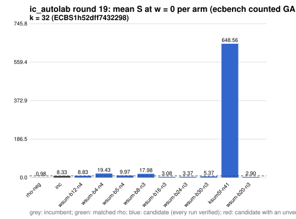

# ic_autolab round 19 (generic track): report

Protocol: [PROTOCOL.md](PROTOCOL.md), frozen 2026-11-04T06:48:30Z at git `ff7401cbf7c5fe5659e1b6262a7128965a33ba33`; route `local`. Counted GAE only (deterministic, host independent); no wall-time claim; development loop, no validation-gate row. Loop home: [`../`](../README.md); ledger: [`../ledger.json`](../ledger.json).

Claim record: `PCC-20261104-997808` (`python3 tools/pcc/pcc.py standing PCC-20261104-997808`). Until a signed replay and recompute exist, this round's outcome is an unverified assertion [pcc:unverified].

## Outcome

| k | class | sel | sel / inc at w = 0 [95%] | w = 0.1 | w = 1 | band | S sel (w = 0 / 0.1 / 1) | S inc | S rho-neg | distance sel / rho |
|--:|:--|:--|:--|:--|:--|:--|:--|:--|:--|:--|
| 32 | **improvement** | wsum-b20-n3 | 0.350 [0.329, 0.373] | 0.360 [0.337, 0.386] | 0.416 [0.377, 0.458] | sel < inc | 2.937 / 3.213 / 5.697 | 8.384 / 8.917 / 13.710 | 0.939 / 1.032 / 1.862 | 3.1x / 3.1x / 3.1x |

Classes follow the protocol's decision rule. Distance to rho is the distance remaining, not a gate. The reasons per size:

- k = 32: compare ops.status = ok, admissible = true; sel / inc = 0.3503 [0.329, 0.373] at w = 0; band: sel < inc; A/A inc-aa / inc interval [1.000, 1.000] contains 1

## Train (development screen, in sample)

### k = 32: session `ECBS1h52dff7432298` (run exit 0, verify exit 0, receipt sha256 `24d84aa535d58ba3d61c8f7043ee601ae1ccac0be4e951bbfd8b35628be09aac`)

| arm | family | N | factor base | oracle | runs | verified | S (w = 0 / 0.1 / 1) | reason proposed |
|:--|:--|--:|:--|:--|--:|--:|:--|:--|
| `rho-neg` | rho | - | `-` | `rho.negation` | 32 | 32 | 0.982 / 1.079 / 1.948 | matched reference |
| `inc` | ksum4 | 26 | `prime-projected-abscissa:size=26,scan_cap=416` | `ksum:m=4` | 32 | 32 | 8.328 / 8.849 / 13.539 | incumbent |
| `wsum-b12-n4` | wsum-b12 | 4 | `prime-projected-abscissa:size=4,scan_cap=64` | `wsum:coef=12,free=1` | 32 | 32 | 8.826 / 8.892 / 9.485 | cross-size transfer: wsum-b12-n3 is the k = 28 incumbent at N / N_a = 0.015 |
| `wsum-b4-n4` | wsum-b4 | 4 | `prime-projected-abscissa:size=4,scan_cap=64` | `wsum:coef=4,free=1` | 32 | 32 | 19.427 / 23.259 / 57.745 | cross-size transfer: wsum-b4-n4 is the k = 24 incumbent at N / N_a = 0.049 |
| `wsum-b5-n4` | wsum-b5 | 4 | `prime-projected-abscissa:size=4,scan_cap=64` | `wsum:coef=5,free=1` | 32 | 32 | 9.972 / 11.879 / 29.047 | cross-size transfer: wsum-b5-n3 is the k = 20 incumbent at N / N_a = 0.094 |
| `wsum-b8-n3` | wsum-b8 | 3 | `prime-projected-abscissa:size=3,scan_cap=48` | `wsum:coef=8,free=1` | 32 | 32 | 17.984 / 21.534 / 53.487 | exploration: family wsum-b8 untried at k = 32, N = 0.0001 x N_a |
| `wsum-b16-n3` | wsum-b16 | 3 | `prime-projected-abscissa:size=3,scan_cap=48` | `wsum:coef=16,free=1` | 32 | 32 | 3.081 / 3.527 / 7.542 | exploration: family wsum-b16 untried at k = 32, N = 0.0001 x N_a |
| `wsum-b24-n3` | wsum-b24 | 3 | `prime-projected-abscissa:size=3,scan_cap=48` | `wsum:coef=24,free=1` | 32 | 32 | 3.369 / 3.521 / 4.895 | exploration: family wsum-b24 untried at k = 32, N = 0.0001 x N_a |
| `wsum-b30-n3` | wsum-b30 | 3 | `prime-projected-abscissa:size=3,scan_cap=48` | `wsum:coef=30,free=1` | 32 | 32 | 5.367 / 5.447 / 6.172 | exploration: family wsum-b30 untried at k = 32, N = 0.0001 x N_a |
| `ksum5f-n41` | ksum5f | 41 | `prime-projected-abscissa:size=41,scan_cap=656` | `ksum:m=5,free=1` | 32 | 32 | 648.557 / 680.065 / 963.637 | exploration: family ksum5f untried at k = 32, at its parent ksum5's best N = 41 |
| `wsum-b20-n3` | wsum-b20 | 3 | `prime-projected-abscissa:size=3,scan_cap=48` | `wsum:coef=20,free=1` | 32 | 32 | 2.901 / 3.170 / 5.590 | exploration: family wsum-b20 untried at k = 32, N = 0.0001 x N_a |

## Selection

- k = 32: challenger `wsum-b20-n3` (Pareto alternative at w = 1: `wsum-b24-n3`)

## Holdout sessions

| k | session | run exit | verify exit | receipt sha256 | levels |
|--:|:--|--:|--:|:--|:--|
| 32 | `ECBS1hf3547017358d` | 0 | 0 | `367ee066a71e7aade2557fe2633eb70b397be5ba91975b3e193e59951910a6e9` | {"verified":480} |

## Ledger after this round

| k | incumbent | since round | S (w = 0 / 0.1 / 1) | distance to rho |
|--:|:--|--:|:--|:--|
| 20 | `wsum-b5-n3` (`prime-projected-abscissa:size=3,scan_cap=48` + `wsum:coef=5,free=1`) | 16 | 5.384 / 5.609 / 7.638 | 3.6x / 3.5x / 3.0x |
| 24 | `wsum-b4-n4` (`prime-projected-abscissa:size=4,scan_cap=64` + `wsum:coef=4,free=1`) | 17 | 4.201 / 4.433 / 6.528 | 3.4x / 3.3x / 2.8x |
| 28 | `wsum-b12-n3` (`prime-projected-abscissa:size=3,scan_cap=48` + `wsum:coef=12,free=1`) | 18 | 2.949 / 3.222 / 5.676 | 3.0x / 3.0x / 3.0x |
| 32 | `wsum-b20-n3` (`prime-projected-abscissa:size=3,scan_cap=48` + `wsum:coef=20,free=1`) | 19 | 2.937 / 3.213 / 5.697 | 3.1x / 3.1x / 3.1x |

## Evidence and deviations

- ecbench binary sha256: `e7242bc192bda8c8da9e64895afe943e8aa47cfa37bd490d656e2181758e9533`; `--cpus auto`, allow_busy = true; `verify --replay 8` per session; audit receipts in `analysis/`; sessions in `sessions/` (records in the artifact store when large).
- Route: the local route is an explicitly requested development screen, not the Iso Lab EKS default; counts are deterministic and replayed, wall time is not claimed. No row of this round enters the IC leaderboard or `benchmarks/README.md` (validation gate).
- Train selection is in sample (disclosed); the holdout is fresh (new `target_seed`, excluded exposures). Failed, timed-out and regressing arms are retained above.
