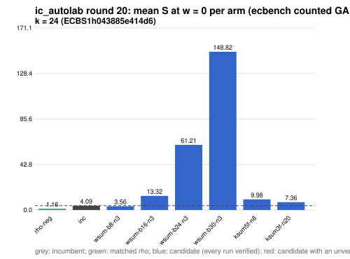

# ic_autolab round 20 (generic track): report

Protocol: [PROTOCOL.md](PROTOCOL.md), frozen 2026-11-04T07:22:29Z at git `5958e283372a706805e09b8762d6c0554b28482b`; route `local`. Counted GAE only (deterministic, host independent); no wall-time claim; development loop, no validation-gate row. Loop home: [`../`](../README.md); ledger: [`../ledger.json`](../ledger.json).

Claim record: `PCC-20261104-b49545` (`python3 tools/pcc/pcc.py standing PCC-20261104-b49545`). Until a signed replay and recompute exist, this round's outcome is an unverified assertion [pcc:unverified].

## Outcome

| k | class | sel | sel / inc at w = 0 [95%] | w = 0.1 | w = 1 | band | S sel (w = 0 / 0.1 / 1) | S inc | S rho-neg | distance sel / rho |
|--:|:--|:--|:--|:--|:--|:--|:--|:--|:--|:--|
| 24 | **improvement** | wsum-b8-n3 | 0.882 [0.839, 0.928] | 0.892 [0.843, 0.944] | 0.949 [0.867, 1.040] | sel < inc | 3.678 / 3.920 / 6.100 | 4.170 / 4.395 / 6.425 | 1.209 / 1.318 / 2.301 | 3.0x / 3.0x / 2.7x |

Classes follow the protocol's decision rule. Distance to rho is the distance remaining, not a gate. The reasons per size:

- k = 24: compare ops.status = ok, admissible = true; sel / inc = 0.8821 [0.839, 0.928] at w = 0; band: sel < inc; A/A inc-aa / inc interval [1.000, 1.000] contains 1

## Train (development screen, in sample)

### k = 24: session `ECBS1h043885e414d6` (run exit 0, verify exit 0, receipt sha256 `e8b5381130f20cd890610458c12a1b8de87c0bf2a9d69e51865ca55ebcfd4511`)

| arm | family | N | factor base | oracle | runs | verified | S (w = 0 / 0.1 / 1) | reason proposed |
|:--|:--|--:|:--|:--|--:|--:|:--|:--|
| `rho-neg` | rho | - | `-` | `rho.negation` | 32 | 32 | 1.162 / 1.266 / 2.207 | matched reference |
| `inc` | wsum-b4 | 4 | `prime-projected-abscissa:size=4,scan_cap=64` | `wsum:coef=4,free=1` | 32 | 32 | 4.090 / 4.302 / 6.216 | incumbent |
| `wsum-b8-n3` | wsum-b8 | 3 | `prime-projected-abscissa:size=3,scan_cap=48` | `wsum:coef=8,free=1` | 32 | 32 | 3.561 / 3.782 / 5.769 | exploration: family wsum-b8 untried at k = 24, N = 0.0001 x N_a |
| `wsum-b16-n3` | wsum-b16 | 3 | `prime-projected-abscissa:size=3,scan_cap=48` | `wsum:coef=16,free=1` | 32 | 32 | 13.318 / 13.352 / 13.667 | exploration: family wsum-b16 untried at k = 24, N = 0.0001 x N_a |
| `wsum-b24-n3` | wsum-b24 | 3 | `prime-projected-abscissa:size=3,scan_cap=48` | `wsum:coef=24,free=1` | 32 | 32 | 61.210 / 63.223 / 81.345 | exploration: family wsum-b24 untried at k = 24, N = 0.0001 x N_a |
| `wsum-b30-n3` | wsum-b30 | 3 | `prime-projected-abscissa:size=3,scan_cap=48` | `wsum:coef=30,free=1` | 32 | 32 | 148.818 / 155.964 / 220.277 | exploration: family wsum-b30 untried at k = 24, N = 0.0001 x N_a |
| `ksum5f-n8` | ksum5f | 8 | `prime-projected-abscissa:size=8,scan_cap=128` | `ksum:m=5,free=1` | 32 | 32 | 9.980 / 11.463 / 24.816 | exploration: family ksum5f untried at k = 24, at its parent ksum5's best N = 6 |
| `ksum3f-n20` | ksum3f | 20 | `prime-projected-abscissa:size=20,scan_cap=320` | `ksum:m=3,free=1` | 32 | 32 | 7.358 / 7.954 / 13.316 | exploration: family ksum3f untried at k = 24, at its parent ksum3's best N = 20 |

## Selection

- k = 24: challenger `wsum-b8-n3` (Pareto alternative at w = 1: `wsum-b8-n3`)

## Holdout sessions

| k | session | run exit | verify exit | receipt sha256 | levels |
|--:|:--|--:|--:|:--|:--|
| 24 | `ECBS1hbaf914946ee3` | 0 | 0 | `5802fde6e6d45085d71c4b903ab3a674fb0a619f2d2753b9475b016d6e4a6fe4` | {"verified":480} |

## Ledger after this round

| k | incumbent | since round | S (w = 0 / 0.1 / 1) | distance to rho |
|--:|:--|--:|:--|:--|
| 20 | `wsum-b5-n3` (`prime-projected-abscissa:size=3,scan_cap=48` + `wsum:coef=5,free=1`) | 16 | 5.384 / 5.609 / 7.638 | 3.6x / 3.5x / 3.0x |
| 24 | `wsum-b8-n3` (`prime-projected-abscissa:size=3,scan_cap=48` + `wsum:coef=8,free=1`) | 20 | 3.678 / 3.920 / 6.100 | 3.0x / 3.0x / 2.7x |
| 28 | `wsum-b12-n3` (`prime-projected-abscissa:size=3,scan_cap=48` + `wsum:coef=12,free=1`) | 18 | 2.949 / 3.222 / 5.676 | 3.0x / 3.0x / 3.0x |
| 32 | `wsum-b20-n3` (`prime-projected-abscissa:size=3,scan_cap=48` + `wsum:coef=20,free=1`) | 19 | 2.937 / 3.213 / 5.697 | 3.1x / 3.1x / 3.1x |

## Evidence and deviations

- ecbench binary sha256: `e7242bc192bda8c8da9e64895afe943e8aa47cfa37bd490d656e2181758e9533`; `--cpus auto`, allow_busy = true; `verify --replay 8` per session; audit receipts in `analysis/`; sessions in `sessions/` (records in the artifact store when large).
- Route: the local route is an explicitly requested development screen, not the Iso Lab EKS default; counts are deterministic and replayed, wall time is not claimed. No row of this round enters the IC leaderboard or `benchmarks/README.md` (validation gate).
- Train selection is in sample (disclosed); the holdout is fresh (new `target_seed`, excluded exposures). Failed, timed-out and regressing arms are retained above.
