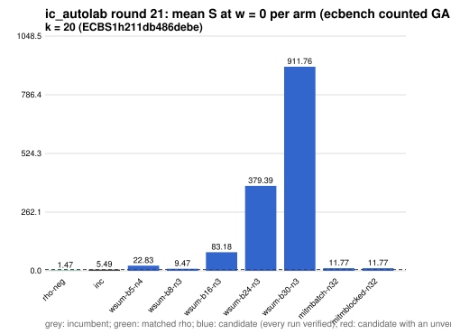

# ic_autolab round 21 (generic track): report

Protocol: [PROTOCOL.md](PROTOCOL.md), frozen 2026-11-04T07:24:00Z at git `f7fed8638a0b83af3e221e89a0b9398fa3889d50`; route `local`. Counted GAE only (deterministic, host independent); no wall-time claim; development loop, no validation-gate row. Loop home: [`../`](../README.md); ledger: [`../ledger.json`](../ledger.json).

Claim record: `PCC-20261104-fe8236` (`python3 tools/pcc/pcc.py standing PCC-20261104-fe8236`). Until a signed replay and recompute exist, this round's outcome is an unverified assertion [pcc:unverified].

## Outcome

| k | class | sel | sel / inc at w = 0 [95%] | w = 0.1 | w = 1 | band | S sel (w = 0 / 0.1 / 1) | S inc | S rho-neg | distance sel / rho |
|--:|:--|:--|:--|:--|:--|:--|:--|:--|:--|:--|
| 20 | **no_challenger** | none (best candidate `wsum-b8-n3`, train S 9.467 / 9.541 / 10.206) | - | - | - | - | - | 5.489 / 5.735 / 7.951 | 1.470 / 1.573 / 2.505 | inc: 3.7x / 3.6x / 3.2x |

Classes follow the protocol's decision rule. Distance to rho is the distance remaining, not a gate. The reasons per size:

- k = 20: no_challenger

## Train (development screen, in sample)

### k = 20: session `ECBS1h211db486debe` (run exit 0, verify exit 0, receipt sha256 `88f5aca8734bd1a51e57390c11d4d21bdd9fe86c9e089381d19c3254b8c855ee`)

| arm | family | N | factor base | oracle | runs | verified | S (w = 0 / 0.1 / 1) | reason proposed |
|:--|:--|--:|:--|:--|--:|--:|:--|:--|
| `rho-neg` | rho | - | `-` | `rho.negation` | 32 | 32 | 1.470 / 1.573 / 2.505 | matched reference |
| `inc` | wsum-b5 | 3 | `prime-projected-abscissa:size=3,scan_cap=48` | `wsum:coef=5,free=1` | 32 | 32 | 5.489 / 5.735 / 7.951 | incumbent |
| `wsum-b5-n4` | wsum-b5 | 4 | `prime-projected-abscissa:size=4,scan_cap=64` | `wsum:coef=5,free=1` | 32 | 32 | 22.826 / 22.883 / 23.393 | incumbent neighbourhood: N = 1.2 x 3 |
| `wsum-b8-n3` | wsum-b8 | 3 | `prime-projected-abscissa:size=3,scan_cap=48` | `wsum:coef=8,free=1` | 32 | 32 | 9.467 / 9.541 / 10.206 | cross-size transfer: wsum-b8-n3 is the k = 24 incumbent at N / N_a = 0.037 |
| `wsum-b16-n3` | wsum-b16 | 3 | `prime-projected-abscissa:size=3,scan_cap=48` | `wsum:coef=16,free=1` | 32 | 32 | 83.185 / 86.489 / 116.227 | exploration: family wsum-b16 untried at k = 20, N = 0.0001 x N_a |
| `wsum-b24-n3` | wsum-b24 | 3 | `prime-projected-abscissa:size=3,scan_cap=48` | `wsum:coef=24,free=1` | 32 | 32 | 379.385 / 406.458 / 650.112 | exploration: family wsum-b24 untried at k = 20, N = 0.0001 x N_a |
| `wsum-b30-n3` | wsum-b30 | 3 | `prime-projected-abscissa:size=3,scan_cap=48` | `wsum:coef=30,free=1` | 32 | 32 | 911.758 / 1000.782 / 1801.998 | exploration: family wsum-b30 untried at k = 20, N = 0.0001 x N_a |
| `mitmbatch-n32` | mitmbatch | 32 | `prime-projected-abscissa:size=32,scan_cap=512` | `mitm-prime-batch:m=2` | 32 | 32 | 11.769 / 12.631 / 20.389 | exploration: family mitmbatch untried at k = 20, N = 1 x N_a |
| `mitmblocked-n32` | mitmblocked | 32 | `prime-projected-abscissa:size=32,scan_cap=512` | `mitm-prime-blocked:m=2` | 32 | 32 | 11.769 / 12.631 / 20.389 | exploration: family mitmblocked untried at k = 20, N = 1 x N_a |

## Selection

- k = 20: no_challenger  (Pareto alternative at w = 1: `wsum-b8-n3`)

## Ledger after this round

| k | incumbent | since round | S (w = 0 / 0.1 / 1) | distance to rho |
|--:|:--|--:|:--|:--|
| 20 | `wsum-b5-n3` (`prime-projected-abscissa:size=3,scan_cap=48` + `wsum:coef=5,free=1`) | 16 | 5.384 / 5.609 / 7.638 | 3.6x / 3.5x / 3.0x |
| 24 | `wsum-b8-n3` (`prime-projected-abscissa:size=3,scan_cap=48` + `wsum:coef=8,free=1`) | 20 | 3.678 / 3.920 / 6.100 | 3.0x / 3.0x / 2.7x |
| 28 | `wsum-b12-n3` (`prime-projected-abscissa:size=3,scan_cap=48` + `wsum:coef=12,free=1`) | 18 | 2.949 / 3.222 / 5.676 | 3.0x / 3.0x / 3.0x |
| 32 | `wsum-b20-n3` (`prime-projected-abscissa:size=3,scan_cap=48` + `wsum:coef=20,free=1`) | 19 | 2.937 / 3.213 / 5.697 | 3.1x / 3.1x / 3.1x |

## Evidence and deviations

- ecbench binary sha256: `e7242bc192bda8c8da9e64895afe943e8aa47cfa37bd490d656e2181758e9533`; `--cpus auto`, allow_busy = true; `verify --replay 8` per session; audit receipts in `analysis/`; sessions in `sessions/` (records in the artifact store when large).
- Route: the local route is an explicitly requested development screen, not the Iso Lab EKS default; counts are deterministic and replayed, wall time is not claimed. No row of this round enters the IC leaderboard or `benchmarks/README.md` (validation gate).
- Train selection is in sample (disclosed); the holdout is fresh (new `target_seed`, excluded exposures). Failed, timed-out and regressing arms are retained above.
