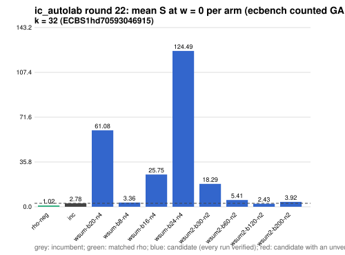

# ic_autolab round 22 (generic track): report

Protocol: [PROTOCOL.md](PROTOCOL.md), frozen 2026-11-04T07:50:02Z at git `15ae5647cbdfb4df0e2a90516f83c33495a2dd50`; route `local`. Counted GAE only (deterministic, host independent); no wall-time claim; development loop, no validation-gate row. Loop home: [`../`](../README.md); ledger: [`../ledger.json`](../ledger.json).

Claim record: `PCC-20261104-09fa2c` (`python3 tools/pcc/pcc.py standing PCC-20261104-09fa2c`). Until a signed replay and recompute exist, this round's outcome is an unverified assertion [pcc:unverified].

## Outcome

| k | class | sel | sel / inc at w = 0 [95%] | w = 0.1 | w = 1 | band | S sel (w = 0 / 0.1 / 1) | S inc | S rho-neg | distance sel / rho |
|--:|:--|:--|:--|:--|:--|:--|:--|:--|:--|:--|
| 32 | **improvement** | wsum2-b120-n2 | 0.838 [0.749, 0.937] | 0.837 [0.741, 0.946] | 0.833 [0.702, 0.988] | sel < inc | 2.519 / 2.759 / 4.915 | 3.006 / 3.295 / 5.901 | 0.918 / 1.008 / 1.818 | 2.7x / 2.7x / 2.7x |

Classes follow the protocol's decision rule. Distance to rho is the distance remaining, not a gate. The reasons per size:

- k = 32: compare ops.status = ok, admissible = true; sel / inc = 0.8381 [0.749, 0.937] at w = 0; band: sel < inc; A/A inc-aa / inc interval [1.000, 1.000] contains 1

## Train (development screen, in sample)

### k = 32: session `ECBS1hd70593046915` (run exit 0, verify exit 0, receipt sha256 `7d7511a185bda23e80c45eeaef1de6f07923e4a49db23c30bfdf5e71beeaadd9`)

| arm | family | N | factor base | oracle | runs | verified | S (w = 0 / 0.1 / 1) | reason proposed |
|:--|:--|--:|:--|:--|--:|--:|:--|:--|
| `rho-neg` | rho | - | `-` | `rho.negation` | 32 | 32 | 1.018 / 1.118 / 2.018 | matched reference |
| `inc` | wsum-b20 | 3 | `prime-projected-abscissa:size=3,scan_cap=48` | `wsum:coef=20,free=1` | 32 | 32 | 2.775 / 3.019 / 5.213 | incumbent |
| `wsum-b20-n4` | wsum-b20 | 4 | `prime-projected-abscissa:size=4,scan_cap=64` | `wsum:coef=20,free=1` | 32 | 32 | 61.084 / 61.092 / 61.164 | incumbent neighbourhood: N = 1.2 x 3 |
| `wsum-b8-n4` | wsum-b8 | 4 | `prime-projected-abscissa:size=4,scan_cap=64` | `wsum:coef=8,free=1` | 32 | 32 | 3.363 / 3.661 / 6.343 | cross-size transfer: wsum-b8-n3 is the k = 24 incumbent at N / N_a = 0.037 |
| `wsum-b16-n4` | wsum-b16 | 4 | `prime-projected-abscissa:size=4,scan_cap=64` | `wsum:coef=16,free=1` | 32 | 32 | 25.751 / 25.770 / 25.937 | alternative wsum-b16 (best S(0) 3.081 at N = 3): N = 1.2 x 3 |
| `wsum-b24-n4` | wsum-b24 | 4 | `prime-projected-abscissa:size=4,scan_cap=64` | `wsum:coef=24,free=1` | 32 | 32 | 124.487 / 124.492 / 124.532 | alternative wsum-b24 (best S(0) 3.369 at N = 3): N = 1.2 x 3 |
| `wsum2-b30-n2` | wsum2-b30 | 2 | `prime-projected-abscissa:size=2,scan_cap=32` | `wsum:coef=30,free=1` | 32 | 32 | 18.286 / 21.902 / 54.447 | exploration: family wsum2-b30 untried at k = 32, N = 0.0001 x N_a |
| `wsum2-b60-n2` | wsum2-b60 | 2 | `prime-projected-abscissa:size=2,scan_cap=32` | `wsum:coef=60,free=1` | 32 | 32 | 5.414 / 6.414 / 15.418 | exploration: family wsum2-b60 untried at k = 32, N = 0.0001 x N_a |
| `wsum2-b120-n2` | wsum2-b120 | 2 | `prime-projected-abscissa:size=2,scan_cap=32` | `wsum:coef=120,free=1` | 32 | 32 | 2.426 / 2.647 / 4.637 | exploration: family wsum2-b120 untried at k = 32, N = 0.0001 x N_a |
| `wsum2-b200-n2` | wsum2-b200 | 2 | `prime-projected-abscissa:size=2,scan_cap=32` | `wsum:coef=200,free=1` | 32 | 32 | 3.917 / 3.994 / 4.682 | exploration: family wsum2-b200 untried at k = 32, N = 0.0001 x N_a |

## Selection

- k = 32: challenger `wsum2-b120-n2` (Pareto alternative at w = 1: `wsum2-b120-n2`)

## Holdout sessions

| k | session | run exit | verify exit | receipt sha256 | levels |
|--:|:--|--:|--:|:--|:--|
| 32 | `ECBS1h66e91aeb7780` | 0 | 0 | `640d6498ac9ac840568cd7523a51a73e3700449933430b4ace96f67d8487bbe3` | {"verified":480} |

## Ledger after this round

| k | incumbent | since round | S (w = 0 / 0.1 / 1) | distance to rho |
|--:|:--|--:|:--|:--|
| 20 | `wsum-b5-n3` (`prime-projected-abscissa:size=3,scan_cap=48` + `wsum:coef=5,free=1`) | 16 | 5.384 / 5.609 / 7.638 | 3.6x / 3.5x / 3.0x |
| 24 | `wsum-b8-n3` (`prime-projected-abscissa:size=3,scan_cap=48` + `wsum:coef=8,free=1`) | 20 | 3.678 / 3.920 / 6.100 | 3.0x / 3.0x / 2.7x |
| 28 | `wsum-b12-n3` (`prime-projected-abscissa:size=3,scan_cap=48` + `wsum:coef=12,free=1`) | 18 | 2.949 / 3.222 / 5.676 | 3.0x / 3.0x / 3.0x |
| 32 | `wsum2-b120-n2` (`prime-projected-abscissa:size=2,scan_cap=32` + `wsum:coef=120,free=1`) | 22 | 2.519 / 2.759 / 4.915 | 2.7x / 2.7x / 2.7x |

## Evidence and deviations

- ecbench binary sha256: `e7242bc192bda8c8da9e64895afe943e8aa47cfa37bd490d656e2181758e9533`; `--cpus auto`, allow_busy = true; `verify --replay 8` per session; audit receipts in `analysis/`; sessions in `sessions/` (records in the artifact store when large).
- Route: the local route is an explicitly requested development screen, not the Iso Lab EKS default; counts are deterministic and replayed, wall time is not claimed. No row of this round enters the IC leaderboard or `benchmarks/README.md` (validation gate).
- Train selection is in sample (disclosed); the holdout is fresh (new `target_seed`, excluded exposures). Failed, timed-out and regressing arms are retained above.
