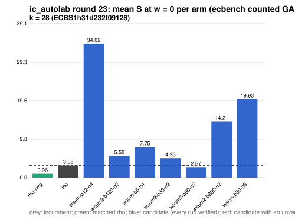

# ic_autolab round 23 (generic track): report

Protocol: [PROTOCOL.md](PROTOCOL.md), frozen 2026-11-04T07:54:07Z at git `3f80e412cef62c837fad7408d1f3dea3ad03ef09`; route `local`. Counted GAE only (deterministic, host independent); no wall-time claim; development loop, no validation-gate row. Loop home: [`../`](../README.md); ledger: [`../ledger.json`](../ledger.json).

Claim record: `PCC-20261104-cf671c` (`python3 tools/pcc/pcc.py standing PCC-20261104-cf671c`). Until a signed replay and recompute exist, this round's outcome is an unverified assertion [pcc:unverified].

## Outcome

| k | class | sel | sel / inc at w = 0 [95%] | w = 0.1 | w = 1 | band | S sel (w = 0 / 0.1 / 1) | S inc | S rho-neg | distance sel / rho |
|--:|:--|:--|:--|:--|:--|:--|:--|:--|:--|:--|
| 28 | **improvement** | wsum2-b60-n2 | 0.849 [0.782, 0.922] | 0.840 [0.768, 0.919] | 0.800 [0.705, 0.908] | sel < inc | 2.576 / 2.793 / 4.746 | 3.034 / 3.324 / 5.934 | 0.934 / 1.021 / 1.804 | 2.8x / 2.7x / 2.6x |

Classes follow the protocol's decision rule. Distance to rho is the distance remaining, not a gate. The reasons per size:

- k = 28: compare ops.status = ok, admissible = true; sel / inc = 0.8491 [0.782, 0.922] at w = 0; band: sel < inc; A/A inc-aa / inc interval [1.000, 1.000] contains 1

## Train (development screen, in sample)

### k = 28: session `ECBS1h31d232f09128` (run exit 0, verify exit 0, receipt sha256 `6cf7635e0645899e5c69a1687794429f6743e1ece75f325641b779e7620a0654`)

| arm | family | N | factor base | oracle | runs | verified | S (w = 0 / 0.1 / 1) | reason proposed |
|:--|:--|--:|:--|:--|--:|--:|:--|:--|
| `rho-neg` | rho | - | `-` | `rho.negation` | 32 | 32 | 0.961 / 1.051 / 1.857 | matched reference |
| `inc` | wsum-b12 | 3 | `prime-projected-abscissa:size=3,scan_cap=48` | `wsum:coef=12,free=1` | 32 | 32 | 3.083 / 3.380 / 6.062 | incumbent |
| `wsum-b12-n4` | wsum-b12 | 4 | `prime-projected-abscissa:size=4,scan_cap=64` | `wsum:coef=12,free=1` | 32 | 32 | 34.018 / 34.033 / 34.168 | incumbent neighbourhood: N = 1.2 x 3 |
| `wsum2-b120-n2` | wsum2-b120 | 2 | `prime-projected-abscissa:size=2,scan_cap=32` | `wsum:coef=120,free=1` | 32 | 32 | 5.520 / 5.577 / 6.091 | cross-size transfer: wsum2-b120-n2 is the k = 32 incumbent at N / N_a = 0.004 |
| `wsum-b8-n4` | wsum-b8 | 4 | `prime-projected-abscissa:size=4,scan_cap=64` | `wsum:coef=8,free=1` | 32 | 32 | 7.746 / 7.808 / 8.363 | cross-size transfer: wsum-b8-n3 is the k = 24 incumbent at N / N_a = 0.037 |
| `wsum2-b30-n2` | wsum2-b30 | 2 | `prime-projected-abscissa:size=2,scan_cap=32` | `wsum:coef=30,free=1` | 32 | 32 | 4.929 / 5.784 / 13.484 | exploration: family wsum2-b30 untried at k = 28, N = 0.0001 x N_a |
| `wsum2-b60-n2` | wsum2-b60 | 2 | `prime-projected-abscissa:size=2,scan_cap=32` | `wsum:coef=60,free=1` | 32 | 32 | 2.670 / 2.904 / 5.016 | exploration: family wsum2-b60 untried at k = 28, N = 0.0001 x N_a |
| `wsum2-b200-n2` | wsum2-b200 | 2 | `prime-projected-abscissa:size=2,scan_cap=32` | `wsum:coef=200,free=1` | 32 | 32 | 14.212 / 14.234 / 14.436 | exploration: family wsum2-b200 untried at k = 28, N = 0.0001 x N_a |
| `wsum-b30-n3` | wsum-b30 | 3 | `prime-projected-abscissa:size=3,scan_cap=48` | `wsum:coef=30,free=1` | 32 | 32 | 19.931 / 19.954 / 20.162 | exploration: family wsum-b30 untried at k = 28, N = 0.0001 x N_a |

## Selection

- k = 28: challenger `wsum2-b60-n2` (Pareto alternative at w = 1: `wsum2-b60-n2`)

## Holdout sessions

| k | session | run exit | verify exit | receipt sha256 | levels |
|--:|:--|--:|--:|:--|:--|
| 28 | `ECBS1hf1bfaa6be63c` | 0 | 0 | `fe5334c24eb6a3f9736667916e36187eb035381ce8d3a1974efc2d80a844abce` | {"verified":480} |

## Ledger after this round

| k | incumbent | since round | S (w = 0 / 0.1 / 1) | distance to rho |
|--:|:--|--:|:--|:--|
| 20 | `wsum-b5-n3` (`prime-projected-abscissa:size=3,scan_cap=48` + `wsum:coef=5,free=1`) | 16 | 5.384 / 5.609 / 7.638 | 3.6x / 3.5x / 3.0x |
| 24 | `wsum-b8-n3` (`prime-projected-abscissa:size=3,scan_cap=48` + `wsum:coef=8,free=1`) | 20 | 3.678 / 3.920 / 6.100 | 3.0x / 3.0x / 2.7x |
| 28 | `wsum2-b60-n2` (`prime-projected-abscissa:size=2,scan_cap=32` + `wsum:coef=60,free=1`) | 23 | 2.576 / 2.793 / 4.746 | 2.8x / 2.7x / 2.6x |
| 32 | `wsum2-b120-n2` (`prime-projected-abscissa:size=2,scan_cap=32` + `wsum:coef=120,free=1`) | 22 | 2.519 / 2.759 / 4.915 | 2.7x / 2.7x / 2.7x |

## Evidence and deviations

- ecbench binary sha256: `e7242bc192bda8c8da9e64895afe943e8aa47cfa37bd490d656e2181758e9533`; `--cpus auto`, allow_busy = true; `verify --replay 8` per session; audit receipts in `analysis/`; sessions in `sessions/` (records in the artifact store when large).
- Route: the local route is an explicitly requested development screen, not the Iso Lab EKS default; counts are deterministic and replayed, wall time is not claimed. No row of this round enters the IC leaderboard or `benchmarks/README.md` (validation gate).
- Train selection is in sample (disclosed); the holdout is fresh (new `target_seed`, excluded exposures). Failed, timed-out and regressing arms are retained above.
