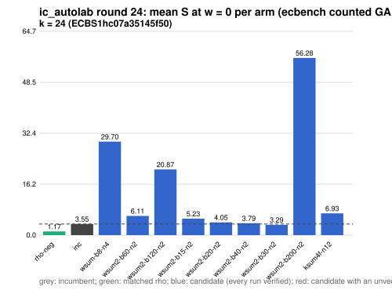

# ic_autolab round 24 (generic track): report

Protocol: [PROTOCOL.md](PROTOCOL.md), frozen 2026-11-04T07:55:52Z at git `d7fa7145f82849c0b91d4ff65e5162bc3382fbbc`; route `local`. Counted GAE only (deterministic, host independent); no wall-time claim; development loop, no validation-gate row. Loop home: [`../`](../README.md); ledger: [`../ledger.json`](../ledger.json).

Claim record: `PCC-20261104-66c1d2` (`python3 tools/pcc/pcc.py standing PCC-20261104-66c1d2`). Until a signed replay and recompute exist, this round's outcome is an unverified assertion [pcc:unverified].

## Outcome

| k | class | sel | sel / inc at w = 0 [95%] | w = 0.1 | w = 1 | band | S sel (w = 0 / 0.1 / 1) | S inc | S rho-neg | distance sel / rho |
|--:|:--|:--|:--|:--|:--|:--|:--|:--|:--|:--|
| 24 | **improvement** | wsum2-b30-n2 | 0.900 [0.845, 0.959] | 0.909 [0.847, 0.975] | 0.957 [0.861, 1.064] | sel < inc | 3.318 / 3.573 / 5.863 | 3.687 / 3.931 / 6.128 | 1.222 / 1.332 / 2.326 | 2.7x / 2.7x / 2.5x |

Classes follow the protocol's decision rule. Distance to rho is the distance remaining, not a gate. The reasons per size:

- k = 24: compare ops.status = ok, admissible = true; sel / inc = 0.9001 [0.845, 0.959] at w = 0; band: sel < inc; A/A inc-aa / inc interval [1.000, 1.000] contains 1

## Train (development screen, in sample)

### k = 24: session `ECBS1hc07a35145f50` (run exit 0, verify exit 0, receipt sha256 `8cf5ec24c85c69f22a2d1cb100bf344425d0ddec867fe4012ad0e1c7e8cd6af9`)

| arm | family | N | factor base | oracle | runs | verified | S (w = 0 / 0.1 / 1) | reason proposed |
|:--|:--|--:|:--|:--|--:|--:|:--|:--|
| `rho-neg` | rho | - | `-` | `rho.negation` | 32 | 32 | 1.168 / 1.274 / 2.220 | matched reference |
| `inc` | wsum-b8 | 3 | `prime-projected-abscissa:size=3,scan_cap=48` | `wsum:coef=8,free=1` | 32 | 32 | 3.547 / 3.764 / 5.720 | incumbent |
| `wsum-b8-n4` | wsum-b8 | 4 | `prime-projected-abscissa:size=4,scan_cap=64` | `wsum:coef=8,free=1` | 32 | 32 | 29.701 / 29.725 / 29.941 | incumbent neighbourhood: N = 1.2 x 3 |
| `wsum2-b60-n2` | wsum2-b60 | 2 | `prime-projected-abscissa:size=2,scan_cap=32` | `wsum:coef=60,free=1` | 32 | 32 | 6.110 / 6.175 / 6.764 | cross-size transfer: wsum2-b60-n2 is the k = 28 incumbent at N / N_a = 0.010 |
| `wsum2-b120-n2` | wsum2-b120 | 2 | `prime-projected-abscissa:size=2,scan_cap=32` | `wsum:coef=120,free=1` | 32 | 32 | 20.867 / 20.885 / 21.044 | cross-size transfer: wsum2-b120-n2 is the k = 32 incumbent at N / N_a = 0.004 |
| `wsum2-b15-n2` | wsum2-b15 | 2 | `prime-projected-abscissa:size=2,scan_cap=32` | `wsum:coef=15,free=1` | 32 | 32 | 5.225 / 5.995 / 12.923 | exploration: family wsum2-b15 untried at k = 24, N = 0.0001 x N_a |
| `wsum2-b20-n2` | wsum2-b20 | 2 | `prime-projected-abscissa:size=2,scan_cap=32` | `wsum:coef=20,free=1` | 32 | 32 | 4.049 / 4.566 / 9.219 | exploration: family wsum2-b20 untried at k = 24, N = 0.0001 x N_a |
| `wsum2-b40-n2` | wsum2-b40 | 2 | `prime-projected-abscissa:size=2,scan_cap=32` | `wsum:coef=40,free=1` | 32 | 32 | 3.792 / 3.949 / 5.360 | exploration: family wsum2-b40 untried at k = 24, N = 0.0001 x N_a |
| `wsum2-b30-n2` | wsum2-b30 | 2 | `prime-projected-abscissa:size=2,scan_cap=32` | `wsum:coef=30,free=1` | 32 | 32 | 3.292 / 3.542 / 5.793 | exploration: family wsum2-b30 untried at k = 24, N = 0.0001 x N_a |
| `wsum2-b200-n2` | wsum2-b200 | 2 | `prime-projected-abscissa:size=2,scan_cap=32` | `wsum:coef=200,free=1` | 32 | 32 | 56.284 / 56.292 / 56.367 | exploration: family wsum2-b200 untried at k = 24, N = 0.0001 x N_a |
| `ksum4f-n12` | ksum4f | 12 | `prime-projected-abscissa:size=12,scan_cap=192` | `ksum:m=4,free=1` | 32 | 32 | 6.926 / 7.442 / 12.085 | exploration: family ksum4f untried at k = 24, at its parent ksum4's best N = 12 |

## Selection

- k = 24: challenger `wsum2-b30-n2` (Pareto alternative at w = 1: `wsum2-b40-n2`)

## Holdout sessions

| k | session | run exit | verify exit | receipt sha256 | levels |
|--:|:--|--:|--:|:--|:--|
| 24 | `ECBS1h4a5add065b8e` | 0 | 0 | `24097ced646444e3eae4738baa175ec04c58eadd6fc8d5c798bdaf2bbc287c80` | {"verified":480} |

## Ledger after this round

| k | incumbent | since round | S (w = 0 / 0.1 / 1) | distance to rho |
|--:|:--|--:|:--|:--|
| 20 | `wsum-b5-n3` (`prime-projected-abscissa:size=3,scan_cap=48` + `wsum:coef=5,free=1`) | 16 | 5.384 / 5.609 / 7.638 | 3.6x / 3.5x / 3.0x |
| 24 | `wsum2-b30-n2` (`prime-projected-abscissa:size=2,scan_cap=32` + `wsum:coef=30,free=1`) | 24 | 3.318 / 3.573 / 5.863 | 2.7x / 2.7x / 2.5x |
| 28 | `wsum2-b60-n2` (`prime-projected-abscissa:size=2,scan_cap=32` + `wsum:coef=60,free=1`) | 23 | 2.576 / 2.793 / 4.746 | 2.8x / 2.7x / 2.6x |
| 32 | `wsum2-b120-n2` (`prime-projected-abscissa:size=2,scan_cap=32` + `wsum:coef=120,free=1`) | 22 | 2.519 / 2.759 / 4.915 | 2.7x / 2.7x / 2.7x |

## Evidence and deviations

- ecbench binary sha256: `e7242bc192bda8c8da9e64895afe943e8aa47cfa37bd490d656e2181758e9533`; `--cpus auto`, allow_busy = true; `verify --replay 8` per session; audit receipts in `analysis/`; sessions in `sessions/` (records in the artifact store when large).
- Route: the local route is an explicitly requested development screen, not the Iso Lab EKS default; counts are deterministic and replayed, wall time is not claimed. No row of this round enters the IC leaderboard or `benchmarks/README.md` (validation gate).
- Train selection is in sample (disclosed); the holdout is fresh (new `target_seed`, excluded exposures). Failed, timed-out and regressing arms are retained above.
