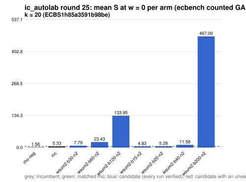

# ic_autolab round 25 (generic track): report

Protocol: [PROTOCOL.md](PROTOCOL.md), frozen 2026-11-04T07:57:50Z at git `59a8d6377c9ab57e4f38fd3b60593d89962b8fd8`; route `local`. Counted GAE only (deterministic, host independent); no wall-time claim; development loop, no validation-gate row. Loop home: [`../`](../README.md); ledger: [`../ledger.json`](../ledger.json).

Claim record: `PCC-20261104-f461bc` (`python3 tools/pcc/pcc.py standing PCC-20261104-f461bc`). Until a signed replay and recompute exist, this round's outcome is an unverified assertion [pcc:unverified].

## Outcome

| k | class | sel | sel / inc at w = 0 [95%] | w = 0.1 | w = 1 | band | S sel (w = 0 / 0.1 / 1) | S inc | S rho-neg | distance sel / rho |
|--:|:--|:--|:--|:--|:--|:--|:--|:--|:--|:--|
| 20 | **improvement** | wsum2-b15-n2 | 0.895 [0.862, 0.930] | 0.899 [0.861, 0.938] | 0.920 [0.856, 0.989] | sel < inc | 4.860 / 5.083 / 7.092 | 5.428 / 5.656 / 7.709 | 1.502 / 1.609 / 2.571 | 3.2x / 3.2x / 2.8x |

Classes follow the protocol's decision rule. Distance to rho is the distance remaining, not a gate. The reasons per size:

- k = 20: compare ops.status = ok, admissible = true; sel / inc = 0.8954 [0.862, 0.930] at w = 0; band: sel < inc; A/A inc-aa / inc interval [1.000, 1.000] contains 1

## Train (development screen, in sample)

### k = 20: session `ECBS1h85a3591b98be` (run exit 0, verify exit 0, receipt sha256 `fbe1dc22f8b2471f801f795a67a3d8b9ccb8aa884215b2e127e862547f8239b1`)

| arm | family | N | factor base | oracle | runs | verified | S (w = 0 / 0.1 / 1) | reason proposed |
|:--|:--|--:|:--|:--|--:|--:|:--|:--|
| `rho-neg` | rho | - | `-` | `rho.negation` | 32 | 32 | 1.558 / 1.670 / 2.682 | matched reference |
| `inc` | wsum-b5 | 3 | `prime-projected-abscissa:size=3,scan_cap=48` | `wsum:coef=5,free=1` | 32 | 32 | 5.332 / 5.549 / 7.496 | incumbent |
| `wsum2-b30-n2` | wsum2-b30 | 2 | `prime-projected-abscissa:size=2,scan_cap=32` | `wsum:coef=30,free=1` | 32 | 32 | 7.786 / 7.854 / 8.471 | cross-size transfer: wsum2-b30-n2 is the k = 24 incumbent at N / N_a = 0.025 |
| `wsum2-b60-n2` | wsum2-b60 | 2 | `prime-projected-abscissa:size=2,scan_cap=32` | `wsum:coef=60,free=1` | 32 | 32 | 23.431 / 23.573 / 24.847 | cross-size transfer: wsum2-b60-n2 is the k = 28 incumbent at N / N_a = 0.010 |
| `wsum2-b120-n2` | wsum2-b120 | 2 | `prime-projected-abscissa:size=2,scan_cap=32` | `wsum:coef=120,free=1` | 32 | 32 | 133.949 / 141.785 / 212.308 | cross-size transfer: wsum2-b120-n2 is the k = 32 incumbent at N / N_a = 0.004 |
| `wsum2-b15-n2` | wsum2-b15 | 2 | `prime-projected-abscissa:size=2,scan_cap=32` | `wsum:coef=15,free=1` | 32 | 32 | 4.832 / 5.055 / 7.059 | exploration: family wsum2-b15 untried at k = 20, N = 0.0001 x N_a |
| `wsum2-b20-n2` | wsum2-b20 | 2 | `prime-projected-abscissa:size=2,scan_cap=32` | `wsum:coef=20,free=1` | 32 | 32 | 5.281 / 5.410 / 6.571 | exploration: family wsum2-b20 untried at k = 20, N = 0.0001 x N_a |
| `wsum2-b40-n2` | wsum2-b40 | 2 | `prime-projected-abscissa:size=2,scan_cap=32` | `wsum:coef=40,free=1` | 32 | 32 | 11.578 / 11.621 / 12.007 | exploration: family wsum2-b40 untried at k = 20, N = 0.0001 x N_a |
| `wsum2-b200-n2` | wsum2-b200 | 2 | `prime-projected-abscissa:size=2,scan_cap=32` | `wsum:coef=200,free=1` | 32 | 32 | 467.001 / 503.658 / 833.571 | exploration: family wsum2-b200 untried at k = 20, N = 0.0001 x N_a |

## Selection

- k = 20: challenger `wsum2-b15-n2` (Pareto alternative at w = 1: `wsum2-b20-n2`)

## Holdout sessions

| k | session | run exit | verify exit | receipt sha256 | levels |
|--:|:--|--:|--:|:--|:--|
| 20 | `ECBS1hf759e8a6c6f9` | 0 | 0 | `63cb936fe0d30b1d80410de1b50238acad52b8813067f5211f59d3057cc7132f` | {"verified":480} |

## Ledger after this round

| k | incumbent | since round | S (w = 0 / 0.1 / 1) | distance to rho |
|--:|:--|--:|:--|:--|
| 20 | `wsum2-b15-n2` (`prime-projected-abscissa:size=2,scan_cap=32` + `wsum:coef=15,free=1`) | 25 | 4.860 / 5.083 / 7.092 | 3.2x / 3.2x / 2.8x |
| 24 | `wsum2-b30-n2` (`prime-projected-abscissa:size=2,scan_cap=32` + `wsum:coef=30,free=1`) | 24 | 3.318 / 3.573 / 5.863 | 2.7x / 2.7x / 2.5x |
| 28 | `wsum2-b60-n2` (`prime-projected-abscissa:size=2,scan_cap=32` + `wsum:coef=60,free=1`) | 23 | 2.576 / 2.793 / 4.746 | 2.8x / 2.7x / 2.6x |
| 32 | `wsum2-b120-n2` (`prime-projected-abscissa:size=2,scan_cap=32` + `wsum:coef=120,free=1`) | 22 | 2.519 / 2.759 / 4.915 | 2.7x / 2.7x / 2.7x |

## Evidence and deviations

- ecbench binary sha256: `e7242bc192bda8c8da9e64895afe943e8aa47cfa37bd490d656e2181758e9533`; `--cpus auto`, allow_busy = true; `verify --replay 8` per session; audit receipts in `analysis/`; sessions in `sessions/` (records in the artifact store when large).
- Route: the local route is an explicitly requested development screen, not the Iso Lab EKS default; counts are deterministic and replayed, wall time is not claimed. No row of this round enters the IC leaderboard or `benchmarks/README.md` (validation gate).
- Train selection is in sample (disclosed); the holdout is fresh (new `target_seed`, excluded exposures). Failed, timed-out and regressing arms are retained above.
