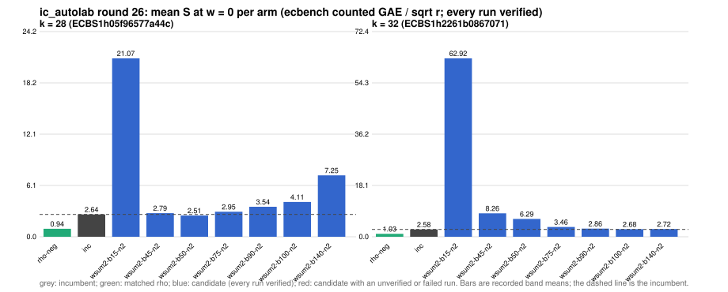

# ic_autolab round 26 (generic track): report

Protocol: [PROTOCOL.md](PROTOCOL.md), frozen 2026-11-04T08:01:30Z at git `49addad3c9f544f7f7d89a80e47b0095ee8704c9`; route `local`. Counted GAE only (deterministic, host independent); no wall-time claim; development loop, no validation-gate row. Loop home: [`../`](../README.md); ledger: [`../ledger.json`](../ledger.json).

Claim record: `PCC-20261104-f9ed8c` (`python3 tools/pcc/pcc.py standing PCC-20261104-f9ed8c`). Until a signed replay and recompute exist, this round's outcome is an unverified assertion [pcc:unverified].

## Outcome

| k | class | sel | sel / inc at w = 0 [95%] | w = 0.1 | w = 1 | band | S sel (w = 0 / 0.1 / 1) | S inc | S rho-neg | distance sel / rho |
|--:|:--|:--|:--|:--|:--|:--|:--|:--|:--|:--|
| 28 | **regression** | wsum2-b50-n2 | 1.066 [0.990, 1.148] | 1.100 [1.015, 1.191] | 1.263 [1.138, 1.402] | inc < sel | 2.750 / 3.076 / 6.012 | 2.580 / 2.798 / 4.759 | 0.996 / 1.090 / 1.928 | 2.8x / 2.8x / 3.1x |
| 32 | **no_challenger** | none (best candidate `wsum2-b100-n2`, train S 2.682 / 3.030 / 6.161) | - | - | - | - | - | 2.581 / 2.833 / 5.100 | 1.030 / 1.131 / 2.044 | inc: 2.5x / 2.5x / 2.5x |

Classes follow the protocol's decision rule. Distance to rho is the distance remaining, not a gate. The reasons per size:

- k = 28: compare ops.status = ok, admissible = true; sel / inc = 1.0660 [0.990, 1.148] at w = 0; band: inc < sel; A/A inc-aa / inc interval [1.000, 1.000] contains 1
- k = 32: no_challenger

## Train (development screen, in sample)

### k = 28: session `ECBS1h05f96577a44c` (run exit 0, verify exit 0, receipt sha256 `70c59cc3e3652cb4cd280a8edae2d759aebce91a52f21b17ae02ca278bc2ad21`)

| arm | family | N | factor base | oracle | runs | verified | S (w = 0 / 0.1 / 1) | reason proposed |
|:--|:--|--:|:--|:--|--:|--:|:--|:--|
| `rho-neg` | rho | - | `-` | `rho.negation` | 32 | 32 | 0.944 / 1.032 / 1.824 | matched reference |
| `inc` | wsum2-b60 | 2 | `prime-projected-abscissa:size=2,scan_cap=32` | `wsum:coef=60,free=1` | 32 | 32 | 2.640 / 2.870 / 4.939 | incumbent |
| `wsum2-b15-n2` | wsum2-b15 | 2 | `prime-projected-abscissa:size=2,scan_cap=32` | `wsum:coef=15,free=1` | 32 | 32 | 21.067 / 25.177 / 62.166 | cross-size transfer: wsum2-b15-n2 is the k = 20 incumbent at N / N_a = 0.062 |
| `wsum2-b45-n2` | wsum2-b45 | 2 | `prime-projected-abscissa:size=2,scan_cap=32` | `wsum:coef=45,free=1` | 32 | 32 | 2.790 / 3.157 / 6.458 | exploration: family wsum2-b45 untried at k = 28, N = 0.0001 x N_a |
| `wsum2-b50-n2` | wsum2-b50 | 2 | `prime-projected-abscissa:size=2,scan_cap=32` | `wsum:coef=50,free=1` | 32 | 32 | 2.505 / 2.784 / 5.290 | exploration: family wsum2-b50 untried at k = 28, N = 0.0001 x N_a |
| `wsum2-b75-n2` | wsum2-b75 | 2 | `prime-projected-abscissa:size=2,scan_cap=32` | `wsum:coef=75,free=1` | 32 | 32 | 2.952 / 3.104 / 4.474 | exploration: family wsum2-b75 untried at k = 28, N = 0.0001 x N_a |
| `wsum2-b90-n2` | wsum2-b90 | 2 | `prime-projected-abscissa:size=2,scan_cap=32` | `wsum:coef=90,free=1` | 32 | 32 | 3.544 / 3.643 / 4.533 | exploration: family wsum2-b90 untried at k = 28, N = 0.0001 x N_a |
| `wsum2-b100-n2` | wsum2-b100 | 2 | `prime-projected-abscissa:size=2,scan_cap=32` | `wsum:coef=100,free=1` | 32 | 32 | 4.110 / 4.191 / 4.915 | exploration: family wsum2-b100 untried at k = 28, N = 0.0001 x N_a |
| `wsum2-b140-n2` | wsum2-b140 | 2 | `prime-projected-abscissa:size=2,scan_cap=32` | `wsum:coef=140,free=1` | 32 | 32 | 7.248 / 7.291 / 7.674 | exploration: family wsum2-b140 untried at k = 28, N = 0.0001 x N_a |

### k = 32: session `ECBS1h2261b0867071` (run exit 0, verify exit 0, receipt sha256 `fd165eae09ca2d2b0f2353b81d8cb45dbac1c4cd4e3b4088efdd9b4f679298db`)

| arm | family | N | factor base | oracle | runs | verified | S (w = 0 / 0.1 / 1) | reason proposed |
|:--|:--|--:|:--|:--|--:|--:|:--|:--|
| `rho-neg` | rho | - | `-` | `rho.negation` | 32 | 32 | 1.030 / 1.131 / 2.044 | matched reference |
| `inc` | wsum2-b120 | 2 | `prime-projected-abscissa:size=2,scan_cap=32` | `wsum:coef=120,free=1` | 32 | 32 | 2.581 / 2.833 / 5.100 | incumbent |
| `wsum2-b15-n2` | wsum2-b15 | 2 | `prime-projected-abscissa:size=2,scan_cap=32` | `wsum:coef=15,free=1` | 32 | 32 | 62.921 / 75.466 / 188.366 | cross-size transfer: wsum2-b15-n2 is the k = 20 incumbent at N / N_a = 0.062 |
| `wsum2-b45-n2` | wsum2-b45 | 2 | `prime-projected-abscissa:size=2,scan_cap=32` | `wsum:coef=45,free=1` | 32 | 32 | 8.260 / 9.854 / 24.203 | exploration: family wsum2-b45 untried at k = 32, N = 0.0001 x N_a |
| `wsum2-b50-n2` | wsum2-b50 | 2 | `prime-projected-abscissa:size=2,scan_cap=32` | `wsum:coef=50,free=1` | 32 | 32 | 6.293 / 7.487 / 18.230 | exploration: family wsum2-b50 untried at k = 32, N = 0.0001 x N_a |
| `wsum2-b75-n2` | wsum2-b75 | 2 | `prime-projected-abscissa:size=2,scan_cap=32` | `wsum:coef=75,free=1` | 32 | 32 | 3.462 / 4.040 / 9.243 | exploration: family wsum2-b75 untried at k = 32, N = 0.0001 x N_a |
| `wsum2-b90-n2` | wsum2-b90 | 2 | `prime-projected-abscissa:size=2,scan_cap=32` | `wsum:coef=90,free=1` | 32 | 32 | 2.863 / 3.280 / 7.029 | exploration: family wsum2-b90 untried at k = 32, N = 0.0001 x N_a |
| `wsum2-b100-n2` | wsum2-b100 | 2 | `prime-projected-abscissa:size=2,scan_cap=32` | `wsum:coef=100,free=1` | 32 | 32 | 2.682 / 3.030 / 6.161 | exploration: family wsum2-b100 untried at k = 32, N = 0.0001 x N_a |
| `wsum2-b140-n2` | wsum2-b140 | 2 | `prime-projected-abscissa:size=2,scan_cap=32` | `wsum:coef=140,free=1` | 32 | 32 | 2.721 / 2.911 / 4.622 | exploration: family wsum2-b140 untried at k = 32, N = 0.0001 x N_a |

## Selection

- k = 28: challenger `wsum2-b50-n2` (Pareto alternative at w = 1: `wsum2-b75-n2`)
- k = 32: no_challenger  (Pareto alternative at w = 1: `wsum2-b140-n2`)

## Holdout sessions

| k | session | run exit | verify exit | receipt sha256 | levels |
|--:|:--|--:|--:|:--|:--|
| 28 | `ECBS1he23f5c757de8` | 0 | 0 | `29ac5ddc611d0ff6addb5c2c674860aee1438fa986a0f1426c63dc16c6c03f4c` | {"verified":480} |

## Ledger after this round

| k | incumbent | since round | S (w = 0 / 0.1 / 1) | distance to rho |
|--:|:--|--:|:--|:--|
| 20 | `wsum2-b15-n2` (`prime-projected-abscissa:size=2,scan_cap=32` + `wsum:coef=15,free=1`) | 25 | 4.860 / 5.083 / 7.092 | 3.2x / 3.2x / 2.8x |
| 24 | `wsum2-b30-n2` (`prime-projected-abscissa:size=2,scan_cap=32` + `wsum:coef=30,free=1`) | 24 | 3.318 / 3.573 / 5.863 | 2.7x / 2.7x / 2.5x |
| 28 | `wsum2-b60-n2` (`prime-projected-abscissa:size=2,scan_cap=32` + `wsum:coef=60,free=1`) | 23 | 2.576 / 2.793 / 4.746 | 2.8x / 2.7x / 2.6x |
| 32 | `wsum2-b120-n2` (`prime-projected-abscissa:size=2,scan_cap=32` + `wsum:coef=120,free=1`) | 22 | 2.519 / 2.759 / 4.915 | 2.7x / 2.7x / 2.7x |

## Evidence and deviations

- ecbench binary sha256: `e7242bc192bda8c8da9e64895afe943e8aa47cfa37bd490d656e2181758e9533`; `--cpus auto`, allow_busy = true; `verify --replay 8` per session; audit receipts in `analysis/`; sessions in `sessions/` (records in the artifact store when large).
- Route: the local route is an explicitly requested development screen, not the Iso Lab EKS default; counts are deterministic and replayed, wall time is not claimed. No row of this round enters the IC leaderboard or `benchmarks/README.md` (validation gate).
- Train selection is in sample (disclosed); the holdout is fresh (new `target_seed`, excluded exposures). Failed, timed-out and regressing arms are retained above.
