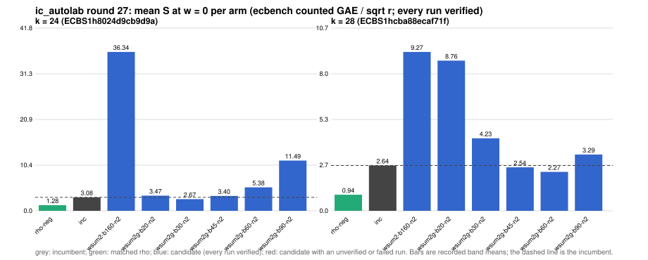

# ic_autolab round 27 (generic track): report

Protocol: [PROTOCOL.md](PROTOCOL.md), frozen 2026-11-04T08:32:31Z at git `434c90658ecca530d20aad59898c585658f7108a`; route `local`. Counted GAE only (deterministic, host independent); no wall-time claim; development loop, no validation-gate row. Loop home: [`../`](../README.md); ledger: [`../ledger.json`](../ledger.json).

Claim record: `PCC-20261104-17a0be` (`python3 tools/pcc/pcc.py standing PCC-20261104-17a0be`). Until a signed replay and recompute exist, this round's outcome is an unverified assertion [pcc:unverified].

## Outcome

| k | class | sel | sel / inc at w = 0 [95%] | w = 0.1 | w = 1 | band | S sel (w = 0 / 0.1 / 1) | S inc | S rho-neg | distance sel / rho |
|--:|:--|:--|:--|:--|:--|:--|:--|:--|:--|:--|
| 24 | **improvement** | wsum2g-b30-n2 | 0.829 [0.761, 0.903] | 0.813 [0.741, 0.892] | 0.731 [0.640, 0.835] | sel < inc | 2.584 / 2.711 / 3.855 | 3.117 / 3.333 / 5.275 | 1.273 / 1.388 / 2.428 | 2.0x / 2.0x / 1.6x |
| 28 | **improvement** | wsum2g-b60-n2 | 0.946 [0.895, 0.999] | 0.915 [0.862, 0.971] | 0.764 [0.702, 0.831] | sel < inc | 2.373 / 2.483 / 3.472 | 2.510 / 2.713 / 4.546 | 0.994 / 1.087 / 1.924 | 2.4x / 2.3x / 1.8x |

Classes follow the protocol's decision rule. Distance to rho is the distance remaining, not a gate. The reasons per size:

- k = 24: compare ops.status = ok, admissible = true; sel / inc = 0.8289 [0.761, 0.903] at w = 0; band: sel < inc; A/A inc-aa / inc interval [1.000, 1.000] contains 1
- k = 28: compare ops.status = ok, admissible = true; sel / inc = 0.9456 [0.895, 0.999] at w = 0; band: sel < inc; A/A inc-aa / inc interval [1.000, 1.000] contains 1

## Train (development screen, in sample)

### k = 24: session `ECBS1h8024d9cb9d9a` (run exit 0, verify exit 0, receipt sha256 `7c9d8f9e3c535d2d347a1d6415645f5e2beb34bda5c14576c667024fd0dbc410`)

| arm | family | N | factor base | oracle | runs | verified | S (w = 0 / 0.1 / 1) | reason proposed |
|:--|:--|--:|:--|:--|--:|--:|:--|:--|
| `rho-neg` | rho | - | `-` | `rho.negation` | 32 | 32 | 1.284 / 1.401 / 2.451 | matched reference |
| `inc` | wsum2-b30 | 2 | `prime-projected-abscissa:size=2,scan_cap=32` | `wsum:coef=30,free=1` | 32 | 32 | 3.085 / 3.296 / 5.201 | incumbent |
| `wsum2-b160-n2` | wsum2-b160 | 2 | `prime-projected-abscissa:size=2,scan_cap=32` | `wsum:coef=160,free=1` | 32 | 32 | 36.343 / 36.353 / 36.440 | exploration: family wsum2-b160 untried at k = 24, N = 0.0001 x N_a |
| `wsum2g-b20-n2` | wsum2g-b20 | 2 | `prime-projected-abscissa:size=2,scan_cap=32` | `wsum:coef=20,free=1` | 32 | 32 | 3.466 / 3.752 / 6.323 | exploration: family wsum2g-b20 untried at k = 24, N = 0.0001 x N_a |
| `wsum2g-b30-n2` | wsum2g-b30 | 2 | `prime-projected-abscissa:size=2,scan_cap=32` | `wsum:coef=30,free=1` | 32 | 32 | 2.672 / 2.808 / 4.031 | exploration: family wsum2g-b30 untried at k = 24, N = 0.0001 x N_a |
| `wsum2g-b45-n2` | wsum2g-b45 | 2 | `prime-projected-abscissa:size=2,scan_cap=32` | `wsum:coef=45,free=1` | 32 | 32 | 3.405 / 3.456 / 3.919 | exploration: family wsum2g-b45 untried at k = 24, N = 0.0001 x N_a |
| `wsum2g-b60-n2` | wsum2g-b60 | 2 | `prime-projected-abscissa:size=2,scan_cap=32` | `wsum:coef=60,free=1` | 32 | 32 | 5.376 / 5.405 / 5.667 | exploration: family wsum2g-b60 untried at k = 24, N = 0.0001 x N_a |
| `wsum2g-b90-n2` | wsum2g-b90 | 2 | `prime-projected-abscissa:size=2,scan_cap=32` | `wsum:coef=90,free=1` | 32 | 32 | 11.491 / 11.506 / 11.642 | exploration: family wsum2g-b90 untried at k = 24, N = 0.0001 x N_a |

### k = 28: session `ECBS1hcba88ecaf71f` (run exit 0, verify exit 0, receipt sha256 `efd299263878b247ad9c2db1640373b665fd7066b1bd1b11dedfa179b170480d`)

| arm | family | N | factor base | oracle | runs | verified | S (w = 0 / 0.1 / 1) | reason proposed |
|:--|:--|--:|:--|:--|--:|--:|:--|:--|
| `rho-neg` | rho | - | `-` | `rho.negation` | 32 | 32 | 0.938 / 1.026 / 1.812 | matched reference |
| `inc` | wsum2-b60 | 2 | `prime-projected-abscissa:size=2,scan_cap=32` | `wsum:coef=60,free=1` | 32 | 32 | 2.644 / 2.874 / 4.946 | incumbent |
| `wsum2-b160-n2` | wsum2-b160 | 2 | `prime-projected-abscissa:size=2,scan_cap=32` | `wsum:coef=160,free=1` | 32 | 32 | 9.274 / 9.306 / 9.595 | exploration: family wsum2-b160 untried at k = 28, N = 0.0001 x N_a |
| `wsum2g-b20-n2` | wsum2g-b20 | 2 | `prime-projected-abscissa:size=2,scan_cap=32` | `wsum:coef=20,free=1` | 32 | 32 | 8.765 / 9.626 / 17.375 | exploration: family wsum2g-b20 untried at k = 28, N = 0.0001 x N_a |
| `wsum2g-b30-n2` | wsum2g-b30 | 2 | `prime-projected-abscissa:size=2,scan_cap=32` | `wsum:coef=30,free=1` | 32 | 32 | 4.232 / 4.622 / 8.133 | exploration: family wsum2g-b30 untried at k = 28, N = 0.0001 x N_a |
| `wsum2g-b45-n2` | wsum2g-b45 | 2 | `prime-projected-abscissa:size=2,scan_cap=32` | `wsum:coef=45,free=1` | 32 | 32 | 2.540 / 2.722 / 4.355 | exploration: family wsum2g-b45 untried at k = 28, N = 0.0001 x N_a |
| `wsum2g-b60-n2` | wsum2g-b60 | 2 | `prime-projected-abscissa:size=2,scan_cap=32` | `wsum:coef=60,free=1` | 32 | 32 | 2.274 / 2.374 / 3.273 | exploration: family wsum2g-b60 untried at k = 28, N = 0.0001 x N_a |
| `wsum2g-b90-n2` | wsum2g-b90 | 2 | `prime-projected-abscissa:size=2,scan_cap=32` | `wsum:coef=90,free=1` | 32 | 32 | 3.286 / 3.331 / 3.734 | exploration: family wsum2g-b90 untried at k = 28, N = 0.0001 x N_a |

## Selection

- k = 24: challenger `wsum2g-b30-n2` (Pareto alternative at w = 1: `wsum2g-b45-n2`)
- k = 28: challenger `wsum2g-b60-n2` (Pareto alternative at w = 1: `wsum2g-b60-n2`)

## Holdout sessions

| k | session | run exit | verify exit | receipt sha256 | levels |
|--:|:--|--:|--:|:--|:--|
| 24 | `ECBS1h30a8186f15ae` | 0 | 0 | `327358af12478f683557713cbb1329fced6729d3a01134d3e7af7016cd901f3c` | {"verified":480} |
| 28 | `ECBS1h77f9661c8891` | 0 | 0 | `1a18510be95320ce57bf410ef1be28b347eae495d52e7ab9efa4ee54e2334e2a` | {"verified":480} |

## Ledger after this round

| k | incumbent | since round | S (w = 0 / 0.1 / 1) | distance to rho |
|--:|:--|--:|:--|:--|
| 20 | `wsum2-b15-n2` (`prime-projected-abscissa:size=2,scan_cap=32` + `wsum:coef=15,free=1`) | 25 | 4.860 / 5.083 / 7.092 | 3.2x / 3.2x / 2.8x |
| 24 | `wsum2g-b30-n2` (`prime-projected-abscissa:size=2,scan_cap=32` + `wsum:coef=30,free=1`) | 27 | 2.584 / 2.711 / 3.855 | 2.0x / 2.0x / 1.6x |
| 28 | `wsum2g-b60-n2` (`prime-projected-abscissa:size=2,scan_cap=32` + `wsum:coef=60,free=1`) | 27 | 2.373 / 2.483 / 3.472 | 2.4x / 2.3x / 1.8x |
| 32 | `wsum2-b120-n2` (`prime-projected-abscissa:size=2,scan_cap=32` + `wsum:coef=120,free=1`) | 22 | 2.519 / 2.759 / 4.915 | 2.7x / 2.7x / 2.7x |

## Evidence and deviations

- ecbench binary sha256: `6229f85b81f9a2e8f2811d675f77f4f830ca536422a1e92680a382183450a62c`; `--cpus auto`, allow_busy = true; `verify --replay 8` per session; audit receipts in `analysis/`; sessions in `sessions/` (records in the artifact store when large).
- Route: the local route is an explicitly requested development screen, not the Iso Lab EKS default; counts are deterministic and replayed, wall time is not claimed. No row of this round enters the IC leaderboard or `benchmarks/README.md` (validation gate).
- Train selection is in sample (disclosed); the holdout is fresh (new `target_seed`, excluded exposures). Failed, timed-out and regressing arms are retained above.
