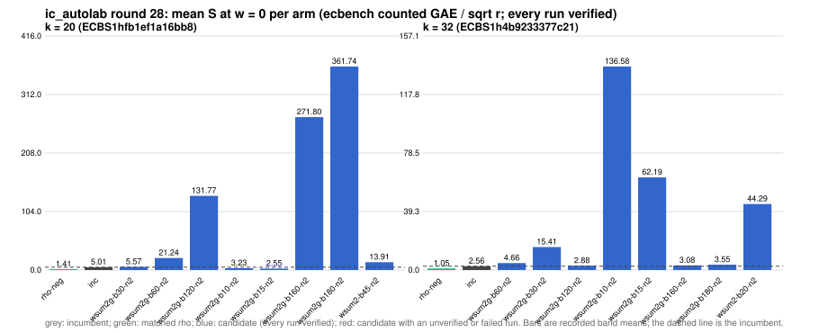

# ic_autolab round 28 (generic track): report

Protocol: [PROTOCOL.md](PROTOCOL.md), frozen 2026-11-04T08:36:02Z at git `aeb70e6d36bf02ae6a7e63b657382edff831122c`; route `local`. Counted GAE only (deterministic, host independent); no wall-time claim; development loop, no validation-gate row. Loop home: [`../`](../README.md); ledger: [`../ledger.json`](../ledger.json).

Claim record: `PCC-20261104-d87806` (`python3 tools/pcc/pcc.py standing PCC-20261104-d87806`). Until a signed replay and recompute exist, this round's outcome is an unverified assertion [pcc:unverified].

## Outcome

| k | class | sel | sel / inc at w = 0 [95%] | w = 0.1 | w = 1 | band | S sel (w = 0 / 0.1 / 1) | S inc | S rho-neg | distance sel / rho |
|--:|:--|:--|:--|:--|:--|:--|:--|:--|:--|:--|
| 20 | **improvement** | wsum2g-b15-n2 | 0.515 [0.474, 0.559] | 0.513 [0.470, 0.560] | 0.499 [0.441, 0.566] | sel < inc | 2.575 / 2.691 / 3.741 | 5.001 / 5.249 / 7.489 | 1.463 / 1.565 / 2.490 | 1.8x / 1.7x / 1.5x |
| 32 | **no_challenger** | none (best candidate `wsum2g-b120-n2`, train S 2.880 / 3.042 / 4.503) | - | - | - | - | - | 2.561 / 2.809 / 5.041 | 1.047 / 1.150 / 2.077 | inc: 2.4x / 2.4x / 2.4x |

Classes follow the protocol's decision rule. Distance to rho is the distance remaining, not a gate. The reasons per size:

- k = 20: compare ops.status = ok, admissible = true; sel / inc = 0.5149 [0.474, 0.559] at w = 0; band: sel < inc; A/A inc-aa / inc interval [1.000, 1.000] contains 1
- k = 32: no_challenger

## Train (development screen, in sample)

### k = 20: session `ECBS1hfb1ef1a16bb8` (run exit 0, verify exit 0, receipt sha256 `0d991304e841507cbcf04d7bd9cd62933cdbc2c1c7ea0128628a76f39c657b04`)

| arm | family | N | factor base | oracle | runs | verified | S (w = 0 / 0.1 / 1) | reason proposed |
|:--|:--|--:|:--|:--|--:|--:|:--|:--|
| `rho-neg` | rho | - | `-` | `rho.negation` | 32 | 32 | 1.407 / 1.505 / 2.383 | matched reference |
| `inc` | wsum2-b15 | 2 | `prime-projected-abscissa:size=2,scan_cap=32` | `wsum:coef=15,free=1` | 32 | 32 | 5.009 / 5.263 / 7.552 | incumbent |
| `wsum2g-b30-n2` | wsum2g-b30 | 2 | `prime-projected-abscissa:size=2,scan_cap=32` | `wsum:coef=30,free=1` | 32 | 32 | 5.575 / 5.611 / 5.934 | cross-size transfer: wsum2g-b30-n2 is the k = 24 incumbent at N / N_a = 0.025 |
| `wsum2g-b60-n2` | wsum2g-b60 | 2 | `prime-projected-abscissa:size=2,scan_cap=32` | `wsum:coef=60,free=1` | 32 | 32 | 21.241 / 21.375 / 22.585 | cross-size transfer: wsum2g-b60-n2 is the k = 28 incumbent at N / N_a = 0.010 |
| `wsum2g-b120-n2` | wsum2g-b120 | 2 | `prime-projected-abscissa:size=2,scan_cap=32` | `wsum:coef=120,free=1` | 32 | 32 | 131.772 / 139.606 / 210.110 | exploration: family wsum2g-b120 untried at k = 20, N = 0.0001 x N_a |
| `wsum2g-b10-n2` | wsum2g-b10 | 2 | `prime-projected-abscissa:size=2,scan_cap=32` | `wsum:coef=10,free=1` | 32 | 32 | 3.228 / 3.483 / 5.771 | exploration: family wsum2g-b10 untried at k = 20, N = 0.0001 x N_a |
| `wsum2g-b15-n2` | wsum2g-b15 | 2 | `prime-projected-abscissa:size=2,scan_cap=32` | `wsum:coef=15,free=1` | 32 | 32 | 2.553 / 2.667 / 3.698 | exploration: family wsum2g-b15 untried at k = 20, N = 0.0001 x N_a |
| `wsum2g-b160-n2` | wsum2g-b160 | 2 | `prime-projected-abscissa:size=2,scan_cap=32` | `wsum:coef=160,free=1` | 32 | 32 | 271.796 / 291.391 / 467.741 | exploration: family wsum2g-b160 untried at k = 20, N = 0.0001 x N_a |
| `wsum2g-b180-n2` | wsum2g-b180 | 2 | `prime-projected-abscissa:size=2,scan_cap=32` | `wsum:coef=180,free=1` | 32 | 32 | 361.741 / 389.203 / 636.366 | exploration: family wsum2g-b180 untried at k = 20, N = 0.0001 x N_a |
| `wsum2-b45-n2` | wsum2-b45 | 2 | `prime-projected-abscissa:size=2,scan_cap=32` | `wsum:coef=45,free=1` | 32 | 32 | 13.915 / 13.953 / 14.297 | exploration: family wsum2-b45 untried at k = 20, N = 0.0001 x N_a |

### k = 32: session `ECBS1h4b9233377c21` (run exit 0, verify exit 0, receipt sha256 `163c7f277f2147025fd2bfc23b00ebe2907dafa5a145a2bc2348a84ace5850d9`)

| arm | family | N | factor base | oracle | runs | verified | S (w = 0 / 0.1 / 1) | reason proposed |
|:--|:--|--:|:--|:--|--:|--:|:--|:--|
| `rho-neg` | rho | - | `-` | `rho.negation` | 32 | 32 | 1.047 / 1.150 / 2.077 | matched reference |
| `inc` | wsum2-b120 | 2 | `prime-projected-abscissa:size=2,scan_cap=32` | `wsum:coef=120,free=1` | 32 | 32 | 2.561 / 2.809 / 5.041 | incumbent |
| `wsum2g-b60-n2` | wsum2g-b60 | 2 | `prime-projected-abscissa:size=2,scan_cap=32` | `wsum:coef=60,free=1` | 32 | 32 | 4.655 / 5.089 / 8.991 | cross-size transfer: wsum2g-b60-n2 is the k = 28 incumbent at N / N_a = 0.010 |
| `wsum2g-b30-n2` | wsum2g-b30 | 2 | `prime-projected-abscissa:size=2,scan_cap=32` | `wsum:coef=30,free=1` | 32 | 32 | 15.413 / 16.946 / 30.742 | cross-size transfer: wsum2g-b30-n2 is the k = 24 incumbent at N / N_a = 0.025 |
| `wsum2g-b120-n2` | wsum2g-b120 | 2 | `prime-projected-abscissa:size=2,scan_cap=32` | `wsum:coef=120,free=1` | 32 | 32 | 2.880 / 3.042 / 4.503 | exploration: family wsum2g-b120 untried at k = 32, N = 0.0001 x N_a |
| `wsum2g-b10-n2` | wsum2g-b10 | 2 | `prime-projected-abscissa:size=2,scan_cap=32` | `wsum:coef=10,free=1` | 32 | 32 | 136.580 / 150.236 / 273.146 | exploration: family wsum2g-b10 untried at k = 32, N = 0.0001 x N_a |
| `wsum2g-b15-n2` | wsum2g-b15 | 2 | `prime-projected-abscissa:size=2,scan_cap=32` | `wsum:coef=15,free=1` | 32 | 32 | 62.187 / 68.403 / 124.349 | exploration: family wsum2g-b15 untried at k = 32, N = 0.0001 x N_a |
| `wsum2g-b160-n2` | wsum2g-b160 | 2 | `prime-projected-abscissa:size=2,scan_cap=32` | `wsum:coef=160,free=1` | 32 | 32 | 3.075 / 3.160 / 3.924 | exploration: family wsum2g-b160 untried at k = 32, N = 0.0001 x N_a |
| `wsum2g-b180-n2` | wsum2g-b180 | 2 | `prime-projected-abscissa:size=2,scan_cap=32` | `wsum:coef=180,free=1` | 32 | 32 | 3.546 / 3.619 / 4.276 | exploration: family wsum2g-b180 untried at k = 32, N = 0.0001 x N_a |
| `wsum2-b20-n2` | wsum2-b20 | 2 | `prime-projected-abscissa:size=2,scan_cap=32` | `wsum:coef=20,free=1` | 32 | 32 | 44.295 / 53.117 / 132.521 | exploration: family wsum2-b20 untried at k = 32, N = 0.0001 x N_a |

## Selection

- k = 20: challenger `wsum2g-b15-n2` (Pareto alternative at w = 1: `wsum2g-b15-n2`)
- k = 32: no_challenger  (Pareto alternative at w = 1: `wsum2g-b160-n2`)

## Holdout sessions

| k | session | run exit | verify exit | receipt sha256 | levels |
|--:|:--|--:|--:|:--|:--|
| 20 | `ECBS1hedb8cab33622` | 0 | 0 | `d1fb88594a6510e05d9d954c155267d2ddf2d53679834041230a703bb5374c71` | {"verified":480} |

## Ledger after this round

| k | incumbent | since round | S (w = 0 / 0.1 / 1) | distance to rho |
|--:|:--|--:|:--|:--|
| 20 | `wsum2g-b15-n2` (`prime-projected-abscissa:size=2,scan_cap=32` + `wsum:coef=15,free=1`) | 28 | 2.575 / 2.691 / 3.741 | 1.8x / 1.7x / 1.5x |
| 24 | `wsum2g-b30-n2` (`prime-projected-abscissa:size=2,scan_cap=32` + `wsum:coef=30,free=1`) | 27 | 2.584 / 2.711 / 3.855 | 2.0x / 2.0x / 1.6x |
| 28 | `wsum2g-b60-n2` (`prime-projected-abscissa:size=2,scan_cap=32` + `wsum:coef=60,free=1`) | 27 | 2.373 / 2.483 / 3.472 | 2.4x / 2.3x / 1.8x |
| 32 | `wsum2-b120-n2` (`prime-projected-abscissa:size=2,scan_cap=32` + `wsum:coef=120,free=1`) | 22 | 2.519 / 2.759 / 4.915 | 2.7x / 2.7x / 2.7x |

## Evidence and deviations

- ecbench binary sha256: `6229f85b81f9a2e8f2811d675f77f4f830ca536422a1e92680a382183450a62c`; `--cpus auto`, allow_busy = true; `verify --replay 8` per session; audit receipts in `analysis/`; sessions in `sessions/` (records in the artifact store when large).
- Route: the local route is an explicitly requested development screen, not the Iso Lab EKS default; counts are deterministic and replayed, wall time is not claimed. No row of this round enters the IC leaderboard or `benchmarks/README.md` (validation gate).
- Train selection is in sample (disclosed); the holdout is fresh (new `target_seed`, excluded exposures). Failed, timed-out and regressing arms are retained above.
