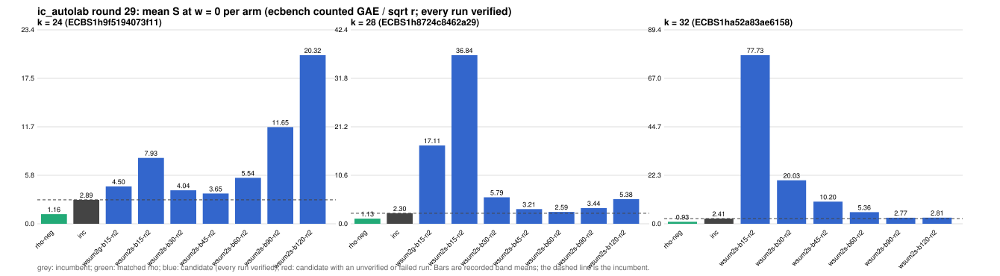

# ic_autolab round 29 (generic track): report

Protocol: [PROTOCOL.md](PROTOCOL.md), frozen 2026-11-04T09:54:53Z at git `54f00879143f9ed6edb618136928858444932405`; route `local`. Counted GAE only (deterministic, host independent); no wall-time claim; development loop, no validation-gate row. Loop home: [`../`](../README.md); ledger: [`../ledger.json`](../ledger.json).

Claim record: `PCC-20261104-795a16` (`python3 tools/pcc/pcc.py standing PCC-20261104-795a16`). Until a signed replay and recompute exist, this round's outcome is an unverified assertion [pcc:unverified].

## Outcome

| k | class | sel | sel / inc at w = 0 [95%] | w = 0.1 | w = 1 | band | S sel (w = 0 / 0.1 / 1) | S inc | S rho-neg | distance sel / rho |
|--:|:--|:--|:--|:--|:--|:--|:--|:--|:--|:--|
| 24 | **no_challenger** | none (best candidate `wsum2s-b45-n2`, train S 3.648 / 3.780 / 4.972) | - | - | - | - | - | 2.886 / 3.043 / 4.460 | 1.163 / 1.267 / 2.208 | inc: 2.5x / 2.4x / 2.0x |
| 28 | **no_challenger** | none (best candidate `wsum2s-b60-n2`, train S 2.588 / 2.846 / 5.161) | - | - | - | - | - | 2.296 / 2.398 / 3.317 | 1.125 / 1.231 / 2.186 | inc: 2.0x / 1.9x / 1.5x |
| 32 | **no_challenger** | none (best candidate `wsum2s-b90-n2`, train S 2.768 / 3.178 / 6.866) | - | - | - | - | - | 2.408 / 2.625 / 4.584 | 0.932 / 1.023 / 1.846 | inc: 2.6x / 2.6x / 2.5x |

Classes follow the protocol's decision rule. Distance to rho is the distance remaining, not a gate. The reasons per size:

- k = 24: no_challenger
- k = 28: no_challenger
- k = 32: no_challenger

## Train (development screen, in sample)

### k = 24: session `ECBS1h9f5194073f11` (run exit 0, verify exit 0, receipt sha256 `8bfae216e2ebde8f5f92c11912326aa659a1a55e6c5b3c70256caee83290240b`)

| arm | family | N | factor base | oracle | runs | verified | S (w = 0 / 0.1 / 1) | reason proposed |
|:--|:--|--:|:--|:--|--:|--:|:--|:--|
| `rho-neg` | rho | - | `-` | `rho.negation` | 32 | 32 | 1.163 / 1.267 / 2.208 | matched reference |
| `inc` | wsum2g-b30 | 2 | `prime-projected-abscissa:size=2,scan_cap=32` | `wsum:coef=30,free=1` | 32 | 32 | 2.886 / 3.043 / 4.460 | incumbent |
| `wsum2g-b15-n2` | wsum2g-b15 | 2 | `prime-projected-abscissa:size=2,scan_cap=32` | `wsum:coef=15,free=1` | 32 | 32 | 4.503 / 4.917 / 8.644 | cross-size transfer: wsum2g-b15-n2 is the k = 20 incumbent at N / N_a = 0.062 |
| `wsum2s-b15-n2` | wsum2s-b15 | 2 | `prime-projected-abscissa:size=2,scan_cap=32` | `wsum:coef=15,free=1` | 32 | 32 | 7.935 / 9.430 / 22.888 | exploration: family wsum2s-b15 untried at k = 24, N = 0.0001 x N_a |
| `wsum2s-b30-n2` | wsum2s-b30 | 2 | `prime-projected-abscissa:size=2,scan_cap=32` | `wsum:coef=30,free=1` | 32 | 32 | 4.038 / 4.563 / 9.291 | exploration: family wsum2s-b30 untried at k = 24, N = 0.0001 x N_a |
| `wsum2s-b45-n2` | wsum2s-b45 | 2 | `prime-projected-abscissa:size=2,scan_cap=32` | `wsum:coef=45,free=1` | 32 | 32 | 3.648 / 3.780 / 4.972 | exploration: family wsum2s-b45 untried at k = 24, N = 0.0001 x N_a |
| `wsum2s-b60-n2` | wsum2s-b60 | 2 | `prime-projected-abscissa:size=2,scan_cap=32` | `wsum:coef=60,free=1` | 32 | 32 | 5.540 / 5.612 / 6.258 | exploration: family wsum2s-b60 untried at k = 24, N = 0.0001 x N_a |
| `wsum2s-b90-n2` | wsum2s-b90 | 2 | `prime-projected-abscissa:size=2,scan_cap=32` | `wsum:coef=90,free=1` | 32 | 32 | 11.652 / 11.695 / 12.081 | exploration: family wsum2s-b90 untried at k = 24, N = 0.0001 x N_a |
| `wsum2s-b120-n2` | wsum2s-b120 | 2 | `prime-projected-abscissa:size=2,scan_cap=32` | `wsum:coef=120,free=1` | 32 | 32 | 20.322 / 20.351 / 20.609 | exploration: family wsum2s-b120 untried at k = 24, N = 0.0001 x N_a |

### k = 28: session `ECBS1h8724c8462a29` (run exit 0, verify exit 0, receipt sha256 `4743c51fb2ec9efbbdc27dbc9669d8f6fa96e97afba8eb728dca63c2bb7c8923`)

| arm | family | N | factor base | oracle | runs | verified | S (w = 0 / 0.1 / 1) | reason proposed |
|:--|:--|--:|:--|:--|--:|--:|:--|:--|
| `rho-neg` | rho | - | `-` | `rho.negation` | 32 | 32 | 1.125 / 1.231 / 2.186 | matched reference |
| `inc` | wsum2g-b60 | 2 | `prime-projected-abscissa:size=2,scan_cap=32` | `wsum:coef=60,free=1` | 32 | 32 | 2.296 / 2.398 / 3.317 | incumbent |
| `wsum2g-b15-n2` | wsum2g-b15 | 2 | `prime-projected-abscissa:size=2,scan_cap=32` | `wsum:coef=15,free=1` | 32 | 32 | 17.114 / 18.816 / 34.135 | cross-size transfer: wsum2g-b15-n2 is the k = 20 incumbent at N / N_a = 0.062 |
| `wsum2s-b15-n2` | wsum2s-b15 | 2 | `prime-projected-abscissa:size=2,scan_cap=32` | `wsum:coef=15,free=1` | 32 | 32 | 36.839 / 44.183 / 110.277 | exploration: family wsum2s-b15 untried at k = 28, N = 0.0001 x N_a |
| `wsum2s-b30-n2` | wsum2s-b30 | 2 | `prime-projected-abscissa:size=2,scan_cap=32` | `wsum:coef=30,free=1` | 32 | 32 | 5.791 / 6.877 / 16.654 | exploration: family wsum2s-b30 untried at k = 28, N = 0.0001 x N_a |
| `wsum2s-b45-n2` | wsum2s-b45 | 2 | `prime-projected-abscissa:size=2,scan_cap=32` | `wsum:coef=45,free=1` | 32 | 32 | 3.215 / 3.707 / 8.138 | exploration: family wsum2s-b45 untried at k = 28, N = 0.0001 x N_a |
| `wsum2s-b60-n2` | wsum2s-b60 | 2 | `prime-projected-abscissa:size=2,scan_cap=32` | `wsum:coef=60,free=1` | 32 | 32 | 2.588 / 2.846 / 5.161 | exploration: family wsum2s-b60 untried at k = 28, N = 0.0001 x N_a |
| `wsum2s-b90-n2` | wsum2s-b90 | 2 | `prime-projected-abscissa:size=2,scan_cap=32` | `wsum:coef=90,free=1` | 32 | 32 | 3.437 / 3.551 / 4.579 | exploration: family wsum2s-b90 untried at k = 28, N = 0.0001 x N_a |
| `wsum2s-b120-n2` | wsum2s-b120 | 2 | `prime-projected-abscissa:size=2,scan_cap=32` | `wsum:coef=120,free=1` | 32 | 32 | 5.382 / 5.448 / 6.042 | exploration: family wsum2s-b120 untried at k = 28, N = 0.0001 x N_a |

### k = 32: session `ECBS1ha52a83ae6158` (run exit 0, verify exit 0, receipt sha256 `db2cb6262bc12bd83f7870dc47df8d43b4b3cb4713e55ba428b05210418eb64f`)

| arm | family | N | factor base | oracle | runs | verified | S (w = 0 / 0.1 / 1) | reason proposed |
|:--|:--|--:|:--|:--|--:|--:|:--|:--|
| `rho-neg` | rho | - | `-` | `rho.negation` | 32 | 32 | 0.932 / 1.023 / 1.846 | matched reference |
| `inc` | wsum2-b120 | 2 | `prime-projected-abscissa:size=2,scan_cap=32` | `wsum:coef=120,free=1` | 32 | 32 | 2.408 / 2.625 / 4.584 | incumbent |
| `wsum2s-b15-n2` | wsum2s-b15 | 2 | `prime-projected-abscissa:size=2,scan_cap=32` | `wsum:coef=15,free=1` | 32 | 32 | 77.726 / 93.265 / 233.115 | exploration: family wsum2s-b15 untried at k = 32, N = 0.0001 x N_a |
| `wsum2s-b30-n2` | wsum2s-b30 | 2 | `prime-projected-abscissa:size=2,scan_cap=32` | `wsum:coef=30,free=1` | 32 | 32 | 20.032 / 24.020 / 59.912 | exploration: family wsum2s-b30 untried at k = 32, N = 0.0001 x N_a |
| `wsum2s-b45-n2` | wsum2s-b45 | 2 | `prime-projected-abscissa:size=2,scan_cap=32` | `wsum:coef=45,free=1` | 32 | 32 | 10.198 / 12.199 / 30.212 | exploration: family wsum2s-b45 untried at k = 32, N = 0.0001 x N_a |
| `wsum2s-b60-n2` | wsum2s-b60 | 2 | `prime-projected-abscissa:size=2,scan_cap=32` | `wsum:coef=60,free=1` | 32 | 32 | 5.365 / 6.372 / 15.439 | exploration: family wsum2s-b60 untried at k = 32, N = 0.0001 x N_a |
| `wsum2s-b90-n2` | wsum2s-b90 | 2 | `prime-projected-abscissa:size=2,scan_cap=32` | `wsum:coef=90,free=1` | 32 | 32 | 2.768 / 3.178 / 6.866 | exploration: family wsum2s-b90 untried at k = 32, N = 0.0001 x N_a |
| `wsum2s-b120-n2` | wsum2s-b120 | 2 | `prime-projected-abscissa:size=2,scan_cap=32` | `wsum:coef=120,free=1` | 32 | 32 | 2.808 / 3.117 / 5.895 | exploration: family wsum2s-b120 untried at k = 32, N = 0.0001 x N_a |

## Selection

- k = 24: no_challenger  (Pareto alternative at w = 1: `wsum2s-b45-n2`)
- k = 28: no_challenger  (Pareto alternative at w = 1: `wsum2s-b90-n2`)
- k = 32: no_challenger  (Pareto alternative at w = 1: `wsum2s-b120-n2`)

## Ledger after this round

| k | incumbent | since round | S (w = 0 / 0.1 / 1) | distance to rho |
|--:|:--|--:|:--|:--|
| 20 | `wsum2g-b15-n2` (`prime-projected-abscissa:size=2,scan_cap=32` + `wsum:coef=15,free=1`) | 28 | 2.575 / 2.691 / 3.741 | 1.8x / 1.7x / 1.5x |
| 24 | `wsum2g-b30-n2` (`prime-projected-abscissa:size=2,scan_cap=32` + `wsum:coef=30,free=1`) | 27 | 2.584 / 2.711 / 3.855 | 2.0x / 2.0x / 1.6x |
| 28 | `wsum2g-b60-n2` (`prime-projected-abscissa:size=2,scan_cap=32` + `wsum:coef=60,free=1`) | 27 | 2.373 / 2.483 / 3.472 | 2.4x / 2.3x / 1.8x |
| 32 | `wsum2-b120-n2` (`prime-projected-abscissa:size=2,scan_cap=32` + `wsum:coef=120,free=1`) | 22 | 2.519 / 2.759 / 4.915 | 2.7x / 2.7x / 2.7x |

## Evidence and deviations

- ecbench binary sha256: `6229f85b81f9a2e8f2811d675f77f4f830ca536422a1e92680a382183450a62c`; `--cpus auto`, allow_busy = true; `verify --replay 8` per session; audit receipts in `analysis/`; sessions in `sessions/` (records in the artifact store when large).
- Route: the local route is an explicitly requested development screen, not the Iso Lab EKS default; counts are deterministic and replayed, wall time is not claimed. No row of this round enters the IC leaderboard or `benchmarks/README.md` (validation gate).
- Train selection is in sample (disclosed); the holdout is fresh (new `target_seed`, excluded exposures). Failed, timed-out and regressing arms are retained above.
