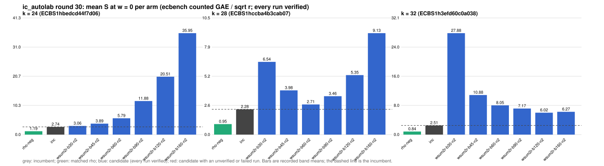

# ic_autolab round 30 (generic track): report

Protocol: [PROTOCOL.md](PROTOCOL.md), frozen 2026-11-04T10:00:06Z at git `897e546fea307e6e6a2ebb4788912aea514b9c6f`; route `local`. Counted GAE only (deterministic, host independent); no wall-time claim; development loop, no validation-gate row. Loop home: [`../`](../README.md); ledger: [`../ledger.json`](../ledger.json).

Claim record: `PCC-20261104-2ed644` (`python3 tools/pcc/pcc.py standing PCC-20261104-2ed644`). Until a signed replay and recompute exist, this round's outcome is an unverified assertion [pcc:unverified].

## Outcome

| k | class | sel | sel / inc at w = 0 [95%] | w = 0.1 | w = 1 | band | S sel (w = 0 / 0.1 / 1) | S inc | S rho-neg | distance sel / rho |
|--:|:--|:--|:--|:--|:--|:--|:--|:--|:--|:--|
| 24 | **no_challenger** | none (best candidate `wsum2r-b30-n2`, train S 3.063 / 3.385 / 6.283) | - | - | - | - | - | 2.738 / 2.881 / 4.165 | 1.191 / 1.298 / 2.264 | inc: 2.3x / 2.2x / 1.8x |
| 28 | **no_challenger** | none (best candidate `wsum2r-b60-n2`, train S 2.713 / 2.992 / 5.509) | - | - | - | - | - | 2.277 / 2.377 / 3.279 | 0.945 / 1.034 / 1.827 | inc: 2.4x / 2.3x / 1.8x |
| 32 | **no_challenger** | none (best candidate `wsum2r-b120-n2`, train S 6.017 / 6.967 / 15.515) | - | - | - | - | - | 2.513 / 2.752 / 4.899 | 0.844 / 0.927 / 1.671 | inc: 3.0x / 3.0x / 2.9x |

Classes follow the protocol's decision rule. Distance to rho is the distance remaining, not a gate. The reasons per size:

- k = 24: no_challenger
- k = 28: no_challenger
- k = 32: no_challenger

## Train (development screen, in sample)

### k = 24: session `ECBS1hbedcd44f7d06` (run exit 0, verify exit 0, receipt sha256 `caf928122bbc3ed1cccdfbffebecd93060a99a83c9dd0694587ddc3ec305d7a0`)

| arm | family | N | factor base | oracle | runs | verified | S (w = 0 / 0.1 / 1) | reason proposed |
|:--|:--|--:|:--|:--|--:|--:|:--|:--|
| `rho-neg` | rho | - | `-` | `rho.negation` | 32 | 32 | 1.191 / 1.298 / 2.264 | matched reference |
| `inc` | wsum2g-b30 | 2 | `prime-projected-abscissa:size=2,scan_cap=32` | `wsum:coef=30,free=1` | 32 | 32 | 2.738 / 2.881 / 4.165 | incumbent |
| `wsum2r-b30-n2` | wsum2r-b30 | 2 | `prime-projected-abscissa:size=2,scan_cap=32` | `wsum:coef=30,free=1` | 32 | 32 | 3.063 / 3.385 / 6.283 | exploration: family wsum2r-b30 untried at k = 24, N = 0.0001 x N_a |
| `wsum2r-b45-n2` | wsum2r-b45 | 2 | `prime-projected-abscissa:size=2,scan_cap=32` | `wsum:coef=45,free=1` | 32 | 32 | 3.885 / 4.057 / 5.603 | exploration: family wsum2r-b45 untried at k = 24, N = 0.0001 x N_a |
| `wsum2r-b60-n2` | wsum2r-b60 | 2 | `prime-projected-abscissa:size=2,scan_cap=32` | `wsum:coef=60,free=1` | 32 | 32 | 5.786 / 5.899 / 6.914 | exploration: family wsum2r-b60 untried at k = 24, N = 0.0001 x N_a |
| `wsum2r-b90-n2` | wsum2r-b90 | 2 | `prime-projected-abscissa:size=2,scan_cap=32` | `wsum:coef=90,free=1` | 32 | 32 | 11.885 / 11.966 / 12.698 | exploration: family wsum2r-b90 untried at k = 24, N = 0.0001 x N_a |
| `wsum2r-b120-n2` | wsum2r-b120 | 2 | `prime-projected-abscissa:size=2,scan_cap=32` | `wsum:coef=120,free=1` | 32 | 32 | 20.510 / 20.568 / 21.091 | exploration: family wsum2r-b120 untried at k = 24, N = 0.0001 x N_a |
| `wsum2r-b160-n2` | wsum2r-b160 | 2 | `prime-projected-abscissa:size=2,scan_cap=32` | `wsum:coef=160,free=1` | 32 | 32 | 35.947 / 35.988 / 36.355 | exploration: family wsum2r-b160 untried at k = 24, N = 0.0001 x N_a |

### k = 28: session `ECBS1hccba4b3cab07` (run exit 0, verify exit 0, receipt sha256 `a46494be9ad8f47ddc5de47f43e1ded3151c4e9f34240270e0fe17683c5dc7ad`)

| arm | family | N | factor base | oracle | runs | verified | S (w = 0 / 0.1 / 1) | reason proposed |
|:--|:--|--:|:--|:--|--:|--:|:--|:--|
| `rho-neg` | rho | - | `-` | `rho.negation` | 32 | 32 | 0.945 / 1.034 / 1.827 | matched reference |
| `inc` | wsum2g-b60 | 2 | `prime-projected-abscissa:size=2,scan_cap=32` | `wsum:coef=60,free=1` | 32 | 32 | 2.277 / 2.377 / 3.279 | incumbent |
| `wsum2r-b30-n2` | wsum2r-b30 | 2 | `prime-projected-abscissa:size=2,scan_cap=32` | `wsum:coef=30,free=1` | 32 | 32 | 6.544 / 7.778 / 18.883 | exploration: family wsum2r-b30 untried at k = 28, N = 0.0001 x N_a |
| `wsum2r-b45-n2` | wsum2r-b45 | 2 | `prime-projected-abscissa:size=2,scan_cap=32` | `wsum:coef=45,free=1` | 32 | 32 | 3.981 / 4.624 / 10.411 | exploration: family wsum2r-b45 untried at k = 28, N = 0.0001 x N_a |
| `wsum2r-b60-n2` | wsum2r-b60 | 2 | `prime-projected-abscissa:size=2,scan_cap=32` | `wsum:coef=60,free=1` | 32 | 32 | 2.713 / 2.992 / 5.509 | exploration: family wsum2r-b60 untried at k = 28, N = 0.0001 x N_a |
| `wsum2r-b90-n2` | wsum2r-b90 | 2 | `prime-projected-abscissa:size=2,scan_cap=32` | `wsum:coef=90,free=1` | 32 | 32 | 3.456 / 3.572 / 4.612 | exploration: family wsum2r-b90 untried at k = 28, N = 0.0001 x N_a |
| `wsum2r-b120-n2` | wsum2r-b120 | 2 | `prime-projected-abscissa:size=2,scan_cap=32` | `wsum:coef=120,free=1` | 32 | 32 | 5.354 / 5.412 / 5.935 | exploration: family wsum2r-b120 untried at k = 28, N = 0.0001 x N_a |
| `wsum2r-b160-n2` | wsum2r-b160 | 2 | `prime-projected-abscissa:size=2,scan_cap=32` | `wsum:coef=160,free=1` | 32 | 32 | 9.128 / 9.165 / 9.495 | exploration: family wsum2r-b160 untried at k = 28, N = 0.0001 x N_a |

### k = 32: session `ECBS1h3efd60c0a038` (run exit 0, verify exit 0, receipt sha256 `40078c39388e9ab9181c7e6dbae215cf72f83542cbfd39c876021fc53138398e`)

| arm | family | N | factor base | oracle | runs | verified | S (w = 0 / 0.1 / 1) | reason proposed |
|:--|:--|--:|:--|:--|--:|--:|:--|:--|
| `rho-neg` | rho | - | `-` | `rho.negation` | 32 | 32 | 0.844 / 0.927 / 1.671 | matched reference |
| `inc` | wsum2-b120 | 2 | `prime-projected-abscissa:size=2,scan_cap=32` | `wsum:coef=120,free=1` | 32 | 32 | 2.513 / 2.752 / 4.899 | incumbent |
| `wsum2r-b30-n2` | wsum2r-b30 | 2 | `prime-projected-abscissa:size=2,scan_cap=32` | `wsum:coef=30,free=1` | 32 | 32 | 27.880 / 33.435 / 83.428 | exploration: family wsum2r-b30 untried at k = 32, N = 0.0001 x N_a |
| `wsum2r-b45-n2` | wsum2r-b45 | 2 | `prime-projected-abscissa:size=2,scan_cap=32` | `wsum:coef=45,free=1` | 32 | 32 | 10.876 / 13.012 / 32.238 | exploration: family wsum2r-b45 untried at k = 32, N = 0.0001 x N_a |
| `wsum2r-b60-n2` | wsum2r-b60 | 2 | `prime-projected-abscissa:size=2,scan_cap=32` | `wsum:coef=60,free=1` | 32 | 32 | 8.045 / 9.588 / 23.473 | exploration: family wsum2r-b60 untried at k = 32, N = 0.0001 x N_a |
| `wsum2r-b90-n2` | wsum2r-b90 | 2 | `prime-projected-abscissa:size=2,scan_cap=32` | `wsum:coef=90,free=1` | 32 | 32 | 7.170 / 8.459 / 20.065 | exploration: family wsum2r-b90 untried at k = 32, N = 0.0001 x N_a |
| `wsum2r-b120-n2` | wsum2r-b120 | 2 | `prime-projected-abscissa:size=2,scan_cap=32` | `wsum:coef=120,free=1` | 32 | 32 | 6.017 / 6.967 / 15.515 | exploration: family wsum2r-b120 untried at k = 32, N = 0.0001 x N_a |
| `wsum2r-b160-n2` | wsum2r-b160 | 2 | `prime-projected-abscissa:size=2,scan_cap=32` | `wsum:coef=160,free=1` | 32 | 32 | 6.270 / 7.076 / 14.331 | exploration: family wsum2r-b160 untried at k = 32, N = 0.0001 x N_a |

## Selection

- k = 24: no_challenger  (Pareto alternative at w = 1: `wsum2r-b45-n2`)
- k = 28: no_challenger  (Pareto alternative at w = 1: `wsum2r-b90-n2`)
- k = 32: no_challenger  (Pareto alternative at w = 1: `wsum2r-b160-n2`)

## Ledger after this round

| k | incumbent | since round | S (w = 0 / 0.1 / 1) | distance to rho |
|--:|:--|--:|:--|:--|
| 20 | `wsum2g-b15-n2` (`prime-projected-abscissa:size=2,scan_cap=32` + `wsum:coef=15,free=1`) | 28 | 2.575 / 2.691 / 3.741 | 1.8x / 1.7x / 1.5x |
| 24 | `wsum2g-b30-n2` (`prime-projected-abscissa:size=2,scan_cap=32` + `wsum:coef=30,free=1`) | 27 | 2.584 / 2.711 / 3.855 | 2.0x / 2.0x / 1.6x |
| 28 | `wsum2g-b60-n2` (`prime-projected-abscissa:size=2,scan_cap=32` + `wsum:coef=60,free=1`) | 27 | 2.373 / 2.483 / 3.472 | 2.4x / 2.3x / 1.8x |
| 32 | `wsum2-b120-n2` (`prime-projected-abscissa:size=2,scan_cap=32` + `wsum:coef=120,free=1`) | 22 | 2.519 / 2.759 / 4.915 | 2.7x / 2.7x / 2.7x |

## Evidence and deviations

- ecbench binary sha256: `6229f85b81f9a2e8f2811d675f77f4f830ca536422a1e92680a382183450a62c`; `--cpus auto`, allow_busy = true; `verify --replay 8` per session; audit receipts in `analysis/`; sessions in `sessions/` (records in the artifact store when large).
- Route: the local route is an explicitly requested development screen, not the Iso Lab EKS default; counts are deterministic and replayed, wall time is not claimed. No row of this round enters the IC leaderboard or `benchmarks/README.md` (validation gate).
- Train selection is in sample (disclosed); the holdout is fresh (new `target_seed`, excluded exposures). Failed, timed-out and regressing arms are retained above.
