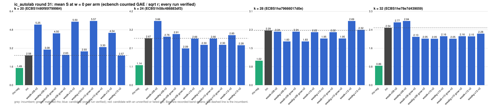

# ic_autolab round 31 (generic track): report

Protocol: [PROTOCOL.md](PROTOCOL.md), frozen 2026-11-04T11:14:46Z at git `007707ed2e32b52844a4c24cb025bc9022d2ddb8`; route `local`. Counted GAE only (deterministic, host independent); no wall-time claim; development loop, no validation-gate row. Loop home: [`../`](../README.md); ledger: [`../ledger.json`](../ledger.json).

Claim record: `PCC-20261104-95313c` (`python3 tools/pcc/pcc.py standing PCC-20261104-95313c`). Until a signed replay and recompute exist, this round's outcome is an unverified assertion [pcc:unverified].

## Outcome

| k | class | sel | sel / inc at w = 0 [95%] | w = 0.1 | w = 1 | band | S sel (w = 0 / 0.1 / 1) | S inc | S rho-neg | distance sel / rho |
|--:|:--|:--|:--|:--|:--|:--|:--|:--|:--|:--|
| 20 | **null** | wwalkg-x12-n2 | 0.988 [0.900, 1.085] | 0.979 [0.886, 1.081] | 0.921 [0.805, 1.054] | sel < inc | 2.588 / 2.682 / 3.530 | 2.620 / 2.741 / 3.831 | 1.593 / 1.709 / 2.755 | 1.6x / 1.6x / 1.3x |
| 24 | **improvement** | wwalkg-x08-grow-n2 | 0.788 [0.702, 0.884] | 0.776 [0.687, 0.876] | 0.707 [0.601, 0.830] | sel < inc | 2.164 / 2.243 / 2.955 | 2.747 / 2.890 / 4.181 | 1.224 / 1.334 / 2.329 | 1.8x / 1.7x / 1.3x |
| 28 | **improvement** | wwalkg-x08-n2 | 0.854 [0.758, 0.962] | 0.864 [0.763, 0.979] | 0.930 [0.798, 1.084] | sel < inc | 1.921 / 2.029 / 3.001 | 2.250 / 2.348 / 3.226 | 0.932 / 1.019 / 1.800 | 2.1x / 2.0x / 1.7x |
| 32 | **improvement** | wwalk-x10-n2 | 0.807 [0.708, 0.921] | 0.806 [0.698, 0.931] | 0.803 [0.659, 0.979] | sel < inc | 2.110 / 2.316 / 4.174 | 2.614 / 2.872 / 5.198 | 0.872 / 0.958 / 1.727 | 2.4x / 2.4x / 2.4x |

Classes follow the protocol's decision rule. Distance to rho is the distance remaining, not a gate. The reasons per size:

- k = 20: compare ops.status = ok, admissible = true; sel / inc = 0.9879 [0.900, 1.085] at w = 0; band: sel < inc; A/A inc-aa / inc interval [1.000, 1.000] contains 1
- k = 24: compare ops.status = ok, admissible = true; sel / inc = 0.7877 [0.702, 0.884] at w = 0; band: sel < inc; A/A inc-aa / inc interval [1.000, 1.000] contains 1
- k = 28: compare ops.status = ok, admissible = true; sel / inc = 0.8537 [0.758, 0.962] at w = 0; band: sel < inc; A/A inc-aa / inc interval [1.000, 1.000] contains 1
- k = 32: compare ops.status = ok, admissible = true; sel / inc = 0.8072 [0.708, 0.921] at w = 0; band: sel < inc; A/A inc-aa / inc interval [1.000, 1.000] contains 1

## Train (development screen, in sample)

### k = 20: session `ECBS1h90f95f799984` (run exit 0, verify exit 0, receipt sha256 `6adbcd055d8955939c62adbac44d0694e676347733e0e8c2a53d257690fd61ff`)

| arm | family | N | factor base | oracle | runs | verified | S (w = 0 / 0.1 / 1) | reason proposed |
|:--|:--|--:|:--|:--|--:|--:|:--|:--|
| `rho-neg` | rho | - | `-` | `rho.negation` | 32 | 32 | 1.489 / 1.594 / 2.540 | matched reference |
| `inc` | wsum2g-b15 | 2 | `prime-projected-abscissa:size=2,scan_cap=32` | `wsum:coef=15,free=1` | 32 | 32 | 2.581 / 2.698 / 3.752 | incumbent |
| `wwalk-x08-n2` | wwalk-x08 | 2 | `prime-projected-abscissa:size=2,scan_cap=32` | `wwalk:x=0.8` | 32 | 32 | 5.254 / 5.575 / 8.458 | exploration: family wwalk-x08 untried at k = 20, N = 0.0001 x N_a |
| `wwalkg-x08-n2` | wwalkg-x08 | 2 | `prime-projected-abscissa:size=2,scan_cap=32` | `wwalk:x=0.8` | 32 | 32 | 3.083 / 3.274 / 4.994 | exploration: family wwalkg-x08 untried at k = 20, N = 0.0001 x N_a |
| `wwalk-x08-grow-n2` | wwalk-x08-grow | 2 | `prime-projected-abscissa:size=2,scan_cap=32` | `wwalk:x=0.8,grow=1` | 32 | 32 | 4.495 / 4.645 / 5.992 | exploration: family wwalk-x08-grow untried at k = 20, N = 0.0001 x N_a |
| `wwalkg-x08-grow-n2` | wwalkg-x08-grow | 2 | `prime-projected-abscissa:size=2,scan_cap=32` | `wwalk:x=0.8,grow=1` | 32 | 32 | 2.628 / 2.742 / 3.767 | exploration: family wwalkg-x08-grow untried at k = 20, N = 0.0001 x N_a |
| `wwalk-x10-n2` | wwalk-x10 | 2 | `prime-projected-abscissa:size=2,scan_cap=32` | `wwalk:x=1.0` | 32 | 32 | 5.504 / 5.842 / 8.880 | exploration: family wwalk-x10 untried at k = 20, N = 0.0001 x N_a |
| `wwalkg-x10-n2` | wwalkg-x10 | 2 | `prime-projected-abscissa:size=2,scan_cap=32` | `wwalk:x=1.0` | 32 | 32 | 2.931 / 3.085 / 4.472 | exploration: family wwalkg-x10 untried at k = 20, N = 0.0001 x N_a |
| `wwalk-x10-grow-n2` | wwalk-x10-grow | 2 | `prime-projected-abscissa:size=2,scan_cap=32` | `wwalk:x=1.0,grow=1` | 32 | 32 | 5.568 / 5.744 / 7.330 | exploration: family wwalk-x10-grow untried at k = 20, N = 0.0001 x N_a |
| `wwalkg-x10-grow-n2` | wwalkg-x10-grow | 2 | `prime-projected-abscissa:size=2,scan_cap=32` | `wwalk:x=1.0,grow=1` | 32 | 32 | 3.303 / 3.394 / 4.206 | exploration: family wwalkg-x10-grow untried at k = 20, N = 0.0001 x N_a |
| `wwalk-x12-n2` | wwalk-x12 | 2 | `prime-projected-abscissa:size=2,scan_cap=32` | `wwalk:x=1.2` | 32 | 32 | 4.539 / 4.669 / 5.845 | exploration: family wwalk-x12 untried at k = 20, N = 0.0001 x N_a |
| `wwalkg-x12-n2` | wwalkg-x12 | 2 | `prime-projected-abscissa:size=2,scan_cap=32` | `wwalk:x=1.2` | 32 | 32 | 2.569 / 2.661 / 3.490 | exploration: family wwalkg-x12 untried at k = 20, N = 0.0001 x N_a |

### k = 24: session `ECBS1h58c486883df3` (run exit 0, verify exit 0, receipt sha256 `97c7fe4bff52353a6dbe9dfb76fab48969e00a2bd257b37cf3d2f12487401a1a`)

| arm | family | N | factor base | oracle | runs | verified | S (w = 0 / 0.1 / 1) | reason proposed |
|:--|:--|--:|:--|:--|--:|--:|:--|:--|
| `rho-neg` | rho | - | `-` | `rho.negation` | 32 | 32 | 1.139 / 1.241 / 2.159 | matched reference |
| `inc` | wsum2g-b30 | 2 | `prime-projected-abscissa:size=2,scan_cap=32` | `wsum:coef=30,free=1` | 32 | 32 | 2.670 / 2.806 / 4.027 | incumbent |
| `wwalk-x08-n2` | wwalk-x08 | 2 | `prime-projected-abscissa:size=2,scan_cap=32` | `wwalk:x=0.8` | 32 | 32 | 3.660 / 4.052 / 7.582 | exploration: family wwalk-x08 untried at k = 24, N = 0.0001 x N_a |
| `wwalkg-x08-n2` | wwalkg-x08 | 2 | `prime-projected-abscissa:size=2,scan_cap=32` | `wwalk:x=0.8` | 32 | 32 | 2.763 / 2.947 / 4.599 | exploration: family wwalkg-x08 untried at k = 24, N = 0.0001 x N_a |
| `wwalk-x08-grow-n2` | wwalk-x08-grow | 2 | `prime-projected-abscissa:size=2,scan_cap=32` | `wwalk:x=0.8,grow=1` | 32 | 32 | 2.914 / 3.081 / 4.582 | exploration: family wwalk-x08-grow untried at k = 24, N = 0.0001 x N_a |
| `wwalkg-x08-grow-n2` | wwalkg-x08-grow | 2 | `prime-projected-abscissa:size=2,scan_cap=32` | `wwalk:x=0.8,grow=1` | 32 | 32 | 2.093 / 2.165 / 2.813 | exploration: family wwalkg-x08-grow untried at k = 24, N = 0.0001 x N_a |
| `wwalk-x10-n2` | wwalk-x10 | 2 | `prime-projected-abscissa:size=2,scan_cap=32` | `wwalk:x=1.0` | 32 | 32 | 2.657 / 2.819 / 4.277 | exploration: family wwalk-x10 untried at k = 24, N = 0.0001 x N_a |
| `wwalkg-x10-n2` | wwalkg-x10 | 2 | `prime-projected-abscissa:size=2,scan_cap=32` | `wwalk:x=1.0` | 32 | 32 | 2.299 / 2.415 / 3.461 | exploration: family wwalkg-x10 untried at k = 24, N = 0.0001 x N_a |
| `wwalk-x10-grow-n2` | wwalk-x10-grow | 2 | `prime-projected-abscissa:size=2,scan_cap=32` | `wwalk:x=1.0,grow=1` | 32 | 32 | 2.659 / 2.821 / 4.278 | exploration: family wwalk-x10-grow untried at k = 24, N = 0.0001 x N_a |
| `wwalkg-x10-grow-n2` | wwalkg-x10-grow | 2 | `prime-projected-abscissa:size=2,scan_cap=32` | `wwalk:x=1.0,grow=1` | 32 | 32 | 2.300 / 2.417 / 3.463 | exploration: family wwalkg-x10-grow untried at k = 24, N = 0.0001 x N_a |
| `wwalk-x12-n2` | wwalk-x12 | 2 | `prime-projected-abscissa:size=2,scan_cap=32` | `wwalk:x=1.2` | 32 | 32 | 2.849 / 3.006 / 4.421 | exploration: family wwalk-x12 untried at k = 24, N = 0.0001 x N_a |
| `wwalkg-x12-n2` | wwalkg-x12 | 2 | `prime-projected-abscissa:size=2,scan_cap=32` | `wwalk:x=1.2` | 32 | 32 | 2.276 / 2.369 / 3.202 | exploration: family wwalkg-x12 untried at k = 24, N = 0.0001 x N_a |

### k = 28: session `ECBS1ha79666017d0e` (run exit 0, verify exit 0, receipt sha256 `6ff173fb92d640242e399f6815a16e11cb61253bf1137b2c59c690ed91a5540d`)

| arm | family | N | factor base | oracle | runs | verified | S (w = 0 / 0.1 / 1) | reason proposed |
|:--|:--|--:|:--|:--|--:|--:|:--|:--|
| `rho-neg` | rho | - | `-` | `rho.negation` | 32 | 32 | 1.024 / 1.120 / 1.983 | matched reference |
| `inc` | wsum2g-b60 | 2 | `prime-projected-abscissa:size=2,scan_cap=32` | `wsum:coef=60,free=1` | 32 | 32 | 2.291 / 2.393 / 3.308 | incumbent |
| `wwalk-x08-n2` | wwalk-x08 | 2 | `prime-projected-abscissa:size=2,scan_cap=32` | `wwalk:x=0.8` | 32 | 32 | 2.240 / 2.475 / 4.594 | exploration: family wwalk-x08 untried at k = 28, N = 0.0001 x N_a |
| `wwalkg-x08-n2` | wwalkg-x08 | 2 | `prime-projected-abscissa:size=2,scan_cap=32` | `wwalk:x=0.8` | 32 | 32 | 1.831 / 1.930 / 2.820 | exploration: family wwalkg-x08 untried at k = 28, N = 0.0001 x N_a |
| `wwalk-x08-grow-n2` | wwalk-x08-grow | 2 | `prime-projected-abscissa:size=2,scan_cap=32` | `wwalk:x=0.8,grow=1` | 32 | 32 | 2.240 / 2.476 / 4.594 | exploration: family wwalk-x08-grow untried at k = 28, N = 0.0001 x N_a |
| `wwalkg-x08-grow-n2` | wwalkg-x08-grow | 2 | `prime-projected-abscissa:size=2,scan_cap=32` | `wwalk:x=0.8,grow=1` | 32 | 32 | 1.831 / 1.930 / 2.821 | exploration: family wwalkg-x08-grow untried at k = 28, N = 0.0001 x N_a |
| `wwalk-x10-n2` | wwalk-x10 | 2 | `prime-projected-abscissa:size=2,scan_cap=32` | `wwalk:x=1.0` | 32 | 32 | 2.219 / 2.411 / 4.140 | exploration: family wwalk-x10 untried at k = 28, N = 0.0001 x N_a |
| `wwalkg-x10-n2` | wwalkg-x10 | 2 | `prime-projected-abscissa:size=2,scan_cap=32` | `wwalk:x=1.0` | 32 | 32 | 1.954 / 2.045 / 2.867 | exploration: family wwalkg-x10 untried at k = 28, N = 0.0001 x N_a |
| `wwalk-x10-grow-n2` | wwalk-x10-grow | 2 | `prime-projected-abscissa:size=2,scan_cap=32` | `wwalk:x=1.0,grow=1` | 32 | 32 | 2.219 / 2.411 / 4.140 | exploration: family wwalk-x10-grow untried at k = 28, N = 0.0001 x N_a |
| `wwalkg-x10-grow-n2` | wwalkg-x10-grow | 2 | `prime-projected-abscissa:size=2,scan_cap=32` | `wwalk:x=1.0,grow=1` | 32 | 32 | 1.954 / 2.046 / 2.868 | exploration: family wwalkg-x10-grow untried at k = 28, N = 0.0001 x N_a |
| `wwalk-x12-n2` | wwalk-x12 | 2 | `prime-projected-abscissa:size=2,scan_cap=32` | `wwalk:x=1.2` | 32 | 32 | 2.688 / 2.933 / 5.141 | exploration: family wwalk-x12 untried at k = 28, N = 0.0001 x N_a |
| `wwalkg-x12-n2` | wwalkg-x12 | 2 | `prime-projected-abscissa:size=2,scan_cap=32` | `wwalk:x=1.2` | 32 | 32 | 2.316 / 2.423 / 3.391 | exploration: family wwalkg-x12 untried at k = 28, N = 0.0001 x N_a |

### k = 32: session `ECBS1he78e7d439059` (run exit 0, verify exit 0, receipt sha256 `b23fb4738d591525aa44a6929e82551205aeee0cc2c5bbf2343b1c46fc4018b8`)

| arm | family | N | factor base | oracle | runs | verified | S (w = 0 / 0.1 / 1) | reason proposed |
|:--|:--|--:|:--|:--|--:|--:|:--|:--|
| `rho-neg` | rho | - | `-` | `rho.negation` | 32 | 32 | 0.856 / 0.940 / 1.696 | matched reference |
| `inc` | wsum2-b120 | 2 | `prime-projected-abscissa:size=2,scan_cap=32` | `wsum:coef=120,free=1` | 32 | 32 | 2.535 / 2.778 / 4.962 | incumbent |
| `wwalk-x08-n2` | wwalk-x08 | 2 | `prime-projected-abscissa:size=2,scan_cap=32` | `wwalk:x=0.8` | 32 | 32 | 2.774 / 3.153 / 6.561 | exploration: family wwalk-x08 untried at k = 32, N = 0.0001 x N_a |
| `wwalkg-x08-n2` | wwalkg-x08 | 2 | `prime-projected-abscissa:size=2,scan_cap=32` | `wwalk:x=0.8` | 32 | 32 | 2.836 / 3.038 / 4.859 | exploration: family wwalkg-x08 untried at k = 32, N = 0.0001 x N_a |
| `wwalk-x08-grow-n2` | wwalk-x08-grow | 2 | `prime-projected-abscissa:size=2,scan_cap=32` | `wwalk:x=0.8,grow=1` | 32 | 32 | 2.135 / 2.304 / 3.826 | exploration: family wwalk-x08-grow untried at k = 32, N = 0.0001 x N_a |
| `wwalkg-x08-grow-n2` | wwalkg-x08-grow | 2 | `prime-projected-abscissa:size=2,scan_cap=32` | `wwalk:x=0.8,grow=1` | 32 | 32 | 2.055 / 2.138 / 2.883 | exploration: family wwalkg-x08-grow untried at k = 32, N = 0.0001 x N_a |
| `wwalk-x10-n2` | wwalk-x10 | 2 | `prime-projected-abscissa:size=2,scan_cap=32` | `wwalk:x=1.0` | 32 | 32 | 2.051 / 2.246 / 3.998 | exploration: family wwalk-x10 untried at k = 32, N = 0.0001 x N_a |
| `wwalkg-x10-n2` | wwalkg-x10 | 2 | `prime-projected-abscissa:size=2,scan_cap=32` | `wwalk:x=1.0` | 32 | 32 | 2.163 / 2.278 / 3.312 | exploration: family wwalkg-x10 untried at k = 32, N = 0.0001 x N_a |
| `wwalk-x10-grow-n2` | wwalk-x10-grow | 2 | `prime-projected-abscissa:size=2,scan_cap=32` | `wwalk:x=1.0,grow=1` | 32 | 32 | 2.051 / 2.246 / 3.998 | exploration: family wwalk-x10-grow untried at k = 32, N = 0.0001 x N_a |
| `wwalkg-x10-grow-n2` | wwalkg-x10-grow | 2 | `prime-projected-abscissa:size=2,scan_cap=32` | `wwalk:x=1.0,grow=1` | 32 | 32 | 2.163 / 2.278 / 3.312 | exploration: family wwalkg-x10-grow untried at k = 32, N = 0.0001 x N_a |
| `wwalk-x12-n2` | wwalk-x12 | 2 | `prime-projected-abscissa:size=2,scan_cap=32` | `wwalk:x=1.2` | 32 | 32 | 2.155 / 2.330 / 3.907 | exploration: family wwalk-x12 untried at k = 32, N = 0.0001 x N_a |
| `wwalkg-x12-n2` | wwalkg-x12 | 2 | `prime-projected-abscissa:size=2,scan_cap=32` | `wwalk:x=1.2` | 32 | 32 | 2.276 / 2.382 / 3.336 | exploration: family wwalkg-x12 untried at k = 32, N = 0.0001 x N_a |

## Selection

- k = 20: challenger `wwalkg-x12-n2` (Pareto alternative at w = 1: `wwalkg-x12-n2`)
- k = 24: challenger `wwalkg-x08-grow-n2` (Pareto alternative at w = 1: `wwalkg-x08-grow-n2`)
- k = 28: challenger `wwalkg-x08-n2` (Pareto alternative at w = 1: `wwalkg-x08-n2`)
- k = 32: challenger `wwalk-x10-n2` (Pareto alternative at w = 1: `wwalkg-x08-grow-n2`)

## Holdout sessions

| k | session | run exit | verify exit | receipt sha256 | levels |
|--:|:--|--:|--:|:--|:--|
| 20 | `ECBS1h95ee8f44e876` | 0 | 0 | `e351712b0986dcfc5375be305d1454a5e21c65b687d2377df323949dea4a0c37` | {"verified":480} |
| 24 | `ECBS1h74e92e8a400c` | 0 | 0 | `6f94145bfcc2e1fe79e609866b1cf4942d8b3d51f389d29687786d19eb7613a4` | {"verified":480} |
| 28 | `ECBS1h9970d0e17516` | 0 | 0 | `1d0d7c8e529cea8d7d26b263e8049b44779c10ba7840fa3309bec2bf0f69626f` | {"verified":480} |
| 32 | `ECBS1hedd879993025` | 0 | 0 | `0bcb9ac6dcafcac392ee7e88bb0d8a428bed45746e66f5813978aae783f90299` | {"verified":480} |

## Ledger after this round

| k | incumbent | since round | S (w = 0 / 0.1 / 1) | distance to rho |
|--:|:--|--:|:--|:--|
| 20 | `wsum2g-b15-n2` (`prime-projected-abscissa:size=2,scan_cap=32` + `wsum:coef=15,free=1`) | 28 | 2.575 / 2.691 / 3.741 | 1.8x / 1.7x / 1.5x |
| 24 | `wwalkg-x08-grow-n2` (`prime-projected-abscissa:size=2,scan_cap=32` + `wwalk:x=0.8,grow=1`) | 31 | 2.164 / 2.243 / 2.955 | 1.8x / 1.7x / 1.3x |
| 28 | `wwalkg-x08-n2` (`prime-projected-abscissa:size=2,scan_cap=32` + `wwalk:x=0.8`) | 31 | 1.921 / 2.029 / 3.001 | 2.1x / 2.0x / 1.7x |
| 32 | `wwalk-x10-n2` (`prime-projected-abscissa:size=2,scan_cap=32` + `wwalk:x=1.0`) | 31 | 2.110 / 2.316 / 4.174 | 2.4x / 2.4x / 2.4x |

## Evidence and deviations

- ecbench binary sha256: `9f3a25b151d9868419ec86574451424a506f06c9bf8e5d790b44d48428feb4eb`; `--cpus auto`, allow_busy = true; `verify --replay 8` per session; audit receipts in `analysis/`; sessions in `sessions/` (records in the artifact store when large).
- Route: the local route is an explicitly requested development screen, not the Iso Lab EKS default; counts are deterministic and replayed, wall time is not claimed. No row of this round enters the IC leaderboard or `benchmarks/README.md` (validation gate).
- Train selection is in sample (disclosed); the holdout is fresh (new `target_seed`, excluded exposures). Failed, timed-out and regressing arms are retained above.
