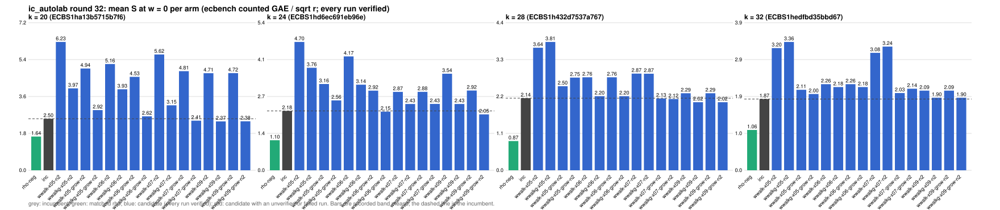

# ic_autolab round 32 (generic track): report

Protocol: [PROTOCOL.md](PROTOCOL.md), frozen 2026-11-04T11:20:39Z at git `f91be83cb98ff3dcc56db595854cc610690a14c2`; route `local`. Counted GAE only (deterministic, host independent); no wall-time claim; development loop, no validation-gate row. Loop home: [`../`](../README.md); ledger: [`../ledger.json`](../ledger.json).

Claim record: `PCC-20261104-976b76` (`python3 tools/pcc/pcc.py standing PCC-20261104-976b76`). Until a signed replay and recompute exist, this round's outcome is an unverified assertion [pcc:unverified].

## Outcome

| k | class | sel | sel / inc at w = 0 [95%] | w = 0.1 | w = 1 | band | S sel (w = 0 / 0.1 / 1) | S inc | S rho-neg | distance sel / rho |
|--:|:--|:--|:--|:--|:--|:--|:--|:--|:--|:--|
| 20 | **regression** | wwalkg-x09-n2 | 1.092 [0.956, 1.248] | 1.097 [0.954, 1.262] | 1.125 [0.940, 1.347] | inc < sel | 2.808 / 2.947 / 4.201 | 2.570 / 2.687 / 3.733 | 1.558 / 1.671 / 2.684 | 1.8x / 1.8x / 1.6x |
| 24 | **null** | wwalkg-x09-grow-n2 | 0.937 [0.819, 1.073] | 0.944 [0.819, 1.088] | 0.985 [0.816, 1.190] | sel < inc | 2.071 / 2.164 / 3.000 | 2.209 / 2.293 / 3.045 | 1.211 / 1.320 / 2.304 | 1.7x / 1.6x / 1.3x |
| 28 | **null** | wwalkg-x09-n2 | 0.972 [0.804, 1.174] | 0.967 [0.794, 1.176] | 0.936 [0.738, 1.189] | sel < inc | 2.080 / 2.194 / 3.221 | 2.140 / 2.270 / 3.439 | 1.098 / 1.202 / 2.132 | 1.9x / 1.8x / 1.5x |
| 32 | **no_challenger** | none (best candidate `wwalkg-x09-n2`, train S 1.901 / 2.000 / 2.889) | - | - | - | - | - | 1.867 / 2.025 / 3.445 | 1.057 / 1.161 / 2.097 | inc: 1.8x / 1.7x / 1.6x |

Classes follow the protocol's decision rule. Distance to rho is the distance remaining, not a gate. The reasons per size:

- k = 20: compare ops.status = ok, admissible = true; sel / inc = 1.0924 [0.956, 1.248] at w = 0; band: inc < sel; A/A inc-aa / inc interval [1.000, 1.000] contains 1
- k = 24: compare ops.status = ok, admissible = true; sel / inc = 0.9375 [0.819, 1.073] at w = 0; band: sel < inc; A/A inc-aa / inc interval [1.000, 1.000] contains 1
- k = 28: compare ops.status = ok, admissible = true; sel / inc = 0.9719 [0.804, 1.174] at w = 0; band: sel < inc; A/A inc-aa / inc interval [1.000, 1.000] contains 1
- k = 32: no_challenger

## Train (development screen, in sample)

### k = 20: session `ECBS1ha13b5715b7f6` (run exit 0, verify exit 0, receipt sha256 `dbe339334dddb7320fb2d0a3331248c3ef1552e8a9192a71d08d04121df1d5d8`)

| arm | family | N | factor base | oracle | runs | verified | S (w = 0 / 0.1 / 1) | reason proposed |
|:--|:--|--:|:--|:--|--:|--:|:--|:--|
| `rho-neg` | rho | - | `-` | `rho.negation` | 32 | 32 | 1.636 / 1.757 / 2.840 | matched reference |
| `inc` | wsum2g-b15 | 2 | `prime-projected-abscissa:size=2,scan_cap=32` | `wsum:coef=15,free=1` | 32 | 32 | 2.502 / 2.611 / 3.594 | incumbent |
| `wwalk-x05-n2` | wwalk-x05 | 2 | `prime-projected-abscissa:size=2,scan_cap=32` | `wwalk:x=0.5` | 32 | 32 | 6.229 / 6.763 / 11.571 | exploration: family wwalk-x05 untried at k = 20, N = 0.0001 x N_a |
| `wwalkg-x05-n2` | wwalkg-x05 | 2 | `prime-projected-abscissa:size=2,scan_cap=32` | `wwalk:x=0.5` | 32 | 32 | 3.975 / 4.291 / 7.131 | exploration: family wwalkg-x05 untried at k = 20, N = 0.0001 x N_a |
| `wwalk-x05-grow-n2` | wwalk-x05-grow | 2 | `prime-projected-abscissa:size=2,scan_cap=32` | `wwalk:x=0.5,grow=1` | 32 | 32 | 4.940 / 5.195 / 7.491 | exploration: family wwalk-x05-grow untried at k = 20, N = 0.0001 x N_a |
| `wwalkg-x05-grow-n2` | wwalkg-x05-grow | 2 | `prime-projected-abscissa:size=2,scan_cap=32` | `wwalk:x=0.5,grow=1` | 32 | 32 | 2.919 / 3.078 / 4.504 | exploration: family wwalkg-x05-grow untried at k = 20, N = 0.0001 x N_a |
| `wwalk-x06-n2` | wwalk-x06 | 2 | `prime-projected-abscissa:size=2,scan_cap=32` | `wwalk:x=0.6` | 32 | 32 | 5.157 / 5.509 / 8.678 | exploration: family wwalk-x06 untried at k = 20, N = 0.0001 x N_a |
| `wwalkg-x06-n2` | wwalkg-x06 | 2 | `prime-projected-abscissa:size=2,scan_cap=32` | `wwalk:x=0.6` | 32 | 32 | 3.932 / 4.230 / 6.916 | exploration: family wwalkg-x06 untried at k = 20, N = 0.0001 x N_a |
| `wwalk-x06-grow-n2` | wwalk-x06-grow | 2 | `prime-projected-abscissa:size=2,scan_cap=32` | `wwalk:x=0.6,grow=1` | 32 | 32 | 4.534 / 4.684 / 6.031 | exploration: family wwalk-x06-grow untried at k = 20, N = 0.0001 x N_a |
| `wwalkg-x06-grow-n2` | wwalkg-x06-grow | 2 | `prime-projected-abscissa:size=2,scan_cap=32` | `wwalk:x=0.6,grow=1` | 32 | 32 | 2.619 / 2.731 / 3.738 | exploration: family wwalkg-x06-grow untried at k = 20, N = 0.0001 x N_a |
| `wwalk-x07-n2` | wwalk-x07 | 2 | `prime-projected-abscissa:size=2,scan_cap=32` | `wwalk:x=0.7` | 32 | 32 | 5.622 / 6.025 / 9.653 | exploration: family wwalk-x07 untried at k = 20, N = 0.0001 x N_a |
| `wwalkg-x07-n2` | wwalkg-x07 | 2 | `prime-projected-abscissa:size=2,scan_cap=32` | `wwalk:x=0.7` | 32 | 32 | 3.154 / 3.364 / 5.253 | exploration: family wwalkg-x07 untried at k = 20, N = 0.0001 x N_a |
| `wwalk-x07-grow-n2` | wwalk-x07-grow | 2 | `prime-projected-abscissa:size=2,scan_cap=32` | `wwalk:x=0.7,grow=1` | 32 | 32 | 4.810 / 5.037 / 7.078 | exploration: family wwalk-x07-grow untried at k = 20, N = 0.0001 x N_a |
| `wwalkg-x07-grow-n2` | wwalkg-x07-grow | 2 | `prime-projected-abscissa:size=2,scan_cap=32` | `wwalk:x=0.7,grow=1` | 32 | 32 | 2.409 / 2.517 / 3.488 | exploration: family wwalkg-x07-grow untried at k = 20, N = 0.0001 x N_a |
| `wwalk-x09-n2` | wwalk-x09 | 2 | `prime-projected-abscissa:size=2,scan_cap=32` | `wwalk:x=0.9` | 32 | 32 | 4.712 / 4.911 / 6.704 | exploration: family wwalk-x09 untried at k = 20, N = 0.0001 x N_a |
| `wwalkg-x09-n2` | wwalkg-x09 | 2 | `prime-projected-abscissa:size=2,scan_cap=32` | `wwalk:x=0.9` | 32 | 32 | 2.372 / 2.468 / 3.331 | exploration: family wwalkg-x09 untried at k = 20, N = 0.0001 x N_a |
| `wwalk-x09-grow-n2` | wwalk-x09-grow | 2 | `prime-projected-abscissa:size=2,scan_cap=32` | `wwalk:x=0.9,grow=1` | 32 | 32 | 4.717 / 4.916 / 6.709 | exploration: family wwalk-x09-grow untried at k = 20, N = 0.0001 x N_a |
| `wwalkg-x09-grow-n2` | wwalkg-x09-grow | 2 | `prime-projected-abscissa:size=2,scan_cap=32` | `wwalk:x=0.9,grow=1` | 32 | 32 | 2.377 / 2.473 / 3.336 | exploration: family wwalkg-x09-grow untried at k = 20, N = 0.0001 x N_a |

### k = 24: session `ECBS1hd6ec691eb96e` (run exit 0, verify exit 0, receipt sha256 `10218ec01ab8fafc080b2b34114ae6d1b0dc611030d00c3d5507778a36bee9ba`)

| arm | family | N | factor base | oracle | runs | verified | S (w = 0 / 0.1 / 1) | reason proposed |
|:--|:--|--:|:--|:--|--:|--:|:--|:--|
| `rho-neg` | rho | - | `-` | `rho.negation` | 32 | 32 | 1.101 / 1.199 / 2.084 | matched reference |
| `inc` | wwalkg-x08-grow | 2 | `prime-projected-abscissa:size=2,scan_cap=32` | `wwalk:x=0.8,grow=1` | 32 | 32 | 2.177 / 2.257 / 2.981 | incumbent |
| `wwalk-x05-n2` | wwalk-x05 | 2 | `prime-projected-abscissa:size=2,scan_cap=32` | `wwalk:x=0.5` | 32 | 32 | 4.705 / 5.340 / 11.059 | exploration: family wwalk-x05 untried at k = 24, N = 0.0001 x N_a |
| `wwalkg-x05-n2` | wwalkg-x05 | 2 | `prime-projected-abscissa:size=2,scan_cap=32` | `wwalk:x=0.5` | 32 | 32 | 3.757 / 4.071 / 6.897 | exploration: family wwalkg-x05 untried at k = 24, N = 0.0001 x N_a |
| `wwalk-x05-grow-n2` | wwalk-x05-grow | 2 | `prime-projected-abscissa:size=2,scan_cap=32` | `wwalk:x=0.5,grow=1` | 32 | 32 | 3.163 / 3.425 / 5.781 | exploration: family wwalk-x05-grow untried at k = 24, N = 0.0001 x N_a |
| `wwalkg-x05-grow-n2` | wwalkg-x05-grow | 2 | `prime-projected-abscissa:size=2,scan_cap=32` | `wwalk:x=0.5,grow=1` | 32 | 32 | 2.561 / 2.705 / 4.000 | exploration: family wwalkg-x05-grow untried at k = 24, N = 0.0001 x N_a |
| `wwalk-x06-n2` | wwalk-x06 | 2 | `prime-projected-abscissa:size=2,scan_cap=32` | `wwalk:x=0.6` | 32 | 32 | 4.174 / 4.694 / 9.371 | exploration: family wwalk-x06 untried at k = 24, N = 0.0001 x N_a |
| `wwalkg-x06-n2` | wwalkg-x06 | 2 | `prime-projected-abscissa:size=2,scan_cap=32` | `wwalk:x=0.6` | 32 | 32 | 3.137 / 3.380 / 5.560 | exploration: family wwalkg-x06 untried at k = 24, N = 0.0001 x N_a |
| `wwalk-x06-grow-n2` | wwalk-x06-grow | 2 | `prime-projected-abscissa:size=2,scan_cap=32` | `wwalk:x=0.6,grow=1` | 32 | 32 | 2.919 / 3.107 / 4.797 | exploration: family wwalk-x06-grow untried at k = 24, N = 0.0001 x N_a |
| `wwalkg-x06-grow-n2` | wwalkg-x06-grow | 2 | `prime-projected-abscissa:size=2,scan_cap=32` | `wwalk:x=0.6,grow=1` | 32 | 32 | 2.149 / 2.237 / 3.031 | exploration: family wwalkg-x06-grow untried at k = 24, N = 0.0001 x N_a |
| `wwalk-x07-n2` | wwalk-x07 | 2 | `prime-projected-abscissa:size=2,scan_cap=32` | `wwalk:x=0.7` | 32 | 32 | 2.874 / 3.131 / 5.443 | exploration: family wwalk-x07 untried at k = 24, N = 0.0001 x N_a |
| `wwalkg-x07-n2` | wwalkg-x07 | 2 | `prime-projected-abscissa:size=2,scan_cap=32` | `wwalk:x=0.7` | 32 | 32 | 2.431 / 2.591 / 4.023 | exploration: family wwalkg-x07 untried at k = 24, N = 0.0001 x N_a |
| `wwalk-x07-grow-n2` | wwalk-x07-grow | 2 | `prime-projected-abscissa:size=2,scan_cap=32` | `wwalk:x=0.7,grow=1` | 32 | 32 | 2.876 / 3.133 / 5.445 | exploration: family wwalk-x07-grow untried at k = 24, N = 0.0001 x N_a |
| `wwalkg-x07-grow-n2` | wwalkg-x07-grow | 2 | `prime-projected-abscissa:size=2,scan_cap=32` | `wwalk:x=0.7,grow=1` | 32 | 32 | 2.433 / 2.592 / 4.024 | exploration: family wwalkg-x07-grow untried at k = 24, N = 0.0001 x N_a |
| `wwalk-x09-n2` | wwalk-x09 | 2 | `prime-projected-abscissa:size=2,scan_cap=32` | `wwalk:x=0.9` | 32 | 32 | 3.539 / 3.887 / 7.021 | exploration: family wwalk-x09 untried at k = 24, N = 0.0001 x N_a |
| `wwalkg-x09-n2` | wwalkg-x09 | 2 | `prime-projected-abscissa:size=2,scan_cap=32` | `wwalk:x=0.9` | 32 | 32 | 2.431 / 2.572 / 3.839 | exploration: family wwalkg-x09 untried at k = 24, N = 0.0001 x N_a |
| `wwalk-x09-grow-n2` | wwalk-x09-grow | 2 | `prime-projected-abscissa:size=2,scan_cap=32` | `wwalk:x=0.9,grow=1` | 32 | 32 | 2.923 / 3.135 / 5.042 | exploration: family wwalk-x09-grow untried at k = 24, N = 0.0001 x N_a |
| `wwalkg-x09-grow-n2` | wwalkg-x09-grow | 2 | `prime-projected-abscissa:size=2,scan_cap=32` | `wwalk:x=0.9,grow=1` | 32 | 32 | 2.049 / 2.139 / 2.956 | exploration: family wwalkg-x09-grow untried at k = 24, N = 0.0001 x N_a |

### k = 28: session `ECBS1h432d7537a767` (run exit 0, verify exit 0, receipt sha256 `6dae1612d3e79789538b80c43d8a2a2a6e540422d99b8711cf30c5cd1148f430`)

| arm | family | N | factor base | oracle | runs | verified | S (w = 0 / 0.1 / 1) | reason proposed |
|:--|:--|--:|:--|:--|--:|--:|:--|:--|
| `rho-neg` | rho | - | `-` | `rho.negation` | 32 | 32 | 0.869 / 0.949 / 1.673 | matched reference |
| `inc` | wwalkg-x08 | 2 | `prime-projected-abscissa:size=2,scan_cap=32` | `wwalk:x=0.8` | 32 | 32 | 2.141 / 2.271 / 3.441 | incumbent |
| `wwalk-x05-n2` | wwalk-x05 | 2 | `prime-projected-abscissa:size=2,scan_cap=32` | `wwalk:x=0.5` | 32 | 32 | 3.640 / 4.209 / 9.328 | exploration: family wwalk-x05 untried at k = 28, N = 0.0001 x N_a |
| `wwalkg-x05-n2` | wwalkg-x05 | 2 | `prime-projected-abscissa:size=2,scan_cap=32` | `wwalk:x=0.5` | 32 | 32 | 3.812 / 4.140 / 7.087 | exploration: family wwalkg-x05 untried at k = 28, N = 0.0001 x N_a |
| `wwalk-x05-grow-n2` | wwalk-x05-grow | 2 | `prime-projected-abscissa:size=2,scan_cap=32` | `wwalk:x=0.5,grow=1` | 32 | 32 | 2.496 / 2.745 / 4.979 | exploration: family wwalk-x05-grow untried at k = 28, N = 0.0001 x N_a |
| `wwalkg-x05-grow-n2` | wwalkg-x05-grow | 2 | `prime-projected-abscissa:size=2,scan_cap=32` | `wwalk:x=0.5,grow=1` | 32 | 32 | 2.753 / 2.925 / 4.468 | exploration: family wwalkg-x05-grow untried at k = 28, N = 0.0001 x N_a |
| `wwalk-x06-n2` | wwalk-x06 | 2 | `prime-projected-abscissa:size=2,scan_cap=32` | `wwalk:x=0.6` | 32 | 32 | 2.762 / 3.139 / 6.528 | exploration: family wwalk-x06 untried at k = 28, N = 0.0001 x N_a |
| `wwalkg-x06-n2` | wwalkg-x06 | 2 | `prime-projected-abscissa:size=2,scan_cap=32` | `wwalk:x=0.6` | 32 | 32 | 2.200 / 2.356 / 3.759 | exploration: family wwalkg-x06 untried at k = 28, N = 0.0001 x N_a |
| `wwalk-x06-grow-n2` | wwalk-x06-grow | 2 | `prime-projected-abscissa:size=2,scan_cap=32` | `wwalk:x=0.6,grow=1` | 32 | 32 | 2.763 / 3.139 / 6.528 | exploration: family wwalk-x06-grow untried at k = 28, N = 0.0001 x N_a |
| `wwalkg-x06-grow-n2` | wwalkg-x06-grow | 2 | `prime-projected-abscissa:size=2,scan_cap=32` | `wwalk:x=0.6,grow=1` | 32 | 32 | 2.200 / 2.356 / 3.760 | exploration: family wwalkg-x06-grow untried at k = 28, N = 0.0001 x N_a |
| `wwalk-x07-n2` | wwalk-x07 | 2 | `prime-projected-abscissa:size=2,scan_cap=32` | `wwalk:x=0.7` | 32 | 32 | 2.871 / 3.250 / 6.667 | exploration: family wwalk-x07 untried at k = 28, N = 0.0001 x N_a |
| `wwalkg-x07-n2` | wwalkg-x07 | 2 | `prime-projected-abscissa:size=2,scan_cap=32` | `wwalk:x=0.7` | 32 | 32 | 2.868 / 3.081 / 4.997 | exploration: family wwalkg-x07 untried at k = 28, N = 0.0001 x N_a |
| `wwalk-x07-grow-n2` | wwalk-x07-grow | 2 | `prime-projected-abscissa:size=2,scan_cap=32` | `wwalk:x=0.7,grow=1` | 32 | 32 | 2.132 / 2.353 / 4.337 | exploration: family wwalk-x07-grow untried at k = 28, N = 0.0001 x N_a |
| `wwalkg-x07-grow-n2` | wwalkg-x07-grow | 2 | `prime-projected-abscissa:size=2,scan_cap=32` | `wwalk:x=0.7,grow=1` | 32 | 32 | 2.115 / 2.246 / 3.421 | exploration: family wwalkg-x07-grow untried at k = 28, N = 0.0001 x N_a |
| `wwalk-x09-n2` | wwalk-x09 | 2 | `prime-projected-abscissa:size=2,scan_cap=32` | `wwalk:x=0.9` | 32 | 32 | 2.288 / 2.514 / 4.547 | exploration: family wwalk-x09 untried at k = 28, N = 0.0001 x N_a |
| `wwalkg-x09-n2` | wwalkg-x09 | 2 | `prime-projected-abscissa:size=2,scan_cap=32` | `wwalk:x=0.9` | 32 | 32 | 2.021 / 2.129 / 3.102 | exploration: family wwalkg-x09 untried at k = 28, N = 0.0001 x N_a |
| `wwalk-x09-grow-n2` | wwalk-x09-grow | 2 | `prime-projected-abscissa:size=2,scan_cap=32` | `wwalk:x=0.9,grow=1` | 32 | 32 | 2.288 / 2.514 / 4.547 | exploration: family wwalk-x09-grow untried at k = 28, N = 0.0001 x N_a |
| `wwalkg-x09-grow-n2` | wwalkg-x09-grow | 2 | `prime-projected-abscissa:size=2,scan_cap=32` | `wwalk:x=0.9,grow=1` | 32 | 32 | 2.021 / 2.129 / 3.103 | exploration: family wwalkg-x09-grow untried at k = 28, N = 0.0001 x N_a |

### k = 32: session `ECBS1hedfbd35bbd67` (run exit 0, verify exit 0, receipt sha256 `068b6bf56fa81784ba2bd9c4e18359e367c3af9bd00b2bf003b00cd6d3101f2c`)

| arm | family | N | factor base | oracle | runs | verified | S (w = 0 / 0.1 / 1) | reason proposed |
|:--|:--|--:|:--|:--|--:|--:|:--|:--|
| `rho-neg` | rho | - | `-` | `rho.negation` | 32 | 32 | 1.057 / 1.161 / 2.097 | matched reference |
| `inc` | wwalk-x10 | 2 | `prime-projected-abscissa:size=2,scan_cap=32` | `wwalk:x=1.0` | 32 | 32 | 1.867 / 2.025 / 3.445 | incumbent |
| `wwalk-x05-n2` | wwalk-x05 | 2 | `prime-projected-abscissa:size=2,scan_cap=32` | `wwalk:x=0.5` | 32 | 32 | 3.203 / 3.726 / 8.437 | exploration: family wwalk-x05 untried at k = 32, N = 0.0001 x N_a |
| `wwalkg-x05-n2` | wwalkg-x05 | 2 | `prime-projected-abscissa:size=2,scan_cap=32` | `wwalk:x=0.5` | 32 | 32 | 3.364 / 3.649 / 6.216 | exploration: family wwalkg-x05 untried at k = 32, N = 0.0001 x N_a |
| `wwalk-x05-grow-n2` | wwalk-x05-grow | 2 | `prime-projected-abscissa:size=2,scan_cap=32` | `wwalk:x=0.5,grow=1` | 32 | 32 | 2.110 / 2.342 / 4.432 | exploration: family wwalk-x05-grow untried at k = 32, N = 0.0001 x N_a |
| `wwalkg-x05-grow-n2` | wwalkg-x05-grow | 2 | `prime-projected-abscissa:size=2,scan_cap=32` | `wwalk:x=0.5,grow=1` | 32 | 32 | 1.999 / 2.111 / 3.114 | exploration: family wwalkg-x05-grow untried at k = 32, N = 0.0001 x N_a |
| `wwalk-x06-n2` | wwalk-x06 | 2 | `prime-projected-abscissa:size=2,scan_cap=32` | `wwalk:x=0.6` | 32 | 32 | 2.257 / 2.573 / 5.414 | exploration: family wwalk-x06 untried at k = 32, N = 0.0001 x N_a |
| `wwalkg-x06-n2` | wwalkg-x06 | 2 | `prime-projected-abscissa:size=2,scan_cap=32` | `wwalk:x=0.6` | 32 | 32 | 2.181 / 2.338 / 3.749 | exploration: family wwalkg-x06 untried at k = 32, N = 0.0001 x N_a |
| `wwalk-x06-grow-n2` | wwalk-x06-grow | 2 | `prime-projected-abscissa:size=2,scan_cap=32` | `wwalk:x=0.6,grow=1` | 32 | 32 | 2.257 / 2.573 / 5.414 | exploration: family wwalk-x06-grow untried at k = 32, N = 0.0001 x N_a |
| `wwalkg-x06-grow-n2` | wwalkg-x06-grow | 2 | `prime-projected-abscissa:size=2,scan_cap=32` | `wwalk:x=0.6,grow=1` | 32 | 32 | 2.181 / 2.338 / 3.749 | exploration: family wwalkg-x06-grow untried at k = 32, N = 0.0001 x N_a |
| `wwalk-x07-n2` | wwalk-x07 | 2 | `prime-projected-abscissa:size=2,scan_cap=32` | `wwalk:x=0.7` | 32 | 32 | 3.078 / 3.537 / 7.666 | exploration: family wwalk-x07 untried at k = 32, N = 0.0001 x N_a |
| `wwalkg-x07-n2` | wwalkg-x07 | 2 | `prime-projected-abscissa:size=2,scan_cap=32` | `wwalk:x=0.7` | 32 | 32 | 3.243 / 3.496 / 5.773 | exploration: family wwalkg-x07 untried at k = 32, N = 0.0001 x N_a |
| `wwalk-x07-grow-n2` | wwalk-x07-grow | 2 | `prime-projected-abscissa:size=2,scan_cap=32` | `wwalk:x=0.7,grow=1` | 32 | 32 | 2.025 / 2.206 / 3.831 | exploration: family wwalk-x07-grow untried at k = 32, N = 0.0001 x N_a |
| `wwalkg-x07-grow-n2` | wwalkg-x07-grow | 2 | `prime-projected-abscissa:size=2,scan_cap=32` | `wwalk:x=0.7,grow=1` | 32 | 32 | 2.138 / 2.246 / 3.216 | exploration: family wwalkg-x07-grow untried at k = 32, N = 0.0001 x N_a |
| `wwalk-x09-n2` | wwalk-x09 | 2 | `prime-projected-abscissa:size=2,scan_cap=32` | `wwalk:x=0.9` | 32 | 32 | 2.087 / 2.309 / 4.307 | exploration: family wwalk-x09 untried at k = 32, N = 0.0001 x N_a |
| `wwalkg-x09-n2` | wwalkg-x09 | 2 | `prime-projected-abscissa:size=2,scan_cap=32` | `wwalk:x=0.9` | 32 | 32 | 1.901 / 2.000 / 2.889 | exploration: family wwalkg-x09 untried at k = 32, N = 0.0001 x N_a |
| `wwalk-x09-grow-n2` | wwalk-x09-grow | 2 | `prime-projected-abscissa:size=2,scan_cap=32` | `wwalk:x=0.9,grow=1` | 32 | 32 | 2.087 / 2.309 / 4.307 | exploration: family wwalk-x09-grow untried at k = 32, N = 0.0001 x N_a |
| `wwalkg-x09-grow-n2` | wwalkg-x09-grow | 2 | `prime-projected-abscissa:size=2,scan_cap=32` | `wwalk:x=0.9,grow=1` | 32 | 32 | 1.901 / 2.000 / 2.889 | exploration: family wwalkg-x09-grow untried at k = 32, N = 0.0001 x N_a |

## Selection

- k = 20: challenger `wwalkg-x09-n2` (Pareto alternative at w = 1: `wwalkg-x09-n2`)
- k = 24: challenger `wwalkg-x09-grow-n2` (Pareto alternative at w = 1: `wwalkg-x09-grow-n2`)
- k = 28: challenger `wwalkg-x09-n2` (Pareto alternative at w = 1: `wwalkg-x09-n2`)
- k = 32: no_challenger  (Pareto alternative at w = 1: `wwalkg-x09-n2`)

## Holdout sessions

| k | session | run exit | verify exit | receipt sha256 | levels |
|--:|:--|--:|--:|:--|:--|
| 20 | `ECBS1hae47e20d85f5` | 0 | 0 | `9fbb663a7b10990b6ff5202246acf09a57504065dce8fc67622ffc56bd641d50` | {"verified":480} |
| 24 | `ECBS1he8d07708495c` | 0 | 0 | `1077656698a81fb7e971fa3c805bc6644fceb6b180eda1544b158a1113f76a5b` | {"verified":480} |
| 28 | `ECBS1h3bcebfa80a91` | 0 | 0 | `ed9f8c7a1e5f04cc7d794d08a47c65c38d824135ef3bc6118871c7429822719d` | {"verified":480} |

## Ledger after this round

| k | incumbent | since round | S (w = 0 / 0.1 / 1) | distance to rho |
|--:|:--|--:|:--|:--|
| 20 | `wsum2g-b15-n2` (`prime-projected-abscissa:size=2,scan_cap=32` + `wsum:coef=15,free=1`) | 28 | 2.575 / 2.691 / 3.741 | 1.8x / 1.7x / 1.5x |
| 24 | `wwalkg-x08-grow-n2` (`prime-projected-abscissa:size=2,scan_cap=32` + `wwalk:x=0.8,grow=1`) | 31 | 2.164 / 2.243 / 2.955 | 1.8x / 1.7x / 1.3x |
| 28 | `wwalkg-x08-n2` (`prime-projected-abscissa:size=2,scan_cap=32` + `wwalk:x=0.8`) | 31 | 1.921 / 2.029 / 3.001 | 2.1x / 2.0x / 1.7x |
| 32 | `wwalk-x10-n2` (`prime-projected-abscissa:size=2,scan_cap=32` + `wwalk:x=1.0`) | 31 | 2.110 / 2.316 / 4.174 | 2.4x / 2.4x / 2.4x |

## Evidence and deviations

- ecbench binary sha256: `9f3a25b151d9868419ec86574451424a506f06c9bf8e5d790b44d48428feb4eb`; `--cpus auto`, allow_busy = true; `verify --replay 8` per session; audit receipts in `analysis/`; sessions in `sessions/` (records in the artifact store when large).
- Route: the local route is an explicitly requested development screen, not the Iso Lab EKS default; counts are deterministic and replayed, wall time is not claimed. No row of this round enters the IC leaderboard or `benchmarks/README.md` (validation gate).
- Train selection is in sample (disclosed); the holdout is fresh (new `target_seed`, excluded exposures). Failed, timed-out and regressing arms are retained above.
