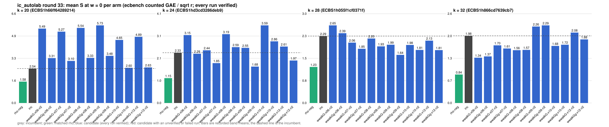

# ic_autolab round 33 (generic track): report

Protocol: [PROTOCOL.md](PROTOCOL.md), frozen 2026-11-04T12:09:43Z at git `aea9539aec5b52da765ca2ebd1c2afe894a64d45`; route `local`. Counted GAE only (deterministic, host independent); no wall-time claim; development loop, no validation-gate row. Loop home: [`../`](../README.md); ledger: [`../ledger.json`](../ledger.json).

Claim record: `PCC-20261104-c28f16` (`python3 tools/pcc/pcc.py standing PCC-20261104-c28f16`). Until a signed replay and recompute exist, this round's outcome is an unverified assertion [pcc:unverified].

## Outcome

| k | class | sel | sel / inc at w = 0 [95%] | w = 0.1 | w = 1 | band | S sel (w = 0 / 0.1 / 1) | S inc | S rho-neg | distance sel / rho |
|--:|:--|:--|:--|:--|:--|:--|:--|:--|:--|:--|
| 20 | **no_challenger** | none (best candidate `wwalkGg-x10-n2`, train S 2.595 / 2.654 / 3.187) | - | - | - | - | - | 2.541 / 2.654 / 3.673 | 1.576 / 1.690 / 2.718 | inc: 1.6x / 1.6x / 1.4x |
| 24 | **improvement** | wwalkGg-x09-n2 | 0.721 [0.610, 0.853] | 0.711 [0.595, 0.850] | 0.647 [0.502, 0.834] | sel < inc | 1.673 / 1.718 / 2.117 | 2.321 / 2.416 / 3.270 | 1.171 / 1.276 / 2.225 | 1.4x / 1.3x / 1.0x |
| 28 | **improvement** | wwalkGg-x09-n2 | 0.795 [0.673, 0.940] | 0.770 [0.647, 0.918] | 0.630 [0.501, 0.792] | sel < inc | 1.572 / 1.611 / 1.961 | 1.977 / 2.091 / 3.113 | 1.052 / 1.151 / 2.039 | 1.5x / 1.4x / 1.0x |
| 32 | **improvement** | wwalkG-x06-n2 | 0.715 [0.648, 0.788] | 0.697 [0.626, 0.777] | 0.620 [0.528, 0.728] | sel < inc | 1.515 / 1.625 / 2.608 | 2.120 / 2.329 / 4.207 | 0.975 / 1.071 / 1.933 | 1.6x / 1.5x / 1.3x |

Classes follow the protocol's decision rule. Distance to rho is the distance remaining, not a gate. The reasons per size:

- k = 20: no_challenger
- k = 24: compare ops.status = ok, admissible = true; sel / inc = 0.7210 [0.610, 0.853] at w = 0; band: sel < inc; A/A inc-aa / inc interval [1.000, 1.000] contains 1
- k = 28: compare ops.status = ok, admissible = true; sel / inc = 0.7950 [0.673, 0.940] at w = 0; band: sel < inc; A/A inc-aa / inc interval [1.000, 1.000] contains 1
- k = 32: compare ops.status = ok, admissible = true; sel / inc = 0.7146 [0.648, 0.788] at w = 0; band: sel < inc; A/A inc-aa / inc interval [1.000, 1.000] contains 1

## Train (development screen, in sample)

### k = 20: session `ECBS1h66ff64289214` (run exit 0, verify exit 0, receipt sha256 `ef7b2fd4780fe2bbe16d7f08240698196e2f3bac0892b7ce8c561e105a9cb7cd`)

| arm | family | N | factor base | oracle | runs | verified | S (w = 0 / 0.1 / 1) | reason proposed |
|:--|:--|--:|:--|:--|--:|--:|:--|:--|
| `rho-neg` | rho | - | `-` | `rho.negation` | 32 | 32 | 1.576 / 1.690 / 2.718 | matched reference |
| `inc` | wsum2g-b15 | 2 | `prime-projected-abscissa:size=2,scan_cap=32` | `wsum:coef=15,free=1` | 32 | 32 | 2.541 / 2.654 / 3.673 | incumbent |
| `wwalkG-x06-n2` | wwalkG-x06 | 2 | `prime-projected-abscissa:size=2,scan_cap=32` | `wwalk:x=0.6,g=1,grow=2` | 32 | 32 | 5.491 / 5.604 / 6.619 | exploration: family wwalkG-x06 untried at k = 20, N = 0.0001 x N_a |
| `wwalkGg-x06-n2` | wwalkGg-x06 | 2 | `prime-projected-abscissa:size=2,scan_cap=32` | `wwalk:x=0.6,g=1,grow=2` | 32 | 32 | 3.311 / 3.370 / 3.901 | exploration: family wwalkGg-x06 untried at k = 20, N = 0.0001 x N_a |
| `wwalkG-x07-n2` | wwalkG-x07 | 2 | `prime-projected-abscissa:size=2,scan_cap=32` | `wwalk:x=0.7,g=1,grow=2` | 32 | 32 | 5.266 / 5.338 / 5.993 | exploration: family wwalkG-x07 untried at k = 20, N = 0.0001 x N_a |
| `wwalkGg-x07-n2` | wwalkGg-x07 | 2 | `prime-projected-abscissa:size=2,scan_cap=32` | `wwalk:x=0.7,g=1,grow=2` | 32 | 32 | 3.105 / 3.145 / 3.503 | exploration: family wwalkGg-x07 untried at k = 20, N = 0.0001 x N_a |
| `wwalkG-x08-n2` | wwalkG-x08 | 2 | `prime-projected-abscissa:size=2,scan_cap=32` | `wwalk:x=0.8,g=1,grow=2` | 32 | 32 | 5.542 / 5.600 / 6.124 | exploration: family wwalkG-x08 untried at k = 20, N = 0.0001 x N_a |
| `wwalkGg-x08-n2` | wwalkGg-x08 | 2 | `prime-projected-abscissa:size=2,scan_cap=32` | `wwalk:x=0.8,g=1,grow=2` | 32 | 32 | 3.326 / 3.352 / 3.591 | exploration: family wwalkGg-x08 untried at k = 20, N = 0.0001 x N_a |
| `wwalkG-x09-n2` | wwalkG-x09 | 2 | `prime-projected-abscissa:size=2,scan_cap=32` | `wwalk:x=0.9,g=1,grow=2` | 32 | 32 | 5.728 / 5.793 / 6.371 | exploration: family wwalkG-x09 untried at k = 20, N = 0.0001 x N_a |
| `wwalkGg-x09-n2` | wwalkGg-x09 | 2 | `prime-projected-abscissa:size=2,scan_cap=32` | `wwalk:x=0.9,g=1,grow=2` | 32 | 32 | 3.478 / 3.506 / 3.760 | exploration: family wwalkGg-x09 untried at k = 20, N = 0.0001 x N_a |
| `wwalkG-x10-n2` | wwalkG-x10 | 2 | `prime-projected-abscissa:size=2,scan_cap=32` | `wwalk:x=1.0,g=1,grow=2` | 32 | 32 | 4.654 / 4.743 / 5.541 | exploration: family wwalkG-x10 untried at k = 20, N = 0.0001 x N_a |
| `wwalkGg-x10-n2` | wwalkGg-x10 | 2 | `prime-projected-abscissa:size=2,scan_cap=32` | `wwalk:x=1.0,g=1,grow=2` | 32 | 32 | 2.595 / 2.654 / 3.187 | exploration: family wwalkGg-x10 untried at k = 20, N = 0.0001 x N_a |
| `wwalkG-x12-n2` | wwalkG-x12 | 2 | `prime-projected-abscissa:size=2,scan_cap=32` | `wwalk:x=1.2,g=1,grow=2` | 32 | 32 | 4.885 / 4.977 / 5.799 | exploration: family wwalkG-x12 untried at k = 20, N = 0.0001 x N_a |
| `wwalkGg-x12-n2` | wwalkGg-x12 | 2 | `prime-projected-abscissa:size=2,scan_cap=32` | `wwalk:x=1.2,g=1,grow=2` | 32 | 32 | 2.626 / 2.667 / 3.040 | exploration: family wwalkGg-x12 untried at k = 20, N = 0.0001 x N_a |

### k = 24: session `ECBS1hd3cd3286deb9` (run exit 0, verify exit 0, receipt sha256 `1f46a35e572ff83f8e3c143a7ec3e2390e52445473ad875c7d23e21e00344d7c`)

| arm | family | N | factor base | oracle | runs | verified | S (w = 0 / 0.1 / 1) | reason proposed |
|:--|:--|--:|:--|:--|--:|--:|:--|:--|
| `rho-neg` | rho | - | `-` | `rho.negation` | 32 | 32 | 1.152 / 1.255 / 2.185 | matched reference |
| `inc` | wwalkg-x08-grow | 2 | `prime-projected-abscissa:size=2,scan_cap=32` | `wwalk:x=0.8,grow=1` | 32 | 32 | 2.327 / 2.422 / 3.281 | incumbent |
| `wwalkG-x06-n2` | wwalkG-x06 | 2 | `prime-projected-abscissa:size=2,scan_cap=32` | `wwalk:x=0.6,g=1,grow=2` | 32 | 32 | 3.146 / 3.232 / 4.013 | exploration: family wwalkG-x06 untried at k = 24, N = 0.0001 x N_a |
| `wwalkGg-x06-n2` | wwalkGg-x06 | 2 | `prime-projected-abscissa:size=2,scan_cap=32` | `wwalk:x=0.6,g=1,grow=2` | 32 | 32 | 2.282 / 2.308 / 2.545 | exploration: family wwalkGg-x06 untried at k = 24, N = 0.0001 x N_a |
| `wwalkG-x07-n2` | wwalkG-x07 | 2 | `prime-projected-abscissa:size=2,scan_cap=32` | `wwalk:x=0.7,g=1,grow=2` | 32 | 32 | 2.441 / 2.517 / 3.198 | exploration: family wwalkG-x07 untried at k = 24, N = 0.0001 x N_a |
| `wwalkGg-x07-n2` | wwalkGg-x07 | 2 | `prime-projected-abscissa:size=2,scan_cap=32` | `wwalk:x=0.7,g=1,grow=2` | 32 | 32 | 1.847 / 1.894 / 2.322 | exploration: family wwalkGg-x07 untried at k = 24, N = 0.0001 x N_a |
| `wwalkG-x08-n2` | wwalkG-x08 | 2 | `prime-projected-abscissa:size=2,scan_cap=32` | `wwalk:x=0.8,g=1,grow=2` | 32 | 32 | 3.188 / 3.227 / 3.581 | exploration: family wwalkG-x08 untried at k = 24, N = 0.0001 x N_a |
| `wwalkGg-x08-n2` | wwalkGg-x08 | 2 | `prime-projected-abscissa:size=2,scan_cap=32` | `wwalk:x=0.8,g=1,grow=2` | 32 | 32 | 2.586 / 2.614 / 2.867 | exploration: family wwalkGg-x08 untried at k = 24, N = 0.0001 x N_a |
| `wwalkG-x09-n2` | wwalkG-x09 | 2 | `prime-projected-abscissa:size=2,scan_cap=32` | `wwalk:x=0.9,g=1,grow=2` | 32 | 32 | 2.554 / 2.678 / 3.799 | exploration: family wwalkG-x09 untried at k = 24, N = 0.0001 x N_a |
| `wwalkGg-x09-n2` | wwalkGg-x09 | 2 | `prime-projected-abscissa:size=2,scan_cap=32` | `wwalk:x=0.9,g=1,grow=2` | 32 | 32 | 1.685 / 1.730 / 2.140 | exploration: family wwalkGg-x09 untried at k = 24, N = 0.0001 x N_a |
| `wwalkG-x10-n2` | wwalkG-x10 | 2 | `prime-projected-abscissa:size=2,scan_cap=32` | `wwalk:x=1.0,g=1,grow=2` | 32 | 32 | 3.595 / 3.643 / 4.077 | exploration: family wwalkG-x10 untried at k = 24, N = 0.0001 x N_a |
| `wwalkGg-x10-n2` | wwalkGg-x10 | 2 | `prime-projected-abscissa:size=2,scan_cap=32` | `wwalk:x=1.0,g=1,grow=2` | 32 | 32 | 2.856 / 2.875 / 3.045 | exploration: family wwalkGg-x10 untried at k = 24, N = 0.0001 x N_a |
| `wwalkG-x12-n2` | wwalkG-x12 | 2 | `prime-projected-abscissa:size=2,scan_cap=32` | `wwalk:x=1.2,g=1,grow=2` | 32 | 32 | 2.615 / 2.689 / 3.358 | exploration: family wwalkG-x12 untried at k = 24, N = 0.0001 x N_a |
| `wwalkGg-x12-n2` | wwalkGg-x12 | 2 | `prime-projected-abscissa:size=2,scan_cap=32` | `wwalk:x=1.2,g=1,grow=2` | 32 | 32 | 1.967 / 2.009 / 2.385 | exploration: family wwalkGg-x12 untried at k = 24, N = 0.0001 x N_a |

### k = 28: session `ECBS1h055f1cf0371f` (run exit 0, verify exit 0, receipt sha256 `3d840a2a354f30b1892b9b5ae1efba4a4bacd878698a3db00483b88ae00197db`)

| arm | family | N | factor base | oracle | runs | verified | S (w = 0 / 0.1 / 1) | reason proposed |
|:--|:--|--:|:--|:--|--:|--:|:--|:--|
| `rho-neg` | rho | - | `-` | `rho.negation` | 32 | 32 | 1.231 / 1.347 / 2.397 | matched reference |
| `inc` | wwalkg-x08 | 2 | `prime-projected-abscissa:size=2,scan_cap=32` | `wwalk:x=0.8` | 32 | 32 | 2.287 / 2.431 / 3.732 | incumbent |
| `wwalkG-x06-n2` | wwalkG-x06 | 2 | `prime-projected-abscissa:size=2,scan_cap=32` | `wwalk:x=0.6,g=1,grow=2` | 32 | 32 | 2.652 / 2.762 / 3.746 | exploration: family wwalkG-x06 untried at k = 28, N = 0.0001 x N_a |
| `wwalkGg-x06-n2` | wwalkGg-x06 | 2 | `prime-projected-abscissa:size=2,scan_cap=32` | `wwalk:x=0.6,g=1,grow=2` | 32 | 32 | 2.385 / 2.434 / 2.878 | exploration: family wwalkGg-x06 untried at k = 28, N = 0.0001 x N_a |
| `wwalkG-x07-n2` | wwalkG-x07 | 2 | `prime-projected-abscissa:size=2,scan_cap=32` | `wwalk:x=0.7,g=1,grow=2` | 32 | 32 | 2.063 / 2.135 / 2.789 | exploration: family wwalkG-x07 untried at k = 28, N = 0.0001 x N_a |
| `wwalkGg-x07-n2` | wwalkGg-x07 | 2 | `prime-projected-abscissa:size=2,scan_cap=32` | `wwalk:x=0.7,g=1,grow=2` | 32 | 32 | 1.852 / 1.888 / 2.215 | exploration: family wwalkGg-x07 untried at k = 28, N = 0.0001 x N_a |
| `wwalkG-x08-n2` | wwalkG-x08 | 2 | `prime-projected-abscissa:size=2,scan_cap=32` | `wwalk:x=0.8,g=1,grow=2` | 32 | 32 | 2.203 / 2.272 / 2.897 | exploration: family wwalkG-x08 untried at k = 28, N = 0.0001 x N_a |
| `wwalkGg-x08-n2` | wwalkGg-x08 | 2 | `prime-projected-abscissa:size=2,scan_cap=32` | `wwalk:x=0.8,g=1,grow=2` | 32 | 32 | 1.935 / 1.964 / 2.224 | exploration: family wwalkGg-x08 untried at k = 28, N = 0.0001 x N_a |
| `wwalkG-x09-n2` | wwalkG-x09 | 2 | `prime-projected-abscissa:size=2,scan_cap=32` | `wwalk:x=0.9,g=1,grow=2` | 32 | 32 | 1.990 / 2.109 / 3.178 | exploration: family wwalkG-x09 untried at k = 28, N = 0.0001 x N_a |
| `wwalkGg-x09-n2` | wwalkGg-x09 | 2 | `prime-projected-abscissa:size=2,scan_cap=32` | `wwalk:x=0.9,g=1,grow=2` | 32 | 32 | 1.644 / 1.690 / 2.106 | exploration: family wwalkGg-x09 untried at k = 28, N = 0.0001 x N_a |
| `wwalkG-x10-n2` | wwalkG-x10 | 2 | `prime-projected-abscissa:size=2,scan_cap=32` | `wwalk:x=1.0,g=1,grow=2` | 32 | 32 | 1.983 / 2.045 / 2.609 | exploration: family wwalkG-x10 untried at k = 28, N = 0.0001 x N_a |
| `wwalkGg-x10-n2` | wwalkGg-x10 | 2 | `prime-projected-abscissa:size=2,scan_cap=32` | `wwalk:x=1.0,g=1,grow=2` | 32 | 32 | 1.813 / 1.848 / 2.166 | exploration: family wwalkGg-x10 untried at k = 28, N = 0.0001 x N_a |
| `wwalkG-x12-n2` | wwalkG-x12 | 2 | `prime-projected-abscissa:size=2,scan_cap=32` | `wwalk:x=1.2,g=1,grow=2` | 32 | 32 | 2.130 / 2.250 / 3.326 | exploration: family wwalkG-x12 untried at k = 28, N = 0.0001 x N_a |
| `wwalkGg-x12-n2` | wwalkGg-x12 | 2 | `prime-projected-abscissa:size=2,scan_cap=32` | `wwalk:x=1.2,g=1,grow=2` | 32 | 32 | 1.807 / 1.856 / 2.295 | exploration: family wwalkGg-x12 untried at k = 28, N = 0.0001 x N_a |

### k = 32: session `ECBS1h866cd7639cb7` (run exit 0, verify exit 0, receipt sha256 `f3ecad56a9d64c014b65247ec2fb833cb7611356d0bd1d88512c4081d17ca1e3`)

| arm | family | N | factor base | oracle | runs | verified | S (w = 0 / 0.1 / 1) | reason proposed |
|:--|:--|--:|:--|:--|--:|--:|:--|:--|
| `rho-neg` | rho | - | `-` | `rho.negation` | 32 | 32 | 0.839 / 0.922 / 1.662 | matched reference |
| `inc` | wwalk-x10 | 2 | `prime-projected-abscissa:size=2,scan_cap=32` | `wwalk:x=1.0` | 32 | 32 | 1.983 / 2.164 / 3.794 | incumbent |
| `wwalkG-x06-n2` | wwalkG-x06 | 2 | `prime-projected-abscissa:size=2,scan_cap=32` | `wwalk:x=0.6,g=1,grow=2` | 32 | 32 | 1.336 / 1.409 / 2.071 | exploration: family wwalkG-x06 untried at k = 32, N = 0.0001 x N_a |
| `wwalkGg-x06-n2` | wwalkGg-x06 | 2 | `prime-projected-abscissa:size=2,scan_cap=32` | `wwalk:x=0.6,g=1,grow=2` | 32 | 32 | 1.375 / 1.421 / 1.842 | exploration: family wwalkGg-x06 untried at k = 32, N = 0.0001 x N_a |
| `wwalkG-x07-n2` | wwalkG-x07 | 2 | `prime-projected-abscissa:size=2,scan_cap=32` | `wwalk:x=0.7,g=1,grow=2` | 32 | 32 | 1.701 / 1.773 / 2.425 | exploration: family wwalkG-x07 untried at k = 32, N = 0.0001 x N_a |
| `wwalkGg-x07-n2` | wwalkGg-x07 | 2 | `prime-projected-abscissa:size=2,scan_cap=32` | `wwalk:x=0.7,g=1,grow=2` | 32 | 32 | 1.608 / 1.641 / 1.937 | exploration: family wwalkGg-x07 untried at k = 32, N = 0.0001 x N_a |
| `wwalkG-x08-n2` | wwalkG-x08 | 2 | `prime-projected-abscissa:size=2,scan_cap=32` | `wwalk:x=0.8,g=1,grow=2` | 32 | 32 | 1.557 / 1.637 / 2.357 | exploration: family wwalkG-x08 untried at k = 32, N = 0.0001 x N_a |
| `wwalkGg-x08-n2` | wwalkGg-x08 | 2 | `prime-projected-abscissa:size=2,scan_cap=32` | `wwalk:x=0.8,g=1,grow=2` | 32 | 32 | 1.566 / 1.613 / 2.036 | exploration: family wwalkGg-x08 untried at k = 32, N = 0.0001 x N_a |
| `wwalkG-x09-n2` | wwalkG-x09 | 2 | `prime-projected-abscissa:size=2,scan_cap=32` | `wwalk:x=0.9,g=1,grow=2` | 32 | 32 | 2.255 / 2.302 / 2.717 | exploration: family wwalkG-x09 untried at k = 32, N = 0.0001 x N_a |
| `wwalkGg-x09-n2` | wwalkGg-x09 | 2 | `prime-projected-abscissa:size=2,scan_cap=32` | `wwalk:x=0.9,g=1,grow=2` | 32 | 32 | 2.290 / 2.323 / 2.616 | exploration: family wwalkGg-x09 untried at k = 32, N = 0.0001 x N_a |
| `wwalkG-x10-n2` | wwalkG-x10 | 2 | `prime-projected-abscissa:size=2,scan_cap=32` | `wwalk:x=1.0,g=1,grow=2` | 32 | 32 | 1.683 / 1.759 / 2.440 | exploration: family wwalkG-x10 untried at k = 32, N = 0.0001 x N_a |
| `wwalkGg-x10-n2` | wwalkGg-x10 | 2 | `prime-projected-abscissa:size=2,scan_cap=32` | `wwalk:x=1.0,g=1,grow=2` | 32 | 32 | 1.718 / 1.766 / 2.193 | exploration: family wwalkGg-x10 untried at k = 32, N = 0.0001 x N_a |
| `wwalkG-x12-n2` | wwalkG-x12 | 2 | `prime-projected-abscissa:size=2,scan_cap=32` | `wwalk:x=1.2,g=1,grow=2` | 32 | 32 | 2.077 / 2.151 / 2.811 | exploration: family wwalkG-x12 untried at k = 32, N = 0.0001 x N_a |
| `wwalkGg-x12-n2` | wwalkGg-x12 | 2 | `prime-projected-abscissa:size=2,scan_cap=32` | `wwalk:x=1.2,g=1,grow=2` | 32 | 32 | 1.876 / 1.899 / 2.103 | exploration: family wwalkGg-x12 untried at k = 32, N = 0.0001 x N_a |

## Selection

- k = 20: no_challenger  (Pareto alternative at w = 1: `wwalkGg-x12-n2`)
- k = 24: challenger `wwalkGg-x09-n2` (Pareto alternative at w = 1: `wwalkGg-x09-n2`)
- k = 28: challenger `wwalkGg-x09-n2` (Pareto alternative at w = 1: `wwalkGg-x09-n2`)
- k = 32: challenger `wwalkG-x06-n2` (Pareto alternative at w = 1: `wwalkGg-x06-n2`)

## Holdout sessions

| k | session | run exit | verify exit | receipt sha256 | levels |
|--:|:--|--:|--:|:--|:--|
| 24 | `ECBS1h05c72414c6d4` | 0 | 0 | `43de56f9cde7f622ed22f2e0b24b44b140d2ff22a101f9a64fef6acd568b93a7` | {"verified":480} |
| 28 | `ECBS1hba478ffc1d23` | 0 | 0 | `3435de2920cad08d48385589d5ac7048b6a179315ed97a2abf2eeb1de3685281` | {"verified":480} |
| 32 | `ECBS1h8b22612ef731` | 0 | 0 | `71c7bf0c4bcbb0e46f155285b7c71dc81d7ce125bf0e79a18fa49f90fa95407c` | {"verified":480} |

## Ledger after this round

| k | incumbent | since round | S (w = 0 / 0.1 / 1) | distance to rho |
|--:|:--|--:|:--|:--|
| 20 | `wsum2g-b15-n2` (`prime-projected-abscissa:size=2,scan_cap=32` + `wsum:coef=15,free=1`) | 28 | 2.575 / 2.691 / 3.741 | 1.8x / 1.7x / 1.5x |
| 24 | `wwalkGg-x09-n2` (`prime-projected-abscissa:size=2,scan_cap=32` + `wwalk:x=0.9,g=1,grow=2`) | 33 | 1.673 / 1.718 / 2.117 | 1.4x / 1.3x / 1.0x |
| 28 | `wwalkGg-x09-n2` (`prime-projected-abscissa:size=2,scan_cap=32` + `wwalk:x=0.9,g=1,grow=2`) | 33 | 1.572 / 1.611 / 1.961 | 1.5x / 1.4x / 1.0x |
| 32 | `wwalkG-x06-n2` (`prime-projected-abscissa:size=2,scan_cap=32` + `wwalk:x=0.6,g=1,grow=2`) | 33 | 1.515 / 1.625 / 2.608 | 1.6x / 1.5x / 1.3x |

## Evidence and deviations

- ecbench binary sha256: `737fb5b0901bda2c34a6a059032aa91fb76b1cfe656a4146c21c9778c5127c2e`; `--cpus auto`, allow_busy = true; `verify --replay 8` per session; audit receipts in `analysis/`; sessions in `sessions/` (records in the artifact store when large).
- Route: the local route is an explicitly requested development screen, not the Iso Lab EKS default; counts are deterministic and replayed, wall time is not claimed. No row of this round enters the IC leaderboard or `benchmarks/README.md` (validation gate).
- Train selection is in sample (disclosed); the holdout is fresh (new `target_seed`, excluded exposures). Failed, timed-out and regressing arms are retained above.
