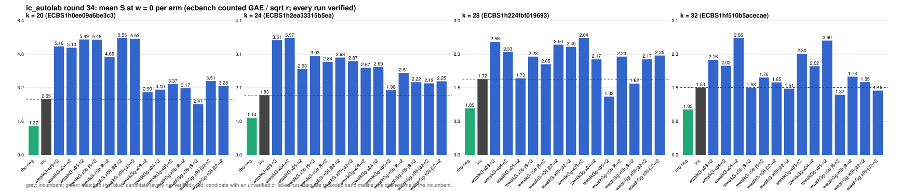

# ic_autolab round 34 (generic track): report

Protocol: [PROTOCOL.md](PROTOCOL.md), frozen 2026-11-04T12:14:18Z at git `290b2770c0f3018c85c94a2e2cf35a54a3addebf`; route `local`. Counted GAE only (deterministic, host independent); no wall-time claim; development loop, no validation-gate row. Loop home: [`../`](../README.md); ledger: [`../ledger.json`](../ledger.json).

Claim record: `PCC-20261104-2631da` (`python3 tools/pcc/pcc.py standing PCC-20261104-2631da`). Until a signed replay and recompute exist, this round's outcome is an unverified assertion [pcc:unverified].

## Outcome

| k | class | sel | sel / inc at w = 0 [95%] | w = 0.1 | w = 1 | band | S sel (w = 0 / 0.1 / 1) | S inc | S rho-neg | distance sel / rho |
|--:|:--|:--|:--|:--|:--|:--|:--|:--|:--|:--|
| 20 | **null** | wwalkGg-x09-j8-n2 | 0.938 [0.864, 1.019] | 0.915 [0.839, 0.999] | 0.774 [0.683, 0.876] | sel < inc | 2.438 / 2.487 / 2.930 | 2.598 / 2.717 / 3.786 | 1.613 / 1.731 / 2.793 | 1.5x / 1.4x / 1.0x |
| 24 | **no_challenger** | none (best candidate `wwalkGg-x05-n2`, train S 1.981 / 2.022 / 2.385) | - | - | - | - | - | 1.825 / 1.885 / 2.420 | 1.135 / 1.237 / 2.152 | inc: 1.6x / 1.5x / 1.1x |
| 28 | **null** | wwalkGg-x05-n2 | 0.981 [0.854, 1.126] | 0.995 [0.859, 1.153] | 1.101 [0.893, 1.358] | unresolved inside the band | 1.488 / 1.543 / 2.038 | 1.517 / 1.550 / 1.851 | 0.947 / 1.036 / 1.830 | 1.6x / 1.5x / 1.1x |
| 32 | **null** | wwalkGg-x06-j8-n2 | 0.880 [0.741, 1.046] | 0.857 [0.713, 1.030] | 0.738 [0.574, 0.948] | sel < inc | 1.352 / 1.414 / 1.970 | 1.536 / 1.649 / 2.670 | 0.838 / 0.920 / 1.660 | 1.6x / 1.5x / 1.2x |

Classes follow the protocol's decision rule. Distance to rho is the distance remaining, not a gate. The reasons per size:

- k = 20: compare ops.status = ok, admissible = true; sel / inc = 0.9384 [0.864, 1.019] at w = 0; band: sel < inc; A/A inc-aa / inc interval [1.000, 1.000] contains 1
- k = 24: no_challenger
- k = 28: compare ops.status = ok, admissible = true; sel / inc = 0.9809 [0.854, 1.126] at w = 0; band: unresolved inside the band; A/A inc-aa / inc interval [1.000, 1.000] contains 1
- k = 32: compare ops.status = ok, admissible = true; sel / inc = 0.8802 [0.741, 1.046] at w = 0; band: sel < inc; A/A inc-aa / inc interval [1.000, 1.000] contains 1

## Train (development screen, in sample)

### k = 20: session `ECBS1h0ee09a6be3c3` (run exit 0, verify exit 0, receipt sha256 `5aa81121535da98221c7dbbb47ca8004a2ef15010b5abe1139f8e470f6e655c6`)

| arm | family | N | factor base | oracle | runs | verified | S (w = 0 / 0.1 / 1) | reason proposed |
|:--|:--|--:|:--|:--|--:|--:|:--|:--|
| `rho-neg` | rho | - | `-` | `rho.negation` | 32 | 32 | 1.370 / 1.463 / 2.307 | matched reference |
| `inc` | wsum2g-b15 | 2 | `prime-projected-abscissa:size=2,scan_cap=32` | `wsum:coef=15,free=1` | 32 | 32 | 2.650 / 2.774 / 3.893 | incumbent |
| `wwalkG-x03-n2` | wwalkG-x03 | 2 | `prime-projected-abscissa:size=2,scan_cap=32` | `wwalk:x=0.3,g=1,grow=2` | 32 | 32 | 5.157 / 5.367 / 7.253 | exploration: family wwalkG-x03 untried at k = 20, N = 0.0001 x N_a |
| `wwalkG-x04-n2` | wwalkG-x04 | 2 | `prime-projected-abscissa:size=2,scan_cap=32` | `wwalk:x=0.4,g=1,grow=2` | 32 | 32 | 5.096 / 5.251 / 6.644 | exploration: family wwalkG-x04 untried at k = 20, N = 0.0001 x N_a |
| `wwalkG-x05-n2` | wwalkG-x05 | 2 | `prime-projected-abscissa:size=2,scan_cap=32` | `wwalk:x=0.5,g=1,grow=2` | 32 | 32 | 5.488 / 5.660 / 7.201 | exploration: family wwalkG-x05 untried at k = 20, N = 0.0001 x N_a |
| `wwalkG-x06-j8-n2` | wwalkG-x06-j8 | 2 | `prime-projected-abscissa:size=2,scan_cap=32` | `wwalk:x=0.6,jumps=8,g=1,grow=2` | 32 | 32 | 5.480 / 5.632 / 6.996 | exploration: family wwalkG-x06-j8 untried at k = 20, N = 0.0001 x N_a |
| `wwalkG-x09-j8-n2` | wwalkG-x09-j8 | 2 | `prime-projected-abscissa:size=2,scan_cap=32` | `wwalk:x=0.9,jumps=8,g=1,grow=2` | 32 | 32 | 4.653 / 4.750 / 5.623 | exploration: family wwalkG-x09-j8 untried at k = 20, N = 0.0001 x N_a |
| `wwalkG-x06-j32-n2` | wwalkG-x06-j32 | 2 | `prime-projected-abscissa:size=2,scan_cap=32` | `wwalk:x=0.6,jumps=32,g=1,grow=2` | 32 | 32 | 5.551 / 5.609 / 6.135 | exploration: family wwalkG-x06-j32 untried at k = 20, N = 0.0001 x N_a |
| `wwalkG-x09-j32-n2` | wwalkG-x09-j32 | 2 | `prime-projected-abscissa:size=2,scan_cap=32` | `wwalk:x=0.9,jumps=32,g=1,grow=2` | 32 | 32 | 5.527 / 5.617 / 6.421 | exploration: family wwalkG-x09-j32 untried at k = 20, N = 0.0001 x N_a |
| `wwalkGg-x03-n2` | wwalkGg-x03 | 2 | `prime-projected-abscissa:size=2,scan_cap=32` | `wwalk:x=0.3,g=1,grow=2` | 32 | 32 | 2.987 / 3.105 / 4.170 | exploration: family wwalkGg-x03 untried at k = 20, N = 0.0001 x N_a |
| `wwalkGg-x04-n2` | wwalkGg-x04 | 2 | `prime-projected-abscissa:size=2,scan_cap=32` | `wwalk:x=0.4,g=1,grow=2` | 32 | 32 | 3.102 / 3.203 / 4.113 | exploration: family wwalkGg-x04 untried at k = 20, N = 0.0001 x N_a |
| `wwalkGg-x05-n2` | wwalkGg-x05 | 2 | `prime-projected-abscissa:size=2,scan_cap=32` | `wwalk:x=0.5,g=1,grow=2` | 32 | 32 | 3.373 / 3.471 / 4.362 | exploration: family wwalkGg-x05 untried at k = 20, N = 0.0001 x N_a |
| `wwalkGg-x06-j8-n2` | wwalkGg-x06-j8 | 2 | `prime-projected-abscissa:size=2,scan_cap=32` | `wwalk:x=0.6,jumps=8,g=1,grow=2` | 32 | 32 | 3.169 / 3.237 / 3.848 | exploration: family wwalkGg-x06-j8 untried at k = 20, N = 0.0001 x N_a |
| `wwalkGg-x09-j8-n2` | wwalkGg-x09-j8 | 2 | `prime-projected-abscissa:size=2,scan_cap=32` | `wwalk:x=0.9,jumps=8,g=1,grow=2` | 32 | 32 | 2.407 / 2.454 / 2.869 | exploration: family wwalkGg-x09-j8 untried at k = 20, N = 0.0001 x N_a |
| `wwalkGg-x06-j32-n2` | wwalkGg-x06-j32 | 2 | `prime-projected-abscissa:size=2,scan_cap=32` | `wwalk:x=0.6,jumps=32,g=1,grow=2` | 32 | 32 | 3.510 / 3.555 / 3.968 | exploration: family wwalkGg-x06-j32 untried at k = 20, N = 0.0001 x N_a |
| `wwalkGg-x09-j32-n2` | wwalkGg-x09-j32 | 2 | `prime-projected-abscissa:size=2,scan_cap=32` | `wwalk:x=0.9,jumps=32,g=1,grow=2` | 32 | 32 | 3.276 / 3.318 / 3.691 | exploration: family wwalkGg-x09-j32 untried at k = 20, N = 0.0001 x N_a |

### k = 24: session `ECBS1h2ea33315b5ea` (run exit 0, verify exit 0, receipt sha256 `0372247c6299808160fd53e7f854083377dfa2c039e265764efe6ede62340f1e`)

| arm | family | N | factor base | oracle | runs | verified | S (w = 0 / 0.1 / 1) | reason proposed |
|:--|:--|--:|:--|:--|--:|--:|:--|:--|
| `rho-neg` | rho | - | `-` | `rho.negation` | 32 | 32 | 1.135 / 1.237 / 2.152 | matched reference |
| `inc` | wwalkGg-x09 | 2 | `prime-projected-abscissa:size=2,scan_cap=32` | `wwalk:x=0.9,g=1,grow=2` | 32 | 32 | 1.825 / 1.885 / 2.420 | incumbent |
| `wwalkG-x03-n2` | wwalkG-x03 | 2 | `prime-projected-abscissa:size=2,scan_cap=32` | `wwalk:x=0.3,g=1,grow=2` | 32 | 32 | 3.506 / 3.824 / 6.686 | exploration: family wwalkG-x03 untried at k = 24, N = 0.0001 x N_a |
| `wwalkG-x04-n2` | wwalkG-x04 | 2 | `prime-projected-abscissa:size=2,scan_cap=32` | `wwalk:x=0.4,g=1,grow=2` | 32 | 32 | 3.571 / 3.843 / 6.295 | exploration: family wwalkG-x04 untried at k = 24, N = 0.0001 x N_a |
| `wwalkG-x05-n2` | wwalkG-x05 | 2 | `prime-projected-abscissa:size=2,scan_cap=32` | `wwalk:x=0.5,g=1,grow=2` | 32 | 32 | 2.628 / 2.699 / 3.342 | exploration: family wwalkG-x05 untried at k = 24, N = 0.0001 x N_a |
| `wwalkG-x06-j8-n2` | wwalkG-x06-j8 | 2 | `prime-projected-abscissa:size=2,scan_cap=32` | `wwalk:x=0.6,jumps=8,g=1,grow=2` | 32 | 32 | 3.032 / 3.097 / 3.677 | exploration: family wwalkG-x06-j8 untried at k = 24, N = 0.0001 x N_a |
| `wwalkG-x09-j8-n2` | wwalkG-x09-j8 | 2 | `prime-projected-abscissa:size=2,scan_cap=32` | `wwalk:x=0.9,jumps=8,g=1,grow=2` | 32 | 32 | 2.843 / 2.913 / 3.539 | exploration: family wwalkG-x09-j8 untried at k = 24, N = 0.0001 x N_a |
| `wwalkG-x06-j32-n2` | wwalkG-x06-j32 | 2 | `prime-projected-abscissa:size=2,scan_cap=32` | `wwalk:x=0.6,jumps=32,g=1,grow=2` | 32 | 32 | 2.977 / 3.075 / 3.950 | exploration: family wwalkG-x06-j32 untried at k = 24, N = 0.0001 x N_a |
| `wwalkG-x09-j32-n2` | wwalkG-x09-j32 | 2 | `prime-projected-abscissa:size=2,scan_cap=32` | `wwalk:x=0.9,jumps=32,g=1,grow=2` | 32 | 32 | 2.867 / 2.942 / 3.614 | exploration: family wwalkG-x09-j32 untried at k = 24, N = 0.0001 x N_a |
| `wwalkGg-x03-n2` | wwalkGg-x03 | 2 | `prime-projected-abscissa:size=2,scan_cap=32` | `wwalk:x=0.3,g=1,grow=2` | 32 | 32 | 2.668 / 2.818 / 4.166 | exploration: family wwalkGg-x03 untried at k = 24, N = 0.0001 x N_a |
| `wwalkGg-x04-n2` | wwalkGg-x04 | 2 | `prime-projected-abscissa:size=2,scan_cap=32` | `wwalk:x=0.4,g=1,grow=2` | 32 | 32 | 2.690 / 2.810 / 3.898 | exploration: family wwalkGg-x04 untried at k = 24, N = 0.0001 x N_a |
| `wwalkGg-x05-n2` | wwalkGg-x05 | 2 | `prime-projected-abscissa:size=2,scan_cap=32` | `wwalk:x=0.5,g=1,grow=2` | 32 | 32 | 1.981 / 2.022 / 2.385 | exploration: family wwalkGg-x05 untried at k = 24, N = 0.0001 x N_a |
| `wwalkGg-x06-j8-n2` | wwalkGg-x06-j8 | 2 | `prime-projected-abscissa:size=2,scan_cap=32` | `wwalk:x=0.6,jumps=8,g=1,grow=2` | 32 | 32 | 2.506 / 2.556 / 2.998 | exploration: family wwalkGg-x06-j8 untried at k = 24, N = 0.0001 x N_a |
| `wwalkGg-x09-j8-n2` | wwalkGg-x09-j8 | 2 | `prime-projected-abscissa:size=2,scan_cap=32` | `wwalk:x=0.9,jumps=8,g=1,grow=2` | 32 | 32 | 2.223 / 2.264 / 2.640 | exploration: family wwalkGg-x09-j8 untried at k = 24, N = 0.0001 x N_a |
| `wwalkGg-x06-j32-n2` | wwalkGg-x06-j32 | 2 | `prime-projected-abscissa:size=2,scan_cap=32` | `wwalk:x=0.6,jumps=32,g=1,grow=2` | 32 | 32 | 2.190 / 2.230 / 2.590 | exploration: family wwalkGg-x06-j32 untried at k = 24, N = 0.0001 x N_a |
| `wwalkGg-x09-j32-n2` | wwalkGg-x09-j32 | 2 | `prime-projected-abscissa:size=2,scan_cap=32` | `wwalk:x=0.9,jumps=32,g=1,grow=2` | 32 | 32 | 2.250 / 2.295 / 2.701 | exploration: family wwalkGg-x09-j32 untried at k = 24, N = 0.0001 x N_a |

### k = 28: session `ECBS1h224fbf019693` (run exit 0, verify exit 0, receipt sha256 `0ae01c532e562c87dea52be84ec3bdcf9a4e55cace2d44cee4f963308b1d9f97`)

| arm | family | N | factor base | oracle | runs | verified | S (w = 0 / 0.1 / 1) | reason proposed |
|:--|:--|--:|:--|:--|--:|--:|:--|:--|
| `rho-neg` | rho | - | `-` | `rho.negation` | 32 | 32 | 1.054 / 1.153 / 2.044 | matched reference |
| `inc` | wwalkGg-x09 | 2 | `prime-projected-abscissa:size=2,scan_cap=32` | `wwalk:x=0.9,g=1,grow=2` | 32 | 32 | 1.716 / 1.769 / 2.250 | incumbent |
| `wwalkG-x03-n2` | wwalkG-x03 | 2 | `prime-projected-abscissa:size=2,scan_cap=32` | `wwalk:x=0.3,g=1,grow=2` | 32 | 32 | 2.562 / 2.833 / 5.273 | exploration: family wwalkG-x03 untried at k = 28, N = 0.0001 x N_a |
| `wwalkG-x04-n2` | wwalkG-x04 | 2 | `prime-projected-abscissa:size=2,scan_cap=32` | `wwalk:x=0.4,g=1,grow=2` | 32 | 32 | 2.329 / 2.493 / 3.977 | exploration: family wwalkG-x04 untried at k = 28, N = 0.0001 x N_a |
| `wwalkG-x05-n2` | wwalkG-x05 | 2 | `prime-projected-abscissa:size=2,scan_cap=32` | `wwalk:x=0.5,g=1,grow=2` | 32 | 32 | 1.734 / 1.851 / 2.905 | exploration: family wwalkG-x05 untried at k = 28, N = 0.0001 x N_a |
| `wwalkG-x06-j8-n2` | wwalkG-x06-j8 | 2 | `prime-projected-abscissa:size=2,scan_cap=32` | `wwalk:x=0.6,jumps=8,g=1,grow=2` | 32 | 32 | 2.226 / 2.269 / 2.653 | exploration: family wwalkG-x06-j8 untried at k = 28, N = 0.0001 x N_a |
| `wwalkG-x09-j8-n2` | wwalkG-x09-j8 | 2 | `prime-projected-abscissa:size=2,scan_cap=32` | `wwalk:x=0.9,jumps=8,g=1,grow=2` | 32 | 32 | 2.054 / 2.209 / 3.599 | exploration: family wwalkG-x09-j8 untried at k = 28, N = 0.0001 x N_a |
| `wwalkG-x06-j32-n2` | wwalkG-x06-j32 | 2 | `prime-projected-abscissa:size=2,scan_cap=32` | `wwalk:x=0.6,jumps=32,g=1,grow=2` | 32 | 32 | 2.498 / 2.584 / 3.360 | exploration: family wwalkG-x06-j32 untried at k = 28, N = 0.0001 x N_a |
| `wwalkG-x09-j32-n2` | wwalkG-x09-j32 | 2 | `prime-projected-abscissa:size=2,scan_cap=32` | `wwalk:x=0.9,jumps=32,g=1,grow=2` | 32 | 32 | 2.448 / 2.494 / 2.912 | exploration: family wwalkG-x09-j32 untried at k = 28, N = 0.0001 x N_a |
| `wwalkGg-x03-n2` | wwalkGg-x03 | 2 | `prime-projected-abscissa:size=2,scan_cap=32` | `wwalk:x=0.3,g=1,grow=2` | 32 | 32 | 2.644 / 2.811 / 4.307 | exploration: family wwalkGg-x03 untried at k = 28, N = 0.0001 x N_a |
| `wwalkGg-x04-n2` | wwalkGg-x04 | 2 | `prime-projected-abscissa:size=2,scan_cap=32` | `wwalk:x=0.4,g=1,grow=2` | 32 | 32 | 2.168 / 2.256 / 3.045 | exploration: family wwalkGg-x04 untried at k = 28, N = 0.0001 x N_a |
| `wwalkGg-x05-n2` | wwalkGg-x05 | 2 | `prime-projected-abscissa:size=2,scan_cap=32` | `wwalk:x=0.5,g=1,grow=2` | 32 | 32 | 1.321 / 1.359 / 1.704 | exploration: family wwalkGg-x05 untried at k = 28, N = 0.0001 x N_a |
| `wwalkGg-x06-j8-n2` | wwalkGg-x06-j8 | 2 | `prime-projected-abscissa:size=2,scan_cap=32` | `wwalk:x=0.6,jumps=8,g=1,grow=2` | 32 | 32 | 2.225 / 2.268 / 2.648 | exploration: family wwalkGg-x06-j8 untried at k = 28, N = 0.0001 x N_a |
| `wwalkGg-x09-j8-n2` | wwalkGg-x09-j8 | 2 | `prime-projected-abscissa:size=2,scan_cap=32` | `wwalk:x=0.9,jumps=8,g=1,grow=2` | 32 | 32 | 1.615 / 1.670 / 2.166 | exploration: family wwalkGg-x09-j8 untried at k = 28, N = 0.0001 x N_a |
| `wwalkGg-x06-j32-n2` | wwalkGg-x06-j32 | 2 | `prime-projected-abscissa:size=2,scan_cap=32` | `wwalk:x=0.6,jumps=32,g=1,grow=2` | 32 | 32 | 2.166 / 2.197 / 2.477 | exploration: family wwalkGg-x06-j32 untried at k = 28, N = 0.0001 x N_a |
| `wwalkGg-x09-j32-n2` | wwalkGg-x09-j32 | 2 | `prime-projected-abscissa:size=2,scan_cap=32` | `wwalk:x=0.9,jumps=32,g=1,grow=2` | 32 | 32 | 2.250 / 2.275 / 2.495 | exploration: family wwalkGg-x09-j32 untried at k = 28, N = 0.0001 x N_a |

### k = 32: session `ECBS1hf510b5acecae` (run exit 0, verify exit 0, receipt sha256 `276d881aaf206a7915768072ce016806b42cc7a8b91f420bcc830c9caa02f862`)

| arm | family | N | factor base | oracle | runs | verified | S (w = 0 / 0.1 / 1) | reason proposed |
|:--|:--|--:|:--|:--|--:|--:|:--|:--|
| `rho-neg` | rho | - | `-` | `rho.negation` | 32 | 32 | 1.032 / 1.133 / 2.047 | matched reference |
| `inc` | wwalkG-x06 | 2 | `prime-projected-abscissa:size=2,scan_cap=32` | `wwalk:x=0.6,g=1,grow=2` | 32 | 32 | 1.531 / 1.644 / 2.657 | incumbent |
| `wwalkG-x03-n2` | wwalkG-x03 | 2 | `prime-projected-abscissa:size=2,scan_cap=32` | `wwalk:x=0.3,g=1,grow=2` | 32 | 32 | 2.162 / 2.396 / 4.505 | exploration: family wwalkG-x03 untried at k = 32, N = 0.0001 x N_a |
| `wwalkG-x04-n2` | wwalkG-x04 | 2 | `prime-projected-abscissa:size=2,scan_cap=32` | `wwalk:x=0.4,g=1,grow=2` | 32 | 32 | 2.027 / 2.174 / 3.503 | exploration: family wwalkG-x04 untried at k = 32, N = 0.0001 x N_a |
| `wwalkG-x05-n2` | wwalkG-x05 | 2 | `prime-projected-abscissa:size=2,scan_cap=32` | `wwalk:x=0.5,g=1,grow=2` | 32 | 32 | 2.655 / 2.868 / 4.786 | exploration: family wwalkG-x05 untried at k = 32, N = 0.0001 x N_a |
| `wwalkG-x06-j8-n2` | wwalkG-x06-j8 | 2 | `prime-projected-abscissa:size=2,scan_cap=32` | `wwalk:x=0.6,jumps=8,g=1,grow=2` | 32 | 32 | 1.528 / 1.674 / 2.990 | exploration: family wwalkG-x06-j8 untried at k = 32, N = 0.0001 x N_a |
| `wwalkG-x09-j8-n2` | wwalkG-x09-j8 | 2 | `prime-projected-abscissa:size=2,scan_cap=32` | `wwalk:x=0.9,jumps=8,g=1,grow=2` | 32 | 32 | 1.761 / 1.818 / 2.335 | exploration: family wwalkG-x09-j8 untried at k = 32, N = 0.0001 x N_a |
| `wwalkG-x06-j32-n2` | wwalkG-x06-j32 | 2 | `prime-projected-abscissa:size=2,scan_cap=32` | `wwalk:x=0.6,jumps=32,g=1,grow=2` | 32 | 32 | 1.649 / 1.709 / 2.247 | exploration: family wwalkG-x06-j32 untried at k = 32, N = 0.0001 x N_a |
| `wwalkG-x09-j32-n2` | wwalkG-x09-j32 | 2 | `prime-projected-abscissa:size=2,scan_cap=32` | `wwalk:x=0.9,jumps=32,g=1,grow=2` | 32 | 32 | 1.506 / 1.579 / 2.232 | exploration: family wwalkG-x09-j32 untried at k = 32, N = 0.0001 x N_a |
| `wwalkGg-x03-n2` | wwalkGg-x03 | 2 | `prime-projected-abscissa:size=2,scan_cap=32` | `wwalk:x=0.3,g=1,grow=2` | 32 | 32 | 2.302 / 2.439 / 3.677 | exploration: family wwalkGg-x03 untried at k = 32, N = 0.0001 x N_a |
| `wwalkGg-x04-n2` | wwalkGg-x04 | 2 | `prime-projected-abscissa:size=2,scan_cap=32` | `wwalk:x=0.4,g=1,grow=2` | 32 | 32 | 2.017 / 2.096 / 2.808 | exploration: family wwalkGg-x04 untried at k = 32, N = 0.0001 x N_a |
| `wwalkGg-x05-n2` | wwalkGg-x05 | 2 | `prime-projected-abscissa:size=2,scan_cap=32` | `wwalk:x=0.5,g=1,grow=2` | 32 | 32 | 2.600 / 2.708 / 3.675 | exploration: family wwalkGg-x05 untried at k = 32, N = 0.0001 x N_a |
| `wwalkGg-x06-j8-n2` | wwalkGg-x06-j8 | 2 | `prime-projected-abscissa:size=2,scan_cap=32` | `wwalk:x=0.6,jumps=8,g=1,grow=2` | 32 | 32 | 1.366 / 1.430 / 1.999 | exploration: family wwalkGg-x06-j8 untried at k = 32, N = 0.0001 x N_a |
| `wwalkGg-x09-j8-n2` | wwalkGg-x09-j8 | 2 | `prime-projected-abscissa:size=2,scan_cap=32` | `wwalk:x=0.9,jumps=8,g=1,grow=2` | 32 | 32 | 1.780 / 1.816 / 2.146 | exploration: family wwalkGg-x09-j8 untried at k = 32, N = 0.0001 x N_a |
| `wwalkGg-x06-j32-n2` | wwalkGg-x06-j32 | 2 | `prime-projected-abscissa:size=2,scan_cap=32` | `wwalk:x=0.6,jumps=32,g=1,grow=2` | 32 | 32 | 1.655 / 1.691 / 2.020 | exploration: family wwalkGg-x06-j32 untried at k = 32, N = 0.0001 x N_a |
| `wwalkGg-x09-j32-n2` | wwalkGg-x09-j32 | 2 | `prime-projected-abscissa:size=2,scan_cap=32` | `wwalk:x=0.9,jumps=32,g=1,grow=2` | 32 | 32 | 1.462 / 1.500 / 1.842 | exploration: family wwalkGg-x09-j32 untried at k = 32, N = 0.0001 x N_a |

## Selection

- k = 20: challenger `wwalkGg-x09-j8-n2` (Pareto alternative at w = 1: `wwalkGg-x09-j8-n2`)
- k = 24: no_challenger  (Pareto alternative at w = 1: `wwalkGg-x05-n2`)
- k = 28: challenger `wwalkGg-x05-n2` (Pareto alternative at w = 1: `wwalkGg-x05-n2`)
- k = 32: challenger `wwalkGg-x06-j8-n2` (Pareto alternative at w = 1: `wwalkGg-x09-j32-n2`)

## Holdout sessions

| k | session | run exit | verify exit | receipt sha256 | levels |
|--:|:--|--:|--:|:--|:--|
| 20 | `ECBS1h32466037ea6b` | 0 | 0 | `32f27095d48f0cd2ea4ab00b6b91ee6a91cfc1c2ffea3bf9a89f44e8472d5ae6` | {"verified":480} |
| 28 | `ECBS1hf733b24e8ac2` | 0 | 0 | `76c1d89d1952a5b2c22b4888036b870ed61735fb434e5b78a9ce6bf3b453e5f7` | {"verified":480} |
| 32 | `ECBS1h2c11272b86e2` | 0 | 0 | `7f2f62dc7d83287f5ba5f405750ccfe60b630010a8001842cb02dcdeb1efbf17` | {"verified":480} |

## Ledger after this round

| k | incumbent | since round | S (w = 0 / 0.1 / 1) | distance to rho |
|--:|:--|--:|:--|:--|
| 20 | `wsum2g-b15-n2` (`prime-projected-abscissa:size=2,scan_cap=32` + `wsum:coef=15,free=1`) | 28 | 2.575 / 2.691 / 3.741 | 1.8x / 1.7x / 1.5x |
| 24 | `wwalkGg-x09-n2` (`prime-projected-abscissa:size=2,scan_cap=32` + `wwalk:x=0.9,g=1,grow=2`) | 33 | 1.673 / 1.718 / 2.117 | 1.4x / 1.3x / 1.0x |
| 28 | `wwalkGg-x09-n2` (`prime-projected-abscissa:size=2,scan_cap=32` + `wwalk:x=0.9,g=1,grow=2`) | 33 | 1.572 / 1.611 / 1.961 | 1.5x / 1.4x / 1.0x |
| 32 | `wwalkG-x06-n2` (`prime-projected-abscissa:size=2,scan_cap=32` + `wwalk:x=0.6,g=1,grow=2`) | 33 | 1.515 / 1.625 / 2.608 | 1.6x / 1.5x / 1.3x |

## Evidence and deviations

- ecbench binary sha256: `737fb5b0901bda2c34a6a059032aa91fb76b1cfe656a4146c21c9778c5127c2e`; `--cpus auto`, allow_busy = true; `verify --replay 8` per session; audit receipts in `analysis/`; sessions in `sessions/` (records in the artifact store when large).
- Route: the local route is an explicitly requested development screen, not the Iso Lab EKS default; counts are deterministic and replayed, wall time is not claimed. No row of this round enters the IC leaderboard or `benchmarks/README.md` (validation gate).
- Train selection is in sample (disclosed); the holdout is fresh (new `target_seed`, excluded exposures). Failed, timed-out and regressing arms are retained above.
