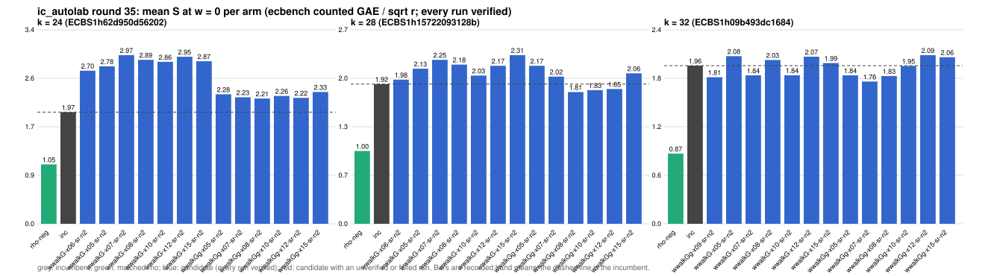

# ic_autolab round 35 (generic track): report

Protocol: [PROTOCOL.md](PROTOCOL.md), frozen 2026-11-04T16:09:43Z at git `85d509189196dfb17c1bd034088611f5dfae2e1c`; route `local`. Counted GAE only (deterministic, host independent); no wall-time claim; development loop, no validation-gate row. Loop home: [`../`](../README.md); ledger: [`../ledger.json`](../ledger.json).

Claim record: `PCC-20261104-d8bbec` (`python3 tools/pcc/pcc.py standing PCC-20261104-d8bbec`). Until a signed replay and recompute exist, this round's outcome is an unverified assertion [pcc:unverified].

## Outcome

| k | class | sel | sel / inc at w = 0 [95%] | w = 0.1 | w = 1 | band | S sel (w = 0 / 0.1 / 1) | S inc | S rho-neg | distance sel / rho |
|--:|:--|:--|:--|:--|:--|:--|:--|:--|:--|:--|
| 24 | **no_challenger** | none (best candidate `wwalkGg-x08-sr-n2`, train S 2.209 / 2.255 / 2.669) | - | - | - | - | - | 1.970 / 2.016 / 2.431 | 1.047 / 1.140 / 1.976 | inc: 1.9x / 1.8x / 1.2x |
| 28 | **null** | wwalkGg-x08-sr-n2 | 0.986 [0.888, 1.094] | 0.988 [0.887, 1.101] | 1.009 [0.874, 1.165] | unresolved inside the band | 1.913 / 1.956 / 2.343 | 1.941 / 1.979 / 2.322 | 1.028 / 1.124 / 1.991 | 1.9x / 1.7x / 1.2x |
| 32 | **null** | wwalkGg-x07-sr-n2 | 0.911 [0.790, 1.050] | 0.885 [0.761, 1.030] | 0.742 [0.595, 0.925] | sel < inc | 1.816 / 1.869 / 2.354 | 1.994 / 2.112 / 3.174 | 0.905 / 0.994 / 1.793 | 2.0x / 1.9x / 1.3x |

Classes follow the protocol's decision rule. Distance to rho is the distance remaining, not a gate. The reasons per size:

- k = 24: no_challenger
- k = 28: compare ops.status = ok, admissible = true; sel / inc = 0.9855 [0.888, 1.094] at w = 0; band: unresolved inside the band; A/A inc-aa / inc interval [1.000, 1.000] contains 1
- k = 32: compare ops.status = ok, admissible = true; sel / inc = 0.9106 [0.790, 1.050] at w = 0; band: sel < inc; A/A inc-aa / inc interval [1.000, 1.000] contains 1

## Train (development screen, in sample)

### k = 24: session `ECBS1h62d950d56202` (run exit 0, verify exit 0, receipt sha256 `37231219b83bcd9e1f37e097eb5b0b2b03a4ade83319ce020f9ae10edcb8c55e`)

| arm | family | N | factor base | oracle | runs | verified | S (w = 0 / 0.1 / 1) | reason proposed |
|:--|:--|--:|:--|:--|--:|--:|:--|:--|
| `rho-neg` | rho | - | `-` | `rho.negation` | 32 | 32 | 1.047 / 1.140 / 1.976 | matched reference |
| `inc` | wwalkGg-x09-sr | 2 | `prime-projected-abscissa:size=2,scan_cap=32` | `wwalk:x=0.9,g=1,grow=2,seed=run` | 32 | 32 | 1.970 / 2.016 / 2.431 | incumbent |
| `wwalkG-x06-sr-n2` | wwalkG-x06-sr | 2 | `prime-projected-abscissa:size=2,scan_cap=32` | `wwalk:x=0.6,g=1,grow=2,seed=run` | 32 | 32 | 2.700 / 2.779 / 3.491 | cross-size transfer: wwalkG-x06-sr-n2 is the k = 32 incumbent at N / N_a = 0.004 |
| `wwalkG-x05-sr-n2` | wwalkG-x05-sr | 2 | `prime-projected-abscissa:size=2,scan_cap=32` | `wwalk:x=0.5,g=1,grow=2,seed=run` | 32 | 32 | 2.778 / 2.892 / 3.920 | exploration: family wwalkG-x05-sr untried at k = 24, N = 0.0001 x N_a |
| `wwalkG-x07-sr-n2` | wwalkG-x07-sr | 2 | `prime-projected-abscissa:size=2,scan_cap=32` | `wwalk:x=0.7,g=1,grow=2,seed=run` | 32 | 32 | 2.975 / 3.088 / 4.108 | exploration: family wwalkG-x07-sr untried at k = 24, N = 0.0001 x N_a |
| `wwalkG-x08-sr-n2` | wwalkG-x08-sr | 2 | `prime-projected-abscissa:size=2,scan_cap=32` | `wwalk:x=0.8,g=1,grow=2,seed=run` | 32 | 32 | 2.892 / 2.981 / 3.782 | exploration: family wwalkG-x08-sr untried at k = 24, N = 0.0001 x N_a |
| `wwalkG-x10-sr-n2` | wwalkG-x10-sr | 2 | `prime-projected-abscissa:size=2,scan_cap=32` | `wwalk:x=1.0,g=1,grow=2,seed=run` | 32 | 32 | 2.856 / 2.923 / 3.530 | exploration: family wwalkG-x10-sr untried at k = 24, N = 0.0001 x N_a |
| `wwalkG-x12-sr-n2` | wwalkG-x12-sr | 2 | `prime-projected-abscissa:size=2,scan_cap=32` | `wwalk:x=1.2,g=1,grow=2,seed=run` | 32 | 32 | 2.946 / 3.008 / 3.568 | exploration: family wwalkG-x12-sr untried at k = 24, N = 0.0001 x N_a |
| `wwalkG-x15-sr-n2` | wwalkG-x15-sr | 2 | `prime-projected-abscissa:size=2,scan_cap=32` | `wwalk:x=1.5,g=1,grow=2,seed=run` | 32 | 32 | 2.867 / 2.916 / 3.356 | exploration: family wwalkG-x15-sr untried at k = 24, N = 0.0001 x N_a |
| `wwalkGg-x05-sr-n2` | wwalkGg-x05-sr | 2 | `prime-projected-abscissa:size=2,scan_cap=32` | `wwalk:x=0.5,g=1,grow=2,seed=run` | 32 | 32 | 2.284 / 2.364 / 3.082 | exploration: family wwalkGg-x05-sr untried at k = 24, N = 0.0001 x N_a |
| `wwalkGg-x07-sr-n2` | wwalkGg-x07-sr | 2 | `prime-projected-abscissa:size=2,scan_cap=32` | `wwalk:x=0.7,g=1,grow=2,seed=run` | 32 | 32 | 2.232 / 2.286 / 2.769 | exploration: family wwalkGg-x07-sr untried at k = 24, N = 0.0001 x N_a |
| `wwalkGg-x08-sr-n2` | wwalkGg-x08-sr | 2 | `prime-projected-abscissa:size=2,scan_cap=32` | `wwalk:x=0.8,g=1,grow=2,seed=run` | 32 | 32 | 2.209 / 2.255 / 2.669 | exploration: family wwalkGg-x08-sr untried at k = 24, N = 0.0001 x N_a |
| `wwalkGg-x10-sr-n2` | wwalkGg-x10-sr | 2 | `prime-projected-abscissa:size=2,scan_cap=32` | `wwalk:x=1.0,g=1,grow=2,seed=run` | 32 | 32 | 2.256 / 2.299 / 2.688 | exploration: family wwalkGg-x10-sr untried at k = 24, N = 0.0001 x N_a |
| `wwalkGg-x12-sr-n2` | wwalkGg-x12-sr | 2 | `prime-projected-abscissa:size=2,scan_cap=32` | `wwalk:x=1.2,g=1,grow=2,seed=run` | 32 | 32 | 2.221 / 2.249 / 2.500 | exploration: family wwalkGg-x12-sr untried at k = 24, N = 0.0001 x N_a |
| `wwalkGg-x15-sr-n2` | wwalkGg-x15-sr | 2 | `prime-projected-abscissa:size=2,scan_cap=32` | `wwalk:x=1.5,g=1,grow=2,seed=run` | 32 | 32 | 2.325 / 2.365 / 2.726 | exploration: family wwalkGg-x15-sr untried at k = 24, N = 0.0001 x N_a |

### k = 28: session `ECBS1h15722093128b` (run exit 0, verify exit 0, receipt sha256 `fe7a9d6cd61633a5ee422ef9c519aa639d394fa794374e7adb96a33715f8e1e5`)

| arm | family | N | factor base | oracle | runs | verified | S (w = 0 / 0.1 / 1) | reason proposed |
|:--|:--|--:|:--|:--|--:|--:|:--|:--|
| `rho-neg` | rho | - | `-` | `rho.negation` | 32 | 32 | 0.999 / 1.092 / 1.933 | matched reference |
| `inc` | wwalkGg-x09-sr | 2 | `prime-projected-abscissa:size=2,scan_cap=32` | `wwalk:x=0.9,g=1,grow=2,seed=run` | 32 | 32 | 1.917 / 1.951 / 2.258 | incumbent |
| `wwalkG-x06-sr-n2` | wwalkG-x06-sr | 2 | `prime-projected-abscissa:size=2,scan_cap=32` | `wwalk:x=0.6,g=1,grow=2,seed=run` | 32 | 32 | 1.977 / 2.057 / 2.781 | cross-size transfer: wwalkG-x06-sr-n2 is the k = 32 incumbent at N / N_a = 0.004 |
| `wwalkG-x05-sr-n2` | wwalkG-x05-sr | 2 | `prime-projected-abscissa:size=2,scan_cap=32` | `wwalk:x=0.5,g=1,grow=2,seed=run` | 32 | 32 | 2.127 / 2.255 / 3.409 | exploration: family wwalkG-x05-sr untried at k = 28, N = 0.0001 x N_a |
| `wwalkG-x07-sr-n2` | wwalkG-x07-sr | 2 | `prime-projected-abscissa:size=2,scan_cap=32` | `wwalk:x=0.7,g=1,grow=2,seed=run` | 32 | 32 | 2.249 / 2.335 / 3.110 | exploration: family wwalkG-x07-sr untried at k = 28, N = 0.0001 x N_a |
| `wwalkG-x08-sr-n2` | wwalkG-x08-sr | 2 | `prime-projected-abscissa:size=2,scan_cap=32` | `wwalk:x=0.8,g=1,grow=2,seed=run` | 32 | 32 | 2.184 / 2.282 / 3.166 | exploration: family wwalkG-x08-sr untried at k = 28, N = 0.0001 x N_a |
| `wwalkG-x10-sr-n2` | wwalkG-x10-sr | 2 | `prime-projected-abscissa:size=2,scan_cap=32` | `wwalk:x=1.0,g=1,grow=2,seed=run` | 32 | 32 | 2.034 / 2.110 / 2.799 | exploration: family wwalkG-x10-sr untried at k = 28, N = 0.0001 x N_a |
| `wwalkG-x12-sr-n2` | wwalkG-x12-sr | 2 | `prime-projected-abscissa:size=2,scan_cap=32` | `wwalk:x=1.2,g=1,grow=2,seed=run` | 32 | 32 | 2.167 / 2.242 / 2.918 | exploration: family wwalkG-x12-sr untried at k = 28, N = 0.0001 x N_a |
| `wwalkG-x15-sr-n2` | wwalkG-x15-sr | 2 | `prime-projected-abscissa:size=2,scan_cap=32` | `wwalk:x=1.5,g=1,grow=2,seed=run` | 32 | 32 | 2.313 / 2.384 / 3.019 | exploration: family wwalkG-x15-sr untried at k = 28, N = 0.0001 x N_a |
| `wwalkGg-x05-sr-n2` | wwalkGg-x05-sr | 2 | `prime-projected-abscissa:size=2,scan_cap=32` | `wwalk:x=0.5,g=1,grow=2,seed=run` | 32 | 32 | 2.167 / 2.257 / 3.063 | exploration: family wwalkGg-x05-sr untried at k = 28, N = 0.0001 x N_a |
| `wwalkGg-x07-sr-n2` | wwalkGg-x07-sr | 2 | `prime-projected-abscissa:size=2,scan_cap=32` | `wwalk:x=0.7,g=1,grow=2,seed=run` | 32 | 32 | 2.019 / 2.060 / 2.429 | exploration: family wwalkGg-x07-sr untried at k = 28, N = 0.0001 x N_a |
| `wwalkGg-x08-sr-n2` | wwalkGg-x08-sr | 2 | `prime-projected-abscissa:size=2,scan_cap=32` | `wwalk:x=0.8,g=1,grow=2,seed=run` | 32 | 32 | 1.807 / 1.840 / 2.135 | exploration: family wwalkGg-x08-sr untried at k = 28, N = 0.0001 x N_a |
| `wwalkGg-x10-sr-n2` | wwalkGg-x10-sr | 2 | `prime-projected-abscissa:size=2,scan_cap=32` | `wwalk:x=1.0,g=1,grow=2,seed=run` | 32 | 32 | 1.834 / 1.873 / 2.226 | exploration: family wwalkGg-x10-sr untried at k = 28, N = 0.0001 x N_a |
| `wwalkGg-x12-sr-n2` | wwalkGg-x12-sr | 2 | `prime-projected-abscissa:size=2,scan_cap=32` | `wwalk:x=1.2,g=1,grow=2,seed=run` | 32 | 32 | 1.849 / 1.875 / 2.117 | exploration: family wwalkGg-x12-sr untried at k = 28, N = 0.0001 x N_a |
| `wwalkGg-x15-sr-n2` | wwalkGg-x15-sr | 2 | `prime-projected-abscissa:size=2,scan_cap=32` | `wwalk:x=1.5,g=1,grow=2,seed=run` | 32 | 32 | 2.064 / 2.095 / 2.377 | exploration: family wwalkGg-x15-sr untried at k = 28, N = 0.0001 x N_a |

### k = 32: session `ECBS1h09b493dc1684` (run exit 0, verify exit 0, receipt sha256 `5d93614b9de76139d15dd50249bd792681d34317607f9386b3d5acd9bae7c482`)

| arm | family | N | factor base | oracle | runs | verified | S (w = 0 / 0.1 / 1) | reason proposed |
|:--|:--|--:|:--|:--|--:|--:|:--|:--|
| `rho-neg` | rho | - | `-` | `rho.negation` | 32 | 32 | 0.869 / 0.954 / 1.721 | matched reference |
| `inc` | wwalkG-x06-sr | 2 | `prime-projected-abscissa:size=2,scan_cap=32` | `wwalk:x=0.6,g=1,grow=2,seed=run` | 32 | 32 | 1.958 / 2.037 / 2.747 | incumbent |
| `wwalkGg-x09-sr-n2` | wwalkGg-x09-sr | 2 | `prime-projected-abscissa:size=2,scan_cap=32` | `wwalk:x=0.9,g=1,grow=2,seed=run` | 32 | 32 | 1.815 / 1.853 / 2.191 | cross-size transfer: wwalkGg-x09-sr is incumbent at 2 sizes; ln N fitted on log2 r (slope 0.000) and extrapolated |
| `wwalkG-x05-sr-n2` | wwalkG-x05-sr | 2 | `prime-projected-abscissa:size=2,scan_cap=32` | `wwalk:x=0.5,g=1,grow=2,seed=run` | 32 | 32 | 2.075 / 2.215 / 3.475 | exploration: family wwalkG-x05-sr untried at k = 32, N = 0.0001 x N_a |
| `wwalkG-x07-sr-n2` | wwalkG-x07-sr | 2 | `prime-projected-abscissa:size=2,scan_cap=32` | `wwalk:x=0.7,g=1,grow=2,seed=run` | 32 | 32 | 1.837 / 1.921 / 2.677 | exploration: family wwalkG-x07-sr untried at k = 32, N = 0.0001 x N_a |
| `wwalkG-x08-sr-n2` | wwalkG-x08-sr | 2 | `prime-projected-abscissa:size=2,scan_cap=32` | `wwalk:x=0.8,g=1,grow=2,seed=run` | 32 | 32 | 2.027 / 2.118 / 2.931 | exploration: family wwalkG-x08-sr untried at k = 32, N = 0.0001 x N_a |
| `wwalkG-x10-sr-n2` | wwalkG-x10-sr | 2 | `prime-projected-abscissa:size=2,scan_cap=32` | `wwalk:x=1.0,g=1,grow=2,seed=run` | 32 | 32 | 1.839 / 1.912 / 2.572 | exploration: family wwalkG-x10-sr untried at k = 32, N = 0.0001 x N_a |
| `wwalkG-x12-sr-n2` | wwalkG-x12-sr | 2 | `prime-projected-abscissa:size=2,scan_cap=32` | `wwalk:x=1.2,g=1,grow=2,seed=run` | 32 | 32 | 2.069 / 2.156 / 2.936 | exploration: family wwalkG-x12-sr untried at k = 32, N = 0.0001 x N_a |
| `wwalkG-x15-sr-n2` | wwalkG-x15-sr | 2 | `prime-projected-abscissa:size=2,scan_cap=32` | `wwalk:x=1.5,g=1,grow=2,seed=run` | 32 | 32 | 1.990 / 2.031 / 2.408 | exploration: family wwalkG-x15-sr untried at k = 32, N = 0.0001 x N_a |
| `wwalkGg-x05-sr-n2` | wwalkGg-x05-sr | 2 | `prime-projected-abscissa:size=2,scan_cap=32` | `wwalk:x=0.5,g=1,grow=2,seed=run` | 32 | 32 | 1.838 / 1.890 / 2.363 | exploration: family wwalkGg-x05-sr untried at k = 32, N = 0.0001 x N_a |
| `wwalkGg-x07-sr-n2` | wwalkGg-x07-sr | 2 | `prime-projected-abscissa:size=2,scan_cap=32` | `wwalk:x=0.7,g=1,grow=2,seed=run` | 32 | 32 | 1.761 / 1.802 / 2.167 | exploration: family wwalkGg-x07-sr untried at k = 32, N = 0.0001 x N_a |
| `wwalkGg-x08-sr-n2` | wwalkGg-x08-sr | 2 | `prime-projected-abscissa:size=2,scan_cap=32` | `wwalk:x=0.8,g=1,grow=2,seed=run` | 32 | 32 | 1.829 / 1.861 / 2.145 | exploration: family wwalkGg-x08-sr untried at k = 32, N = 0.0001 x N_a |
| `wwalkGg-x10-sr-n2` | wwalkGg-x10-sr | 2 | `prime-projected-abscissa:size=2,scan_cap=32` | `wwalk:x=1.0,g=1,grow=2,seed=run` | 32 | 32 | 1.954 / 2.008 / 2.497 | exploration: family wwalkGg-x10-sr untried at k = 32, N = 0.0001 x N_a |
| `wwalkGg-x12-sr-n2` | wwalkGg-x12-sr | 2 | `prime-projected-abscissa:size=2,scan_cap=32` | `wwalk:x=1.2,g=1,grow=2,seed=run` | 32 | 32 | 2.088 / 2.139 / 2.603 | exploration: family wwalkGg-x12-sr untried at k = 32, N = 0.0001 x N_a |
| `wwalkGg-x15-sr-n2` | wwalkGg-x15-sr | 2 | `prime-projected-abscissa:size=2,scan_cap=32` | `wwalk:x=1.5,g=1,grow=2,seed=run` | 32 | 32 | 2.062 / 2.097 / 2.405 | exploration: family wwalkGg-x15-sr untried at k = 32, N = 0.0001 x N_a |

## Selection

- k = 24: no_challenger  (Pareto alternative at w = 1: `wwalkGg-x12-sr-n2`)
- k = 28: challenger `wwalkGg-x08-sr-n2` (Pareto alternative at w = 1: `wwalkGg-x12-sr-n2`)
- k = 32: challenger `wwalkGg-x07-sr-n2` (Pareto alternative at w = 1: `wwalkGg-x08-sr-n2`)

## Holdout sessions

| k | session | run exit | verify exit | receipt sha256 | levels |
|--:|:--|--:|--:|:--|:--|
| 28 | `ECBS1h96fcdf912133` | 0 | 0 | `d25d4553ba0d1501b96c791cc8513a0de1c0b7059746cbaa69cbd773f62dfde0` | {"verified":480} |
| 32 | `ECBS1h054b87722fed` | 0 | 0 | `f6fa596398824a281594d5dbe43119edb9b1aa9f3887fb27ff6306a661fe7b72` | {"verified":480} |

## Ledger after this round

| k | incumbent | since round | S (w = 0 / 0.1 / 1) | distance to rho |
|--:|:--|--:|:--|:--|
| 20 | `wsum2g-b15-n2` (`prime-projected-abscissa:size=2,scan_cap=32` + `wsum:coef=15,free=1`) | 28 | 2.575 / 2.691 / 3.741 | 1.8x / 1.7x / 1.5x |
| 24 | `wwalkGg-x09-sr-n2` (`prime-projected-abscissa:size=2,scan_cap=32` + `wwalk:x=0.9,g=1,grow=2,seed=run`) | 33 | 2.105 / 2.148 / 2.531 | 1.9x / 1.8x / 1.2x |
| 28 | `wwalkGg-x09-sr-n2` (`prime-projected-abscissa:size=2,scan_cap=32` + `wwalk:x=0.9,g=1,grow=2,seed=run`) | 33 | 1.883 / 1.926 / 2.309 | 1.8x / 1.7x / 1.1x |
| 32 | `wwalkG-x06-sr-n2` (`prime-projected-abscissa:size=2,scan_cap=32` + `wwalk:x=0.6,g=1,grow=2,seed=run`) | 33 | 1.842 / 1.932 / 2.740 | 1.8x / 1.7x / 1.4x |

## Evidence and deviations

- ecbench binary sha256: `294344544cac9f2701e796bdb298a316b737aec15801948a6489f579c2ae2ca4`; `--cpus auto`, allow_busy = true; `verify --replay 8` per session; audit receipts in `analysis/`; sessions in `sessions/` (records in the artifact store when large).
- Route: the local route is an explicitly requested development screen, not the Iso Lab EKS default; counts are deterministic and replayed, wall time is not claimed. No row of this round enters the IC leaderboard or `benchmarks/README.md` (validation gate).
- Train selection is in sample (disclosed); the holdout is fresh (new `target_seed`, excluded exposures). Failed, timed-out and regressing arms are retained above.
