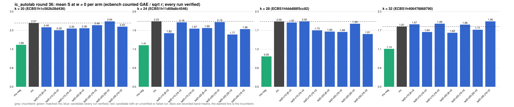

# ic_autolab round 36 (generic track): report

Protocol: [PROTOCOL.md](PROTOCOL.md), frozen 2026-11-10T03:59:40Z at git `b46d1ee5fbc8507c95a6256b0982aad3180f55f7`; route `local`. Counted GAE only (deterministic, host independent); no wall-time claim; development loop, no validation-gate row. Loop home: [`../`](../README.md); ledger: [`../ledger.json`](../ledger.json).

Claim record: none yet. Record one with `python3 tools/pcc/pcc.py claim new` before citing this round; until then its outcome is an unverified assertion [pcc:unverified].

## Outcome

| k | class | sel | sel / inc at w = 0 [95%] | w = 0.1 | w = 1 | band | S sel (w = 0 / 0.1 / 1) | S inc | S rho-neg | distance sel / rho |
|--:|:--|:--|:--|:--|:--|:--|:--|:--|:--|:--|
| 20 | **null** | tw2l-x10-j16-n2 | 0.998 [0.931, 1.069] | 0.977 [0.911, 1.048] | 0.883 [0.819, 0.953] | sel < inc | 2.446 / 2.627 / 4.257 | 2.452 / 2.689 / 4.821 | 1.492 / 1.598 / 2.551 | 1.6x / 1.6x / 1.7x |
| 24 | **improvement** | tw2l-x20-j32-n2 | 0.924 [0.857, 0.996] | 0.924 [0.857, 0.998] | 0.928 [0.856, 1.006] | sel < inc | 2.016 / 2.189 / 3.743 | 2.182 / 2.368 / 4.034 | 1.125 / 1.226 / 2.133 | 1.8x / 1.8x / 1.8x |
| 28 | **null** | tw2l-x30-j16-n2 | 0.958 [0.869, 1.055] | 0.959 [0.871, 1.058] | 0.967 [0.875, 1.067] | sel < inc | 1.768 / 1.938 / 3.473 | 1.846 / 2.020 / 3.593 | 1.016 / 1.111 / 1.968 | 1.7x / 1.7x / 1.8x |
| 32 | **null** | tw2l-x20-j8-n2 | 0.942 [0.843, 1.054] | 0.925 [0.825, 1.037] | 0.852 [0.751, 0.967] | sel < inc | 1.772 / 1.948 / 3.529 | 1.880 / 2.106 / 4.139 | 1.005 / 1.104 / 1.993 | 1.8x / 1.8x / 1.8x |

Classes follow the protocol's decision rule. Distance to rho is the distance remaining, not a gate. The reasons per size:

- k = 20: compare ops.status = ok, admissible = true; sel / inc = 0.9977 [0.931, 1.069] at w = 0; band: sel < inc; A/A inc-aa / inc interval [1.000, 1.000] contains 1
- k = 24: compare ops.status = ok, admissible = true; sel / inc = 0.9238 [0.857, 0.996] at w = 0; band: sel < inc; A/A inc-aa / inc interval [1.000, 1.000] contains 1
- k = 28: compare ops.status = ok, admissible = true; sel / inc = 0.9579 [0.869, 1.055] at w = 0; band: sel < inc; A/A inc-aa / inc interval [1.000, 1.000] contains 1
- k = 32: compare ops.status = ok, admissible = true; sel / inc = 0.9425 [0.843, 1.054] at w = 0; band: sel < inc; A/A inc-aa / inc interval [1.000, 1.000] contains 1

## Train (development screen, in sample)

### k = 20: session `ECBS1h1c562b28d436` (run exit 0, verify exit 0, receipt sha256 `cf51440c88d1ca13266578c7cdab74e3eb5459429ba9cc41c41393fd08b8780d`)

| arm | family | N | factor base | oracle | runs | verified | S (w = 0 / 0.1 / 1) | reason proposed |
|:--|:--|--:|:--|:--|--:|--:|:--|:--|
| `rho-neg` | rho | - | `-` | `rho.negation` | 16 | 16 | 1.694 / 1.819 / 2.948 | matched reference |
| `inc` | wsum2g-b15 | 2 | `prime-projected-abscissa:size=2,scan_cap=32` | `wsum:coef=15,free=1` | 16 | 16 | 2.574 / 2.823 / 5.063 | incumbent |
| `tw2l-x10-j8-n2` | tw2l-x10-j8 | 2 | `prime-projected-abscissa:size=2,scan_cap=32` | `wwalk:x=1.0,jumps=8,g=1,grow=2,tw=2,cj=1,lazy=1,seed=run` | 16 | 16 | 2.403 / 2.592 / 4.289 | x/jumps sweep of tw2cj-lazy after the SNC panel (PCC-20261110-978c29: x = 2.0, 16 jumps gave 0.936/0.914/0.909/0.922 of the incumbent at k = 20/24/28/32) |
| `tw2l-x10-j16-n2` | tw2l-x10-j16 | 2 | `prime-projected-abscissa:size=2,scan_cap=32` | `wwalk:x=1.0,jumps=16,g=1,grow=2,tw=2,cj=1,lazy=1,seed=run` | 16 | 16 | 2.284 / 2.448 / 3.925 | x/jumps sweep of tw2cj-lazy after the SNC panel (PCC-20261110-978c29: x = 2.0, 16 jumps gave 0.936/0.914/0.909/0.922 of the incumbent at k = 20/24/28/32) |
| `tw2l-x15-j16-n2` | tw2l-x15-j16 | 2 | `prime-projected-abscissa:size=2,scan_cap=32` | `wwalk:x=1.5,jumps=16,g=1,grow=2,tw=2,cj=1,lazy=1,seed=run` | 16 | 16 | 2.352 / 2.520 / 4.038 | x/jumps sweep of tw2cj-lazy after the SNC panel (PCC-20261110-978c29: x = 2.0, 16 jumps gave 0.936/0.914/0.909/0.922 of the incumbent at k = 20/24/28/32) |
| `tw2l-x20-j8-n2` | tw2l-x20-j8 | 2 | `prime-projected-abscissa:size=2,scan_cap=32` | `wwalk:x=2.0,jumps=8,g=1,grow=2,tw=2,cj=1,lazy=1,seed=run` | 16 | 16 | 2.363 / 2.545 / 4.179 | x/jumps sweep of tw2cj-lazy after the SNC panel (PCC-20261110-978c29: x = 2.0, 16 jumps gave 0.936/0.914/0.909/0.922 of the incumbent at k = 20/24/28/32) |
| `tw2l-x20-j16-n2` | tw2l-x20-j16 | 2 | `prime-projected-abscissa:size=2,scan_cap=32` | `wwalk:x=2.0,jumps=16,g=1,grow=2,tw=2,cj=1,lazy=1,seed=run` | 16 | 16 | 2.487 / 2.667 / 4.287 | x/jumps sweep of tw2cj-lazy after the SNC panel (PCC-20261110-978c29: x = 2.0, 16 jumps gave 0.936/0.914/0.909/0.922 of the incumbent at k = 20/24/28/32) |
| `tw2l-x20-j32-n2` | tw2l-x20-j32 | 2 | `prime-projected-abscissa:size=2,scan_cap=32` | `wwalk:x=2.0,jumps=32,g=1,grow=2,tw=2,cj=1,lazy=1,seed=run` | 16 | 16 | 2.642 / 2.810 / 4.322 | x/jumps sweep of tw2cj-lazy after the SNC panel (PCC-20261110-978c29: x = 2.0, 16 jumps gave 0.936/0.914/0.909/0.922 of the incumbent at k = 20/24/28/32) |
| `tw2l-x30-j16-n2` | tw2l-x30-j16 | 2 | `prime-projected-abscissa:size=2,scan_cap=32` | `wwalk:x=3.0,jumps=16,g=1,grow=2,tw=2,cj=1,lazy=1,seed=run` | 16 | 16 | 2.429 / 2.603 / 4.168 | x/jumps sweep of tw2cj-lazy after the SNC panel (PCC-20261110-978c29: x = 2.0, 16 jumps gave 0.936/0.914/0.909/0.922 of the incumbent at k = 20/24/28/32) |

### k = 24: session `ECBS1h11d09a8c4546` (run exit 0, verify exit 0, receipt sha256 `4cd17605ffe0b1d7a9527ce7b30fca23b99887a416792281562e3482616f884a`)

| arm | family | N | factor base | oracle | runs | verified | S (w = 0 / 0.1 / 1) | reason proposed |
|:--|:--|--:|:--|:--|--:|--:|:--|:--|
| `rho-neg` | rho | - | `-` | `rho.negation` | 16 | 16 | 1.409 / 1.538 / 2.702 | matched reference |
| `inc` | wwalkGg-x09-sr | 2 | `prime-projected-abscissa:size=2,scan_cap=32` | `wwalk:x=0.9,g=1,grow=2,seed=run` | 16 | 16 | 2.218 / 2.408 / 4.117 | incumbent |
| `tw2l-x10-j8-n2` | tw2l-x10-j8 | 2 | `prime-projected-abscissa:size=2,scan_cap=32` | `wwalk:x=1.0,jumps=8,g=1,grow=2,tw=2,cj=1,lazy=1,seed=run` | 16 | 16 | 1.817 / 1.982 / 3.469 | x/jumps sweep of tw2cj-lazy after the SNC panel (PCC-20261110-978c29: x = 2.0, 16 jumps gave 0.936/0.914/0.909/0.922 of the incumbent at k = 20/24/28/32) |
| `tw2l-x10-j16-n2` | tw2l-x10-j16 | 2 | `prime-projected-abscissa:size=2,scan_cap=32` | `wwalk:x=1.0,jumps=16,g=1,grow=2,tw=2,cj=1,lazy=1,seed=run` | 16 | 16 | 2.185 / 2.383 / 4.169 | x/jumps sweep of tw2cj-lazy after the SNC panel (PCC-20261110-978c29: x = 2.0, 16 jumps gave 0.936/0.914/0.909/0.922 of the incumbent at k = 20/24/28/32) |
| `tw2l-x15-j16-n2` | tw2l-x15-j16 | 2 | `prime-projected-abscissa:size=2,scan_cap=32` | `wwalk:x=1.5,jumps=16,g=1,grow=2,tw=2,cj=1,lazy=1,seed=run` | 16 | 16 | 1.972 / 2.149 / 3.740 | x/jumps sweep of tw2cj-lazy after the SNC panel (PCC-20261110-978c29: x = 2.0, 16 jumps gave 0.936/0.914/0.909/0.922 of the incumbent at k = 20/24/28/32) |
| `tw2l-x20-j8-n2` | tw2l-x20-j8 | 2 | `prime-projected-abscissa:size=2,scan_cap=32` | `wwalk:x=2.0,jumps=8,g=1,grow=2,tw=2,cj=1,lazy=1,seed=run` | 16 | 16 | 1.992 / 2.174 / 3.814 | x/jumps sweep of tw2cj-lazy after the SNC panel (PCC-20261110-978c29: x = 2.0, 16 jumps gave 0.936/0.914/0.909/0.922 of the incumbent at k = 20/24/28/32) |
| `tw2l-x20-j16-n2` | tw2l-x20-j16 | 2 | `prime-projected-abscissa:size=2,scan_cap=32` | `wwalk:x=2.0,jumps=16,g=1,grow=2,tw=2,cj=1,lazy=1,seed=run` | 16 | 16 | 2.194 / 2.393 / 4.178 | x/jumps sweep of tw2cj-lazy after the SNC panel (PCC-20261110-978c29: x = 2.0, 16 jumps gave 0.936/0.914/0.909/0.922 of the incumbent at k = 20/24/28/32) |
| `tw2l-x20-j32-n2` | tw2l-x20-j32 | 2 | `prime-projected-abscissa:size=2,scan_cap=32` | `wwalk:x=2.0,jumps=32,g=1,grow=2,tw=2,cj=1,lazy=1,seed=run` | 16 | 16 | 1.773 / 1.921 / 3.258 | x/jumps sweep of tw2cj-lazy after the SNC panel (PCC-20261110-978c29: x = 2.0, 16 jumps gave 0.936/0.914/0.909/0.922 of the incumbent at k = 20/24/28/32) |
| `tw2l-x30-j16-n2` | tw2l-x30-j16 | 2 | `prime-projected-abscissa:size=2,scan_cap=32` | `wwalk:x=3.0,jumps=16,g=1,grow=2,tw=2,cj=1,lazy=1,seed=run` | 16 | 16 | 1.956 / 2.131 / 3.703 | x/jumps sweep of tw2cj-lazy after the SNC panel (PCC-20261110-978c29: x = 2.0, 16 jumps gave 0.936/0.914/0.909/0.922 of the incumbent at k = 20/24/28/32) |

### k = 28: session `ECBS1hfddd88f5cc82` (run exit 0, verify exit 0, receipt sha256 `c0c07530c90c8469907361226d229a99ba185f0f0b352a153a80d0cd1101d248`)

| arm | family | N | factor base | oracle | runs | verified | S (w = 0 / 0.1 / 1) | reason proposed |
|:--|:--|--:|:--|:--|--:|--:|:--|:--|
| `rho-neg` | rho | - | `-` | `rho.negation` | 16 | 16 | 0.929 / 1.016 / 1.794 | matched reference |
| `inc` | wwalkGg-x09-sr | 2 | `prime-projected-abscissa:size=2,scan_cap=32` | `wwalk:x=0.9,g=1,grow=2,seed=run` | 16 | 16 | 1.997 / 2.187 / 3.896 | incumbent |
| `tw2l-x10-j8-n2` | tw2l-x10-j8 | 2 | `prime-projected-abscissa:size=2,scan_cap=32` | `wwalk:x=1.0,jumps=8,g=1,grow=2,tw=2,cj=1,lazy=1,seed=run` | 16 | 16 | 1.965 / 2.157 / 3.881 | x/jumps sweep of tw2cj-lazy after the SNC panel (PCC-20261110-978c29: x = 2.0, 16 jumps gave 0.936/0.914/0.909/0.922 of the incumbent at k = 20/24/28/32) |
| `tw2l-x10-j16-n2` | tw2l-x10-j16 | 2 | `prime-projected-abscissa:size=2,scan_cap=32` | `wwalk:x=1.0,jumps=16,g=1,grow=2,tw=2,cj=1,lazy=1,seed=run` | 16 | 16 | 2.001 / 2.195 / 3.942 | x/jumps sweep of tw2cj-lazy after the SNC panel (PCC-20261110-978c29: x = 2.0, 16 jumps gave 0.936/0.914/0.909/0.922 of the incumbent at k = 20/24/28/32) |
| `tw2l-x15-j16-n2` | tw2l-x15-j16 | 2 | `prime-projected-abscissa:size=2,scan_cap=32` | `wwalk:x=1.5,jumps=16,g=1,grow=2,tw=2,cj=1,lazy=1,seed=run` | 16 | 16 | 1.726 / 1.893 / 3.391 | x/jumps sweep of tw2cj-lazy after the SNC panel (PCC-20261110-978c29: x = 2.0, 16 jumps gave 0.936/0.914/0.909/0.922 of the incumbent at k = 20/24/28/32) |
| `tw2l-x20-j8-n2` | tw2l-x20-j8 | 2 | `prime-projected-abscissa:size=2,scan_cap=32` | `wwalk:x=2.0,jumps=8,g=1,grow=2,tw=2,cj=1,lazy=1,seed=run` | 16 | 16 | 1.688 / 1.852 / 3.325 | x/jumps sweep of tw2cj-lazy after the SNC panel (PCC-20261110-978c29: x = 2.0, 16 jumps gave 0.936/0.914/0.909/0.922 of the incumbent at k = 20/24/28/32) |
| `tw2l-x20-j16-n2` | tw2l-x20-j16 | 2 | `prime-projected-abscissa:size=2,scan_cap=32` | `wwalk:x=2.0,jumps=16,g=1,grow=2,tw=2,cj=1,lazy=1,seed=run` | 16 | 16 | 1.678 / 1.840 / 3.293 | x/jumps sweep of tw2cj-lazy after the SNC panel (PCC-20261110-978c29: x = 2.0, 16 jumps gave 0.936/0.914/0.909/0.922 of the incumbent at k = 20/24/28/32) |
| `tw2l-x20-j32-n2` | tw2l-x20-j32 | 2 | `prime-projected-abscissa:size=2,scan_cap=32` | `wwalk:x=2.0,jumps=32,g=1,grow=2,tw=2,cj=1,lazy=1,seed=run` | 16 | 16 | 1.928 / 2.113 / 3.772 | x/jumps sweep of tw2cj-lazy after the SNC panel (PCC-20261110-978c29: x = 2.0, 16 jumps gave 0.936/0.914/0.909/0.922 of the incumbent at k = 20/24/28/32) |
| `tw2l-x30-j16-n2` | tw2l-x30-j16 | 2 | `prime-projected-abscissa:size=2,scan_cap=32` | `wwalk:x=3.0,jumps=16,g=1,grow=2,tw=2,cj=1,lazy=1,seed=run` | 16 | 16 | 1.614 / 1.770 / 3.166 | x/jumps sweep of tw2cj-lazy after the SNC panel (PCC-20261110-978c29: x = 2.0, 16 jumps gave 0.936/0.914/0.909/0.922 of the incumbent at k = 20/24/28/32) |

### k = 32: session `ECBS1h406478868790` (run exit 0, verify exit 0, receipt sha256 `4321ebe0b1695edd4d09b9cddd8f644ccb1e566b0a929a001e7a2837e5dac9fa`)

| arm | family | N | factor base | oracle | runs | verified | S (w = 0 / 0.1 / 1) | reason proposed |
|:--|:--|--:|:--|:--|--:|--:|:--|:--|
| `rho-neg` | rho | - | `-` | `rho.negation` | 16 | 16 | 1.138 / 1.250 / 2.259 | matched reference |
| `inc` | wwalkG-x06-sr | 2 | `prime-projected-abscissa:size=2,scan_cap=32` | `wwalk:x=0.6,g=1,grow=2,seed=run` | 16 | 16 | 1.807 / 2.020 / 3.942 | incumbent |
| `tw2l-x10-j8-n2` | tw2l-x10-j8 | 2 | `prime-projected-abscissa:size=2,scan_cap=32` | `wwalk:x=1.0,jumps=8,g=1,grow=2,tw=2,cj=1,lazy=1,seed=run` | 16 | 16 | 1.875 / 2.061 / 3.734 | x/jumps sweep of tw2cj-lazy after the SNC panel (PCC-20261110-978c29: x = 2.0, 16 jumps gave 0.936/0.914/0.909/0.922 of the incumbent at k = 20/24/28/32) |
| `tw2l-x10-j16-n2` | tw2l-x10-j16 | 2 | `prime-projected-abscissa:size=2,scan_cap=32` | `wwalk:x=1.0,jumps=16,g=1,grow=2,tw=2,cj=1,lazy=1,seed=run` | 16 | 16 | 1.643 / 1.806 / 3.269 | x/jumps sweep of tw2cj-lazy after the SNC panel (PCC-20261110-978c29: x = 2.0, 16 jumps gave 0.936/0.914/0.909/0.922 of the incumbent at k = 20/24/28/32) |
| `tw2l-x15-j16-n2` | tw2l-x15-j16 | 2 | `prime-projected-abscissa:size=2,scan_cap=32` | `wwalk:x=1.5,jumps=16,g=1,grow=2,tw=2,cj=1,lazy=1,seed=run` | 16 | 16 | 1.893 / 2.080 / 3.768 | x/jumps sweep of tw2cj-lazy after the SNC panel (PCC-20261110-978c29: x = 2.0, 16 jumps gave 0.936/0.914/0.909/0.922 of the incumbent at k = 20/24/28/32) |
| `tw2l-x20-j8-n2` | tw2l-x20-j8 | 2 | `prime-projected-abscissa:size=2,scan_cap=32` | `wwalk:x=2.0,jumps=8,g=1,grow=2,tw=2,cj=1,lazy=1,seed=run` | 16 | 16 | 1.621 / 1.781 / 3.226 | x/jumps sweep of tw2cj-lazy after the SNC panel (PCC-20261110-978c29: x = 2.0, 16 jumps gave 0.936/0.914/0.909/0.922 of the incumbent at k = 20/24/28/32) |
| `tw2l-x20-j16-n2` | tw2l-x20-j16 | 2 | `prime-projected-abscissa:size=2,scan_cap=32` | `wwalk:x=2.0,jumps=16,g=1,grow=2,tw=2,cj=1,lazy=1,seed=run` | 16 | 16 | 1.865 / 2.049 / 3.711 | x/jumps sweep of tw2cj-lazy after the SNC panel (PCC-20261110-978c29: x = 2.0, 16 jumps gave 0.936/0.914/0.909/0.922 of the incumbent at k = 20/24/28/32) |
| `tw2l-x20-j32-n2` | tw2l-x20-j32 | 2 | `prime-projected-abscissa:size=2,scan_cap=32` | `wwalk:x=2.0,jumps=32,g=1,grow=2,tw=2,cj=1,lazy=1,seed=run` | 16 | 16 | 1.712 / 1.880 / 3.399 | x/jumps sweep of tw2cj-lazy after the SNC panel (PCC-20261110-978c29: x = 2.0, 16 jumps gave 0.936/0.914/0.909/0.922 of the incumbent at k = 20/24/28/32) |
| `tw2l-x30-j16-n2` | tw2l-x30-j16 | 2 | `prime-projected-abscissa:size=2,scan_cap=32` | `wwalk:x=3.0,jumps=16,g=1,grow=2,tw=2,cj=1,lazy=1,seed=run` | 16 | 16 | 1.962 / 2.156 / 3.906 | x/jumps sweep of tw2cj-lazy after the SNC panel (PCC-20261110-978c29: x = 2.0, 16 jumps gave 0.936/0.914/0.909/0.922 of the incumbent at k = 20/24/28/32) |

## Selection

- k = 20: challenger `tw2l-x10-j16-n2` (Pareto alternative at w = 1: `tw2l-x10-j16-n2`)
- k = 24: challenger `tw2l-x20-j32-n2` (Pareto alternative at w = 1: `tw2l-x20-j32-n2`)
- k = 28: challenger `tw2l-x30-j16-n2` (Pareto alternative at w = 1: `tw2l-x30-j16-n2`)
- k = 32: challenger `tw2l-x20-j8-n2` (Pareto alternative at w = 1: `tw2l-x20-j8-n2`)

## Holdout sessions

| k | session | run exit | verify exit | receipt sha256 | levels |
|--:|:--|--:|--:|:--|:--|
| 20 | `ECBS1h4d22b97cc821` | 0 | 0 | `9d2d23404316557c1138c5f729b0532e0a45159f974efa8fdc54d872b1f3ca36` | {"verified":480} |
| 24 | `ECBS1hbefb5a60befd` | 0 | 0 | `9c7f9c918ae01d295cc7dd4dc6bb46386c864ce3d4699a1cd70a14010e1e7a68` | {"verified":480} |
| 28 | `ECBS1h464c8731ec2c` | 0 | 0 | `73a0b4830bb6724fafa6f89ee16617ff2059a2dee51effa5b278e29ced9466bb` | {"verified":480} |
| 32 | `ECBS1h4f6f7a8be11f` | 0 | 0 | `f3000600d494cff45e88c84ba83bae8d56d4e2e54edf1756d4e947d4623e14cb` | {"verified":480} |

## Ledger after this round

| k | incumbent | since round | S (w = 0 / 0.1 / 1) | distance to rho |
|--:|:--|--:|:--|:--|
| 20 | `wsum2g-b15-n2` (`prime-projected-abscissa:size=2,scan_cap=32` + `wsum:coef=15,free=1`) | 28 | 2.575 / 2.691 / 3.741 | 1.8x / 1.7x / 1.5x |
| 24 | `tw2l-x20-j32-n2` (`prime-projected-abscissa:size=2,scan_cap=32` + `wwalk:x=2.0,jumps=32,g=1,grow=2,tw=2,cj=1,lazy=1,seed=run`) | 36 | 2.016 / 2.189 / 3.743 | 1.8x / 1.8x / 1.8x |
| 28 | `wwalkGg-x09-sr-n2` (`prime-projected-abscissa:size=2,scan_cap=32` + `wwalk:x=0.9,g=1,grow=2,seed=run`) | 33 | 1.883 / 1.926 / 2.309 | 1.8x / 1.7x / 1.1x |
| 32 | `wwalkG-x06-sr-n2` (`prime-projected-abscissa:size=2,scan_cap=32` + `wwalk:x=0.6,g=1,grow=2,seed=run`) | 33 | 1.842 / 1.932 / 2.740 | 1.8x / 1.7x / 1.4x |

## Evidence and deviations

- ecbench binary sha256: `1163f6b35d27ec8853455f6d88dfb9fb1d824745068df4dfd065bf6ada23b859`; `--cpus auto`, allow_busy = true; `verify --replay 8` per session; audit receipts in `analysis/`; sessions in `sessions/` (records in the artifact store when large).
- Route: the local route is an explicitly requested development screen, not the Iso Lab EKS default; counts are deterministic and replayed, wall time is not claimed. No row of this round enters the IC leaderboard or `benchmarks/README.md` (validation gate).
- Train selection is in sample (disclosed); the holdout is fresh (new `target_seed`, excluded exposures). Failed, timed-out and regressing arms are retained above.
