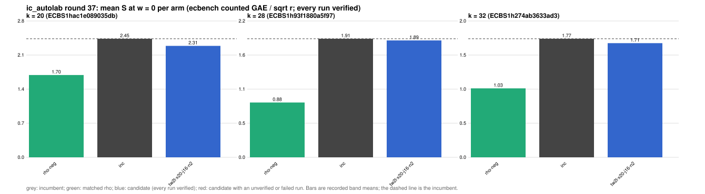

# ic_autolab round 37 (generic track): report

Protocol: [PROTOCOL.md](PROTOCOL.md), frozen 2026-11-10T04:09:00Z at git `7242133d0d8d7d54321bd2954f12a85398aa4475`; route `local`. Counted GAE only (deterministic, host independent); no wall-time claim; development loop, no validation-gate row. Loop home: [`../`](../README.md); ledger: [`../ledger.json`](../ledger.json).

Claim record: none yet. Record one with `python3 tools/pcc/pcc.py claim new` before citing this round; until then its outcome is an unverified assertion [pcc:unverified].

## Outcome

| k | class | sel | sel / inc at w = 0 [95%] | w = 0.1 | w = 1 | band | S sel (w = 0 / 0.1 / 1) | S inc | S rho-neg | distance sel / rho |
|--:|:--|:--|:--|:--|:--|:--|:--|:--|:--|:--|
| 20 | **null** | tw2l-x20-j16-n2 | 0.986 [0.941, 1.034] | 0.965 [0.920, 1.011] | 0.866 [0.824, 0.910] | sel < inc | 2.469 / 2.649 / 4.263 | 2.503 / 2.746 / 4.925 | 1.538 / 1.649 / 2.645 | 1.6x / 1.6x / 1.6x |
| 28 | **null** | tw2l-x20-j16-n2 | 0.967 [0.927, 1.008] | 0.968 [0.928, 1.010] | 0.976 [0.935, 1.018] | sel < inc | 1.834 / 2.011 / 3.605 | 1.897 / 2.077 / 3.695 | 1.005 / 1.099 / 1.945 | 1.8x / 1.8x / 1.9x |
| 32 | **improvement** | tw2l-x20-j16-n2 | 0.915 [0.864, 0.969] | 0.897 [0.846, 0.951] | 0.825 [0.775, 0.879] | sel < inc | 1.715 / 1.884 / 3.411 | 1.875 / 2.101 / 4.132 | 0.966 / 1.061 / 1.915 | 1.8x / 1.8x / 1.8x |

Classes follow the protocol's decision rule. Distance to rho is the distance remaining, not a gate. The reasons per size:

- k = 20: compare ops.status = ok, admissible = true; sel / inc = 0.9863 [0.941, 1.034] at w = 0; band: sel < inc; A/A inc-aa / inc interval [1.000, 1.000] contains 1
- k = 28: compare ops.status = ok, admissible = true; sel / inc = 0.9667 [0.927, 1.008] at w = 0; band: sel < inc; A/A inc-aa / inc interval [1.000, 1.000] contains 1
- k = 32: compare ops.status = ok, admissible = true; sel / inc = 0.9146 [0.864, 0.969] at w = 0; band: sel < inc; A/A inc-aa / inc interval [1.000, 1.000] contains 1

## Train (development screen, in sample)

### k = 20: session `ECBS1hac1e089035db` (run exit 0, verify exit 0, receipt sha256 `f0f307de2133274b5e84be3d62587feb69c04d6c276f51eff7d2e2084bd8bcb2`)

| arm | family | N | factor base | oracle | runs | verified | S (w = 0 / 0.1 / 1) | reason proposed |
|:--|:--|--:|:--|:--|--:|--:|:--|:--|
| `rho-neg` | rho | - | `-` | `rho.negation` | 16 | 16 | 1.703 / 1.830 / 2.972 | matched reference |
| `inc` | wsum2g-b15 | 2 | `prime-projected-abscissa:size=2,scan_cap=32` | `wsum:coef=15,free=1` | 16 | 16 | 2.454 / 2.691 / 4.822 | incumbent |
| `tw2l-x20-j16-n2` | tw2l-x20-j16 | 2 | `prime-projected-abscissa:size=2,scan_cap=32` | `wwalk:x=2.0,jumps=16,g=1,grow=2,tw=2,cj=1,lazy=1,seed=run` | 16 | 16 | 2.307 / 2.470 / 3.940 | the SNC-panel arm (PCC-20261110-978c29: 0.936 / 0.909 / 0.922 of the incumbent at k = 20 / 28 / 32 over 480 multi-curve pairs); round 36's 64-pair holdout left these sizes null (0.998 / 0.958 / 0.942 with intervals touching 1), so this round re-tests it with a four times larger holdout |

### k = 28: session `ECBS1h93f1880a5f97` (run exit 0, verify exit 0, receipt sha256 `ace77c39993091d89bae957d69d6d6d0cb1ab4f0923e836432ed7dcea3df52ab`)

| arm | family | N | factor base | oracle | runs | verified | S (w = 0 / 0.1 / 1) | reason proposed |
|:--|:--|--:|:--|:--|--:|--:|:--|:--|
| `rho-neg` | rho | - | `-` | `rho.negation` | 16 | 16 | 0.884 / 0.966 / 1.703 | matched reference |
| `inc` | wwalkGg-x09-sr | 2 | `prime-projected-abscissa:size=2,scan_cap=32` | `wwalk:x=0.9,g=1,grow=2,seed=run` | 16 | 16 | 1.912 / 2.093 / 3.726 | incumbent |
| `tw2l-x20-j16-n2` | tw2l-x20-j16 | 2 | `prime-projected-abscissa:size=2,scan_cap=32` | `wwalk:x=2.0,jumps=16,g=1,grow=2,tw=2,cj=1,lazy=1,seed=run` | 16 | 16 | 1.885 / 2.068 / 3.709 | the SNC-panel arm (PCC-20261110-978c29: 0.936 / 0.909 / 0.922 of the incumbent at k = 20 / 28 / 32 over 480 multi-curve pairs); round 36's 64-pair holdout left these sizes null (0.998 / 0.958 / 0.942 with intervals touching 1), so this round re-tests it with a four times larger holdout |

### k = 32: session `ECBS1h274ab3633ad3` (run exit 0, verify exit 0, receipt sha256 `83480de0e162fda1f5d39ad71052d3d34103f7b1e5773806371b56be6ffbf689`)

| arm | family | N | factor base | oracle | runs | verified | S (w = 0 / 0.1 / 1) | reason proposed |
|:--|:--|--:|:--|:--|--:|--:|:--|:--|
| `rho-neg` | rho | - | `-` | `rho.negation` | 16 | 16 | 1.031 / 1.133 / 2.046 | matched reference |
| `inc` | wwalkG-x06-sr | 2 | `prime-projected-abscissa:size=2,scan_cap=32` | `wwalk:x=0.6,g=1,grow=2,seed=run` | 16 | 16 | 1.773 / 2.000 / 4.041 | incumbent |
| `tw2l-x20-j16-n2` | tw2l-x20-j16 | 2 | `prime-projected-abscissa:size=2,scan_cap=32` | `wwalk:x=2.0,jumps=16,g=1,grow=2,tw=2,cj=1,lazy=1,seed=run` | 16 | 16 | 1.707 / 1.876 / 3.395 | the SNC-panel arm (PCC-20261110-978c29: 0.936 / 0.909 / 0.922 of the incumbent at k = 20 / 28 / 32 over 480 multi-curve pairs); round 36's 64-pair holdout left these sizes null (0.998 / 0.958 / 0.942 with intervals touching 1), so this round re-tests it with a four times larger holdout |

## Selection

- k = 20: challenger `tw2l-x20-j16-n2` (Pareto alternative at w = 1: `tw2l-x20-j16-n2`)
- k = 28: challenger `tw2l-x20-j16-n2` (Pareto alternative at w = 1: `tw2l-x20-j16-n2`)
- k = 32: challenger `tw2l-x20-j16-n2` (Pareto alternative at w = 1: `tw2l-x20-j16-n2`)

## Holdout sessions

| k | session | run exit | verify exit | receipt sha256 | levels |
|--:|:--|--:|--:|:--|:--|
| 20 | `ECBS1h26723704be6c` | 0 | 0 | `19fa4b43810d94cd6f676f98bf090d076d5a74628bdd09c62996a101a40bfbdf` | {"verified":1600} |
| 28 | `ECBS1hc56a473e04fb` | 0 | 0 | `ac9c4f7bc68afee944b2051ccb70e6b7ff2d362bcbe44f2541e0ac235231941f` | {"verified":1600} |
| 32 | `ECBS1h879b9a8f4677` | 0 | 0 | `6eef034fb7e60d80946bc3d7c95acaa129ab59adaa71c798c2ed2b910e45ef91` | {"verified":1600} |

## Ledger after this round

| k | incumbent | since round | S (w = 0 / 0.1 / 1) | distance to rho |
|--:|:--|--:|:--|:--|
| 20 | `wsum2g-b15-n2` (`prime-projected-abscissa:size=2,scan_cap=32` + `wsum:coef=15,free=1`) | 28 | 2.575 / 2.691 / 3.741 | 1.8x / 1.7x / 1.5x |
| 24 | `tw2l-x20-j32-n2` (`prime-projected-abscissa:size=2,scan_cap=32` + `wwalk:x=2.0,jumps=32,g=1,grow=2,tw=2,cj=1,lazy=1,seed=run`) | 36 | 2.016 / 2.189 / 3.743 | 1.8x / 1.8x / 1.8x |
| 28 | `wwalkGg-x09-sr-n2` (`prime-projected-abscissa:size=2,scan_cap=32` + `wwalk:x=0.9,g=1,grow=2,seed=run`) | 33 | 1.883 / 1.926 / 2.309 | 1.8x / 1.7x / 1.1x |
| 32 | `tw2l-x20-j16-n2` (`prime-projected-abscissa:size=2,scan_cap=32` + `wwalk:x=2.0,jumps=16,g=1,grow=2,tw=2,cj=1,lazy=1,seed=run`) | 37 | 1.715 / 1.884 / 3.411 | 1.8x / 1.8x / 1.8x |

## Evidence and deviations

- ecbench binary sha256: `1163f6b35d27ec8853455f6d88dfb9fb1d824745068df4dfd065bf6ada23b859`; `--cpus auto`, allow_busy = true; `verify --replay 8` per session; audit receipts in `analysis/`; sessions in `sessions/` (records in the artifact store when large).
- Route: the local route is an explicitly requested development screen, not the Iso Lab EKS default; counts are deterministic and replayed, wall time is not claimed. No row of this round enters the IC leaderboard or `benchmarks/README.md` (validation gate).
- Train selection is in sample (disclosed); the holdout is fresh (new `target_seed`, excluded exposures). Failed, timed-out and regressing arms are retained above.
