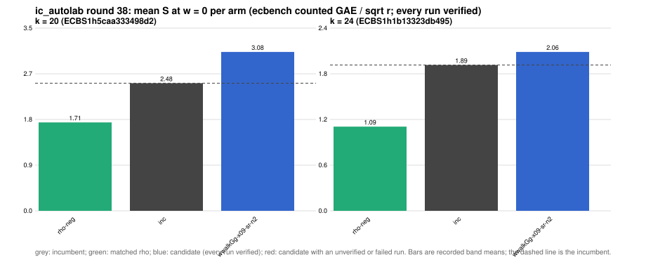
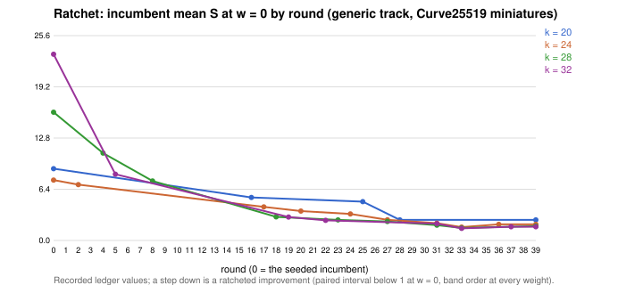

# ic_autolab round 38 (generic track): report

Protocol: [PROTOCOL.md](PROTOCOL.md), frozen 2026-11-17T06:12:48Z at git `27a54c948ecdf1975325a0cb07575d53f6b48508`; route `local`. Counted GAE only (deterministic, host independent); no wall-time claim; development loop, no validation-gate row. Loop home: [`../`](../README.md); ledger: [`../ledger.json`](../ledger.json).

Claim record: `PCC-20261117-b88049` (measurement, data, standing unverified); the outcome stays an unverified assertion until validated.

## Outcome

| k | class | sel | sel / inc at w = 0 [95%] | w = 0.1 | w = 1 | band | S sel (w = 0 / 0.1 / 1) | S inc | S rho-neg | distance sel / rho |
|--:|:--|:--|:--|:--|:--|:--|:--|:--|:--|:--|
| 20 | **no_challenger** | none (best candidate `wwalkGg-x09-sr-n2`, train S 3.082 / 3.287 / 5.133) | - | - | - | - | - | 2.475 / 2.714 / 4.867 | 1.715 / 1.843 / 2.998 | inc: 1.4x / 1.5x / 1.6x |
| 24 | **no_challenger** | none (best candidate `wwalkGg-x09-sr-n2`, train S 2.055 / 2.229 / 3.787) | - | - | - | - | - | 1.887 / 2.047 / 3.487 | 1.089 / 1.186 / 2.058 | inc: 1.7x / 1.7x / 1.7x |

Classes follow the protocol's decision rule. Distance to rho is the distance remaining, not a gate. The reasons per size:

- k = 20: no_challenger
- k = 24: no_challenger

## Train (development screen, in sample)

### k = 20: session `ECBS1h5caa333498d2` (run exit 0, verify exit 0, receipt sha256 `5d02235b0240bca611d6595cb66349aff356efa384d246ef4fd112e64d61b57f`)

| arm | family | N | factor base | oracle | runs | verified | S (w = 0 / 0.1 / 1) | reason proposed |
|:--|:--|--:|:--|:--|--:|--:|:--|:--|
| `rho-neg` | rho | - | `-` | `rho.negation` | 16 | 16 | 1.715 / 1.843 / 2.998 | matched reference |
| `inc` | wsum2g-b15 | 2 | `prime-projected-abscissa:size=2,scan_cap=32` | `wsum:coef=15,free=1` | 16 | 16 | 2.475 / 2.714 / 4.867 | incumbent |
| `wwalkGg-x09-sr-n2` | wwalkGg-x09-sr | 2 | `prime-projected-abscissa:size=2,scan_cap=32` | `wwalk:x=0.9,g=1,grow=2,seed=run` | 16 | 16 | 3.082 / 3.287 / 5.133 | cross-size transfer: wwalkGg-x09-sr-n2 is the k = 28 incumbent at N / N_a = 0.010 |

### k = 24: session `ECBS1h1b13323db495` (run exit 0, verify exit 0, receipt sha256 `4afcee2b1b9cead9683000670d61273e37c7c15e12f9fb03f8ce0091f447eeeb`)

| arm | family | N | factor base | oracle | runs | verified | S (w = 0 / 0.1 / 1) | reason proposed |
|:--|:--|--:|:--|:--|--:|--:|:--|:--|
| `rho-neg` | rho | - | `-` | `rho.negation` | 16 | 16 | 1.089 / 1.186 / 2.058 | matched reference |
| `inc` | tw2l-x20-j32 | 2 | `prime-projected-abscissa:size=2,scan_cap=32` | `wwalk:x=2.0,jumps=32,g=1,grow=2,tw=2,cj=1,lazy=1,seed=run` | 16 | 16 | 1.887 / 2.047 / 3.487 | incumbent |
| `wwalkGg-x09-sr-n2` | wwalkGg-x09-sr | 2 | `prime-projected-abscissa:size=2,scan_cap=32` | `wwalk:x=0.9,g=1,grow=2,seed=run` | 16 | 16 | 2.055 / 2.229 / 3.787 | cross-size transfer: wwalkGg-x09-sr-n2 is the k = 28 incumbent at N / N_a = 0.010 |

## Selection

- k = 20: no_challenger  (Pareto alternative at w = 1: `wwalkGg-x09-sr-n2`)
- k = 24: no_challenger  (Pareto alternative at w = 1: `wwalkGg-x09-sr-n2`)

## Ledger after this round

| k | incumbent | since round | S (w = 0 / 0.1 / 1) | distance to rho |
|--:|:--|--:|:--|:--|
| 20 | `wsum2g-b15-n2` (`prime-projected-abscissa:size=2,scan_cap=32` + `wsum:coef=15,free=1`) | 28 | 2.575 / 2.691 / 3.741 | 1.8x / 1.7x / 1.5x |
| 24 | `tw2l-x20-j32-n2` (`prime-projected-abscissa:size=2,scan_cap=32` + `wwalk:x=2.0,jumps=32,g=1,grow=2,tw=2,cj=1,lazy=1,seed=run`) | 36 | 2.016 / 2.189 / 3.743 | 1.8x / 1.8x / 1.8x |
| 28 | `wwalkGg-x09-sr-n2` (`prime-projected-abscissa:size=2,scan_cap=32` + `wwalk:x=0.9,g=1,grow=2,seed=run`) | 33 | 1.883 / 1.926 / 2.309 | 1.8x / 1.7x / 1.1x |
| 32 | `tw2l-x20-j16-n2` (`prime-projected-abscissa:size=2,scan_cap=32` + `wwalk:x=2.0,jumps=16,g=1,grow=2,tw=2,cj=1,lazy=1,seed=run`) | 37 | 1.715 / 1.884 / 3.411 | 1.8x / 1.8x / 1.8x |

## Evidence and deviations

- ecbench binary sha256: `581b3c6f1db53678871712f94cf5a4bb28650d1b02de78474716aeeb208da738`; `--cpus auto`, allow_busy = false; `verify --replay 8` per session; audit receipts in `analysis/`; sessions in `sessions/` (records in the artifact store when large).
- Route: the local route is an explicitly requested development screen, not the Iso Lab EKS default; counts are deterministic and replayed, wall time is not claimed. No row of this round enters the IC leaderboard or `benchmarks/README.md` (validation gate).
- Train selection is in sample (disclosed); the holdout is fresh (new `target_seed`, excluded exposures). Failed, timed-out and regressing arms are retained above.

## Prediction against outcome

`ideas/PREDICTION-R38.md` was committed before the freeze. It predicted a null at w = 0 with the transfer arm ahead at w = 1 (sel / inc about 0.69 at k = 24, 0.8 to 1.0 at k = 20). Measured on train (in sample, 16 targets per size; no holdout was run because no candidate was below inc at w = 0): [pcc:unverified]

| k | w = 0 | w = 0.1 | w = 1 |
|--:|--:|--:|--:|
| 20 | 1.245 | 1.211 | 1.055 |
| 24 | 1.089 | 1.089 | 1.086 |

The w = 0 part of the prediction held in direction (no improvement); the w = 1 part failed: at k = 24 the arm is 9 percent worse at w = 1, not 31 percent better. At k = 28 its w = 1 profile came from a lighter table; at k = 24 it stores about as many points per relation as `tw2l-x20-j32-n2` [pcc:unverified]. The cross-size transfer is closed at k = 20 and k = 24; `propose` has nothing left at k = 20, 24, 28 or 32.

## Deviations

- Owner waiver (2026-11-17, in-session answer): the S3 resume-checkpoint gate was waived for this round because the session holds no upload token or AWS profile; runs used `CHECKPOINT_SKIP`. No benchmark record (`benchrec`) was filed. [pcc:unverified]
- Train attempt 1 (`analysis/run-train.attempt1-hostbusy.json`, log `logs/train-k20.run.attempt1-hostbusy.log`): `ecbench` refused k = 20 before any measurement (host PSI cpu avg10 5.01 > 5.00). The write-once stage record was moved aside and the stage re-run once with the same frozen spec; k = 24 had run and was adopted, then re-verified. I ran the k = 20 train spec once into the scratchpad before this, as a probe (96 records, verified, 4 inc / wwalk / rho-neg rounds); it was discarded and not used. Train targets are in sample and never promote, so this exposes no holdout seed.
- `ecbench` and `ic_autolab` are the Nov-14 binaries (sha256 in `analysis/run-train.json`): the current `main` fails to build the standalone `hashed-ecdl-tensor` crate (8 x E0433, `crate::metrics` undeclared in `lib.rs`), not fixed here.
- Development evidence only: counted GAE, no wall time, no validation gate; no claim record yet.
