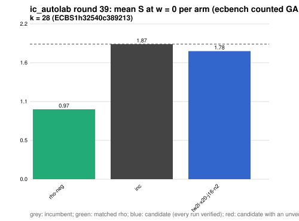
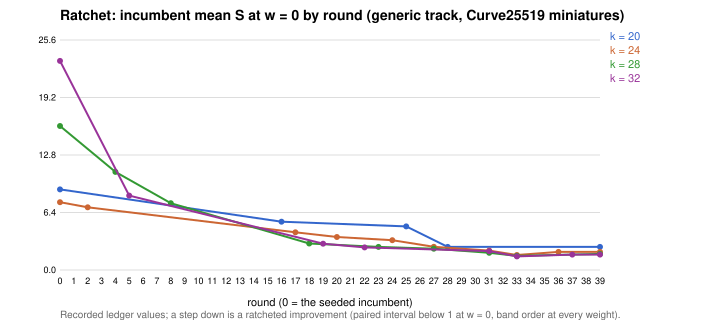

# ic_autolab round 39 (generic track): report

Protocol: [PROTOCOL.md](PROTOCOL.md), frozen 2026-11-17T06:27:16Z at git `8330552a1724de819187ede91f1aedb486f2fb0b`; route `local`. Counted GAE only (deterministic, host independent); no wall-time claim; development loop, no validation-gate row. Loop home: [`../`](../README.md); ledger: [`../ledger.json`](../ledger.json).

Claim record: `PCC-20261117-15fb13` (measurement, data, standing unverified); the outcome stays an unverified assertion until validated.

## Outcome

| k | class | sel | sel / inc at w = 0 [95%] | w = 0.1 | w = 1 | band | S sel (w = 0 / 0.1 / 1) | S inc | S rho-neg | distance sel / rho |
|--:|:--|:--|:--|:--|:--|:--|:--|:--|:--|:--|
| 28 | **improvement** | tw2l-x20-j16-n2 | 0.944 [0.919, 0.970] | 0.945 [0.920, 0.971] | 0.952 [0.926, 0.979] | sel < inc | 1.796 / 1.970 / 3.530 | 1.903 / 2.083 / 3.707 | 1.037 / 1.134 / 2.010 | 1.7x / 1.7x / 1.8x |

Classes follow the protocol's decision rule. Distance to rho is the distance remaining, not a gate. The reasons per size:

- k = 28: compare ops.status = ok, admissible = true; sel / inc = 0.9439 [0.919, 0.970] at w = 0; band: sel < inc; A/A inc-aa / inc interval [1.000, 1.000] contains 1

## Train (development screen, in sample)

### k = 28: session `ECBS1h32540c389213` (run exit 0, verify exit 0, receipt sha256 `f28a7192a25980b92ed0fcb415a5998b9e26500d5cf9249b949272e8e3e1b079`)

| arm | family | N | factor base | oracle | runs | verified | S (w = 0 / 0.1 / 1) | reason proposed |
|:--|:--|--:|:--|:--|--:|--:|:--|:--|
| `rho-neg` | rho | - | `-` | `rho.negation` | 64 | 64 | 0.969 / 1.060 / 1.874 | matched reference |
| `inc` | wwalkGg-x09-sr | 2 | `prime-projected-abscissa:size=2,scan_cap=32` | `wwalk:x=0.9,g=1,grow=2,seed=run` | 64 | 64 | 1.873 / 2.050 / 3.647 | incumbent |
| `tw2l-x20-j16-n2` | tw2l-x20-j16 | 2 | `prime-projected-abscissa:size=2,scan_cap=32` | `wwalk:x=2.0,jumps=16,g=1,grow=2,tw=2,cj=1,lazy=1,seed=run` | 64 | 64 | 1.776 / 1.947 / 3.489 | the SNC-panel arm (PCC-20261110-978c29: 0.936 / 0.909 / 0.922 of the incumbent at k = 20 / 28 / 32 over 480 multi-curve pairs); round 36's 64-pair holdout left these sizes null (0.998 / 0.958 / 0.942 with intervals touching 1), so this round re-tests it with a four times larger holdout |

## Selection

- k = 28: challenger `tw2l-x20-j16-n2` (Pareto alternative at w = 1: `tw2l-x20-j16-n2`)

## Holdout sessions

| k | session | run exit | verify exit | receipt sha256 | levels |
|--:|:--|--:|--:|:--|:--|
| 28 | `ECBS1h48b12649df44` | 0 | 0 | `0a3b6584d17ec063ebbb06bd332db77424d21649ef40d4d9df4c248ecf53914f` | {"verified":5760} |

## Ledger after this round

| k | incumbent | since round | S (w = 0 / 0.1 / 1) | distance to rho |
|--:|:--|--:|:--|:--|
| 20 | `wsum2g-b15-n2` (`prime-projected-abscissa:size=2,scan_cap=32` + `wsum:coef=15,free=1`) | 28 | 2.575 / 2.691 / 3.741 | 1.8x / 1.7x / 1.5x |
| 24 | `tw2l-x20-j32-n2` (`prime-projected-abscissa:size=2,scan_cap=32` + `wwalk:x=2.0,jumps=32,g=1,grow=2,tw=2,cj=1,lazy=1,seed=run`) | 36 | 2.016 / 2.189 / 3.743 | 1.8x / 1.8x / 1.8x |
| 28 | `tw2l-x20-j16-n2` (`prime-projected-abscissa:size=2,scan_cap=32` + `wwalk:x=2.0,jumps=16,g=1,grow=2,tw=2,cj=1,lazy=1,seed=run`) | 39 | 1.796 / 1.970 / 3.530 | 1.7x / 1.7x / 1.8x |
| 32 | `tw2l-x20-j16-n2` (`prime-projected-abscissa:size=2,scan_cap=32` + `wwalk:x=2.0,jumps=16,g=1,grow=2,tw=2,cj=1,lazy=1,seed=run`) | 37 | 1.715 / 1.884 / 3.411 | 1.8x / 1.8x / 1.8x |

## Evidence and deviations

- ecbench binary sha256: `581b3c6f1db53678871712f94cf5a4bb28650d1b02de78474716aeeb208da738`; `--cpus auto`, allow_busy = false; `verify --replay 8` per session; audit receipts in `analysis/`; sessions in `sessions/` (records in the artifact store when large).
- Route: the local route is an explicitly requested development screen, not the Iso Lab EKS default; counts are deterministic and replayed, wall time is not claimed. No row of this round enters the IC leaderboard or `benchmarks/README.md` (validation gate).
- Train selection is in sample (disclosed); the holdout is fresh (new `target_seed`, excluded exposures). Failed, timed-out and regressing arms are retained above.

## Prediction against outcome

`ideas/PREDICTION-R39.md` (committed before the freeze) predicted sel / inc about 0.95 at w = 0 with a 95% half-width of about 0.02, class improvement with probability about 0.6, w = 1 at 0.97 to 1.0. Measured on the 1024-pair holdout (128 fresh targets x 8 rounds): 0.944 [0.919, 0.970] at w = 0, 0.945 at w = 0.1, 0.952 at w = 1, band `sel < inc`, A/A interval containing 1. The point estimate and half-width (0.025) match; the w = 1 ratio (0.952) is lower than predicted, so the band condition held with margin [pcc:unverified]. Train (64 targets) selected the arm: S 1.776 / 1.947 / 3.489 against inc 1.873 / 2.050 / 3.647. This was the fourth look at the same arm against the same incumbent (480 multi-curve pairs 0.909, round 36 0.958, round 37 0.967 [0.927, 1.008]); only this round's fresh seeds decide, as disclosed beforehand.

Reading: the gain over the `wwalkGg` incumbent is about 5.6 percent at k = 28, the size expected from dropping the probe phase and chaining the target walk (`ideas/OBSTRUCTION.md`: probes about 0.37 sqrt(r) at k = 28). It is not a new mechanism. S 1.796 sits 8 percent above the K = 3 floor of 1.662; the distance to rho-neg is 1.7x at w = 0, so the generic track remains above matched rho [pcc:unverified].

## Deviations

- Owner waiver (2026-11-17, second in-session answer): the S3 resume-checkpoint gate was waived for round 39 as well; runs used `CHECKPOINT_SKIP`. No benchmark record (`benchrec`) was filed.
- Nov-14 `ecbench` and `ic_autolab` binaries, as in round 38 (`hashed-ecdl-tensor` does not build standalone on `main`).
- Producer-side replay at 64 and an independent recompute of the w = 0 ratio are in `recompute/README.md` (0.9439, matching 0.944); not a validator run.
- Development evidence only: counted GAE, no wall time, no validation gate; the IC leaderboard is not regenerated, because no row reaches it without the gate's replay certificate and validator report.

## Validator report and findings to carry forward

A `validator` subagent (fresh context, own scripts, run from this session, so not a second host or a second human) re-checked the round at commit d317b8728e; the full report is `recompute/VALIDATOR-REPORT.md`. It reproduced the w = 0 / 0.1 / 1 ratios exactly (0.94388 [0.9188, 0.9696] / 0.94537 / 0.95227 [0.9265, 0.9788]), re-checked all 5760 certificates with its own EC arithmetic (0 failures), replayed 48 runs on a different host class (0 problems), found the manifest hashes, commit order (prediction 06:27Z, freeze 07:20Z, data 15:11Z) and seed disjointness in order, and found no accounting asymmetry between `inc` and `sel` [pcc:unverified]. Disposition: validated for the numeric claim in counted GAE; no `VALIDATION.json`, so no leaderboard or benchmarks row.

Findings it raised, none of which changes the numbers:

- **Wall time goes the other way.** In the same session `sel` is slower: solve wall `sel / inc` 1.2356 [1.209, 1.262] (admitted ns per GAE 1.309). The 5.6 percent gain is in counted GAE only and does not transfer to wall time on this host and binary. The round makes no wall-time claim, and any use of the win beyond counted GAE needs this result beside it.
- **Binary provenance is unproven.** The Nov-14 `ecbench` (sha256 581b3c6f...) has no recorded build commit and the holdout `session.json` says `git_dirty: true`; `src/` has changed heavily since. The numbers are self-consistent (replays on two host classes, independent certificates), but "same source as the freeze commit" is not established.
- **Repeat-looks.** The frozen PROTOCOL says each candidate is untried at its size; this arm was run at k = 28 in rounds 36 and 37, as `PREDICTION-R39.md` discloses. The fresh seeds make the round's test valid and the effect survives a four-look correction, but a ratchet on the first success of a repeated test inherits a selection risk.
- **The holdout spec was first committed with the results**; its diff from the train spec is exactly the frozen design (8 rounds, 128 targets, the two control arms).
- **The target walk is booked as reusable setup** (`oracle_setup`, `work.reusable_bitops`), so `sel`'s per-target and online splits must not be used for amortised claims.

## Wall time: where it goes, and a change that removes most of it (2026-11-19)

`profiles/README.md` profiles the solve (perf `cpu-clock`) and finds the extra wall time of `tw2l-x20-j16-n2` in its walk table (page faults on about 190 fresh pages and the inserts), not in the group arithmetic. Replacing that table with a 40-byte-slot table prefaulted in one call (`TwTable`, `src/cryptanalysis/ic_boundary.rs`) cut `sel`'s mean solve wall by 26% in an interleaved A/B of two `ecbench` builds (0.739, A/A control 0.9967) and left the counted cost and every other report field identical on all 320 jobs; `inc` moved 1.6%. The harness is not a frozen session (no isolation or pinning, no PMU) and gives a baseline `sel` / `inc` of 1.31, not 1.2356, so the new wall ratio (0.986 there) is development evidence until an isolated `ecbench` session repeats it [pcc:unverified].
