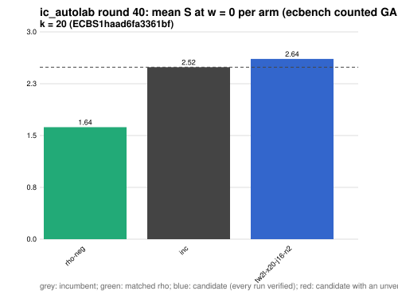
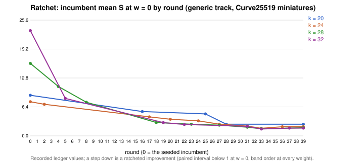

# ic_autolab round 40 (generic track): report

Protocol: [PROTOCOL.md](PROTOCOL.md), frozen 2026-11-17T15:17:44Z at git `89d704376ad7879e562f3e1f1118302afa2d6461`; route `local`. Counted GAE only (deterministic, host independent); no wall-time claim; development loop, no validation-gate row. Loop home: [`../`](../README.md); ledger: [`../ledger.json`](../ledger.json).

Claim record: `PCC-20261117-61da52` (measurement, data, standing unverified); the outcome stays an unverified assertion until validated.

## Outcome

| k | class | sel | sel / inc at w = 0 [95%] | w = 0.1 | w = 1 | band | S sel (w = 0 / 0.1 / 1) | S inc | S rho-neg | distance sel / rho |
|--:|:--|:--|:--|:--|:--|:--|:--|:--|:--|:--|
| 20 | **no_challenger** | none (best candidate `tw2l-x20-j16-n2`, train S 2.645 / 2.841 / 4.614) | - | - | - | - | - | 2.523 / 2.767 / 4.963 | 1.644 / 1.765 / 2.854 | inc: 1.5x / 1.6x / 1.7x |

Classes follow the protocol's decision rule. Distance to rho is the distance remaining, not a gate. The reasons per size:

- k = 20: no_challenger

## Train (development screen, in sample)

### k = 20: session `ECBS1haad6fa3361bf` (run exit 0, verify exit 0, receipt sha256 `1f0c9f6be996dfafeee2e78f6d2fecdad440aa35ba60f001b934982ca1f77ddd`)

| arm | family | N | factor base | oracle | runs | verified | S (w = 0 / 0.1 / 1) | reason proposed |
|:--|:--|--:|:--|:--|--:|--:|:--|:--|
| `rho-neg` | rho | - | `-` | `rho.negation` | 64 | 64 | 1.644 / 1.765 / 2.854 | matched reference |
| `inc` | wsum2g-b15 | 2 | `prime-projected-abscissa:size=2,scan_cap=32` | `wsum:coef=15,free=1` | 64 | 64 | 2.523 / 2.767 / 4.963 | incumbent |
| `tw2l-x20-j16-n2` | tw2l-x20-j16 | 2 | `prime-projected-abscissa:size=2,scan_cap=32` | `wwalk:x=2.0,jumps=16,g=1,grow=2,tw=2,cj=1,lazy=1,seed=run` | 64 | 64 | 2.645 / 2.841 / 4.614 | the SNC-panel arm (PCC-20261110-978c29: 0.936 / 0.909 / 0.922 of the incumbent at k = 20 / 28 / 32 over 480 multi-curve pairs); round 36's 64-pair holdout left these sizes null (0.998 / 0.958 / 0.942 with intervals touching 1), so this round re-tests it with a four times larger holdout |

## Selection

- k = 20: no_challenger  (Pareto alternative at w = 1: `tw2l-x20-j16-n2`)

## Ledger after this round

| k | incumbent | since round | S (w = 0 / 0.1 / 1) | distance to rho |
|--:|:--|--:|:--|:--|
| 20 | `wsum2g-b15-n2` (`prime-projected-abscissa:size=2,scan_cap=32` + `wsum:coef=15,free=1`) | 28 | 2.575 / 2.691 / 3.741 | 1.8x / 1.7x / 1.5x |
| 24 | `tw2l-x20-j32-n2` (`prime-projected-abscissa:size=2,scan_cap=32` + `wwalk:x=2.0,jumps=32,g=1,grow=2,tw=2,cj=1,lazy=1,seed=run`) | 36 | 2.016 / 2.189 / 3.743 | 1.8x / 1.8x / 1.8x |
| 28 | `tw2l-x20-j16-n2` (`prime-projected-abscissa:size=2,scan_cap=32` + `wwalk:x=2.0,jumps=16,g=1,grow=2,tw=2,cj=1,lazy=1,seed=run`) | 39 | 1.796 / 1.970 / 3.530 | 1.7x / 1.7x / 1.8x |
| 32 | `tw2l-x20-j16-n2` (`prime-projected-abscissa:size=2,scan_cap=32` + `wwalk:x=2.0,jumps=16,g=1,grow=2,tw=2,cj=1,lazy=1,seed=run`) | 37 | 1.715 / 1.884 / 3.411 | 1.8x / 1.8x / 1.8x |

## Evidence and deviations

- ecbench binary sha256: `581b3c6f1db53678871712f94cf5a4bb28650d1b02de78474716aeeb208da738`; `--cpus auto`, allow_busy = false; `verify --replay 8` per session; audit receipts in `analysis/`; sessions in `sessions/` (records in the artifact store when large).
- Route: the local route is an explicitly requested development screen, not the Iso Lab EKS default; counts are deterministic and replayed, wall time is not claimed. No row of this round enters the IC leaderboard or `benchmarks/README.md` (validation gate).
- Train selection is in sample (disclosed); the holdout is fresh (new `target_seed`, excluded exposures). Failed, timed-out and regressing arms are retained above.

## Prediction against outcome

`ideas/PREDICTION-R40.md` (committed before the freeze) predicted a holdout ratio of about 0.965 at w = 0 with probability about 0.35 of an improvement, and 0.85 to 0.90 at w = 1. The round stopped at selection: on the 64-target train screen `tw2l-x20-j16-n2` had S 2.645 / 2.841 / 4.614 against inc 2.523 / 2.767 / 4.963, ratios 1.048 / 1.027 / 0.930 at w = 0 / 0.1 / 1, so it was not below inc at w = 0 and the frozen rule sent no challenger to the holdout [pcc:unverified]. Train is in sample and its per-size noise at k = 20 is large (round 38's k = 20 train S ranged 2.5 to 3.1 for incumbents and arms); this is a screen result, not a holdout estimate, and it neither supports nor refutes the 0.965 prediction. By the round's own rule, the arm is closed at k = 20 by this outcome; I did not rerun the screen or lower the bar.

## Deviations

- Owner waiver (2026-11-17, third in-session answer): the S3 resume-checkpoint gate was waived for round 40; runs used `CHECKPOINT_SKIP`. No benchmark record (`benchrec`) was filed.
- Nov-14 `ecbench` and `ic_autolab` binaries (`hashed-ecdl-tensor` does not build standalone on `main`).
- Development evidence only: counted GAE, no wall time, no validation gate.
