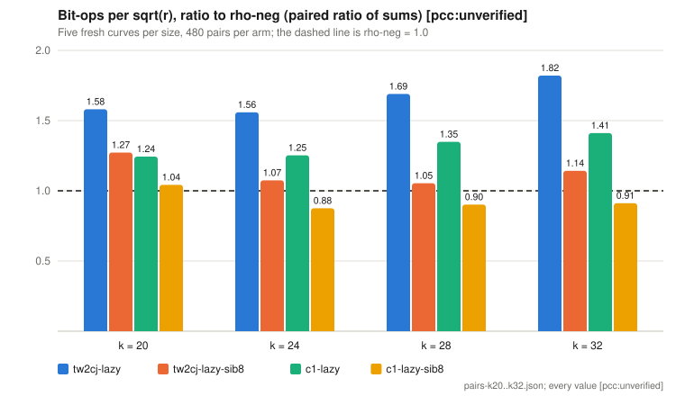

# Sibling-points panel (Stage 1): `sib=8,pool=64` on five fresh curves per size, k = 20, 24, 28, 32

Write-up of the panel frozen in [`PROTOCOL.md`](PROTOCOL.md) (2026-11-21, before any data). Every number on this page is an unverified assertion of the lane that produced it and is tagged [pcc:unverified]; no pcc claim has been filed for it yet. Nothing here changes the ledger: the ratchet waits for the owner's unit ruling (protocol, section 5).

## What was run

Four independent lanes, one per size, each a single `ecbench` session on this machine (`target/release/ecbench`, SHA-256 `797f4b589ae6ac5b466b65e6a1abcc4e9a56d8222cb3e95623ffde3aafc150fa` in [`data/binary.sha256`](data/binary.sha256), the binary named in protocol section 2). Per size: the five fresh sibling curves of `../c1/confirm-curves.json`, 12 public targets per curve, 8 measured rounds plus 1 warm-up, `order = alternate`, six arms (`rho-neg`; `inc`, the ledger incumbent at the size; `tw2cj-lazy` and `tw2cj-lazy-sib8`, the C = 2 track; `c1-lazy` and `c1-lazy-sib8`, the C = 1 track), so 5 x 12 x 9 x 6 = 3240 records per size, 2880 of them measured (480 per arm) and 360 warm-ups [pcc:unverified]. Audits, from `verify-k{20,24,28,32}.json` (`ecbench verify --replay 8`): every size `ok = true`, zero problems, 3240 of 3240 records with audit status `verified` [pcc:unverified] (warm-ups included), `records_bound`, `regraded`, 8 sampled replays per size all reproduced with detail `identical`, auditor binary hash equal to the hash above [pcc:unverified]. Sessions: k = 20 `ECBS1hcae3d8febd36`, k = 24 `ECBS1haa5a3cbbfec2`, k = 28 `ECBS1h761c71b6ad3f`, k = 32 `ECBS1h26f412a396bb`, all `status = complete`. Statistics: `scripts/bitops_pairs.py` (paired by workload and round, ratio of sums, percentile bootstrap over 60 workload blocks, 4000 resamples, seed 20261121) in `pairs-k*.json`; `ecbench band --ranks` at w = 0, 0.1, 1 in `band-k*.json`. The independent validator (own standard-library Python over `records.jsonl`, no repository scripts) re-derived all eight bit-op ratios per size and agreed with the lane values within 6e-5 relative at k = 20, 24 and 28, with 480 pairs per comparison, zero duplicate keys and zero records dropped [pcc:unverified]; for k = 32 the validator reported agreement, but its recomputed values did not reach this write-up intact (the lane result was truncated in transit), so the k = 32 column below rests on `pairs-k32.json` alone.

## Table 1: the four pre-registered pairs, bit-ops per sqrt(r)

Ratio of sums with the 95 percent bootstrap interval, next to the protocol section 3 prediction with its interval. "Inside" means the measured point lies inside the predicted interval; the note says where the measured ci95 leaves it. All values [pcc:unverified].

| pair | k | measured [ci95] | predicted [interval] | inside? |
|:--|--:|:--|:--|:--|
| `tw2cj-lazy-sib8` / `tw2cj-lazy` | 20 | 0.805 [0.786, 0.824] | 0.74 [0.66, 0.84] | inside |
| | 24 | 0.689 [0.669, 0.709] | 0.70 [0.62, 0.80] | inside |
| | 28 | 0.624 [0.603, 0.647] | 0.68 [0.60, 0.78] | inside |
| | 32 | 0.627 [0.605, 0.650] | 0.68 [0.60, 0.78] | inside |
| `c1-lazy-sib8` / `c1-lazy` | 20 | 0.838 [0.814, 0.864] | 0.74 [0.66, 0.84] | inside (point 0.838; ci95 upper end 0.864 beyond 0.84) |
| | 24 | 0.699 [0.674, 0.723] | 0.70 [0.62, 0.80] | inside |
| | 28 | 0.669 [0.642, 0.696] | 0.68 [0.60, 0.78] | inside |
| | 32 | 0.646 [0.615, 0.680] | 0.68 [0.60, 0.78] | inside |
| `tw2cj-lazy-sib8` / `rho-neg` | 20 | 1.272 [1.233, 1.314] | 1.40 [1.25, 1.55] | inside (point 1.272; ci95 lower end 1.233 below 1.25) |
| | 24 | 1.074 [1.025, 1.125] | 1.30 [1.15, 1.45] | outside, below |
| | 28 | 1.054 [1.006, 1.104] | 1.30 [1.15, 1.45] | outside, below |
| | 32 | 1.142 [1.086, 1.207] | 1.30 [1.15, 1.45] | outside, below (ci95 upper end 1.207 reaches in) |
| `c1-lazy-sib8` / `rho-neg` | 20 | 1.043 [1.007, 1.080] | 1.10 [0.95, 1.25] | inside |
| | 24 | 0.875 [0.833, 0.920] | 1.00 [0.88, 1.12] | outside, below (ci95 upper end 0.920 reaches in) |
| | 28 | 0.902 [0.862, 0.941] | 1.00 [0.88, 1.12] | inside |
| | 32 | 0.912 [0.859, 0.971] | 1.00 [0.88, 1.12] | inside |

The other ratios from `pairs-k*.json`, for the record [pcc:unverified]: `inc` / `rho-neg` 1.688, 1.595, 1.774, 1.821; `tw2cj-lazy` / `rho-neg` 1.580, 1.559, 1.690, 1.821; `c1-lazy` / `rho-neg` 1.244, 1.253, 1.349, 1.411; `tw2cj-lazy-sib8` / `inc` 0.754 [0.717, 0.794], 0.674 [0.652, 0.699], 0.594 [0.575, 0.614], 0.627 [0.605, 0.650] (k = 20, 24, 28, 32 in that order). Per-arm means of bit-ops per sqrt(r) [pcc:unverified]:

| arm | k = 20 | k = 24 | k = 28 | k = 32 |
|:--|--:|--:|--:|--:|
| `rho-neg` | 43,721 | 48,727 | 55,517 | 64,840 |
| `inc` | 73,781 | 77,695 | 98,493 | 118,053 |
| `tw2cj-lazy` | 69,102 | 75,961 | 93,813 | 118,053 |
| `tw2cj-lazy-sib8` | 55,621 | 52,353 | 58,510 | 74,057 |
| `c1-lazy` | 54,376 | 61,044 | 74,865 | 91,490 |
| `c1-lazy-sib8` | 45,581 | 42,659 | 50,058 | 59,121 |

## Table 2: GAE S in the band, w = 0 / 0.1 / 1

Mean S per arm, averaged over the five curves of the size (96 runs per curve and arm, warm-ups excluded by the band tool), from `band-k*.json`; table work priced in U at w per operation, the sibling second point and lift products among it. All values [pcc:unverified].

| arm | k = 20 | k = 24 | k = 28 | k = 32 |
|:--|:--|:--|:--|:--|
| `rho-neg` | 1.554 / 1.666 / 2.673 | 1.234 / 1.346 / 2.351 | 1.048 / 1.146 / 2.031 | 0.950 / 1.044 / 1.884 |
| `inc` | 2.676 / 2.935 / 5.268 | 2.010 / 2.182 / 3.732 | 1.916 / 2.097 / 3.732 | 1.775 / 1.950 / 3.531 |
| `tw2cj-lazy` | 2.459 / 2.636 / 4.235 | 1.964 / 2.139 / 3.718 | 1.822 / 1.998 / 3.581 | 1.775 / 1.950 / 3.531 |
| `tw2cj-lazy-sib8` | 1.741 / 2.036 / 4.693 | 1.139 / 1.418 / 3.933 | 0.938 / 1.206 / 3.619 | 0.914 / 1.189 / 3.665 |
| `c1-lazy` | 1.958 / 2.102 / 3.404 | 1.586 / 1.728 / 3.014 | 1.456 / 1.597 / 2.865 | 1.376 / 1.512 / 2.738 |
| `c1-lazy-sib8` | 1.453 / 1.692 / 3.846 | 0.936 / 1.162 / 3.197 | 0.806 / 1.035 / 3.096 | 0.731 / 0.950 / 2.922 |

Paired GAE ratio of sums at w = 0 (`pairs-k*.json`) [pcc:unverified]: `tw2cj-lazy-sib8` / `tw2cj-lazy` 0.708 [0.691, 0.725], 0.580 [0.563, 0.596], 0.515 [0.498, 0.534], 0.515 [0.497, 0.534]; `c1-lazy-sib8` / `c1-lazy` 0.742 [0.721, 0.765], 0.590 [0.569, 0.611], 0.553 [0.531, 0.576], 0.531 [0.505, 0.559]; `c1-lazy-sib8` / `rho-neg` 0.935 [0.903, 0.968], 0.758 [0.721, 0.796], 0.769 [0.735, 0.802], 0.769 [0.724, 0.819]; `tw2cj-lazy-sib8` / `rho-neg` 1.120, 0.923, 0.896, 0.962 (k = 20, 24, 28, 32).

Band verdicts (`ecbench band --ranks`, per curve, five curves per size) for the two sibling pairs [pcc:unverified]:

| pair | k = 20 | k = 24 | k = 28 | k = 32 |
|:--|:--|:--|:--|:--|
| `tw2cj-lazy` vs `tw2cj-lazy-sib8` | unresolved 5/5 | unresolved 5/5 | unresolved 4/5, `sib8` below on 1 | unresolved 4/5, `sib8` below on 1 |
| `c1-lazy` vs `c1-lazy-sib8` | unresolved 5/5 | unresolved 4/5, `sib8` below on 1 | unresolved 5/5 | unresolved 5/5 |

On every size and both tracks the pooled `sib8` mean sits below its no-sibling arm at w = 0 and w = 0.1 and above it at w = 1, the pattern section 3 predicted; the order flips inside the band, so 17 of the 20 curve-level verdicts are unresolved and 3 rank `sib8` below across the band [pcc:unverified]. `c1-lazy-sib8` vs `rho-neg` is unresolved on 19 of 20 curves and `rho-neg` ranks below on 1 (k = 20); `tw2cj-lazy-sib8` vs `rho-neg` has `rho-neg` below on all 5 curves at k = 20 and on 1 at k = 32, unresolved elsewhere [pcc:unverified].

## Stored points per sqrt(r)

`table_insert_attempts` of the `oracle_setup` phase per record, divided by sqrt(r), averaged over the 480 measured records per arm (the same counter SMOKE.md used); for `rho-neg` the row gives walk steps per sqrt(r), which is not a stored-point count. Ratios are paired ratios of sums over the 480 (workload, round) pairs. All values [pcc:unverified].

| arm | k = 20 | k = 24 | k = 28 | k = 32 |
|:--|--:|--:|--:|--:|
| `rho-neg` (walk steps) | 0.984 | 1.010 | 0.936 | 0.896 |
| `inc` | 1.326 | 1.695 | 1.405 | 1.755 |
| `tw2cj-lazy` | 1.668 | 1.726 | 1.752 | 1.755 |
| `tw2cj-lazy-sib8` | 1.817 | 1.774 | 1.715 | 1.764 |
| `c1-lazy` | 1.400 | 1.417 | 1.406 | 1.362 |
| `c1-lazy-sib8` | 1.499 | 1.441 | 1.467 | 1.406 |
| ratio `tw2cj-lazy-sib8` / `tw2cj-lazy` | 1.089 | 1.027 | 0.979 | 1.005 |
| ratio `c1-lazy-sib8` / `c1-lazy` | 1.071 | 1.017 | 1.043 | 1.032 |

Every `sib8` arm stores within 10 percent of its no-sibling arm (largest excess 8.9 percent, `tw2cj-lazy-sib8` at k = 20), inside the section 3 prediction and under the 1.10 kill line of section 4 at every size [pcc:unverified].

## Reading

Section 4 falsification lines, taken one by one [pcc:unverified]:

- Line 1, main track (dead if the ci95 upper end of `tw2cj-lazy-sib8` / `tw2cj-lazy` in bit-ops is at or above 0.80 at two of k = 24, 28, 32): the upper ends are 0.709, 0.647 and 0.650. Does not fire. Boundary track, same rule for the C = 1 pair: 0.723, 0.696, 0.680. Does not fire.
- Line 2 (any record without audit status `verified` [pcc:unverified], any failed replay, or stored points above 1.10 x the no-sibling arm at two sizes): 12,960 of 12,960 records carry the status, 32 of 32 replays are identical, and the largest stored-point ratio is 1.089 at one size. Does not fire.
- Line 3 (a prediction outside its interval stays missed): four of the sixteen entries in Table 1 are missed, all in the same direction, the `sib8` arm measured below its predicted ratio to `rho-neg`: `tw2cj-lazy-sib8` / `rho-neg` at k = 24 (1.074 against [1.15, 1.45]), k = 28 (1.054) and k = 32 (1.142), and `c1-lazy-sib8` / `rho-neg` at k = 24 (0.875 against [0.88, 1.12]). They are recorded as missed; no interval is widened. The two within-track pairs land inside their intervals at all eight entries, with the C = 1 pair at k = 20 the one whose ci95 upper end (0.864) crosses the prediction's 0.84.

So the panel's claim survives its own kill lines, and the within-track effect of `sib=8,pool=64` is 0.62 to 0.84 in bit-ops per sqrt(r) and 0.52 to 0.74 in GAE at w = 0, with the no-sibling arms unchanged in the ledger [pcc:unverified].

The 0.75x goal is not approached. In the harness's exact unit, the closest any arm comes to `rho-neg` is `c1-lazy-sib8` at k = 24, 0.875 [0.833, 0.920] of `rho-neg`'s bit-ops per sqrt(r); at k = 28 and 32 it is 0.902 and 0.912, and at k = 20 it is above `rho-neg` (1.043). `tw2cj-lazy-sib8` is above `rho-neg` at every size (1.054 to 1.272). The w = 0 GAE reading puts `c1-lazy-sib8` at 0.758 to 0.769 of `rho-neg` for k >= 24, but that reading prices the sibling second point at nothing, the band verdict for the pair is unresolved on 19 of 20 curves, and at w = 1 the arm is 1.36 to 1.55 x `rho-neg`. Section 1 of the protocol said this before data: the mechanism cannot reach 0.75x for any K >= 2, and the panel measures the gain it gives, which is the within-track ratio above [pcc:unverified]. The distance remaining to the matched rho, in bit-ops, is a factor 1.04 to 1.27 for the two `sib8` arms across the four sizes.

## Limits

- Single binary, single host: one build (`797f4b58...c150fa`), run and audited on the same machine (`env_class_id ECBENV3he484bb335352`, process affinity cores 0 to 3), through the local route rather than `isolab-eks`; no second host, no independent replay certificate from another machine.
- The audit is the harness's own `ecbench verify --replay 8` on the producing host: 8 of 2880 measured records replayed per size. There is no signed replay and no third-party replay certificate; the k = 32 validator agreement is recorded but its numbers were not delivered to this page.
- At k = 32 the ledger incumbent `tw2l-x20-j16` has the same oracle string as `tw2cj-lazy` (`wwalk:x=2.0,jumps=16,g=1,grow=2,tw=2,cj=1,lazy=1,seed=run`), so `inc` and `tw2cj-lazy` are the same configuration with the same seeds and produced identical records (identical means in Table 1 and Table 2); the `inc` / `tw2cj-lazy-sib8` entry at k = 32 is the within-track pair restated, not a third comparison.
- Which unit the ratchet reads, bit-ops or GAE at some w, is pending the owner's ruling (protocol section 2 and 5); the two units disagree on whether `c1-lazy-sib8` is below `rho-neg` at k >= 24, and the band leaves the sibling pairs unresolved on 17 of 20 curves.
- No pcc claim, no bench record close-out, no PDF and no row in `../README.md` are part of this page; every figure here is an unverified assertion until the gate steps in section 5 of the protocol are done.
- No A/A arm: ecbench seeds runs by workload and round, so the noise floor is read from the bootstrap intervals, not from a same-arm pair.

## Red-team corrections (post-data, from the review lane) [pcc:unverified]

- The five curves per size are the c1 confirmation curves, also used by the SNC panel and by the two smokes that calibrated the predictions; new here are the target and measurement seeds. PROTOCOL.md section 6 records this. The cheapest falsification left: the same frozen specs at k = 28 and 32 on five curves not used by any earlier study, `ecbench verify --replay 8`, `scripts/bitops_pairs.py` unchanged; the claim falls if the upper CI end of `tw2cj-lazy-sib8` / `tw2cj-lazy` reaches 0.80 at both sizes, stored points exceed 1.10x at both, or the `c1-lazy-sib8` / rho-neg CI moves above 1 at both.
- At k = 32 the ledger incumbent is the control arm itself (same oracle string, byte-identical records), so the k = 32 `inc` rows duplicate the `tw2cj-lazy` rows; at k = 24 `inc` is the jumps = 32 variant of the control.
- Four of the sixteen pre-registered bit-op cells missed their interval, all in the cheaper-than-predicted direction (`tw2cj-lazy-sib8` / rho-neg at k = 24, 28, 32; `c1-lazy-sib8` / rho-neg at k = 24 by 0.0045); the frozen table's rho-neg rows and pair rows were not mutually consistent (0.77 x against 0.68 x the baseline). They are recorded as misses.
- Independent validation: a second lane recomputed all 32 bit-op ratios and the GAE ratios from `records.jsonl` with its own code and agreed within 6e-5 relative at every size; the red-team reconstructed a k = 28 `oracle_setup` phase's bit-op total exactly from its primitive counts (3,214 group additions x 51,044 + ... = 206,777,900) and confirmed rho-neg is priced with the same 51,044 per addition on the same binary.
- The unit disagreement between bit-ops and the band is structural: a second point is 0.200 of an addition in `bitop/v1` and 1.0 at w = 1 in the band, so the band verdict is unresolved at every size while the bit-op ratio is below 1 at k >= 24 for the C = 1 arm. The owner's unit ruling decides which reading the ledger takes.
