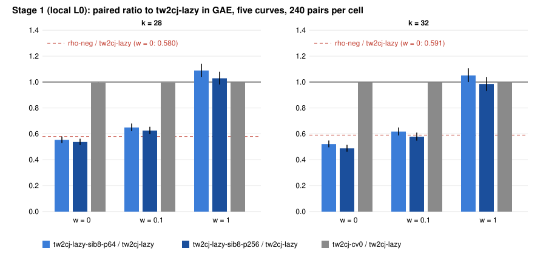

# Sibling points and `cv=0`, Stage 1: results (local L0, Amendment 1)

**What ran.** The frozen panel of `PROTOCOL.md` (frozen in commit `a4db61b2e1`, Amendment 1 in `a5202f9183`, both before any data). It uses the five SNC-panel curves at k = 28 and k = 32, 8 public targets per curve, 6 rounds plus 1 warmup, and alternating arm order. The arms are rho-neg, rho-neg-aa, tw2cj-lazy, sib8-p64, sib8-p256 and tw2cj-cv0, with 1,680 executions per size.

The planned EKS jobs failed before any pod ran (Amendment 1), so the panel ran on this session's 4-vCPU cloud VM at L0, under bench record `benchmarks/records/20261110T2210Z-sib-cv0-stage1-eks.json`.

**Admission.** Both sessions pass: 1,680 of 1,680 records verified, and `verify --replay 8` reproduced all 8 sampled replays with 0 problems (`verify-k{28,32}.json`). The A/A arm rho-neg-aa has the same seeds as rho-neg, so in the counted unit it is identical (ratio exactly 1). It controls the instrument, not timing noise. This is development evidence: no validation gate, no EKS. Every number is `[pcc:unverified]`, and no pcc claim is filed.

## Results: paired ratios over 240 pairs on 40 workloads and 5 curves (`ecbench compare`, `results.json`)

Each cell gives the ratio at w = 0 / 0.1 / 1 GAE per unpriced native operation. The bracket is the 95 percent interval at w = 0.

| k | ratio | w = 0 | w = 0.1 | w = 1 | order in the band (§5a) |
|---|---|---|---|---|---|
| 28 | sib8-p64 / tw2cj-lazy | 0.554 [0.530, 0.579] | 0.650 | 1.089 | unresolved |
| 28 | sib8-p256 / tw2cj-lazy | 0.538 [0.514, 0.562] | 0.626 | 1.029 | unresolved |
| 28 | cv0 / tw2cj-lazy | 0.997 [0.996, 0.997] | 0.997 | 0.998 | cv0 lower at every weight |
| 28 | sib8-p256 / rho-neg | 0.927 [0.861, 0.998] | 1.082 | 1.801 | unresolved |
| 28 | tw2cj-lazy / rho-neg | 1.724 [1.603, 1.855] | 1.729 | 1.750 | rho-neg lower at every weight |
| 32 | sib8-p64 / tw2cj-lazy | 0.522 [0.496, 0.549] | 0.618 | 1.051 | unresolved |
| 32 | **sib8-p256 / tw2cj-lazy** | **0.488 [0.463, 0.515]** | **0.578** | **0.984 [0.932, 1.039]** | **sib8-p256 lower at every weight** |
| 32 | cv0 / tw2cj-lazy | 0.999 [0.999, 0.999] | 0.999 | 0.999 | cv0 lower at every weight |
| 32 | sib8-p256 / rho-neg | 0.827 [0.758, 0.902] | 0.979 | 1.671 | unresolved |
| 32 | tw2cj-lazy / rho-neg | 1.693 [1.568, 1.827] | 1.694 | 1.698 | rho-neg lower at every weight |

**Bit-ops** (bitop/v1, each record's own `work.bitops_per_sqrt_r`, with the second points priced at their field work; `stats_bitops.py`, `bitops-k{28,32}.json`):

| ratio | k = 28 | k = 32 |
|---|---|---|
| sib8-p64 / tw2cj-lazy | 0.671 [0.636, 0.705] | 0.635 [0.605, 0.668] |
| sib8-p256 / tw2cj-lazy | 0.647 [0.616, 0.681] | 0.595 [0.567, 0.626] |
| sib8-p256 / rho-neg | 1.085 [1.017, 1.158] | 0.982 [0.911, 1.063] |

**Per curve** (`band-k{28,32}.txt`): sib8-p256 < tw2cj-lazy holds at every weight on 4 of 5 curves at k = 32 and on 2 of 5 at k = 28. Against rho-neg the order is unresolved on every curve at k = 32 and on 4 of 5 at k = 28. On the fifth k = 28 curve, rho-neg is lower at every weight.

**Wall time** (end-to-end, L0, against tw2cj-lazy): sib8-p64 1.108 / 1.136, sib8-p256 1.077 / 1.076 and cv0 1.013 / 1.006 at k = 28 / 32. The sibling arms do fewer counted operations but take 8 to 14 percent longer on this host.

## Reading against the pre-registered expectations

- **E1** (sib8-p64 / tw2cj-lazy, bit-ops, w = 0): expected 0.69 [0.62, 0.76] at k = 28 and 0.66 [0.58, 0.74] at k = 32. Measured 0.671 and 0.635, both inside. **Holds.**
- **E2** (sib8-p256 below tw2cj-lazy at k = 32, w = 0): measured 0.488 in GAE and 0.595 in bit-ops. **Holds.** It also holds at w = 1 in the pooled band: 0.984, though the w = 1 interval [0.932, 1.039] includes 1.
- **E3** (cv0 vs lazy, no direction pre-registered): cv0 is lower at every weight, but only by 0.3 and 0.1 percent. On the two-seed walk the re-verification that `cv=0` removes is almost free, so this lead is closed as a negligible constant.
- **E4** (distance to rho-neg): the incumbent family tw2cj-lazy is 1.72 and 1.69 times rho-neg. sib8-p256 is 0.93 / 0.83 of rho-neg at w = 0, 1.08 / 0.98 at w = 0.1 and 1.80 / 1.67 at w = 1, so it is unresolved in the band. In bit-ops it is 1.085 at k = 28 and 0.982 [0.911, 1.063] at k = 32, level with rho-neg within the interval.

## What this means, and what it does not

- **The finding.** Sibling points with a 256-point pool are the first configuration in this program whose counted cost beats the incumbent family at every band weight on the pooled five-curve panel (k = 32). Its gap to rho in bit-ops closes from about 1.65 to 0.98 [0.91, 1.06]. This is a measured improvement in the counted units only, at L0, on one host, without the validation gate [pcc:unverified].
- **Not shown.** No below-rho result in the band: at w = 1 the second points and lifts make sib8-p256 1.67 to 1.80 times rho-neg. No wall-time gain: the arm is 8 percent slower end to end on this host. Not an EKS L2 measurement. No change to any leaderboard row.
- **Trend.** The advantage grows from k = 28 to k = 32 (0.538 to 0.488 at w = 0 in GAE; 0.647 to 0.595 in bit-ops), as expected if the fixed pool set-up becomes a smaller share. That is two sizes, not a fitted trend.

## Next

1. Re-run the frozen EKS specs (`spec-k28.json`, `spec-k32.json`) once the Iso Lab route works. The failed jobs' receipts in S3 need someone with AWS access.
2. k = 36 and 40 on explicit curves (`prime_search` stops at 32 bits), and pool = 512, to test whether the band order against rho moves.
3. Validation gate (replay certificate, validator report, VALIDATION.json) before any leaderboard or `benchmarks/README.md` row.
4. Wall time: profile why fewer counted operations cost more time (the per-parent subset draw and the x-only key path are candidates; unmeasured).

Files: `PROTOCOL.md`, `LAUNCH.md`, `spec-*.json`, `frozen.sha256`, `run_local.sh`, `sessions/k{28,32}/`, `verify-*.json`, `band-*.{json,txt}`, `results.json`, `collect.py`, `stats_bitops.py`, `bitops-*.json`, `plot.py`, `figures/`, `REPORT.pdf`.
