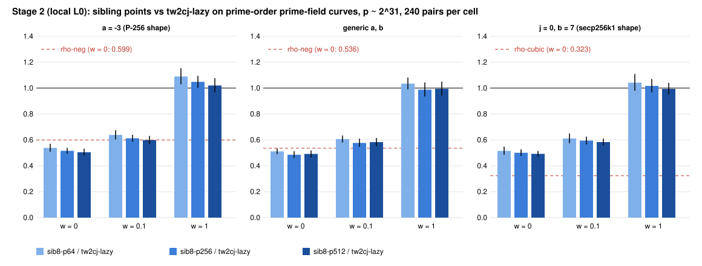

# Sibling points, Stage 2: prime-field curve shapes (results, local L0)

**What ran.** The frozen panel of `PROTOCOL.md` (commit `2faf4ecaf9`, frozen before data). It covers three prime-field shapes, each with five prime-order curves (31-bit p, r from 2^30.1 to 2^31):
- `a3`: a = -3, the NIST P-curve shape.
- `gen`: random a and b.
- `j0b7`: j = 0, b = 7, the secp256k1 shape.

Each curve has 8 public targets, run for 6 rounds plus 1 warmup. The arms are rho-neg, rho-neg-aa (A/A), tw2cj-lazy, sib8-p64, sib8-p256 and sib8-p512, plus rho-cubic (A = 6) on j0b7. The panel ran on this session's 4-vCPU VM at L0, under bench record `benchmarks/records/20261111T0020Z-sib-stage2-primefield.json`.

The first launch hit "no space left on device" while a worktree was being created. That partial session was deleted and the same frozen specs were re-run unchanged.

**Admission.** All three specs pass: 1,680 + 1,680 + 1,960 records verified, `verify --replay 8` reproduced 8 of 8 per spec with 0 problems, and the A/A ratio is exactly 1 in the counted unit. All numbers are `[pcc:unverified]`, with no pcc claim filed and no validation gate.

## Results: paired ratios over 240 pairs on 40 workloads and 5 curves (`ecbench compare`, `results.json`)

Each cell gives the ratio at w = 0 / 0.1 / 1. The bracket is the 95 percent interval at w = 0, except where a cell carries its own interval.

| shape | ratio | w = 0 | w = 0.1 | w = 1 | pooled band order | per curve (lower at every weight) |
|---|---|---|---|---|---|---|
| a3 | sib8-p256 / tw2cj-lazy | 0.516 [0.494, 0.538] | 0.612 | 1.048 | unresolved | 1 of 5 |
| a3 | sib8-p512 / tw2cj-lazy | 0.505 [0.479, 0.532] | 0.598 | 1.020 | unresolved | 1 of 5 |
| gen | **sib8-p256 / tw2cj-lazy** | **0.486 [0.460, 0.513]** | **0.577** | **0.988** | **sib8-p256 lower at every weight** | 4 of 5 |
| gen | sib8-p512 / tw2cj-lazy | 0.492 [0.466, 0.519] | 0.583 | 0.995 | sib8-p512 lower at every weight | 3 of 5 |
| j0b7 | sib8-p256 / tw2cj-lazy | 0.501 [0.476, 0.527] | 0.594 | 1.017 | unresolved | 2 of 5 |
| j0b7 | **sib8-p512 / tw2cj-lazy** | **0.492 [0.471, 0.515]** | **0.583** | **0.994** | **sib8-p512 lower at every weight** | 3 of 5 |
| a3 / gen / j0b7 | sib8-p512 / sib8-p256 | 0.979 / 1.012 / 0.984 | | | p512 lower / higher / lower | |
| a3 / gen / j0b7 | tw2cj-lazy / rho-neg | 1.669 / 1.865 / 1.796 | | | rho-neg lower | |
| a3 | best sib / rho-neg | p512: 0.843 [0.786, 0.903] | 0.999 | 1.705 | unresolved | unresolved on 5 of 5 |
| gen | best sib / rho-neg | p256: 0.906 [0.848, 0.968] | 1.076 | 1.846 | unresolved | rho-neg lower on 1 of 5 |
| j0b7 | rho-cubic / rho-neg | 0.581 [0.539, 0.626] | 0.580 | 0.577 | rho-cubic lower | |
| j0b7 | best sib / rho-cubic | p512: 1.523 [1.416, 1.638] | 1.807 | 3.099 | **rho-cubic lower at every weight** | |

**Bit-ops** (bitop/v1, `stats_bitops.py`, `bitops-*.json`):

| ratio | a3 | gen | j0b7 |
|---|---|---|---|
| sib8-p256 / tw2cj-lazy | 0.630 [0.598, 0.664] | 0.594 [0.563, 0.625] | 0.611 [0.582, 0.642] |
| sib8-p512 / tw2cj-lazy | 0.616 [0.585, 0.647] | 0.600 [0.568, 0.633] | 0.601 [0.571, 0.631] |
| sib8-p256 / rho-neg | 1.023 [0.954, 1.099] | 1.077 [1.003, 1.162] | 1.069 [0.997, 1.149] |
| sib8-p512 / rho-neg | 1.000 [0.935, 1.068] | 1.089 [1.013, 1.171] | 1.050 [0.980, 1.126] |
| rho-cubic / rho-neg | | | 1.095 [1.003, 1.194] |

## Against the pre-registered expectations

- **F1 holds.** sib8-p256 / tw2cj-lazy is at most 0.56 on a3 (0.516) and on gen (0.486). The order "lower at every weight" holds pooled on gen.
- **F2 does not hold as stated.** p512 / p256 is 0.979 on a3 and 0.984 on j0b7, but 1.012 on gen, and every interval contains 1. Going from a 256-point to a 512-point pool changes cost by about ±2 percent at this size.
- **F3 holds on a3 and fails on gen.** The bit-op interval of sib8-p256 / rho-neg contains 1 on a3 and j0b7, but lies above 1 on gen: 1.077 [1.003, 1.162]. The band order against rho-neg stays unresolved on every shape.
- **F4 holds in GAE.** rho-cubic / rho-neg is 0.581, the expected sqrt(3) gain. Every IC arm is above rho-cubic at every weight; the best sibling arm is 1.52 to 3.10 times rho-cubic.
- **Open instrument question.** In bit-ops, rho-cubic / rho-neg is 1.095 [1.003, 1.194]: the unit charges rho-cubic more than rho-neg, where GAE says 0.58. The two units disagree on what the order-3 canonicalisation costs. Until that is reconciled, bit-op ratios on j0b7 against rho-cubic are not used here.

## What this means for prime-field ECDLP, and what it does not

- **The gain carries over.** Sibling points cut the counted cost of the C = 2 two-seed walk to about half at w = 0 and to 0.6 in bit-ops on all three prime-field shapes, not only on the cofactor-8 Stage 1 family. On gen and j0b7 the gain survives every band weight pooled [pcc:unverified].
- **Distance to rho remains.**
  - Against rho-neg (A = 2), the best sibling arm is level in bit-ops on a3 (1.000 [0.935, 1.068]) and 5 to 9 percent above it on gen and j0b7. It is unresolved in the band everywhere.
  - Against the matched rho for the secp256k1 shape, rho-cubic (A = 6), the distance is 1.5 times at w = 0 and 3.1 times at w = 1. The index-calculus walk has no counterpart to the order-3 automorphism, so that rho has a sqrt(3) head start the walk does not get.
- **Size.** r is at most 2^31, the engine's current limit for `sib` (and 2^37 for `lazy=1, tw=2`). These measurements say nothing about how the ratio scales with p. Lifting the limit is engine work (next steps).
- **Not shown.** No below-rho result. No wall-time result (L0). No EKS run. No leaderboard change. No claim about P-256 or secp256k1 themselves.

## Next

1. Engine: widen the `wwalk` coefficient packing so `sib` and `lazy` run at r = 2^34 to 2^40. Stage 3 then measures how the ratio to rho moves with r on these three shapes.
2. Give the walk the order-3 automorphism on j = 0 curves (orbit-canonical keys, as rho-cubic does). Without it, the secp256k1 shape stays more than 1.5 times behind its matched rho.
3. Reconcile the bitop/v1 charge for rho-cubic's canonicalisation against GAE.
4. Validation gate and an EKS L2 re-run once the Iso Lab route works.

Files: `PROTOCOL.md`, `frozen.sha256`, `spec-{a3,gen,j0b7}.json`, `run_local.sh`, `sessions/`, `verify-*.json`, `band-*.{json,txt}`, `results.json`, `collect.py`, `stats_bitops.py`, `bitops-*.json`, `plot.py`, `figures/`, `REPORT.pdf`.
