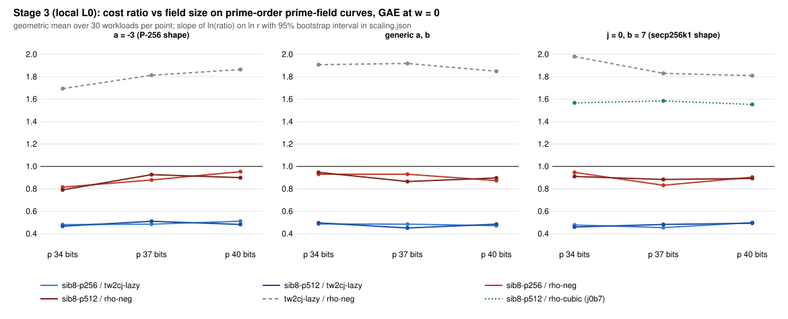

# Sibling points, Stage 3: scaling with r on prime-field shapes (results, local L0)

**What ran.** The frozen panel of `PROTOCOL.md` (commit `2acaaaab04`, frozen before data). It used `ecbench` built from engine commit `ce7cd4e716`, which widens the target walk's coefficient word to u128; with that binary, existing sessions replay byte-identically.

The panel has 9 specs: three prime-field shapes, each at 34-, 37- and 40-bit p. Each spec has five prime-order curves, so r runs from 2^33.1 to 2^40, with 6 public targets per curve and 6 rounds plus 1 warmup. The arms are rho-neg, rho-neg-aa, tw2cj-lazy, sib8-p256 and sib8-p512, plus rho-cubic on j0b7. It ran on this session's 4-vCPU VM at L0, under bench record `benchmarks/records/20261111T0151Z-sib-stage3-scaling.json`. All numbers are `[pcc:unverified]`, with no pcc claim filed and no validation gate.

**Admission.** All 9 specs pass: 6 × 1,050 + 3 × 1,260 = 10,080 records verified, `verify --replay 8` reproduced 8 of 8 per spec with 0 problems, and the A/A ratio is exactly 1 [pcc:unverified].

## Results

**Per size.** Paired ratios from `ecbench compare`, 180 pairs on 30 workloads per spec (`results.json`; per-curve band verdicts in `band-*.txt`). The best sibling arm against tw2cj-lazy at w = 0:

| shape | p 34 | p 37 | p 40 |
|---|---|---|---|
| a = -3 | p512 0.465 [0.434, 0.498] | p256 0.486 [0.458, 0.515] | p512 0.482 [0.451, 0.515] |
| generic | p256 0.488 [0.461, 0.516] | p512 0.452 [0.426, 0.479] | p256 0.472 [0.444, 0.502] |
| j = 0, b = 7 | p512 0.460 [0.428, 0.494] | p256 0.454 [0.424, 0.486] | p512 0.495 [0.467, 0.524] |

In 12 of the 18 (shape, size, pool) cells, the sibling arm is lower than tw2cj-lazy at every weight (w = 0, 0.1 and 1). At w = 1 the ratios are 0.93 to 1.06.

Against the matched rho the order is unresolved in the band everywhere. At w = 0 the best sib arm is 0.78 to 0.91 of rho-neg; at w = 1 it is 1.60 to 1.87. On j0b7 the best arm is 1.48 to 1.54 times rho-cubic at w = 0 and 3.04 to 3.17 times at w = 1, with rho-cubic lower at every weight.

**Scaling.** `scaling_fit.py` computes a derived statistic, because `ecbench trend` accepts binary-field slugs only. It is the slope of ln(ratio of per-workload means) on ln r over 90 workloads, with a 95 percent cluster-bootstrap interval (`scaling.json`):

| shape | sib8-p256 / tw2cj-lazy | sib8-p256 / rho-neg | sib8-p512 / rho-neg | tw2cj-lazy / rho-neg | sib8-p512 / rho-cubic |
|---|---|---|---|---|---|
| a = -3 | +0.013 [-0.007, +0.034] | **+0.034 [+0.007, +0.061]** | **+0.030 [+0.006, +0.056]** | +0.021 [-0.005, +0.048] | |
| generic | -0.008 [-0.026, +0.011] | -0.015 [-0.047, +0.019] | -0.012 [-0.042, +0.022] | -0.007 [-0.043, +0.030] | |
| j = 0, b = 7 | +0.011 [-0.012, +0.034] | -0.011 [-0.045, +0.022] | -0.005 [-0.034, +0.024] | -0.022 [-0.052, +0.008] | -0.000 [-0.030, +0.029] |

These are GAE slopes; the bit-op slopes agree to within 0.002.

## Against the pre-registered expectations

- **G1 holds.** The best sib arm / tw2cj-lazy is at most 0.56 at every size and shape; the largest value is 0.495.
- **G2 holds on gen and fails on a3.**
  - On gen (and on j0b7) the slope intervals against rho-neg contain 0.
  - On a3 they lie above 0: +0.034 [+0.007, +0.061] for p256 and +0.030 [+0.006, +0.056] for p512. On the a = -3 curves the sibling walk falls slightly further behind rho-neg as r grows, from 0.79 to 0.82 of rho-neg at p 34 to 0.90 to 0.95 at p 40 (geometric means, w = 0).
  - The incumbent tw2cj-lazy drifts the same way on a3 (+0.021), so the drift belongs to the C = 2 walk on these curves rather than to the sibling mechanism. Over 2.5 octaves of r this is not an exponent statement either way.
  - No slope is negative beyond -0.05, so there is no sign that the gap to rho closes with size.
- **G3 holds.** On j0b7 the best sib arm stays above rho-cubic at every weight at every size, and its slope against rho-cubic is flat: -0.000 [-0.030, +0.029].
- **G4 holds.** The band order against rho-neg is unresolved at every size on a3 and gen.

## What this means for prime-field ECDLP

- **A constant factor, stable from r = 2^30 to 2^40.** Sibling points halves the counted cost of the C = 2 two-seed walk (0.45 to 0.51 at w = 0, about 0.6 in bit-ops) on all three prime-field shapes. The ratio does not move measurably with r.
- **The distance to rho remains, as a constant.**
  - Against rho-neg the best arm is 0.78 to 0.91 at w = 0 and 1.60 to 1.87 at w = 1, unresolved.
  - Against the matched rho of the secp256k1 shape (rho-cubic) it is 1.48 to 1.54 times at w = 0.
  - None of these gaps closes with r. On a = -3 the gap widens slightly.
- **Not shown.** No below-rho result. No exponent change. No wall-time result. No EKS run. No leaderboard change. No claim about P-256 or secp256k1.
- **Open instrument question carried from Stage 2.** bitop/v1 charges rho-cubic about 1.1 times rho-neg, where GAE gives 0.58 (`scaling.json`, j0b7). In bit-ops, sib8-p512 / rho-cubic is 0.97 to 0.99, versus 1.55 in GAE. Until the cost of the order-3 canonicalisation is reconciled, the j0b7 comparison with rho-cubic is stated in GAE only.

## Next

1. The order-3 automorphism in the walk for j = 0 curves (orbit-canonical keys), to remove rho-cubic's sqrt(3) head start.
2. Reconcile bitop/v1 against GAE for rho-cubic.
3. Look at why the C = 2 walk drifts against rho on a = -3 curves: curve choice, or the a = -3 doubling price.
4. Validation gate and an EKS L2 re-run once the route works.

Files: `PROTOCOL.md`, `frozen.sha256`, `spec-*.json`, `run_local.sh`, `sessions/` (records gzip-compressed, raw SHA-256 in `sessions/raw.sha256`), `verify-*.json`, `band-*.{json,txt}`, `results.json`, `collect.py`, `scaling.json`, `scaling_fit.py`, `plot.py`, `figures/`, `REPORT.pdf`.
