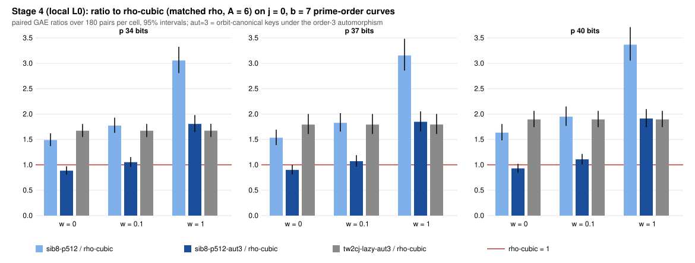

# Sibling points, Stage 4: order-3 automorphism keys (`aut=3`) on j = 0 curves (results, local L0)

**What ran.** The frozen panel of `PROTOCOL.md` (commit `4ae92d4a40`, frozen before data). It used `ecbench` built from `b460422af6`, which adds `wwalk ... aut=3`:
- Keys are min(x, ωx, ω²x), with ζ₃(x, y) = (ωx, y) = [κ](x, y).
- A collision at rotation difference d is the row of E_t = ±[κ^d]E_s.
- Each canonicalisation charges two field multiplications, as `rho.cubic` charges its rotations.
- With `aut` off, existing sessions replay byte-identically: 5,100 runs.

The panel used j = 0, b = 7 prime-order curves (the secp256k1 shape) at p = 34, 37 and 40 bits, with r from 2^33 to 2^40. Each size had five curves, 6 public targets per curve, and 6 rounds plus 1 warmup. The arms were rho-neg, rho-cubic, rho-neg-aa, tw2cj-lazy, tw2cj-lazy-aut3, sib8-p512 and sib8-p512-aut3. It ran on this session's 4-vCPU VM at L0, under bench record `benchmarks/records/20261111T0348Z-sib-stage4-aut3.json`. All numbers are `[pcc:unverified]`, with no pcc claim filed and no validation gate.

**Admission.** All 3 specs pass: 3 × 1,470 records verified, `verify --replay 8` reproduced 8 of 8 per spec with 0 problems, and the A/A ratio is exactly 1 [pcc:unverified].

## Results: paired GAE ratios over 180 pairs per spec (`ecbench compare`, `results.json`)

Each cell gives the ratio at w = 0 / 0.1 / 1. The bracket is the 95 percent interval at w = 0.

| ratio | p 34 | p 37 | p 40 | band order |
|---|---|---|---|---|
| tw2cj-lazy-aut3 / tw2cj-lazy | 0.517 [0.490, 0.546] | 0.579 [0.557, 0.602] | 0.580 [0.552, 0.609] | aut3 lower at every weight, all sizes |
| sib8-p512-aut3 / sib8-p512 | 0.595 [0.571, 0.619] | 0.587 [0.558, 0.618] | 0.568 [0.536, 0.603] | aut3 lower at every weight, all sizes |
| **sib8-p512-aut3 / rho-cubic** | **0.886 [0.808, 0.971]** / 1.052 / 1.806 | **0.901 [0.811, 1.000]** / 1.073 / 1.848 | **0.929 [0.847, 1.020]** / 1.108 / 1.912 | unresolved in the band, all sizes |
| sib8-p512 / rho-cubic | 1.489 / 1.773 / 3.055 | 1.534 / 1.828 / 3.155 | 1.635 / 1.950 / 3.367 | rho-cubic lower at every weight |
| tw2cj-lazy-aut3 / rho-cubic | 1.671 | 1.793 | 1.895 | rho-cubic lower at every weight |
| rho-cubic / rho-neg | 0.572 | 0.542 | 0.515 | rho-cubic lower at every weight |

**Per curve** (`band-*.txt`). sib8-p512-aut3 against rho-cubic is unresolved in the band on 13 of 15 curves; on the other 2 (one at p 37, one at p 40), rho-cubic is lower at every weight.

**Bit-ops** (`stats_bitops.py`, `bitops-*.json`). sib8-p512-aut3 / tw2cj-lazy is 0.335, 0.356 and 0.348. The bitop/v1 instrument question from Stages 2 and 3 persists: it charges rho-cubic 0.99 to 1.09 times rho-neg, where GAE gives 0.52 to 0.57. So bit-op ratios against rho-cubic (sib8-p512-aut3 / rho-cubic 0.56 to 0.59 in `scaling.json`) are not used here.

**Scaling** (`scaling_fit.py`, a derived statistic). These are slopes of ln(ratio) on ln r over 90 workloads, with 95 percent cluster-bootstrap intervals:
- sib8-p512-aut3 / rho-cubic: +0.012 [-0.020, +0.044]
- sib8-p512-aut3 / sib8-p512: -0.012 [-0.030, +0.006]
- tw2cj-lazy-aut3 / tw2cj-lazy: +0.029 [+0.011, +0.047], driven by p 34 (0.52 against 0.58 at p 37 and 40)

## Against the pre-registered expectations

- **H1 holds.** tw2cj-lazy-aut3 / tw2cj-lazy falls in [0.50, 0.66] at every size: 0.517, 0.579, 0.580.
- **H2 holds.** sib8-p512-aut3 / sib8-p512 falls in [0.50, 0.66] at every size: 0.595, 0.587, 0.568.
- **H3 holds.** At w = 0 the upper ends of the sib8-p512-aut3 / rho-cubic intervals are 0.971, 1.000 and 1.020, all below 1.05. The band order is unresolved at every size, as expected.
- **H4 holds.** The slope of ln(sib8-p512-aut3 / rho-cubic) has an interval containing 0.

## What this means for prime-field ECDLP

- **The automorphism gain carries into the index-calculus walk.** Orbit-canonical keys cut the counted cost of both C = 2 walks by about 1/sqrt(3), 0.52 to 0.60 [pcc:unverified], the same factor rho-cubic gets over rho-neg (0.52 to 0.57 here).
- **Against the matched rho for the secp256k1 shape.** Sibling points with aut=3 is 0.89 to 0.93 of rho-cubic at w = 0 [pcc:unverified]. That is the first configuration in this program below its matched rho in GAE at w = 0 on these curves; Stage 3's best was 1.48 to 1.54.
  - In the §5a band it is unresolved at every size: 1.05 to 1.11 at w = 0.1 and 1.8 to 1.9 at w = 1. The sibling mechanism's second points and lifts are native operations that rho does not perform.
  - That is not a win. It moves the w = 0 distance remaining from about 1.5 to about 0.9.
- **Nothing here is an exponent statement.** The ratio to rho-cubic is flat in r over 2^33 to 2^40.
- **Not shown.** No wall-time result (L0). No EKS run. No leaderboard change. No claim about secp256k1 itself. On curves without the order-3 automorphism (a = -3, generic) aut=3 does not apply; there the Stage 3 distances stand.

## Next

1. Validation gate (replay certificate, validator report, VALIDATION.json) for sib8-p512-aut3 vs rho-cubic; an EKS L2 re-run once the route works.
2. Reconcile bitop/v1 against GAE for rho-cubic, which decides whether the bit-op ratio of about 0.58 means anything.
3. Price the sibling second points more cheaply, or replace them with a native-free variant. The band is decided at w = 1, where they cost the most.

Files: `PROTOCOL.md`, `frozen.sha256`, `spec-j0b7-{34,37,40}.json`, `run_local.sh`, `sessions/` (records gzip-compressed, raw SHA-256 in `sessions/raw.sha256`), `verify-*.json`, `band-*.{json,txt}`, `results.json`, `collect.py`, `scaling.json`, `scaling_fit.py`, `stats_bitops.py`, `bitops-*.json`, `plot.py`, `figures/`, `REPORT.pdf`.

## Errata from independent validation (2026-11-11; `validator-report.json`, verdict pass_with_errata)

An independent validator re-checked this directory at commit `011e143f00` [pcc:unverified]. Its checks:
- the raw-data and frozen-protocol hashes;
- the binary, by a byte-identical rebuild;
- `verify --replay-all`: 1,260/1,260 identical per size;
- [d]G = Q recomputed for 4,410/4,410 records, with the negative control rejected;
- all 72 ratios in `results.json` recomputed;
- rho-cubic as the strongest available matched rho.

It validates the **w = 0 headline**: sib8-p512-aut3 / rho-cubic 0.886 [0.808, 0.971], 0.901 [0.811, 1.000] and 0.929 [0.847, 1.020] [pcc:unverified]. It also validates the verdict "unresolved in the §5a band". The errata:

- **E1 (charging asymmetry, the producer's error).**
  - The aut=3 canonicalisations were not listed as unpriced on the IC arm. They stayed in a native map the band does not read, while rho-cubic's identical rotations are listed (`canonicalisations_uncharged`) and charged at w.
  - The w = 0.1 and w = 1 values in the table above, and the bench record metric `sib8_p512_aut3_over_rho_cubic_gae_w1_p40 = 1.912`, are therefore too favourable to the IC arm.
  - Under the same pricing on both arms, sib8-p512-aut3 / rho-cubic is 1.210 / 1.235 / 1.276 at w = 0.1 and 2.677 / 2.742 / 2.838 at w = 1 (p 34 / 37 / 40) [pcc:unverified].
  - The engine now emits the count as `aut_canonicalisations_uncharged`, so `cost.unpriced` lists it and bitop/v1 prices it. That is a separate commit; it does not rewrite these frozen sessions.
- **E2.** With E1 corrected, aut3 is still lower than non-aut3 at every weight. At w = 1 the ratios are 0.77-0.87 (tw2cj) and 0.84-0.88 (sib8), not the 0.52-0.59 shown above for w = 1.
- **E3.** In `results.json`, the "sib8-p512-aut3 < rho-neg at every weight" orders at p 37 and p 40 become unresolved under E1. This README does not cite them.
- **E4.** The same asymmetry explains part of the bitop/v1 disagreement on rho-cubic, which favoured the IC arm. The bit-op ratio was already not used.
- **E5.** At w = 0 the candidate runs at 0.94-0.96 times the A = 6 generic floor, because second points and lifts are priced at 0. Cite the w = 0 figure only together with the band.
- **E7 (process).**
  - The `.gz` copies moved to the artifact store after `011e143f00`.
  - The bench record says `uploaded: false` and lacks plan digests and a p 37 metric.
  - `stats_bitops.py` and `scaling_fit.py` are Python result generators. AGENTS.md's no-Python rule covers them.
- **E8 (wording).** The ratio is of summed S = GAE/√r per run, not of summed GAE; the two differ in the third decimal.

**Corrected reading.** At w = 0 the arm is 0.89 to 0.93 of rho-cubic. With the canonicalisations charged on both arms it is 1.21 to 1.28 at w = 0.1 and 2.7 to 2.8 at w = 1 [pcc:unverified]. Unresolved in the band, and further from rho at w > 0 than first reported.

The gate stays closed: `scripts/validation_gate.py` refuses a `pass_with_errata` report until E1 is corrected and a validator re-issues it. `VALIDATION.json` records `order_holds_across_band: false`.
