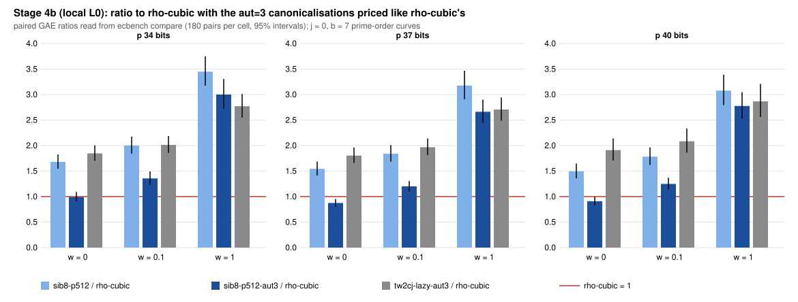

# Sibling points, Stage 4b: the aut=3 panel re-banded with its canonicalisations priced (results, local L0)

**What ran.** The frozen panel of `PROTOCOL.md` (commit `709f978290`, frozen before data). It re-runs Stage 4's design on fresh seeds and curves, with the engine on `main` that lists the `aut=3` canonicalisations as `aut_canonicalisations_uncharged`. That is the fix for the Stage 4 validator's erratum E1. The binary was built from `4e2ea6c1be`.

The panel used j = 0, b = 7 prime-order curves (the secp256k1 shape) at p = 34, 37 and 40 bits, with five curves per size, 6 targets per curve and 6 rounds plus 1 warmup. The arms were rho-neg, rho-cubic, rho-neg-aa, tw2cj-lazy, tw2cj-lazy-aut3, sib8-p512 and sib8-p512-aut3. It ran locally at L0 under bench record `benchmarks/records/20261112T0311Z-sib-stage4b-aut3.json`.

The analysis is native only: `compare.sh` calls `ecbench compare` (GAE at w = 0, 0.1 and 1, and `--unit bitop/v1`), `ecbench band` and `ecbench trend`. The saved comparison files under `sessions/*/comparisons/` are the results; `compare.txt` is the run log. All numbers are `[pcc:unverified]`, with no pcc claim filed.

**Admission.** All 3 specs pass: 3 × 1,470 records verified, `verify --replay 8` reproduced 8 of 8 per spec with 0 problems, and the A/A ratio is exactly 1 at every weight [pcc:unverified].

## Results: paired GAE ratios, 180 pairs per cell (ecbench compare)

Each cell gives the ratio at w = 0 / 0.1 / 1. The bracket is the 95 percent interval at w = 0.

| ratio | p 34 | p 37 | p 40 | band order |
|---|---|---|---|---|
| **sib8-p512-aut3 / rho-cubic** | **0.992 [0.902, 1.092]** / 1.356 / 3.000 | **0.875 [0.804, 0.952]** / 1.200 / 2.663 | **0.909 [0.828, 0.997]** / 1.248 / 2.776 | unresolved at every size |
| tw2cj-lazy-aut3 / rho-cubic | 1.846 / 2.014 / 2.770 | 1.805 / 1.968 / 2.707 | 1.911 / 2.085 / 2.866 | rho-cubic lower at every weight |
| sib8-p512 / rho-cubic | 1.680 / 2.001 / 3.450 | 1.544 / 1.840 / 3.175 | 1.495 / 1.782 / 3.078 | rho-cubic lower at every weight |
| tw2cj-lazy-aut3 / tw2cj-lazy | 0.560 / 0.611 / 0.838 | 0.563 / 0.614 / 0.844 | 0.575 / 0.627 / 0.862 | aut3 lower at every weight |
| sib8-p512-aut3 / sib8-p512 | 0.590 / 0.678 / 0.870 | 0.567 / 0.652 / 0.839 | 0.608 / 0.700 / 0.902 | aut3 lower at every weight |
| rho-cubic / rho-neg | 0.556 | 0.544 | 0.558 | rho-cubic lower at every weight |

**Bit-ops** (`ecbench compare --unit bitop/v1`): sib8-p512-aut3 / tw2cj-lazy is 0.368 / 0.334 / 0.334.
- The bitop/v1 instrument question persists for rho-cubic: rho-cubic / rho-neg is 1.059 / 1.041 / 1.072 in bit-ops, against 0.55 in GAE.
- So sib8-p512-aut3 / rho-cubic in bit-ops (0.621 / 0.547 / 0.568) is not used.

**Slope in r** (`ecbench trend`, fit `free_r`, w = 0 comparisons over the three sizes): sib8-p512-aut3 / rho-cubic is -0.015 [-0.051, +0.021].

## Against the pre-registered expectations

- **J1 holds.** At w = 0, sib8-p512-aut3 / rho-cubic is 0.992, 0.875 and 0.909, inside [0.80, 1.00]. At p 34 it sits at the top of the range, with an interval that crosses 1.
- **J2 holds.** At w = 0.1 the ratio is 1.356, 1.200 and 1.248, inside [1.10, 1.40]. At w = 1 it is 3.000, 2.663 and 2.776, inside [2.4, 3.1]. The band is unresolved at every size.
- **J3 holds.** aut3 / non-aut3 is 0.56 to 0.61 at w = 0, inside [0.50, 0.66], and 0.84 to 0.90 at w = 1, inside [0.70, 0.95].
- **J4 holds.** Every one of the 1,080 measured aut3 records lists `aut_canonicalisations_uncharged` in `cost.unpriced`, and its count equals the record's `table_insert_attempts`.

## What this means

- **The validator's corrected band reproduces on fresh curves.** The aut=3 sibling arm is at or below rho-cubic at w = 0 (0.88 to 0.99). It is 1.20 to 1.36 times rho-cubic at w = 0.1 and 2.7 to 3.0 times at w = 1, flat in r. It is unresolved in the band, and rho-cubic stays well ahead once native operations carry any weight [pcc:unverified].
- **At w = 1 the sibling mechanism no longer pays** against the plain aut=3 walk. tw2cj-lazy-aut3 is 2.77 / 2.71 / 2.87 times rho-cubic, against 3.00 / 2.66 / 2.78 for sib8-p512-aut3: lower at p 34, about level at p 37 and p 40. This is the design note's arithmetic (`../stage5-design/README.md`): two inserts and a second point per pair.
- **Not claimed.** No below-rho result in the band, no exponent statement, no wall-time result, no leaderboard row, no claim about secp256k1.

## Next

An independent validator re-checks this directory. If it passes, `VALIDATION.json` opens the gate on these numbers.

Files:
- `PROTOCOL.md`, `frozen.sha256`, `spec-j0b7-{34,37,40}.json`
- `run_local.sh`, `compare.sh`, `compare.txt`
- `sessions/` (records, saved comparisons), `trend/`
- `verify-*.json`, `band-*.{json,txt}`
- `plot.py` (renders the saved comparisons; computes nothing), `figures/`, `REPORT.pdf`

## Independent validation (2026-11-12; `validator-report.json`): pass, gate open, with errata

An independent validator re-checked this directory at `55d2f329d2` [pcc:unverified]:
- the frozen artifact set and hashes;
- the freeze order: protocol committed at 03:11:02Z, sessions from 03:11:47Z;
- the binary: a rebuild differs only in symbol names and build-id, and replays p 34 1,260/1,260 identical;
- `verify --replay-all`: 3 × 1,260 identical;
- [d]G = Q recomputed in its own Rust code for 4,410/4,410 records, with the negative controls rejected, and all 15 curves checked;
- all 63 saved GAE comparisons and 105 band rows reproduced within 1e-15;
- the slope, J1-J4, and the charging symmetry of aut=3 and rho-cubic in the band (E1 fixed);
- rho-cubic as the strongest matched rho (A = 6, 1.02-1.07 times its floor).

Verdict **pass**, disposition validated, scoped to the GAE comparison. `scripts/validation_gate.py evidence` reports `valid`. `VALIDATION.json` covers the GAE comparison only.

Errata:
- **N1 (my error; affects the bit-op line above).** The bitop/v1 rule for `aut_canonicalisations_uncharged` was placed in the generic rule table, which `ic.*` records never reach. These records therefore still leave the canonicalisations unpriced in bit-ops, and the "Bit-ops" figures above are too favourable to the aut=3 arms.
  - Pricing each canonicalisation at 2 field multiplications + 2 word operations (the validator's recomputation): sib8-p512-aut3 / tw2cj-lazy is **0.589 / 0.538 / 0.540** (not 0.368 / 0.334 / 0.334), and sib8-p512-aut3 / rho-cubic is **0.995 / 0.881 / 0.917** (not 0.621 / 0.547 / 0.568) at p 34 / 37 / 40 [pcc:unverified].
  - The statement in this stage's frozen PROTOCOL.md that bitop/v1 prices them was false when the data was taken. The rule now sits in `ic_rule` (commit after this note); re-pricing one p 40 record with `ecbench work` moves it from 70,424 to 113,654 bit-ops/√r.
  - Every IC bit-op price stays a lower bound: other walk counters are still unpriced in bitop/v1.
- **N2.** `compare --unit bitop/v1` does not flag records whose bit-op price is incomplete, and drops failed runs instead of censoring them (0 failures here).
- **N3.** The raw `records.jsonl` were committed for the artifact-store migration, which the bot has since done. The bench record still says `uploaded = false`.
- **N4.** `compare.txt` contains broken-pipe messages from `| head` in `compare.sh`. Cosmetic: all comparison files were saved.
- **N5.** The measuring binary was built before `4e2ea6c1be` was committed. Its code and data are identical to a fresh build of that commit, but no build commit is recorded.
- **Also noted.** At L0 the IC arm takes 5.2-5.3 times rho-cubic's end-to-end wall time. The walk carries 99.75-99.96 percent of its GAE.
