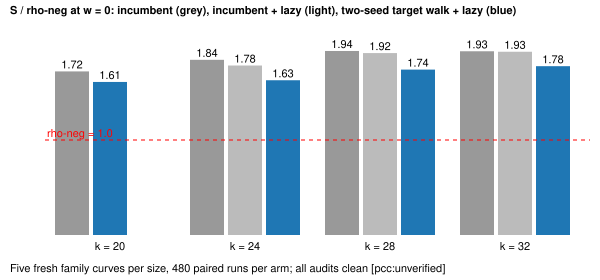

# SNC-1 and SNC-2 shared panel: lazy certification and the two-seed target walk at C = 2

Claim `PCC-20261110-978c29`, standing `unverified`. Stage 1 of the two engineering records in `../ideas/SYNTHESIS-NC-20261108.md` after both passed Stage 0 (`../snc/RESULTS.md`). Protocol, arms, predictions and falsification lines were frozen before any data (`PROTOCOL.md`); the binary hash and the replay precondition are in `data/`. Five fresh family curves per size, 12 public targets x 8 rounds, arms paired run for run. Audits: 2160 / 2700 / 2700 / 2700 records at k = 20 / 24 / 28 / 32, every one with status `verified`, 8 replays reproduced at each size, 0 problems [pcc:unverified].

## What was built

- `lazy=1` (SNC-1): a collision row is kept on its exact key match (abscissa plus sign bit) instead of recomputing both entries. The pipeline's final check `[d]G = Q` stays charged. In the target walks a failed check triggers a charged recomputation of every collision and drops the failing rows; in the C = 2 walk table a wrong row is not repaired, and the final check rejects the answer, so no lazy arm can report the audit status `verified` on a wrong log [pcc:unverified]. Fault-injection tests: 96 of 96 corrupted target-walk rows caught and dropped; 32 of 32 corrupted table rows rejected by the final check.
- `tw=2` (SNC-2): the one-seed target walk generalised to two seeds. Entries `u1 P1 + u2 P2 + z G + b Q`, every key collision a row over `(s1, s2, log Q)`, rows with zero seed part dropped by construction, stop at rank 3, cap `3T`, no probe phase; `cj=1` chains the `G`/`Q` parts of the jumps. The one-seed path is unchanged: committed `wwalk g=1` sessions replay byte-identically with the new binary (60 replays each on three sessions, `data/replay-precondition.txt`).

## Result [pcc:unverified]

Paired ratios from `ecbench compare` (480 pairs, 60 workloads, 5 curves; linearised t, df 59), w = 0 / 0.1 / 1:

| k | `inc-lazy` / `inc` | `tw2cj-lazy` / incumbent | `tw2cj` / `tw2cj-lazy` (lazy effect inside the walk) |
|--:|:--|:--|:--|
| 20 | n/a (box, 0 collisions) | 0.936 [0.877, 0.998] / 0.915 / 0.822 (vs box) | 1.174 / 1.162 / 1.101 |
| 24 | 0.9665 [0.966, 0.967] / 0.969 / 0.982 | 0.914 [0.881, 0.948] / 0.915 / 0.920 (vs `inc-lazy`) | 1.071 / 1.065 / 1.038 |
| 28 | 0.9888 [0.988, 0.989] / 0.990 / 0.994 | 0.909 [0.877, 0.942] / 0.909 / 0.911 (vs `inc-lazy`) | 1.024 / 1.021 / 1.012 |
| 32 | 0.9972 [0.997, 0.997] / 0.998 / 0.999 | 0.922 [0.890, 0.955] / 0.902 / 0.823 (vs `inc-lazy`) | 1.007 / 1.006 / 1.003 |

Mean S at w = 0 and ratio to rho-neg (mean of the five curves):

| k | `inc` | `inc-lazy` | `tw2cj` | `tw2cj-lazy` | rho-neg | `inc` / rho | `tw2cj-lazy` / rho |
|--:|--:|--:|--:|--:|--:|--:|--:|
| 20 | 2.703 | n/a | 2.970 | 2.529 | 1.570 | 1.72 | 1.61 |
| 24 | 2.168 | 2.096 | 2.051 | 1.915 | 1.175 | 1.84 | 1.63 |
| 28 | 1.953 | 1.932 | 1.797 | 1.756 | 1.009 | 1.94 | 1.74 |
| 32 | 1.913 | 1.908 | 1.770 | 1.758 | 0.989 | 1.93 | 1.78 |

## Against the frozen predictions and falsification lines [pcc:unverified]

- SNC-1 survives: `inc-lazy` / `inc` at k = 24 is 0.9665 against the predicted 0.968 [0.95, 0.99]; 0.989 and 0.997 at k = 28 and 32 against 0.987 and 0.997. Walk and probe counters are identical on all 480 pairs at each size (`data/diagnostics.json`), so the option removed only verification. Verify ops of `inc-lazy` are zero.
- SNC-2 survives: the upper end of `tw2cj-lazy` against the incumbent is below 1 at every size (0.998 at k = 20, 0.948, 0.942, 0.955), and the order holds at w = 0.1 and 1. Measured 0.936 at k = 20 against the predicted 0.88 [0.83, 0.95]; 0.914 / 0.909 / 0.922 at k = 24 / 28 / 32 against 0.94 / 0.96 / 0.92. Stored entries per sqrt(r) 1.738 / 1.677 / 1.686 / 1.738, inside [1.66, 1.85] and 1 to 5 percent above the K = 3 floor 1.662.
- Combined against the incumbent at w = 0: 0.936 (k = 20), 0.883 (k = 24), 0.899 (k = 28), 0.919 (k = 32).
- Without lazy certification the two-seed walk loses at k = 20 (2.970 against the box's 2.703): every collision is a row, so recomputation is a large share there.

## Reading and limits

- Under the success rule these are measured gains over the current C = 2 baseline at every size. They do not move toward 0.75x of rho-neg: `tw2cj-lazy` sits at 1.61 to 1.78x, and its stored-entry count is within 5 percent of the K = 3 Poisson floor, as `../ideas/OBSTRUCTION.md` predicts for any collision method with two unknown seeds.
- Classification is the owner's call. `tw=2` carries two unknown base logarithms (the 2026-11-04 ruling counts C = 2 seed arms with known-log `G` jumps), but the target is inside the walk and there is no probe phase, so like the one-seed version it is a collision walk with superfluous unknowns rather than a decomposition. The main-track ledger is not touched here.
- Zero-seed rows are dropped inside the build and not exported per record; the guard is enforced by construction and covered by unit tests, not read from the records.
- Single-target by construction: the `tw` walk is built from the target, so there is no reusable table to amortise over many targets.
- The k = 32 `inc` arm has no `targets=stride-generator`, matching `../multicurve/spec-k32.json`.
